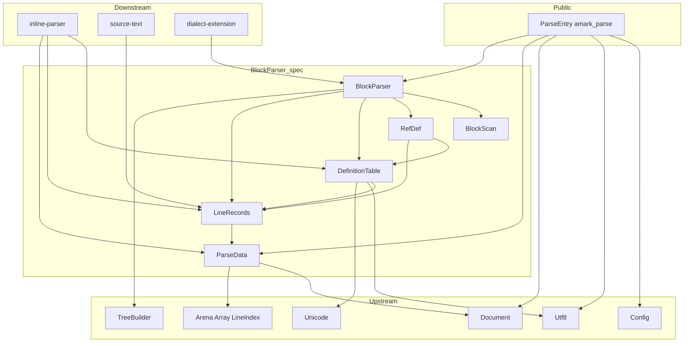
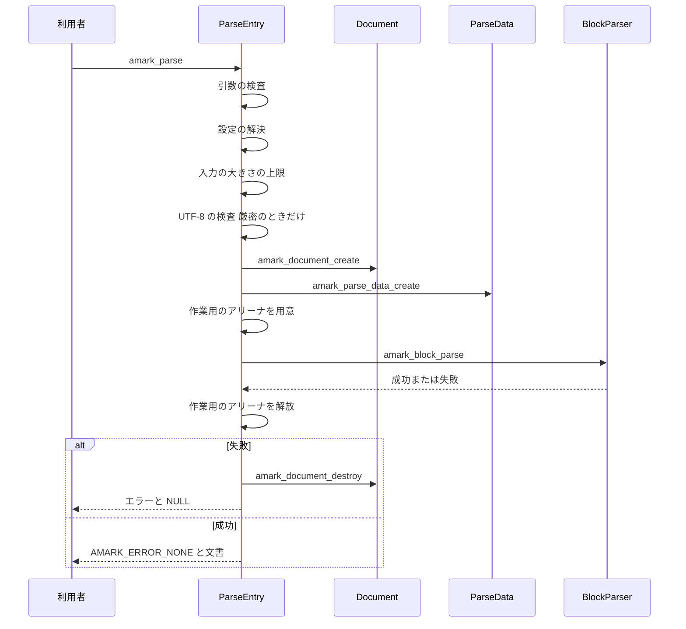
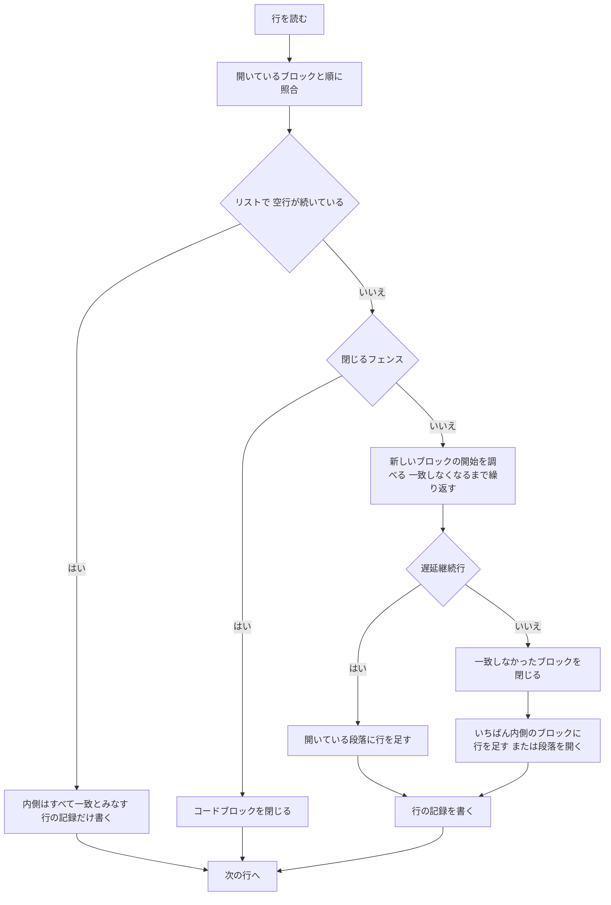
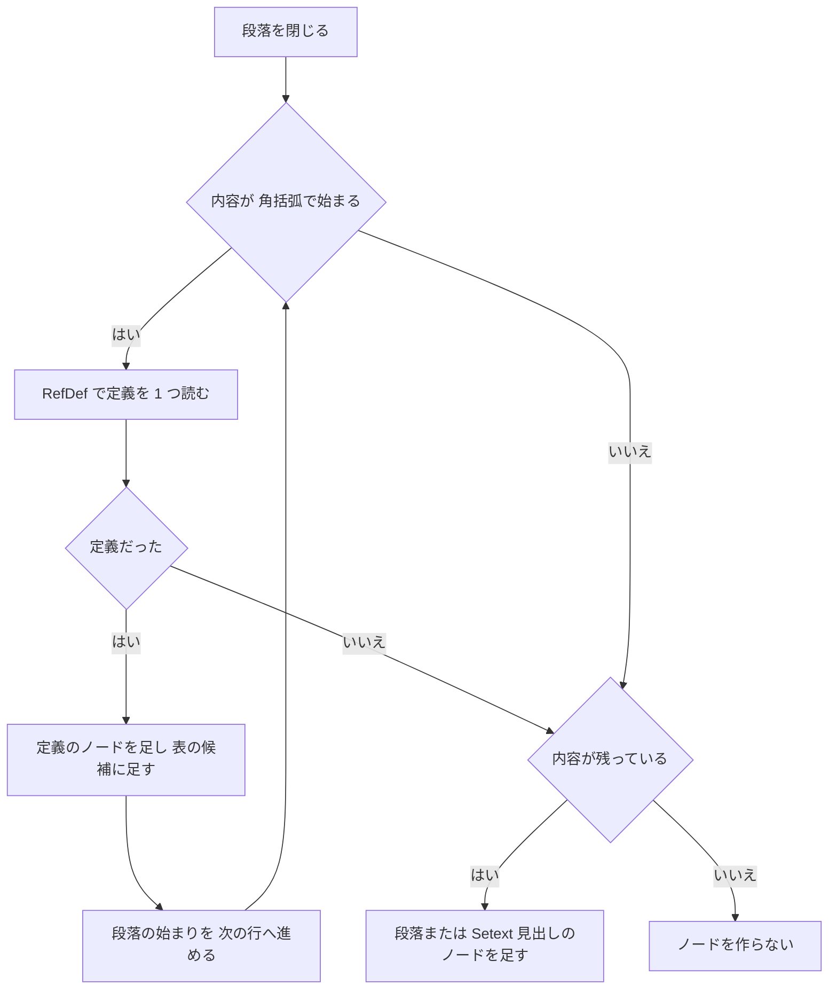

# Design Document

## Overview

**Purpose**: block-parser は、amark の解析の入口と、CommonMark 0.31.2 のブロック構造の解析を作る。利用者は、内容と設定を渡して文書を受け取れるようになる。

**Users**: 利用者は、公開の関数 `amark_parse` を呼ぶ。下流の開発者（inline-parser、source-text、dialect-extension）は、この spec が文書に付ける 3 つのデータ（行の記録、定義の表、インラインの解析に渡す内容）を、内部の関数で読む。

**Impact**: 公開ヘッダに、はじめて解析の関数が加わる。上流の 2 つの spec に、小さな追加をする。syntax-tree の文書に「解析のデータへのポインタ」と、文書のアリーナを返す関数を足す。project-foundation の `utf8` に、不正なバイト列を U+FFFD として読むデコードを足す。この spec が終わった時点で `amark_parse` が返す文書は、ブロックのノードだけを持つ。

### Goals
- どの入力も、再帰を使わず、内容の長さにほぼ比例する時間で、ブロックの木にする。
- すべての範囲を、利用者が渡した内容のオフセットで表す。写しは作らない。
- 下流が、プレフィックスとインデントの規則を解析し直さずに済むだけの情報を、文書に残す。
- 失敗したときは、確保したものをすべて解放し、文書を渡さない。

### Non-Goals
- インラインの構造（inline-parser）
- 範囲から文字列を組み立てること、エスケープと文字参照を文字に戻すこと（source-text）
- 方言を登録する公開 API、規則を呼び出す契約、結果の検査（dialect-extension）
- spec.txt の全例を HTML と比べること（spec-conformance）
- 失敗の位置（不正な UTF-8 のオフセットなど）を返すこと。エラーの種類だけを返す。

## Boundary Commitments

### This Spec Owns
- 公開の関数 `amark_parse` と、公開ヘッダ `include/amark/parse.h`
- 設定の適用：解析する範囲、UTF-8 の扱い、資源の上限（入力の大きさ、入れ子の深さ、ノードの数）、確保関数、ファイル名
- ブロックの規則のすべて：行の分割、タブの桁、コンテナ、リーフ、遅延継続行、リストのタイトとルーズ
- ブロックのノードの範囲と属性を定めること（要件 6 の決まり）
- リンク参照定義の構文、ラベルの走査と正規化、定義の表
- 文書に付ける解析のデータ `amark_parse_data_t` の中身：行の記録、定義の表、インラインの解析に渡す内容
- 上のものを読む内部の関数（`src/line.h`、`src/definition.h`、`src/parse_data.h`）の契約
- ブロックの種類ごとの「開始」「継続」「閉じる」の判定を、それぞれ 1 つの関数にまとめた構造（方言の規則を足す箇所）

### Out of Boundary
- インラインのノードを作ること。`amark_parse` にインラインの解析を足すのは inline-parser である。
- 行の記録から論理的な文字列を作ること（source-text）
- `struct amark_dialect` の中身と、方言の規則の呼び出し（dialect-extension）。この spec は、設定の `dialect` を読まない。
- 「置き換えて続ける」設定のときに、インラインの中の不正なバイト列を読むこと（inline-parser、source-text）。この spec は、そのためのデコード `amark_utf8_decode_lossy` を用意するだけである。
- 木の表し方、不変条件の定義（syntax-tree）
- spec.txt をリポジトリに置くこと、例を取り出すスクリプト（spec-conformance）

### Allowed Dependencies
- syntax-tree：`document`、`tree_internal`、`config_internal`、`tree_check`（テストだけ）、公開の型
- project-foundation：`alloc`、`arena`、`array`、`line_index`、`utf8`
- unicode-tables：`unicode` の `amark_unicode_fold` だけ。`entity` は使わない。
- C99 の標準ヘッダ：`stdbool.h`、`stddef.h`、`stdint.h`、`string.h`
- 依存の向きは `parse → block → refdef → definition → line → parse_data → document` の一方向である。`scan` は何にも依存しない。左のものだけが右のものを取り込む。
- 上流への変更は、次の 2 つに限る。どちらも追加だけで、既存の関数の契約は変えない。
  - `src/document.h`・`src/document.c`：`parse_data` の項目と、3 つの関数
  - `src/utf8.h`・`src/utf8.c`：`amark_utf8_decode_lossy`

### Revalidation Triggers
次の変更は、下流の spec（inline-parser、source-text、dialect-extension、spec-conformance）の見直しを要する。
- `amark_parse` の引数、戻り値、失敗の順の変更
- ブロックのノードの範囲の決まり（要件 6）と、属性の範囲の決まり（info、ラベル、dest、title）の変更
- 行の記録の意味（`content_start` と `pad`）の変更
- インラインの解析に渡す内容の範囲の決まりと、並びの順の変更
- ラベルの走査と正規化の手順、定義の表の検索の関数の変更
- 入れ子の深さとノードの数の数え方の変更
- `amark_parse_data_t` の項目の削除や意味の変更（項目の追加は、見直しを要しない）

## Architecture

### Existing Architecture Analysis
- 文書（`amark_document_t`）は、本体 1 つとアリーナ 1 つでできている。解放は `amark_document_destroy` の 1 回で済む。この形を保つため、解析のデータはすべて文書のアリーナに置く。
- 文書の構造体には、解析器のデータを置く場所がない。syntax-tree は解析の規則を知らない決まりなので、中身の見えないポインタを 1 つ足す形にする。
- アリーナには個別の解放がない。解析の間だけ使うメモリは、2 つ目のアリーナ（作業用のアリーナ）に置き、戻る前に解放する。
- `amark_utf8_decode` は、検査を通ったバイト列だけを受け付ける。「置き換えて続ける」設定では検査を通っていないバイト列を読むので、別のデコードが要る。
- `checks.objects` は、可変の静的データと、ポインタを含む const の表を禁じる。HTML のタグ名の表は、固定長の文字の 2 次元配列にする。種類ごとの処理は、関数ポインタの表ではなく `switch` で分ける。
- 内部 API は、子の範囲が親の外にあることを、木を作っている間は許す。コンテナの範囲の終わりは、閉じるときに 1 回だけ設定する。

### Architecture Pattern & Boundary Map

方式は cmark と同じ「行ごとの 3 段階」である。開いているブロックを明示的なスタックで持ち、1 行ごとに、(1) 開いているブロックとの照合、(2) 新しいブロックの開始、(3) 行の内容の追加、を行う。



**Architecture Integration**:
- Selected pattern: 行ごとの 3 段階と、開いているブロックのスタック。cmark と同じ流れなので、spec.txt に合わせやすい。
- Domain boundaries: 「行のバイトを見て判定するだけの関数」（BlockScan）、「複数の行にわたる定義の構文」（RefDef）、「ラベルと表」（DefinitionTable）、「行ごとの記録」（LineRecords）を、スタックを動かす本体（BlockParser）から分ける。前の 4 つは、木を作らないので、単独でテストできる。
- Existing patterns preserved: 資源の持ち主は文書。木を作るのは内部 API だけ。原文は複製しない。モジュールは `.c` と同じ名前の内部ヘッダの組。
- New components rationale: 下の「Components and Interfaces」の表を参照。
- Steering compliance: 再帰なし、グローバルな状態なし、I/O なし、失敗は戻り値、規則は設定で変えない。

**重要な決定**（背景は `research.md`）:
- **リーフのノードは、閉じるときに作る**。コンテナのノードは、子の親になるので、開くときに作る。こうすると、段落からリンク参照定義を取り出すときに、定義のノード、残りの段落のノードの順に足すだけで済み、ノードを取り除く操作が要らない。作ったノードの数は、返す木のノードの数と常に等しい。
- **コンテナの範囲の終わりは、閉じるときに 1 回だけ設定する**。開いている間は、スタックの要素に終わりを持ち、子が閉じるたびに親へ伝える。遅延継続行が来ても、開いているコンテナをすべて更新する必要がない。
- **定義の表は、整列した配列と二分探索にする**。ハッシュ表は使わない。種を固定したハッシュは、衝突するラベルを並べた入力で遅くなりうる。整列なら、最悪の場合でも N log N である。
- **正規化したラベルは、どこにも保存しない**。正規化は、原文の範囲からコードポイントを 1 つずつ取り出す読み手（リーダー）として作り、比較のたびに読み直す。検索はメモリを確保しないので、失敗しない。
- **空行が続くときは、照合を途中で打ち切る**。深い入れ子のリストの後に空行が続く入力で、1 行ごとに入れ子の深さだけ照合すると、時間が 2 乗になる。リストの要素に「前の行もここで空行だった」の印を持ち、印があれば、それより内側の照合を省く（cmark の対策と同じ考え方）。
- **タイトとルーズは、スタックの要素の印だけで決める**。閉じたノードごとの印の表を持たず、木を後からたどらない。

### Technology Stack

| Layer | Choice / Version | Role in Feature | Notes |
|-------|------------------|-----------------|-------|
| Language | C99 | 実装のすべて | コンパイラの拡張なし。`assert` は使わない |
| Build | CMake（既存） | `AMARK_SOURCES` にファイルを足す | 新しい依存はない |
| Test | Naos v0.4.0（既存） | 単体テストと公開 API のテスト | |
| 仕様 | CommonMark 0.31.2 | ブロックの規則の出どころ | spec.txt はリポジトリに置かない。例はテストのコードに写す |
| 参考の実装 | cmark 0.31.1 の `blocks.c` | 流れと、境の場合の扱いの参考 | コードは写さない |

## File Structure Plan

### Directory Structure
```
include/amark/
└── parse.h                 # amark_parse の宣言
src/
├── parse.c                 # ParseEntry：引数と設定の検査、上限、UTF-8、文書の作成、後始末
├── parse_data.h            # ParseData：文書に付ける解析のデータの型と、インラインに渡す内容
├── parse_data.c
├── line.h                  # LineRecords：行の境、行の記録の読み書き
├── line.c
├── scan.h                  # BlockScan：1 行のバイトを見て判定する関数
├── scan.c
├── definition.h            # DefinitionTable：ラベルの走査と正規化、定義の表
├── definition.c
├── refdef.h                # RefDef：リンク参照定義の構文
├── refdef.c
├── block.h                 # BlockParser：amark_block_parse
└── block.c
tests/
├── support/
│   ├── tree_dump.h         # 木のブロックの構造を、1 行の文字列にする
│   └── tree_dump.c
├── unit/
│   ├── test_scan.c         # BlockScan
│   ├── test_line.c         # LineRecords と ParseData
│   ├── test_definition.c   # ラベルの走査と正規化、定義の表
│   ├── test_refdef.c       # リンク参照定義の構文
│   ├── test_block.c        # 種類ごとの範囲と属性、行の記録、インラインに渡す内容
│   ├── test_block_limits.c # 上限、深い入れ子、空行の続く入力、確保の失敗の注入
│   ├── test_parse.c        # 設定の適用、失敗の順、UTF-8 の 2 つの設定
│   ├── test_spec_leaf.c    # spec.txt の例：Tabs から Blank lines までの 9 つの節
│   ├── test_spec_container.c # spec.txt の例：Block quotes、List items、Lists
│   └── test_spec_refdef.c  # spec.txt の例：Link reference definitions
└── public/
    └── test_parse.c        # 公開 API だけで、解析して木をたどる
```

- `block.c` は、この spec でいちばん大きいファイルになる（1500 行前後の見込み）。行の 3 段階とスタックは強く結び付いているので、分けない。判定だけの関数を `scan.c` に出すことで、大きさを抑える。
- `parse.c` に内部ヘッダはない。宣言は公開ヘッダ `include/amark/parse.h` だけである。

### Modified Files
- `include/amark/amark.h` — `<amark/parse.h>` を取り込む。
- `src/CMakeLists.txt` — `AMARK_SOURCES` に `block.c`、`definition.c`、`line.c`、`parse.c`、`parse_data.c`、`refdef.c`、`scan.c` を足す。
- `src/document.h`、`src/document.c` — `struct amark_document` に `parse_data` の項目を足す。`amark_document_arena`、`amark_document_parse_data`、`amark_document_set_parse_data` を足す。
- `src/utf8.h`、`src/utf8.c` — `amark_utf8_decode_lossy` を足す。
- `tests/CMakeLists.txt` — 上の単体テストと公開 API のテストを登録する。`amark_test_support` に `support/tree_dump.c` を足す。
- `tests/unit/test_document.c`、`tests/unit/test_utf8.c` — 足した関数のテストを足す。
- `tests/public/header_cxx.cpp` — `amark_parse` を呼ぶ行を足す。
- `tests/checks/exported_symbols.txt` — `amark_parse` を足す。
- `.kiro/specs/syntax-tree/design.md` — 文書の項目と関数の追加を反映する（「内部：文書」と「Physical Data Model」）。
- `.kiro/specs/project-foundation/design.md` — `amark_utf8_decode_lossy` を反映する（Utf8 の節）。

## System Flows

### 解析の入口



- 文書を作る前の検査（引数、設定、入力の大きさ、UTF-8）は、メモリを確保しない。
- 作業用のアリーナは、成功でも失敗でも、戻る前に必ず解放する。
- inline-parser は、`amark_block_parse` の後、作業用のアリーナの解放の前に、自分の処理を足す。

### 1 行の処理



- 「閉じる」は、1 つの関数にまとめる。リーフはここでノードを作る。段落はここでリンク参照定義を取り出す。リストはここでタイトかルーズかを決める。閉じた要素の終わりは、親の要素に伝える。
- 解析する範囲の最後の行の後で、開いているブロックを内側から順にすべて閉じる。

### 段落を閉じるとき



- Setext 見出しの下線が来たときも、同じ取り出しを先に行う。内容が残れば見出しにして閉じる。残らなければ、段落は空のまま開いておき、下線の行は、ほかのブロックの開始として調べ直す（どれにもならなければ、段落の最初の行になる）。空の段落も、段落を中断する規則の上では段落として扱う。これは cmark と commonmark.js の動作に合わせたものである。

## Requirements Traceability

| Requirement | Summary | Components | Interfaces | Flows |
|-------------|---------|------------|------------|-------|
| 1.1, 1.2, 1.3, 1.4, 1.5, 1.6, 1.10, 1.11 | 入口の呼び出しと戻り値 | ParseEntry | `amark_parse` | 解析の入口 |
| 1.7, 1.8, 1.9 | 根の範囲、木の不変条件、内容を変えない | ParseEntry、BlockParser | `amark_document_create`、`amark_block_parse` | 解析の入口 |
| 2.1 | 設定の誤り | ParseEntry | `amark_config_resolve` | 解析の入口 |
| 2.2, 2.3, 2.4 | 範囲の外を読まない、範囲の端、オフセットと行番号 | LineRecords、BlockParser | `amark_line_bounds` | 1 行の処理 |
| 2.5, 2.6 | UTF-8 の検査は範囲だけ | ParseEntry | `amark_utf8_validate` | 解析の入口 |
| 2.7, 2.8, 2.9 | 置き換えて続ける | ParseEntry、DefinitionTable | `amark_utf8_decode_lossy` | — |
| 2.10, 2.11 | 確保関数とファイル名 | ParseEntry | `amark_document_create` | 解析の入口 |
| 3.1, 3.2, 3.7, 3.9 | 入力の大きさと失敗の順 | ParseEntry | `amark_parse` | 解析の入口 |
| 3.3, 3.4 | 入れ子の深さ | BlockParser | スタックの高さ | 1 行の処理 |
| 3.5, 3.6, 3.8 | ノードの数と、木の上限 | BlockParser | `amark_document_node_count`、`amark_tree_append` | — |
| 4.1, 4.2, 4.3, 4.4, 4.5 | 失敗の扱いと作業用メモリ | ParseEntry | `amark_parse` | 解析の入口 |
| 5.1, 5.2, 5.3 | 行の分割 | LineRecords | `amark_line_bounds` | — |
| 5.4, 5.5, 5.6, 5.7 | タブの桁と空白 | BlockParser | 行の位置（オフセットと桁） | 1 行の処理 |
| 6.1, 6.2, 6.3, 6.4, 6.5, 6.6, 6.7, 6.8, 6.9, 6.10, 6.11, 6.12 | ノードの範囲 | BlockParser | 「範囲の決まり」の表 | 1 行の処理 |
| 7.1, 7.2, 7.3, 7.4, 7.5 | ブロッククォートと遅延継続行 | BlockParser | 照合、開始、閉じる | 1 行の処理 |
| 8.1, 8.2, 8.3, 8.4, 8.5, 8.6, 8.7 | リスト項目とリスト | BlockParser、BlockScan | `amark_scan_list_marker`、`amark_tree_set_list` | 1 行の処理 |
| 8.8, 8.9, 8.10 | タイトとルーズ、入れ子 | BlockParser | 「タイトとルーズ」の規則 | 1 行の処理 |
| 9.1, 9.2 | テーマの区切りと ATX 見出し | BlockParser、BlockScan | `amark_scan_thematic_break`、`amark_scan_atx_heading` | 1 行の処理 |
| 9.3, 9.4, 9.5, 9.6 | Setext 見出し | BlockParser、BlockScan、RefDef | `amark_scan_setext_underline` | 段落を閉じるとき |
| 10.1, 10.2, 10.3 | インデントされたコードブロック | BlockParser | 照合、開始 | 1 行の処理 |
| 10.4, 10.5, 10.6, 10.7, 10.8, 10.9 | フェンスのコードブロック | BlockParser、BlockScan | `amark_scan_open_fence`、`amark_scan_close_fence`、`amark_tree_set_code_block` | 1 行の処理 |
| 11.1, 11.2, 11.3, 11.4, 11.5, 11.6 | HTML ブロック | BlockParser、BlockScan | `amark_scan_html_start`、`amark_scan_html_end` | 1 行の処理 |
| 12.1, 12.2, 12.3, 12.4, 12.5 | 段落 | BlockParser | 照合、開始、閉じる | 1 行の処理 |
| 13.1, 13.2, 13.3, 13.4, 13.11, 13.12 | 定義の取り出しとノード | BlockParser、RefDef | `amark_refdef_parse`、`amark_tree_append` | 段落を閉じるとき |
| 13.5, 13.6, 13.7, 13.8, 13.9 | 定義の構文と属性の範囲 | RefDef | `amark_refdef_parse`、`amark_tree_set_definition` | 段落を閉じるとき |
| 13.10 | ラベルの上限と空のラベル | DefinitionTable | `amark_label_scan` | — |
| 14.1, 14.2, 14.3, 14.4 | ラベルの正規化 | DefinitionTable | `amark_label_compare` | — |
| 14.5, 14.6, 14.9, 14.10 | 表を作る | DefinitionTable | `amark_definitions_build` | — |
| 14.7, 14.8, 14.11, 14.12 | 検索と、inline-parser からの利用 | DefinitionTable | `amark_definitions_find`、`amark_label_scan` | — |
| 15.1, 15.2, 15.3, 15.4, 15.5 | 行の記録の中身 | BlockParser、LineRecords | `amark_line_set`、「行の記録の決まり」の表 | 1 行の処理 |
| 15.6, 15.7, 15.8, 15.9 | 行の記録の読み出しと寿命 | LineRecords、ParseData | `amark_line_get` | — |
| 16.1, 16.2, 16.3, 16.4, 16.5, 16.6 | 内容の範囲 | BlockParser、ParseData | `amark_inline_content_add` | 段落を閉じるとき |
| 16.7, 16.8, 16.9 | 行をまたぐ内容、順、非公開 | ParseData、LineRecords | `amark_inline_content_at`、`amark_line_get` | — |
| 17.1, 17.2, 17.3, 17.4, 17.5 | 方言の規則を呼ぶ箇所 | BlockParser | 開始・継続・閉じるの 3 つの関数 | 1 行の処理 |
| 18.1, 18.2, 18.3 | 時間、メモリ、再帰なし | BlockParser、DefinitionTable | 「Performance & Scalability」 | — |
| 18.4, 18.5, 18.6 | 状態なし、決定性、並行 | すべて | — | — |
| 18.7, 18.8 | 公開シンボルと公開ヘッダ | ParseEntry | `exported_symbols.txt`、`header_cxx.cpp` | — |
| 19.1 | spec.txt の例 | テスト | `test_spec_*.c`、`tree_dump` | — |
| 19.2, 19.4 | 範囲、正規化、表、行の記録、内容 | テスト | `test_block.c`、`test_definition.c`、`test_line.c`、`test_refdef.c` | — |
| 19.3 | 設定の適用と失敗の順 | テスト | `test_parse.c` | — |
| 19.5, 19.6, 19.7 | 不変条件、確保の失敗、深い入れ子 | テスト | `test_block_limits.c`、`amark_tree_check` | — |
| 19.8 | 公開 API だけのテスト | テスト | `tests/public/test_parse.c` | — |

## Components and Interfaces

| Component | Domain/Layer | Intent | Req Coverage | Key Dependencies (P0/P1) | Contracts |
|-----------|--------------|--------|--------------|--------------------------|-----------|
| ParseEntry | 公開 | 解析の入口と設定の適用 | 1, 2, 3.1, 3.2, 3.7, 3.9, 4, 18.7, 18.8 | Config、Document、Utf8、ParseData、BlockParser (P0) | Service |
| ParseData | 内部 | 文書に付ける解析のデータ | 15.7, 16.1, 16.7, 16.8, 16.9 | Document、Arena、Array (P0) | Service、State |
| LineRecords | 内部 | 行の境と、行ごとの記録 | 2.3, 5.1, 5.2, 5.3, 15 | ParseData、LineIndex (P0) | Service |
| BlockScan | 内部 | 1 行のバイトを見て判定する | 8.1, 9, 10, 11 | なし | Service |
| DefinitionTable | 内部 | ラベルの走査と正規化、定義の表 | 13.10, 14 | LineRecords、Utf8、Unicode (P0) | Service |
| RefDef | 内部 | リンク参照定義の構文 | 13.5, 13.6, 13.7, 13.8, 13.9 | DefinitionTable、LineRecords (P0) | Service |
| BlockParser | 内部 | ブロックの規則と、木を作ること | 3.3〜3.8, 5.4〜5.7, 6〜13, 15.1〜15.5, 16, 17, 18.1〜18.3 | TreeBuilder、BlockScan、RefDef、DefinitionTable、LineRecords (P0) | Service、State |
| 上流への追加 | 内部 | 文書の項目と、寛容なデコード | 2.7, 14.4, 15.7 | — | Service |

### 公開

#### ParseEntry

| Field | Detail |
|-------|--------|
| Intent | 内容と設定を受け取り、文書かエラーを返す |
| Requirements | 1.1, 1.2, 1.3, 1.4, 1.5, 1.6, 1.7, 1.8, 1.9, 1.10, 1.11, 2.1, 2.5, 2.6, 2.7, 2.8, 2.9, 2.10, 2.11, 3.1, 3.2, 3.7, 3.9, 4.1, 4.2, 4.3, 4.4, 4.5, 18.4, 18.7, 18.8 |

**Responsibilities & Constraints**
- 検査を決まった順で行い、最初に当てはまった失敗を返す。
- 文書と作業用のアリーナの寿命を管理する。ブロックの規則は知らない。
- 設定の `dialect` は読まない。

**Dependencies**
- Outbound: Config — `amark_config_resolve` (P0)
- Outbound: Utf8 — `amark_utf8_validate` (P0)
- Outbound: Document — `amark_document_create`、`amark_document_destroy` (P0)
- Outbound: ParseData — `amark_parse_data_create` (P0)
- Outbound: BlockParser — `amark_block_parse` (P0)
- Inbound: 利用者、inline-parser（インラインの解析の呼び出しを足す）(P0)

**Contracts**: Service [x]

##### Service Interface
```c
/* include/amark/parse.h */
AMARK_API amark_error_t amark_parse(const char *content, size_t length,
                                    const amark_config_t *config,
                                    amark_document_t **out);
```
- Preconditions: `content` は、`length` バイトを読めるバイト列。`length` が 0 のときは `NULL` でもよい。`config` は `NULL`（既定の設定）か、`amark_config_init` で初期化した設定。成功したとき、利用者は、文書を解放するまで `content` を変更も解放もしない。
- Postconditions（成功）: `AMARK_ERROR_NONE` を返す。`*out` は、ブロックの木を持つ文書である。根の範囲は解析する範囲と同じ。木は syntax-tree の不変条件をすべて満たす。文書には、解析のデータ（行の記録、定義の表、インラインに渡す内容）が付いている。
- Postconditions（失敗）: 確保したものをすべて解放してある。`out` が `NULL` でなければ、`*out` は `NULL` である。
- 検査の順と、返すエラー:

| 順 | 条件 | エラー | 確保 |
|----|------|--------|------|
| 1 | `out` が `NULL` | `AMARK_ERROR_INVALID_INPUT` | なし |
| 2 | `content` が `NULL` で `length` が 0 でない | `AMARK_ERROR_INVALID_INPUT` | なし |
| 3 | `amark_config_resolve` が失敗 | `AMARK_ERROR_INVALID_CONFIG` | なし |
| 4 | `max_input_size` が 0 でなく、`length` がそれを超える | `AMARK_ERROR_LIMIT_EXCEEDED` | なし |
| 5 | `utf8_mode` が `AMARK_UTF8_STRICT` で、`content[start, end)` が不正 | `AMARK_ERROR_INVALID_INPUT` | なし |
| 6 | 文書、解析のデータ、ブロックの解析のどれかが失敗 | `AMARK_ERROR_NOMEM` か `AMARK_ERROR_LIMIT_EXCEEDED` | すべて解放 |

- `AMARK_UTF8_REPLACE` のときは、5 の検査を行わない。不正なバイト列は、読むところで U+FFFD として扱う。
- `char` と `unsigned char` の変換は、この関数の中の 1 か所だけで行う。

**Implementation Notes**
- Integration: `amark.h` が `parse.h` を取り込む。`exported_symbols.txt` に `amark_parse` を足す。
- Validation: `test_parse.c` が、検査の順と、各設定を確かめる。`tests/public/test_parse.c` が、公開 API だけで使えることを確かめる。
- Risks: 失敗の位置を返さないので、不正な UTF-8 の場所を知るには、利用者が自分で調べる必要がある。位置を返す引数は、後から関数を足して対応できる。

### 内部：文書に付けるデータ

#### 上流への追加

| Field | Detail |
|-------|--------|
| Intent | 文書に解析のデータを付ける場所と、検査を通っていないバイト列のデコード |
| Requirements | 2.7, 2.8, 14.4, 14.10, 15.7 |

##### Service Interface
```c
/* src/document.h（syntax-tree のファイルへの追加） */
struct amark_parse_data; /* 中身は block-parser が定める */

amark_arena_t *amark_document_arena(amark_document_t *doc);
struct amark_parse_data *amark_document_parse_data(const amark_document_t *doc);
void amark_document_set_parse_data(amark_document_t *doc,
                                   struct amark_parse_data *data);

/* src/utf8.h（project-foundation のファイルへの追加） */
size_t amark_utf8_decode_lossy(const unsigned char *bytes, size_t length,
                               uint32_t *codepoint);
```
- `struct amark_document` に `struct amark_parse_data *parse_data;` を足す。`amark_document_create` は `NULL` にする。文書は、このポインタの先を読まず、解放もしない（先は文書のアリーナにあるので、アリーナの解放でともに消える）。
- `amark_document_arena`：文書のアリーナを返す。ここから確保したメモリは、文書の解放まで有効である。
- `amark_utf8_decode_lossy`：`bytes[0]` から始まる 1 文字を読む。`length` は 1 以上。正しい並びなら、そのコードポイントを書いて、長さ（1 から 4）を返す。不正な並びなら、U+FFFD を書いて、極大の部分の長さ（1 から 3）を返す。`amark_utf8_inspect` と同じ判定を使うので、`amark_utf8_replace` の結果と文字の区切りが一致する。U+0000 は U+0000 のまま返す（U+FFFD にするのは呼び出す側である）。

**Implementation Notes**
- Integration: syntax-tree と project-foundation の `design.md` に、追加を反映する。既存の関数は変えない。
- Validation: `test_document.c` に、作った直後は `NULL`、設定した値が読める、解放で漏れがない、を足す。`test_utf8.c` に、正しい並びでは `amark_utf8_decode` と同じ結果、不正な並びでは `amark_utf8_replace` と同じ区切り、を足す。

#### ParseData

| Field | Detail |
|-------|--------|
| Intent | 解析が終わった後も下流が読むデータを、文書の寿命で持つ |
| Requirements | 14.10, 15.7, 16.1, 16.6, 16.7, 16.8, 16.9 |

**Responsibilities & Constraints**
- 3 つのデータを 1 つの構造体にまとめ、文書のアリーナに置く。
- インラインに渡す内容の一覧を、足した順（文書の順）に持つ。

**Contracts**: Service [x] / State [x]

##### Service Interface
```c
/* src/parse_data.h */
typedef struct amark_line_record {
    size_t content_start; /* 内容が始まる位置（内容の先頭からのオフセット） */
    unsigned pad;         /* 0 から 3。0 でなければ、content_start のタブをこの数の空白として読む */
} amark_line_record_t;

typedef struct amark_definition_entry {
    amark_node_id_t node; /* リンク参照定義のノード */
    size_t label_start;   /* ラベルの範囲（角括弧の内側） */
    size_t label_end;
} amark_definition_entry_t;

typedef struct amark_inline_content {
    amark_node_id_t node; /* 段落か見出し */
    size_t start;         /* インラインとして解析する範囲 */
    size_t end;
} amark_inline_content_t;

typedef struct amark_parse_data {
    size_t range_start;                 /* 解析する範囲 */
    size_t range_end;
    size_t first_line;                  /* 範囲の最初の行の番号。範囲が空なら 0 */
    size_t line_count;                  /* 範囲にかかる行の数。範囲が空なら 0 */
    amark_line_record_t *lines;         /* line_count 個 */
    const amark_definition_entry_t *definitions; /* 正規化したラベルの順 */
    size_t definition_count;
    amark_array_t inline_contents;      /* amark_inline_content_t。文書の順 */
} amark_parse_data_t;

amark_error_t amark_parse_data_create(amark_document_t *doc);

amark_error_t amark_inline_content_add(amark_document_t *doc,
                                       amark_node_id_t node,
                                       size_t start, size_t end);
size_t amark_inline_content_count(const amark_document_t *doc);
bool amark_inline_content_at(const amark_document_t *doc, size_t index,
                             amark_inline_content_t *out);
```
- `amark_parse_data_create`
  - Preconditions: `doc` は `amark_document_create` で作ったばかりの文書。
  - Postconditions: 構造体と `lines`（`line_count` 個）を文書のアリーナから確保し、文書に付ける。行の記録は、どれも「その行の内容の終わり、`pad` は 0」で初期化する。定義の表は空、内容の一覧は空である。
  - 失敗すると `NOMEM` か `LIMIT_EXCEEDED` を返す。文書は、解放できる状態のままである。
- 行の数の決め方：範囲が空（`start == end`）なら 0。そうでなければ、`first_line` は `start` を含む行、最後の行は `end - 1` を含む行で、`line_count` はその差に 1 を足した数。
- `amark_inline_content_at`：`index` が件数以上なら `false` を返し、`*out` を変えない。
- 構造体の項目は `src/` の中から見えるが、ほかのモジュールは関数を通して使う（既存の部品と同じ決まり）。

##### State Management
- State model: ブロックの解析の間だけ書き込む。`amark_block_parse` が成功して戻った後は、読み取り専用である。
- Concurrency strategy: 文書ごとに 1 つ。共有する状態はない。

#### LineRecords

| Field | Detail |
|-------|--------|
| Intent | 行の境を返し、行の記録を読み書きする |
| Requirements | 2.2, 2.3, 2.4, 5.1, 5.2, 5.3, 15.1, 15.6, 15.8, 15.9 |

**Responsibilities & Constraints**
- 行の境は、文書の行の索引から求め、解析する範囲で切り詰める。行末記号の判定は、範囲の中のバイトだけで行う。
- 行の記録の意味（下の表）を定める。記録を書くのは BlockParser だけである。

**Contracts**: Service [x]

##### Service Interface
```c
/* src/line.h */
typedef struct amark_line_bounds {
    size_t start;       /* 行の最初のバイト。範囲の開始より前にはならない */
    size_t content_end; /* 行末記号の直前。行末記号がなければ end と同じ */
    size_t end;         /* 次の行の最初のバイト。範囲の終了より後にはならない */
} amark_line_bounds_t;

bool amark_line_bounds(const amark_document_t *doc, size_t line,
                       amark_line_bounds_t *out);
bool amark_line_get(const amark_document_t *doc, size_t line,
                    amark_line_record_t *out);
void amark_line_set(amark_document_t *doc, size_t line,
                    size_t content_start, unsigned pad);
```
- `line` は、内容の最初の行を 1 とする行番号。範囲にかからない行では、`amark_line_bounds` と `amark_line_get` は `false` を返し、`*out` を変えない。
- どの関数も、行の数によらない時間で終わり、メモリを確保しない。
- `amark_line_set` の事前条件：`line` は範囲にかかる行。`start <= content_start <= content_end`。`pad` は 0 から 3。

**行の記録の決まり**（`content_start` が指す位置）

| 行の種類 | `content_start` | `pad` |
|----------|-----------------|-------|
| 段落の行、遅延継続行、リンク参照定義の行 | プレフィックスの後の、最初の空白でないバイト | 0 |
| ATX 見出しの行 | 内容の範囲の開始（内容がなければ、内容の範囲の位置） | 0 |
| Setext 見出しの下線、テーマの区切り、開始と閉じるフェンスの行 | その印の最初のバイト | 0 |
| インデントされたコードブロックの行 | プレフィックスの後、4 桁のインデントの後 | 残りの桁 |
| フェンスのコードブロックの中の行 | プレフィックスの後、開始のフェンスのインデントの分までの空白の後 | 残りの桁 |
| HTML ブロックの行 | プレフィックスの後（インデントを含む） | 残りの桁 |
| コードブロックの中の空行で、空白がインデントに足りない行 | 行の内容の終わり | 0 |
| 上のどれでもない空行、コンテナの印だけの行 | 行の内容の終わり | 0 |

- `pad` が 0 でないとき、`content_start` のバイトはタブである。その行の論理的な内容は、「空白を `pad` 個」と「`content_start + 1` から `content_end` まで」をつないだものである。`pad` が 0 のときは、`content_start` から `content_end` までである。
- リーフのノードに属する行は、そのノードの開始行から終了行までの、連続した行である。下流は、ノードの行番号と行の記録だけで、リーフの内容を行ごとに読める。

### 内部：判定

#### BlockScan

| Field | Detail |
|-------|--------|
| Intent | 1 行のバイトを見て、ブロックの開始や終了の形に合うかを答える |
| Requirements | 5.7, 8.1, 8.4, 9.1, 9.2, 9.3, 10.4, 10.5, 10.6, 10.7, 11.1, 11.2, 11.4, 11.5 |

**Responsibilities & Constraints**
- どの関数も、渡されたバイト列だけを読む。文書も木も知らない。メモリを確保せず、失敗しない。
- `p` は行の最初の空白でないバイト、`len` はそこから行の内容の終わりまでの長さである。インデントが 3 桁以下かどうかは、呼び出す側が確かめる。
- 空白は、スペースとタブだけである。

**Contracts**: Service [x]

##### Service Interface
```c
/* src/scan.h */
typedef struct amark_list_marker {
    amark_list_type_t type;
    char marker;           /* 箇条書きの記号、または番号付きの区切り */
    uint32_t start_number; /* 番号付きだけ */
    size_t width;          /* 印のバイト数（数字と区切り、または記号 1 つ） */
    bool blank_after;      /* 印の後が空白だけ */
} amark_list_marker_t;

bool amark_scan_thematic_break(const unsigned char *p, size_t len);
bool amark_scan_atx_heading(const unsigned char *p, size_t len,
                            unsigned *level, size_t *content_start,
                            size_t *content_end);
unsigned amark_scan_setext_underline(const unsigned char *p, size_t len);
bool amark_scan_open_fence(const unsigned char *p, size_t len,
                           char *fence_char, size_t *fence_length,
                           size_t *info_start, size_t *info_end);
size_t amark_scan_close_fence(const unsigned char *p, size_t len,
                              char fence_char);
bool amark_scan_list_marker(const unsigned char *p, size_t len,
                            amark_list_marker_t *out);
unsigned amark_scan_html_start(const unsigned char *p, size_t len);
bool amark_scan_html_end(const unsigned char *p, size_t len, unsigned type);
```
- `amark_scan_atx_heading`：合えば `true`。`content_start` と `content_end` は、`p` からの相対の位置で、開始の `#` の列とその後の空白、閉じる `#` の列とその前の空白、行末の空白を除いた部分である。内容がなければ、2 つは等しい。
- `amark_scan_setext_underline`：`=` の下線なら 1、`-` の下線なら 2、どちらでもなければ 0。
- `amark_scan_open_fence`：info の位置は `p` からの相対で、前後の空白を除いた部分。info がなければ、2 つは等しい。バッククォートのフェンスで、info にバッククォートがあれば `false`。
- `amark_scan_close_fence`：`fence_char` の連続と、その後が空白だけの行なら、連続の長さを返す。そうでなければ 0。長さが開始のフェンス以上かどうかは、呼び出す側が比べる。
- `amark_scan_list_marker`：印の形と、その後が空白か行の終わりであることだけを確かめる。数字は 1 から 9 桁。段落を中断できるかどうか（番号が 1、空でない）は、呼び出す側が `start_number` と `blank_after` で判定する。
- `amark_scan_html_start`：開始条件の番号（1 から 7）を返す。どれにも合わなければ 0。7 番で段落を中断しないことは、呼び出す側が判定する。タグの名前は、ASCII の大文字と小文字を区別しない。
- `amark_scan_html_end`：`type` が 1 から 5 のとき、その終了条件の文字列が行にあれば `true`。6 と 7 の終了条件（空行）は、呼び出す側が判定する。
- 6 番の条件のタグ名の表は、名前の順に並べた `static const char [][11]` とし、二分探索で引く。

### 内部：ラベルと定義

#### DefinitionTable

| Field | Detail |
|-------|--------|
| Intent | ラベルを走査し、正規化して比べ、定義の表を作って引く |
| Requirements | 13.10, 14.1, 14.2, 14.3, 14.4, 14.5, 14.6, 14.7, 14.8, 14.9, 14.10, 14.11, 14.12, 2.7 |

**Responsibilities & Constraints**
- ラベルの正規化は、範囲からコードポイントを 1 つずつ取り出す読み手として作る。結果は保存しない。読み手の状態は、呼び出す関数の中の変数だけである。
- 読み手が取り出す手順は、次のとおりである。
  1. 範囲のバイトを、行の記録を使って読む。行の内容の終わりから、次の行の `content_start` までのバイト（行末記号、プレフィックス、行の先頭の空白）は、まとめて空白 1 つとして読む。
  2. `amark_utf8_decode_lossy` でコードポイントにする。U+0000 は U+FFFD にする。
  3. スペース、タブ、行末記号の連続を、スペース 1 つにする。先頭と末尾のものは捨てる。
  4. `amark_unicode_fold` で畳み込み、結果のコードポイントを順に返す。
- バックスラッシュのエスケープと文字参照は、文字に戻さない。
- 比べ方は、取り出したコードポイントの列の辞書式の順である。
- 表は、定義の要素を「正規化したラベルの順、同じならノードの ID の小さい順」に整列し、同じラベルの 2 つ目以降を除いた配列である。ノードの ID は原文の順に付くので、原文で最初の定義が残る。

**Dependencies**
- Outbound: LineRecords — 行をまたぐラベルの読み方 (P0)
- Outbound: Utf8 — `amark_utf8_decode_lossy` (P0)
- Outbound: Unicode — `amark_unicode_fold` (P0)
- Inbound: RefDef、BlockParser、inline-parser (P0)

**Contracts**: Service [x]

##### Service Interface
```c
/* src/definition.h */
#define AMARK_LABEL_MAX_CHARS 999

bool amark_label_scan(const amark_document_t *doc, size_t open, size_t limit,
                      size_t *label_start, size_t *label_end);
int amark_label_compare(const amark_document_t *doc,
                        size_t a_start, size_t a_end,
                        size_t b_start, size_t b_end);
amark_error_t amark_definitions_build(amark_document_t *doc,
                                      amark_arena_t *scratch,
                                      const amark_definition_entry_t *entries,
                                      size_t count);
amark_node_id_t amark_definitions_find(const amark_document_t *doc,
                                       size_t label_start, size_t label_end);
```
- `amark_label_scan`：`open` は `[` の位置、`limit` は読んでよい範囲の終わり（段落の内容の終わり）。`[` の次から、エスケープされていない `]` までを読む。次のどれかなら `false` を返す。`limit` までに `]` がない。エスケープされていない `[` がある。内側が 999 文字（コードポイント）を超える。内側に、空白と行末記号でない文字が 1 つもない。成功すると、内側の範囲を書く（`label_end` は `]` の位置）。行をまたぐときに飛ばすバイト（プレフィックスなど）は、文字として数えない。行末記号は、1 つにつき 1 文字と数える。読むバイトは、1000 文字ぶんを超えない。
- `amark_label_compare`：2 つのラベルを正規化して比べ、負・0・正を返す。メモリを確保しない。時間は、2 つのラベルの長さの和に比例する。
- `amark_definitions_build`
  - Preconditions: `entries` は、原文の順（ノードの ID の小さい順）に並んだ `count` 個の要素。`scratch` は作業用のアリーナ。
  - Postconditions: 整列して重なりを除いた配列を文書のアリーナに置き、解析のデータに設定する。`count` が 0 なら、何も確保しない。
  - 整列は、再帰のない併合整列（下から順に幅を倍にする方式）で行う。作業用の配列は `scratch` から得る。標準の `qsort` は、最悪の場合の時間が実装によって違うので使わない。
  - 失敗すると `NOMEM` か `LIMIT_EXCEEDED` を返す。
- `amark_definitions_find`：範囲のラベルと正規化して一致する定義のノードを返す。なければ `AMARK_NODE_NONE`。二分探索で、メモリを確保しない。表が空のとき、および解析のデータがないときは `AMARK_NODE_NONE` を返す。

**Implementation Notes**
- Integration: inline-parser は、リンクのラベルを `amark_label_scan` で読み、`amark_definitions_find` で引く。正規化の手順を自分で持たない。
- Validation: `test_definition.c` が、case folding（`ẞ` と `SS` など、1 つが複数になるもの）、空白の畳み込み、行をまたぐラベル、コンテナの中のラベル、999 文字と 1000 文字、同じラベルの重なり、U+0000 と不正なバイト列を確かめる。
- Risks: 比較のたびに正規化し直すので、1 回の比較はラベルの長さに比例する。ラベルは 999 文字までなので、上限がある。

#### RefDef

| Field | Detail |
|-------|--------|
| Intent | 段落の先頭から、リンク参照定義を 1 つ読む |
| Requirements | 13.5, 13.6, 13.7, 13.8, 13.9, 13.10 |

**Responsibilities & Constraints**
- 木を作らない。読んだ結果を範囲で返すだけである。メモリを確保せず、失敗しない（「定義ではない」は失敗ではない）。
- 行をまたぐところは、行の記録を使って、次の行の `content_start` へ進む。
- 構文は CommonMark 0.31.2 の 4.7 節に従う。要点は次のとおり。
  - ラベル、`:`、空白（行末記号を 1 つまで含む）、dest、空白（行末記号を 1 つまで含む）、title（省略できる）、行の終わり。
  - dest は、`<` と `>` で囲む書き方（行末記号とエスケープされていない `<` `>` を含まない）か、囲まない書き方（空白と制御文字を含まず、丸括弧が釣り合う）。
  - title は、`"`、`'`、丸括弧のどれかで囲む。空行を含まない。dest と title の間には、空白か行末記号が 1 つ以上要る。
  - title の後に、空白でないものが同じ行にあるとき：title が dest と同じ行で始まっていれば、定義ではない。title が次の行で始まっていれば、title のない定義とする。

**Contracts**: Service [x]

##### Service Interface
```c
/* src/refdef.h */
typedef struct amark_refdef {
    amark_range_t label;       /* 角括弧の内側 */
    amark_range_t destination; /* 山括弧の内側、または囲まない書き方の全体 */
    amark_range_t title;       /* 区切りの内側。has_title が false のときは使わない */
    bool has_title;
    size_t last_line;          /* 定義の最後の行の番号 */
    size_t end;                /* その行の内容の終わり（定義のノードの終了） */
} amark_refdef_t;

bool amark_refdef_parse(const amark_document_t *doc, size_t start,
                        size_t limit, amark_refdef_t *out);
```
- Preconditions: `start` は、行の `content_start` にある `[` の位置。`limit` は、段落の最後の行の内容の終わり。`start` から `limit` までの行の記録は、書き込み済みである。
- Postconditions: 定義なら `true` を返して `*out` を書く。定義でなければ `false` を返し、`*out` を変えない。
- dest が `<>` のときは、長さ 0 の範囲を返す。title の区切りの内側が空のときは、`has_title` が `true` で、長さ 0 の範囲を返す。
- 1 回の呼び出しで読むバイトは、ラベルは 1000 文字ぶんまで、title は `limit` までである。title を `limit` まで読んで閉じる区切りが見つからない場合、その段落からそれ以上の定義は取り出されない（次の行が `[` で始まらないため）。したがって、1 つの段落で `limit` まで読む失敗は、区切りの種類の数（3）までである。

### 内部：ブロックの解析

#### BlockParser

| Field | Detail |
|-------|--------|
| Intent | 行を順に読み、開いているブロックのスタックを動かして、ブロックの木を作る |
| Requirements | 2.2, 2.3, 2.4, 3.3, 3.4, 3.5, 3.6, 3.8, 5.4, 5.5, 5.6, 5.7, 6.1〜6.12, 7.1〜7.5, 8.1〜8.10, 9.1〜9.6, 10.1〜10.9, 11.1〜11.6, 12.1〜12.5, 13.1, 13.2, 13.3, 13.4, 13.11, 13.12, 15.1〜15.5, 16.1〜16.6, 17.1〜17.5, 18.1, 18.2, 18.3 |

**Responsibilities & Constraints**
- 解析する範囲の行を、最初から最後まで 1 回ずつ処理する。後戻りはしない。
- 木は、syntax-tree の内部 API だけで作る。ノードを取り除く操作と、種類を変える操作は使わない。
- 作業用の状態（スタック、定義の候補の配列）は、作業用のアリーナに置く。関数の外に状態を持たない。
- 再帰を使わない。入れ子は、スタックの配列で扱う。

**Dependencies**
- Outbound: TreeBuilder — `amark_tree_append`、`amark_tree_set_range`、属性の設定 (P0)
- Outbound: BlockScan、RefDef、DefinitionTable、LineRecords、ParseData (P0)
- Outbound: Document — `amark_document_node_count`、`amark_document_content` (P0)
- Inbound: ParseEntry (P0)、dialect-extension（規則の呼び出しを足す）(P1)

**Contracts**: Service [x] / State [x]

##### Service Interface
```c
/* src/block.h */
amark_error_t amark_block_parse(amark_document_t *doc,
                                const amark_resolved_config_t *config,
                                amark_arena_t *scratch);
```
- Preconditions: `doc` は根だけを持ち、解析のデータが付いている。`config` は、その文書を作ったときの解決済みの設定。`scratch` は、初期化済みの作業用のアリーナ。「エラーにする」設定のときは、解析する範囲が UTF-8 として正しいことを、呼び出す側が確かめてある。
- Postconditions（成功）: ブロックの木、すべての行の記録、定義の表、インラインに渡す内容の一覧ができている。木は、不変条件をすべて満たす。
- Postconditions（失敗）: `NOMEM` か `LIMIT_EXCEEDED` を返す。文書は、`amark_document_destroy` で解放できる状態である（木は途中のままでよい）。
- `config` から読むのは、`max_nesting_depth` と `max_node_count` だけである。

##### State Management

**行の位置**：1 行を処理する間、次の値を持つ。

| 値 | 意味 |
|----|------|
| `offset` | いま見ているバイトの位置 |
| `column` | その位置の桁（行の先頭を 0 とする。タブは幅 4 のタブ位置まで進む） |
| `pad` | 直前のタブの桁のうち、まだ消費していない数（0 から 3） |
| `first_nonspace`、`indent`、`blank` | 次の空白でないバイトの位置、そこまでの桁の数、行の残りが空白だけか |

- 進め方は 2 つある。「バイト数で進める」と「桁数で進める」。桁数で進めてタブの途中で止まったとき、`offset` はそのタブに留まり、`pad` に残りの桁を入れる。
- 解析する範囲の最初の行は、範囲の開始を桁 0 とする。

**開いているブロックのスタック**：要素は、根（深さ 0）から内側へ並ぶ。要素は次の項目を持つ。

| 項目 | 持つ種類 | 意味 |
|------|----------|------|
| `kind`、`is_container` | すべて | 種類と、コンテナかリーフか |
| `node` | コンテナ | 開くときに作ったノードの ID。リーフでは、閉じるまで「なし」 |
| `start`、`end` | すべて | 範囲。`end` は、行を足すたび、または子が閉じるたびに延びる |
| `marker_offset`、`padding`、`type`、`marker`、`start_number` | リストとリスト項目 | 印の位置と、内容の字下げの桁 |
| `fence_char`、`fence_length`、`fence_offset`、`info` | フェンスのコードブロック | 開始のフェンスの情報 |
| `html_type` | HTML ブロック | 開始条件の番号 |
| `level`、`content_start`、`content_end` | 見出しと段落 | レベルと、インラインに渡す内容の範囲 |
| `last_nonblank_end` | インデントされたコードブロック | 最後の空行でない行の終わり |
| `child_count` | コンテナ | この要素の内側で開いたブロックの数。まだ開いているリーフと、定義だけになってノードを作らなかった段落も数える |
| 空行の印 | リスト、リスト項目 | タイトとルーズの判定と、空行の打ち切りに使う（下の節） |

- 入れ子の深さは、スタックの添字である。要素を積む前に、`max_nesting_depth` が 0 でなく、新しい添字がそれを超えるなら `LIMIT_EXCEEDED` を返す（リーフも、ノードを作る前のこの時点で検査する）。
- ノードを作るたびに、`max_node_count` が 0 でなく、`amark_document_node_count` がそれを超えるなら `LIMIT_EXCEEDED` を返す。ノードを取り除かないので、この数は、返す木のノードの数と等しい。

**3 つの関数**（方言の規則を足す箇所）：種類ごとの処理は、次の 3 つの `static` の関数の中の `switch` にまとめる。方言の種類は、`default` の枝に入る。この spec では、`default` の枝は「継続しない」「開始しない」「何もせずに閉じる」である。dialect-extension は、この 3 つの `default` の枝に、規則の呼び出しを足す。

| 関数 | 役割 | 呼ぶ場所 |
|------|------|----------|
| 継続の判定 | 開いている要素 1 つが、この行で続くかを答え、プレフィックスを消費する | 照合の繰り返しの中の 1 か所 |
| 開始の判定 | いまの位置で新しいブロックが始まるかを調べ、始まれば要素を積む | 開始の繰り返しの中の 1 か所 |
| 閉じる | 要素を降ろし、ノードを作るか範囲を設定し、親に終わりを伝える | 一致しなかった要素を閉じるとき、範囲の終わり、親が子を含められないとき |

**継続の判定**（CommonMark の種類）

| 種類 | 続く条件 | 消費するもの |
|------|----------|--------------|
| ブロッククォート | インデントが 3 桁以下で、次が `>` | インデント、`>`、その後の空白 1 桁 |
| リスト | 常に続く | なし |
| リスト項目 | インデントが `marker_offset + padding` 以上。または、行の残りが空白だけで、項目の `child_count` が 0 でない | 前者はその桁数。後者は空白のすべて |
| インデントされたコードブロック | インデントが 4 桁以上。または、行の残りが空白だけ | 前者は 4 桁。後者は空白のすべて |
| フェンスのコードブロック | 閉じるフェンスでない | `fence_offset` 桁までの空白。閉じるフェンスなら、その行で閉じて、行の処理を終える |
| HTML ブロック | 1 から 5 番は常に続く。6 と 7 番は、行の残りが空白だけでない | なし |
| 段落 | 行の残りが空白だけでない | なし |
| 見出し、テーマの区切り | 続かない | — |

**開始の判定の順**：いまの位置で、次の順に調べる。コードブロックと HTML ブロックの中では調べない。コンテナを開いたら、その内側の位置から繰り返す。リーフを開いたら、繰り返しを終える。

1. ブロッククォート
2. ATX 見出し
3. 開始のフェンス
4. HTML ブロック（1 から 6 番。7 番は、段落が開いておらず、遅延継続行にもなりえないときだけ）
5. Setext 見出しの下線（いちばん内側が段落で、すべての要素が一致したときだけ）
6. テーマの区切り
7. リスト項目（段落を中断するのは、箇条書きか番号が 1 で、空でないときだけ）
8. インデントされたコードブロック（インデントが 4 桁以上で、遅延継続行になりえず、空行でないとき）

- 定義だけでできた段落も、リスト項目の `child_count` に数える。したがって、`- [a]: /u` の後に空行が続いても、項目は続く（仕様の文言では、この項目は空行で始まっていない）。
- 1 から 7 は、インデントが 3 桁以下のときだけ調べる。いちばん内側がリストのときも、7 はインデントが 3 桁以下であることを要する（インデントは、一致したコンテナのプレフィックスの後から数える。仕様の例 312 の `    - e` は項目にならず、段落の遅延継続行になる。cmark の `cont_type == LIST` の条件も、同じ条件に `indent < 4` があるため結果を変えない）。
- 新しい子を、それを含められない親（リストにリスト項目でないもの、など）に足すときは、含められる親に行き着くまで、親を閉じる。
- リスト項目を開くとき、いちばん内側がリストで、種類と印（箇条書きの記号、番号付きの区切り）が同じなら、そのリストに足す。そうでなければ、リストのノードを新しく開く。リストの属性は、開くときに「タイト」として設定し、閉じるときに設定し直す。
- リスト項目の内容の字下げ（`padding`）は、印の幅に、その後の空白の桁数（1 から 4）を足した数。空白が 5 桁以上のとき、または印の後が空白だけのときは、印の幅に 1 を足した数とする。

**閉じるときの処理**

| 種類 | 処理 |
|------|------|
| 段落 | リンク参照定義を取り出す（「段落を閉じるとき」の図）。残りがあれば、段落のノードを足し、内容の範囲を一覧に足す |
| Setext 見出し | 見出しのノードを足し、属性を設定し、内容の範囲を一覧に足す |
| ATX 見出し | 同上 |
| テーマの区切り、HTML ブロック | ノードを足す |
| コードブロック | ノードを足し、属性（書き方、フェンスの文字と長さ、info）を設定する。インデントのものは、`end` を `last_nonblank_end` にする |
| ブロッククォート、リスト項目、リスト | `amark_tree_set_range` で範囲を設定する。リストは、詰まり方を設定し直す |

- どの種類でも、最後に、親の要素の `end` を、自分の `end` との大きいほうにする。

**範囲の決まり**（要件 6 との対応）

| 種類 | 開始 | 終了 |
|------|------|------|
| ブロッククォート | 最初の `>` | `>` を持つ最後の行の内容の終わりと、最後の子の終了の、後ろのほう |
| リスト項目 | 印の最初のバイト | 印のある行の内容の終わりと、最後の子の終了の、後ろのほう |
| リスト | 最初の項目の開始 | 最後の項目の終了 |
| 段落 | 最初の行の `content_start` | 最後の行の内容の終わり |
| ATX 見出し、テーマの区切り | 最初の空白でないバイト | その行の内容の終わり |
| Setext 見出し | 段落と同じ | 下線の行の内容の終わり |
| インデントされたコードブロック | 最初の行の `content_start` | 最後の空行でない行の内容の終わり |
| フェンスのコードブロック | 開始のフェンスの最初のバイト | 閉じるフェンスの行、または最後に足した行の、内容の終わり |
| HTML ブロック | 最初の行の、プレフィックスの後 | 最後に足した行の内容の終わり |
| リンク参照定義 | `[` | 定義の最後の行の内容の終わり |

- 「行の内容の終わり」は、行末記号の直前である（`amark_line_bounds` の `content_end`）。行末の空白は含む。
- 段落の内容の範囲の終了は、最後の行の、最後の空白でないバイトの直後である（ノードの終了とは違う）。

**タイトとルーズ**：リストの要素は、ルーズかどうかの印を 1 つ持つ。次のどれかで、印を立てる。

- 項目が閉じ、同じリストに次の項目が足されるとき。閉じた項目自身か、その最後の子が「空行で終わった」なら、立てる。
- 項目に 2 つ目以降の子が足されるとき。直前の子が「空行で終わった」なら、立てる。

「空行で終わった」は、次の規則で、スタックの要素の印として持つ。リーフのノードは閉じるまで木にないので、ここでいう「子」は、木のノードではなく、`child_count` と、スタックの要素で判定する。コンテナの要素は、自身の印のほかに、「最後の子の値」を持つ。

- 「C の最後の子」に印を付ける先は、次のとおりである。C の内側に、この行で一致せず、これから閉じる要素があれば、その要素自身（C のすぐ内側のもの）に付ける。なければ、C が持つ「最後の子の値」に付ける。こうすると、空行で閉じる段落は、印が付いた後で閉じ、その値が C に伝わる。

- 空行を処理したとき、いちばん内側の一致した要素（これを C とする）について、C に子があれば「C の最後の子は空行で終わった」とする。C 自身も「空行で終わった」とする。ただし、C がブロッククォート、フェンスのコードブロック、または「印の行が空で、まだ子のないリスト項目で、いまがその印の行」であるときは、C 自身には付けない。
- 空行でない行を処理したとき、一致した要素のすべてについて、自身の「空行で終わった」を消す。空行を処理したときも、C より外側の要素については消す。
- 子が閉じるとき、親に伝える値は、子がリストかリスト項目で子を持つなら「その最後の子の値」、それ以外なら「子自身の値」である。

この規則は、cmark の `last_line_blank` と `S_ends_with_blank_line` を、閉じたノードの印を持たない形に直したものである。導出は `research.md` に記す。

**空行の打ち切り**：リストの要素は、「前の行も、この要素のところで行の残りが空白だけだった」の印を持つ。照合の途中でリストの要素に来て、行の残りが空白だけで、印が立っていれば、それより内側の要素はすべて一致とみなして、照合を終える。このとき行うのは、行の記録を書くことと、いちばん内側がコードブロックか HTML ブロックなら、その `end` を延ばすことだけである。行の残りが空白だけでなければ、印を消す。

- 内側がすべて一致とみなせる理由：前の空行を処理した時点で、一致しなかった要素は閉じてあり、空行では何も開かない。残っている要素（リスト、子のあるリスト項目、空行を受け付けるリーフ）は、どれも空行で必ず続く。ただし、子のないリスト項目は、空白だけの行でも字下げが内容の字下げ以上なら続くので、前の行で開いたまま残りうる（子がないので、いちばん内側にしかない）。いちばん内側がそのような項目のときは、行の残りの桁が、このリストからその項目までのリスト項目の内容の字下げの桁の合計（根からの合計の差）以上のときだけ打ち切る。足りなければ打ち切らずにふつうに照合し、その項目はその行で閉じる。これは項目 1 つにつき 1 回なので、1 行あたりの照合の数は均すと定数のままである。
- コードブロックの中の空行の `content_start` は、リストの要素からいちばん内側までの字下げの桁の合計を使って、1 回の計算で求める。このため、スタックの要素は、根からその要素までのリスト項目の内容の字下げ（`marker_offset + padding`）の桁の合計（`content_indent`）を持つ。リスト項目でない要素は親の値を引き継ぐ。

**Implementation Notes**
- Integration: 行の記録は、行を足す時点で書く（遅延継続行も、段落に足す時点で書く）。定義の候補は、作業用のアリーナの配列に足し、最後に `amark_definitions_build` に渡す。
- Validation: `test_block.c` と `test_spec_*.c` が、種類ごとの木を確かめる。どのテストも、できた文書を `amark_tree_check` に通す。
- Risks: タイトとルーズの規則と、空行の打ち切りは、cmark の動作を別の形に直したものなので、取り違えやすい。spec.txt の Lists と List items の全例と、打ち切りの有無で木が変わらないことを確かめる入力（空行の間に、空白だけの行を混ぜたもの）で確かめる。

### テストの支援

#### TreeDump

| Field | Detail |
|-------|--------|
| Intent | 木のブロックの構造を、比べやすい 1 行の文字列にする |
| Requirements | 19.1, 19.2 |

```c
/* tests/support/tree_dump.h */
size_t amark_test_dump_blocks(const amark_document_t *doc, char *buffer,
                              size_t size);
```
- 公開のたどる API だけを使い、再帰なしで、文書の順に書く。`buffer` に NUL で終わる文字列を書き、書こうとした長さを返す（`size` 以上なら、途中で切れている）。
- 書式：`(doc (bq (p)) (ul - tight (li (p))) (ol 3 . loose (li (p))) (h 2 atx) (h 1 setext) (code indented) (code fenced ` 3 info) (html) (hr) (def))`。属性は、種類の後に、決まった順で並べる。インラインのノードは書かない。
- 範囲は書かない。範囲は、`test_block.c` が、ノードごとに数値で確かめる。

## Data Models

### Logical Data Model

- **文書**は、木のほかに、解析のデータを 1 つ持つ。解析のデータは、行の記録（範囲にかかる行ごとに 1 つ）、定義の表（正規化したラベルで重なりを除いた、定義のノードの一覧）、インラインに渡す内容の一覧（段落と見出しごとに 1 つ）からなる。
- **行の記録**は、行番号で引く。リーフのノードの行は、開始行から終了行まで連続する。
- **定義の表**の要素は、定義のノードを ID で指す。ノードは木に残り、表はその一部（ラベルごとに最初のもの）を指す。
- **インラインに渡す内容**の要素は、段落か見出しのノードを ID で指す。範囲は、そのノードの範囲の内側にある。並びは、文書の順で、ノードの ID の小さい順でもある。

### Physical Data Model

| データ | 置き場 | 大きさ |
|--------|--------|--------|
| `amark_parse_data_t` | 文書のアリーナ | 1 つ |
| 行の記録 | 文書のアリーナ。最初に 1 回だけ確保する配列 | 行 1 つにつき `sizeof(amark_line_record_t)`（64 ビットで 16 バイト） |
| 定義の表 | 文書のアリーナ。最後に 1 回だけ確保する配列 | 重なりを除いた定義 1 つにつき 24 バイト |
| インラインに渡す内容 | 文書のアリーナ。`amark_array_t` | 段落と見出し 1 つにつき 24 バイト。伸びるときに古い場所が残るので、最大で約 2 倍 |
| 開いているブロックのスタック | 作業用のアリーナ。`amark_array_t` | 入れ子の深さに比例 |
| 定義の候補、整列の作業用の配列 | 作業用のアリーナ | 定義の数に比例 |

- 原文のバイトは、どこにも複製しない。正規化したラベルも保存しない。
- 行の数は、内容のバイト数以下なので、行の記録は内容の長さの定数倍に収まる。

## Error Handling

### Error Strategy
- 失敗は、戻り値の `amark_error_t` だけで伝える。失敗した関数は、すぐに呼び出した側へ戻る。途中の木は直さない。後始末は、`amark_parse` が、作業用のアリーナの解放と `amark_document_destroy` の 2 つで行う。
- 内部の関数の誤用（事前条件の違反）は検査しない。`assert` は使えないので、事前条件は関数の説明に書き、テストで確かめる。

### Error Categories and Responses
- **入力の制約違反**（`INVALID_INPUT`）：`out` が `NULL`、`content` が `NULL` で長さが 0 でない、「エラーにする」設定で範囲に不正な UTF-8 がある。
- **設定の誤り**（`INVALID_CONFIG`）：`amark_config_resolve` の判定のとおり。
- **資源の上限の超過**（`LIMIT_EXCEEDED`）：入力の大きさ、入れ子の深さ、ノードの数。ノードの数が木の上限（32 ビット）を超えたとき。大きさの計算があふれたとき。
- **メモリ不足**（`NOMEM`）：確保関数が失敗したとき。
- Markdown の構文を理由とする失敗はない。診断も足さない（この spec の規則は、診断を出す場合を持たない）。

### Monitoring
- ライブラリは I/O を持たないので、ログは出さない。

## Testing Strategy

どのテストも、できた文書を `amark_tree_check` に通す（19.5）。

### 単体テスト：`tests/unit/test_scan.c`
- 各関数について、spec.txt の各節の「合う例」と「合わない例」を、1 行のバイト列で確かめる（テーマの区切りの 3 つの文字と途中の空白、ATX の `#` の数と閉じる列、フェンスの長さと info、リストの印の桁数の境、HTML の 7 つの条件とタグ名の大文字と小文字）。

### 単体テスト：`tests/unit/test_line.c`
- 3 種類の行末記号と、行末記号のない最後の行で、`amark_line_bounds` が正しい境を返す（5.1、5.2、5.3）。
- 解析する範囲が行の途中で始まる・終わる場合、CR と LF の間で切れる場合の境（2.3）。
- 範囲の外の行で `false` を返す。作った直後の記録の既定値。`amark_line_set` で書いた値が読める（15.6）。
- 範囲が空のとき、行の数が 0 である。

### 単体テスト：`tests/unit/test_definition.c`
- `amark_label_scan`：エスケープされた角括弧、エスケープされていない `[`、999 文字と 1000 文字、空白だけのラベル、行をまたぐラベル（13.10、14.2）。
- `amark_label_compare`：大文字と小文字、`ẞ` と `ss`、空白の畳み込み、前後の空白、エスケープを戻さないこと、U+0000 と不正なバイト列が U+FFFD と一致すること（14.1、14.3、14.4）。
- `amark_definitions_build` と `amark_definitions_find`：重なるラベルで最初のものが返る、ない場合、表が空の場合、整列の前後で結果が入力の順によらないこと（14.6、14.7、14.8）。
- 確保の失敗を各回に注入して、漏れがない（19.6）。

### 単体テスト：`tests/unit/test_refdef.c`
- 1 行の定義、ラベル・dest の前・title の前・title の中で改行する定義（13.8）。
- title の 3 つの区切り、`<>` の dest、空の title、title なし（13.5、13.6、13.7）。
- title にあたる部分が規則に合わない 2 つの場合（同じ行なら定義でない、次の行なら title のない定義）（13.9）。
- コンテナの中の定義で、範囲がプレフィックスを正しく飛ばす。

### 単体テスト：`tests/unit/test_block.c`
- 種類ごとに、ノードの範囲と行番号を数値で確かめる。「範囲の決まり」の表の各行を、LF・CR・CRLF・行末記号なしで確かめる（19.2）。
- 属性：見出しのレベルと書き方、リストの種類・記号・番号・区切り・詰まり方、コードブロックのフェンスと info の 2 つの状態（8.7、10.4、10.5、10.6）。
- リンク参照定義：定義だけの段落、定義の後に内容が残る段落、定義だけの段落の後の `===` と `---`（13.3、13.4、9.5）。
- 行の記録：「行の記録の決まり」の表の各行。タブがプレフィックスの境をまたぐ場合の `pad`。遅延継続行（15.1〜15.5）。
- インラインに渡す内容：段落（行末の空白を除く）、ATX（閉じる `#` を除く、空の見出し）、Setext。並びが文書の順であること（16.1〜16.8）。
- 解析する範囲が 0 から始まらないとき、範囲と行番号が内容の先頭から数えられている（2.4）。

### 単体テスト：`tests/unit/test_block_limits.c`
- 入れ子の深さの上限：上限ちょうどで成功、1 つ超えると `LIMIT_EXCEEDED`（3.3、3.4）。ノードの数の上限も同じ（3.5、3.6）。
- 入れ子が 10 万段のブロッククォート（`>` を 10 万個）と、10 万段のリスト（`- ` を 10 万個）で、解析と解放が終わる（19.7）。
- 時間が 2 乗になりやすい入力が、決まった大きさで終わる：深いリストの後に空行と空白だけの行が数万行、ブロッククォートの中の深いリストの後に `>` だけの行が数万行、数万個の定義、数万行の遅延継続行（18.1）。時間は測らず、CI の制限時間の中で終わることで確かめる。
- 空行の打ち切りで木が変わらないこと。空行が 1 行だけのときは打ち切りが起きない（印は 1 行目で立ち、2 行目から効く）。そこで、コードブロックと HTML ブロックが開いていない入力について、空行が 1 行のものと、同じ場所の空行を 2 行・3 行・空白だけの行に増やしたもので、`amark_test_dump_blocks` の結果が同じことを確かめる。リスト、入れ子のリスト、ブロッククォートの中のリスト、タイトとルーズが分かれる場合を含める。
- 打ち切りが起きる行の、コードブロックと HTML ブロックの扱い。リスト項目の中のフェンスのコードブロック、インデントされたコードブロック、HTML ブロックに空行が 3 行以上続く入力で、ブロックの範囲と、各行の記録（`content_start` と `pad`）を数値で確かめる。
- 確保の失敗を各回に注入する。成功するまで `fail_at` を 1 ずつ増やし、どの回でも `live` が 0 に戻り、失敗のときは `*out` が `NULL` である（19.6、4.1、4.2）。

### 単体テスト：`tests/unit/test_parse.c`
- 検査の順の表の各行。複数が同時に当てはまるとき、表の上のものが返る（3.9）。設定の誤りと上限の超過では、確保関数が 1 回も呼ばれない（2.1、3.1）。
- 空の範囲、長さ 0 で `NULL` の内容（1.4、1.5）。
- UTF-8：範囲の外の不正なバイトで失敗しない。範囲の中の不正なバイトは、「エラーにする」で失敗し、「置き換えて続ける」で成功する。正しい入力では、2 つの設定で同じ木になる。「置き換えて続ける」で、範囲が元の内容のオフセットである（2.5〜2.9）。
- 入力の大きさの上限の境（3.1、3.2）。ファイル名が文書に入る（2.11）。指定した確保関数だけが使われる（2.10）。
- 同じ入力を 2 回解析して、ノードの ID・種類・範囲・属性が同じである（18.5）。

### 単体テスト：spec.txt の例（`test_spec_leaf.c`、`test_spec_container.c`、`test_spec_refdef.c`）
- 対象は、13 の節のすべての例（例 1〜11 と、例 43〜326。合わせて 295 個）である。ブロックの構造は、インラインの解析によらずに決まるので、除く例はない。
- 例ごとに、入力の文字列と、期待する `amark_test_dump_blocks` の結果を、表として手で書く。例の番号を添える。

| ファイル | 節 | 例の数 |
|----------|----|--------|
| `test_spec_leaf.c` | Tabs、Thematic breaks、ATX headings、Setext headings、Indented code blocks、Fenced code blocks、HTML blocks、Paragraphs、Blank lines | 169 |
| `test_spec_refdef.c` | Link reference definitions | 27 |
| `test_spec_container.c` | Block quotes、List items、Lists | 99 |

- これらのファイルは、先頭の MIT の表示の後に、例が CommonMark の仕様（CC BY-SA 4.0）から取ったものであることを書く。

### 公開 API のテスト：`tests/public/test_parse.c` と `tests/public/header_cxx.cpp`
- 公開ヘッダだけを取り込み、短い文書を解析して、たどる API で種類と範囲を読み、解放する（19.8）。
- `NULL` の設定で解析できる（1.2）。
- `header_cxx.cpp` で、`amark_parse` を C++ から呼べる（18.8）。

### リポジトリの検査（既存のもの）
- `checks.exports`：`amark_parse` だけが公開シンボルに加わる（18.7）。
- `checks.objects`：可変の静的データと、禁止した関数の参照がない（18.4、4.4）。

## Performance & Scalability

- **時間**：1 行の処理は、「行の長さ」と「この行で一致した要素の数」と「この行で開いた・閉じた要素の数」の和に比例する。
  - 一致した要素の数は、空行の打ち切りがあるので、行の長さ（消費したプレフィックス）に比例する範囲に収まる。ブロッククォートは `>` を、リスト項目は字下げを、行ごとに消費するからである。
  - 開いた要素と閉じた要素の数は、全体で、ノードの数に比例する。
  - 遅延継続行は、最初に一致しなかった要素で照合を終える。開いているコンテナの範囲は更新しない。
  - リンク参照定義の取り出しは、段落ごとに、段落の長さに比例する（RefDef の節を参照）。
  - 定義の表は、N 個の定義で N log N 回の比較、1 回の比較はラベルの長さ（999 文字まで）に比例する。
  - ノードを 1 つ作るたび、範囲を 1 回設定するたびに、行番号の二分探索が 2 回ある（syntax-tree の性質）。
- **メモリ**：文書に残るのは、ノードと、「Physical Data Model」の表のものである。どれも、内容の長さの定数倍に収まる。作業用のメモリは、入れ子の深さと定義の数に比例し、戻る前に解放する。
- **スタック**：再帰がないので、呼び出しの深さは、入力によらず一定である。

## Supporting References

- CommonMark Spec 0.31.2：4 章（リーフ）、5 章（コンテナ）、付録「A parsing strategy」
- cmark 0.31.1 `src/blocks.c`：`S_process_line`、`check_open_blocks`、`open_new_blocks`、`add_text_to_container`、`finalize`
- 調査の記録と、決定の背景：`research.md`
