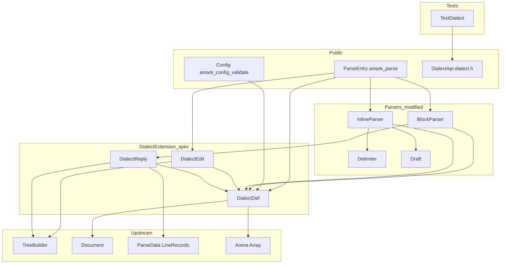
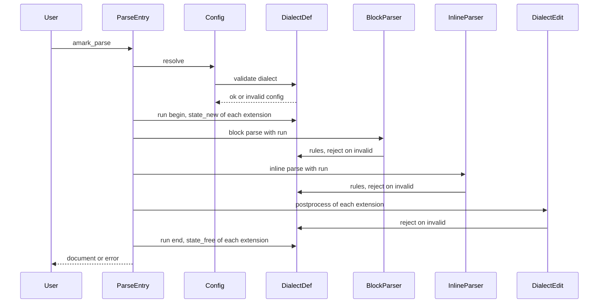
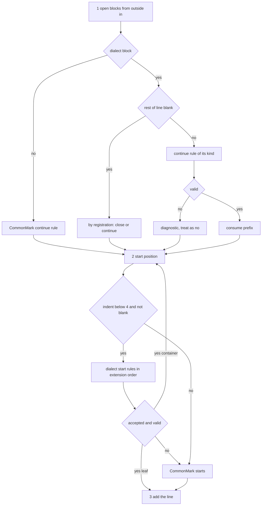
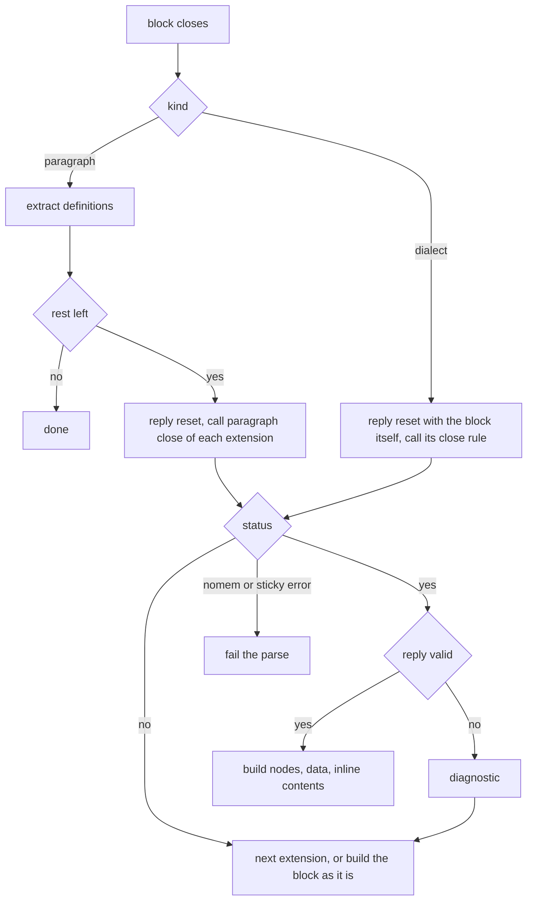

# Design Document

## Overview

**Purpose**: dialect-extension は、方言（拡張の集合）を利用者のコードで定義し、本体を変えずに CommonMark にない構文を足せるようにする。規則が返した結果は、本体が木に入れる前に検査し、不正なら採用せずに診断を出して、解析を続ける。

**Users**: 方言の作者（利用者と、後の段階の GFM の spec の開発者）は、公開ヘッダ `<amark/dialect.h>` の型で方言を静的な const のデータとして書き、設定の `dialect` に指定する。利用者は、方言の種類のノードを、これまでと同じたどる API で読む。

**Impact**: 設定の `dialect` が、初めて解析の結果に影響する。`amark_config_validate` と `amark_parse` は、不正な方言の定義を「設定の誤り」として返すようになる。`block.c`、`inline.c`、`delimiter.c`、`draft.c` に、規則の呼び出しと方言のブロックの扱いが加わる。方言を指定しない解析の結果と確保の回数は変わらない。

### Goals
- 方言を定義する公開の型と、6 つの差し込み口（ブロックの開始・継続・閉じるとき、インラインの起動文字、区切りの種類、後処理）の契約を定める。
- 規則の結果を、木に入れる前に検査する。不正な結果は木にもアリーナにも残さず、診断を 1 件足す。
- 方言を指定しないときに、結果も確保の回数も変えない。方言を指定したときも、再帰を使わず、規則を呼ぶ回数を入力の長さに比例させる。
- テスト用の方言で、各差し込み口と、不正とする条件のすべてを確かめる。

### Non-Goals
- GFM の各拡張の実装。ライブラリは組み込みの方言を持たない。
- 木を自由に作る・書き換える公開 API。規則ができるのは、結果を返すことと、後処理の 5 つの操作を求めることだけである。
- 規則の中の時間を本体が制限すること。
- 継続のプレフィックスを桁の単位で（タブの途中まで）消費すること。消費はバイトの範囲で表す（Risks を参照）。
- スレッドを使った並行性のテスト（spec-conformance が行う）。

## Boundary Commitments

### This Spec Owns
- 公開ヘッダ `include/amark/dialect.h`：`struct amark_dialect` の中身、拡張・種類・規則・区切りの型、規則に渡す入力と結果の型、閉じるときの返事を組み立てる 3 つの関数、後処理の 5 つの操作の関数、行を読む 2 つの補助の関数。
- 方言の定義の検査（`amark_config_resolve` の規則 5 として呼ばれる）。
- 解析 1 回分の方言の実行の状態（文書ごとの状態の作成と破棄）。
- 各差し込み口での規則の呼び出しと、結果の検査、採用、不採用のときの診断の文面。
- 方言のブロックの、ブロックの解析の中での扱い（開く、続ける、行を足す、閉じる、空行、入れられる親と子）。
- 方言の区切りの対応の決まり（同じ長さどうし）と、公開する上限（種類の数 6、長さ 1 から 4）。
- 後処理の 5 つの操作と、その検査。
- テスト用の方言（`tests/support/`）と、この spec の単体テスト・公開 API のテスト。

### Out of Boundary
- CommonMark の規則（block-parser、inline-parser）。方言を指定しないときの動作は変えない。
- GFM の各拡張と、その HTML 出力（後の段階の spec、spec-conformance）。
- 方言の種類のノードの意味上の値（source-text は、原文のバイト列と、インラインの論理的な文字列だけを返す。この spec は変えない）。
- 木の不変条件の定義と、木の全体の検査の関数（syntax-tree）。この spec は、検査の関数をテストで使い、解析の中では、結果の記述に対する自前の検査を使う。
- ノードを取り除く操作、兄弟の順を入れ替える操作。
- `structure.md` の依存の図の更新（この設計が示す向きに合わせる作業は、`/kiro-steering` で行う）。

### Allowed Dependencies
- syntax-tree：`document.h`（内容、行の索引、診断の追加、ノードの数、アリーナ、ノードの 5 つのつながり）、`tree_internal.h`（`amark_tree_append`、`amark_tree_insert_before`、`amark_tree_set_range`、`amark_tree_set_kind`、`amark_tree_set_dialect_data`）、公開のたどる API。`tree_check.h` はテストだけが使う。
- block-parser：`parse_data.h`（`amark_inline_content_add`）、`line.h`（行の範囲と行の記録）。
- project-foundation：`alloc.h`、`arena.h`、`array.h`。
- 依存の向き（左が右に依存する）：

```
DialectEdit → InlineParser → BlockParser → DialectReply → DialectDef → 構文木 → 内部の部品
                                   Config → DialectDef
```

- `DialectDef` は、解析器を知らない。`DialectReply` は、インラインの解析を知らない。`block.c` と `inline.c` は、`DialectEdit` を知らない。
- 依存してはならないもの：`utf8`、`unicode`、`entity`、`charref`（方言のモジュールは、文字の知識を持たない。UTF-8 の文字の境目だけは、バイトの上位 2 ビットで見る）。

### Revalidation Triggers
次の変更は、下流（後の段階の GFM の spec、spec-conformance）の見直しを要する。
- `<amark/dialect.h>` の型の項目・意味・`AMARK_DIALECT_ABI` の値の変更。
- 規則を呼ぶ条件、順序、回数の変更（「CommonMark の規則より先」「拡張の順」を含む）。
- 不正とする条件の追加・削除と、不採用のときの扱いの変更。
- 診断の文面の変更（テストが文面を比べる）。
- 方言のリーフの行の記録の決まり（段落と同じ）、方言のブロックの範囲の決まりの変更。
- 区切りの対応の決まりと、上限（6 種類、長さ 1 から 4）の変更。
- 後処理の操作の追加・削除。

上流の変更で、この spec の見直しを要するもの：`open_block_t` と「3 つの関数」の構造（block-parser）、起動文字の表・区切りの種類の表・項目の木の形（inline-parser）、木を作る内部 API と不変条件（syntax-tree）。

## Architecture

### Existing Architecture Analysis
- `block.c` は、種類ごとの処理を `start_block`、`continue_block`、`close_block` の `switch` にまとめている。方言の種類は `default` の枝に入り、いまは「開始しない」「続かない」「何もせずに閉じる」である。種類で分岐する箇所は、ほかに `can_contain`、`add_line`、`add_blank_run_line`、`note_blank_line` がある。
- リーフのノードは閉じるときに作られ、コンテナのノードは開いたときに作られる。段落は、閉じるとき（`close_paragraph`）に、リンク参照定義を取り出した後でノードになる。置き換えは、ここで「段落のノードの代わりに、別のノードの並びを作る」ことになる。
- 空行の打ち切り（`blank_run_continues`、`add_blank_run_line`）は、「リストの内側に残っている要素は、次の空行でも必ず続く」を前提にする。要件 5.6 は、空行での扱いを種類の登録で決めるので、この前提が保たれる。
- インラインのカーソルは、範囲の最初の行を範囲の開始から、最後の行を範囲の終わりまで読み、続きの行は行の記録の `content_start` から読む。行の途中から始まる範囲（表のセルなど）も、そのまま解析できる。範囲の両端は、行の内容の中か端になければならない。
- `amark_delimiters_process` は、強調の決まり（長さが違っても対応し、1 つか 2 つずつ使う）だけを持つ。下限の表は、種類ごとに 6 つの組を持つ。
- `amark_document_node_count` は、取り除いたノードも数える。不採用の結果を木に入れてから取り除くと、ノードの数の上限に数えられる。そのため、検査は木に入れる前に行う（要件 10.12）。
- `checks.objects` は、ライブラリのオブジェクトに、可変の静的データと、ポインタを含む const の表を禁じる。診断の文面の振り分けは `switch` で行う。
- `amark_block_parse` と `amark_inline_parse` を呼ぶ箇所は、`parse.c` のほかに、単体テストの 5 つのファイル（7 か所）である。

### Architecture Pattern & Boundary Map

方式は「規則は記述を返し、本体が検査してから木を作る」である。規則は木を作る内部 API に触れない。

- **小さな結果**（開始、継続、インライン）：規則は、呼ぶ側が用意した構造体に範囲を書く。本体は、その場で条件を確かめる。
- **閉じるときの返事**：規則は、本体が持つ返事のバッファに、公開の関数でブロックを足す。本体は、足すたびに条件を確かめ、規則が戻った後で、通った返事だけを木にする。
- **後処理の操作**：規則は、公開の関数で操作を 1 つずつ求める。本体は、操作ごとに、対象のノードとその親・前後の兄弟・最初と最後の子だけを見て確かめ、通れば木に適用する。



**Architecture Integration**:
- Selected pattern：gap 分析の Option C。検査・診断・状態・返事・後処理は新しいモジュールに置き、解析の流れに入る部分は既存の解析器を広げる。
- Domain boundaries：`DialectDef` は「定義を読む・確かめる・診断を作る・状態を持つ」。`DialectReply` は「閉じるときの返事を受け取り、確かめ、木にする」。`DialectEdit` は「後処理を呼び、操作を確かめて適用する」。規則を呼ぶ時点を決めるのは、解析器である。
- Existing patterns preserved：種類ごとの `switch`、作業用のアリーナ、失敗は戻り値、`parse_document` での 1 か所の後始末、ポインタを持たない区切りの種類の表。
- New components rationale：検査と診断は 3 つの差し込み口に共通なので 1 か所に置く。返事と後処理は、公開の関数を持つので、解析器から分ける。
- Steering compliance：再帰なし、グローバルな状態なし、確保は解析の確保関数だけ、規則の不正な結果は診断にする。

### Technology Stack

| Layer | Choice / Version | Role in Feature | Notes |
|-------|------------------|-----------------|-------|
| Language | C99 | 公開の型と実装 | 新しい依存はない |
| Build | CMake | `AMARK_SOURCES` に 3 つのファイルを足す | 公開ヘッダ 1 つをインストールの対象に足す |
| Test | Naos v0.4.0 | 単体テストと公開 API のテスト | テスト用の方言は `amark_test_support` に置く |

## File Structure Plan

### Directory Structure
```
include/amark/
└── dialect.h              # DialectApi：方言の公開の型と関数の宣言
src/
├── dialect.c              # DialectDef：定義の検査、種類の引き当て、実行の状態、診断
├── dialect_internal.h     # DialectDef の内部ヘッダ（公開ヘッダと同じ名前なので _internal）
├── dialect_reply.c        # DialectReply：閉じるときの返事のバッファ、検査、木への反映、行を読む補助
├── dialect_reply.h
├── dialect_edit.c         # DialectEdit：後処理の呼び出しと、5 つの操作
└── dialect_edit.h
tests/
├── support/
│   ├── test_dialect.c     # TestDialect：公開 API だけで書いたテスト用の方言
│   └── test_dialect.h
├── unit/
│   ├── test_dialect_def.c     # 定義の検査、診断の文面、実行の状態
│   ├── test_dialect_block.c   # ブロックの 3 つの差し込み口と、不正な結果
│   ├── test_dialect_inline.c  # 起動文字の規則、区切りの種類、不正な結果
│   ├── test_dialect_edit.c    # 後処理の操作と、不正な操作
│   └── test_dialect_limits.c  # 確保の失敗の注入、上限、深い入れ子、大量の区切り
└── public/
    └── test_dialect.c     # 公開ヘッダと Amark::amark だけで方言を定義して解析する
```

### Modified Files
- `include/amark/amark.h` — `<amark/dialect.h>` を取り込む。
- `include/amark/config.h` — `amark_config_validate` の説明に、方言の定義の誤りを足す（型は変えない）。
- `src/config.c` — `amark_config_resolve` に規則 5（方言の定義の検査）を足す。拡張が 0 個の方言は、`dialect` を `NULL` に解決する。
- `src/parse.c` — 実行の状態の開始と終了、後処理の呼び出しを足す。
- `src/block.h`、`src/block.c` — `amark_block_parse` に実行の状態の引数を足す。`open_block_t` に方言の項目を足す。`can_contain`、`start_block`、`continue_block`、`close_block`、`close_paragraph`、`add_line`、`append_node` を広げる。
- `src/inline.h`、`src/inline.c` — `amark_inline_parse` に実行の状態の引数を足す。起動文字の印、`scan_special` の先頭での規則の呼び出し、方言の区切りの登録を足す。
- `src/delimiter.h`、`src/delimiter.c` — 種類に対応の決まり（強調か、同じ長さか）と長さの集合を足す。種類を足す関数を足す。下限の表を種類ごとに 8 つにする。
- `src/draft.h`、`src/draft.c` — 項目に方言の属性の値を持たせ、出力で `amark_tree_set_dialect_data` を呼ぶ。
- `src/CMakeLists.txt` — `AMARK_SOURCES` に `dialect.c`、`dialect_reply.c`、`dialect_edit.c` を、公開ヘッダの一覧に `dialect.h` を足す。
- `tests/CMakeLists.txt` — `amark_test_support` に `support/test_dialect.c` を足し、新しいテストを登録する。公開 API のテストは、`support/test_dialect.c` を自分のソースに含める。
- `tests/checks/exported_symbols.txt` — この spec の公開の関数（10 個）を足す。
- `tests/public/header_cxx.cpp` — `<amark/dialect.h>` を足す。
- `tests/unit/test_block.c`、`test_cursor.c`、`test_inline.c`、`test_inline_scan.c`、`test_parse.c` — `amark_block_parse` と `amark_inline_parse` の呼び出しに、実行の状態として `NULL` を足す（7 か所）。
- `tests/unit/test_delimiter.c`、`test_draft.c` — 新しい決まりと属性の値の単体テストを足す。
- `tests/unit/test_config.c`、`tests/public/test_config.c` — 方言の定義の検査の入口のテストを足す。

## System Flows

### 解析 1 回の流れ

- `run begin` は、文書を作った後に呼ぶ。失敗したら、作った状態を捨て、文書を破棄する。
- `run end` は、成功でも失敗でも、`parse_document` から戻る前に 1 回だけ呼ぶ。
- 設定の `dialect` が `NULL`（拡張が 0 個の方言を含む）のとき、`run` は `NULL` で、上の図の D と E への呼び出しは 1 つも起きない。

### ブロックの 1 行と、方言の規則

- 開始の規則は、判定する位置が「インデントが 4 桁未満で、空行でない」ときだけ呼ぶ。4 桁以上は、インデントコードか段落の続きである。
- 不正な結果のときは、診断を足し、次の規則へ進む。

### 閉じるときの返事


## Requirements Traceability

| Requirement | Summary | Components | Interfaces | Flows |
|-------------|---------|------------|------------|-------|
| 1.1, 1.2, 1.3 | 方言と拡張の定義 | DialectApi | `amark_dialect_t`、`amark_dialect_extension_t`（名前のほかは 0 か `NULL` にできる） | — |
| 1.4 | 規則を呼ぶ | BlockParser、InlineParser、DialectEdit | 各差し込み口 | 解析 1 回 |
| 1.5 | 定義を変えず、参照を残さない | DialectDef、DialectReply | 定義は `const`。文書に入るのは ID、別、属性の写し、診断の写しだけ | — |
| 1.6 | 契約の版 | DialectApi、DialectDef | `struct_size`、`abi`、`AMARK_DIALECT_ABI` | — |
| 1.7、14.3 | 公開ヘッダだけで、静的な const のデータとして書ける | DialectApi、TestDialect | 指示付き初期化子で書ける構造体 | — |
| 1.8 | 組み込みの方言なし | — | ライブラリに方言の定義を置かない | — |
| 2.1, 2.2, 2.3, 2.9 | 種類の登録 | DialectApi | `amark_dialect_kind_t`（`id`、`cls`、`blank`） | — |
| 2.4, 2.5, 2.6 | ノードの ID・別・属性 | DialectReply、Draft、DialectEdit | `amark_tree_append` の `cls`、`amark_tree_set_dialect_data` | — |
| 2.7, 2.8 | 登録されていない種類、別と合わない位置 | DialectReply、DialectEdit | 理由 `KIND`、`NESTING` | 閉じるときの返事 |
| 3.1, 3.12 | 検査の入口 | Config、DialectDef | `amark_config_resolve` の規則 5、`amark_dialect_validate` | 解析 1 回 |
| 3.2, 3.3, 3.4, 3.5, 3.6, 3.7, 3.8, 3.9 | 定義の誤り | DialectDef | `amark_dialect_validate` の規則 | — |
| 3.10, 3.11 | 拡張が 0 個 | Config | `dialect` を `NULL` に解決する | — |
| 3.13 | 規則を呼ばず、確保しない | DialectDef | `amark_dialect_validate` | — |
| 4.1, 4.2, 4.3, 4.4, 4.6, 4.7, 4.12 | 開始の規則を呼ぶ | BlockParser | `start_block`、`amark_dialect_line_t`、`amark_dialect_block_start_t` | ブロックの 1 行 |
| 4.5, 4.8, 4.9 | 方言のブロックを開く | BlockParser | `push_block`、`add_line` | ブロックの 1 行 |
| 4.10, 4.11 | 開始の結果の検査 | BlockParser、DialectDef | 理由 `ORIGIN`、`LINE`、`EMPTY`、`amark_dialect_reject` | ブロックの 1 行 |
| 5.1, 5.2, 5.3, 5.4, 5.5, 5.7 | 継続の規則 | BlockParser | `continue_block`、`amark_dialect_open_block_t`、`amark_dialect_block_continue_t` | ブロックの 1 行 |
| 5.6 | 空行 | BlockParser | `blank` の登録、空行の打ち切りは変えない | ブロックの 1 行 |
| 5.8, 5.9 | 継続の結果の検査 | BlockParser、DialectDef | 理由 `ORIGIN`、`LINE` | ブロックの 1 行 |
| 5.10, 5.11 | 終わりで閉じる、範囲と行 | BlockParser | `close_above`、方言のブロックの範囲の決まり | — |
| 6.1, 6.2, 6.3, 6.4, 6.12, 6.13 | 閉じるときの規則を呼ぶ | BlockParser、DialectReply | `close_block`、`close_paragraph`、`amark_dialect_closing_t`、`amark_dialect_closing_line` | 閉じるときの返事 |
| 6.5, 6.6 | 返事の内容 | DialectReply | `amark_dialect_reply_add_block`（段落の置き換えだけ）、`_set_data`、`_set_inline` | 閉じるときの返事 |
| 6.7, 6.8, 6.9 | 返事を木にする | DialectReply、InlineParser | `amark_dialect_reply_apply`、`amark_inline_content_add` | 閉じるときの返事 |
| 6.10, 6.11 | 返事の検査 | DialectReply | 理由 `PARENT`、`ORDER`、`INLINE`、`PARAGRAPH` ほか | 閉じるときの返事 |
| 7.1, 7.2, 7.3, 7.4, 7.5, 7.6, 7.9, 7.10, 7.11 | 起動文字の規則 | InlineParser、Draft | `scan_special`、`amark_dialect_inline_t`、`amark_dialect_inline_result_t`、`amark_dialect_inline_next_line` | — |
| 7.7, 7.8 | インラインの結果の検査 | InlineParser、DialectDef | 理由 `ORIGIN`、`EMPTY`、`PARENT`、`PREFIX` | — |
| 8.1, 8.2, 8.3, 8.4, 8.5, 8.10 | 区切りの種類 | Delimiter、InlineParser | `amark_dialect_delimiter_t`、`amark_delimiters_add_kind`、`AMARK_DELIMITER_MATCH_EQUAL` | — |
| 8.6, 8.7, 8.8 | 区切りの定義の誤り | DialectDef | `amark_dialect_validate` | — |
| 8.9 | 上限の公開 | DialectApi | `AMARK_DIALECT_DELIMITER_MAX`、`AMARK_DIALECT_DELIMITER_LENGTH_MAX` | — |
| 9.1, 9.2 | 後処理を呼ぶ | DialectEdit、ParseEntry | `amark_dialect_postprocess`、`amark_dialect_post_t` | 解析 1 回 |
| 9.3, 9.4, 9.5, 9.7, 9.8 | 操作 | DialectEdit | `amark_dialect_edit_*`（5 つ） | — |
| 9.6 | 操作の検査 | DialectEdit | 理由 `NODE`、`PROTECTED`、`KIND`、`NESTING`、`PARENT`、`ORDER`、`TEXT`、`ATTRIBUTE` | — |
| 9.9、10.5 | 返す文書は不変条件を満たす | DialectReply、DialectEdit、InlineParser | 入れる前の検査 | — |
| 9.10、10.11 | 資源の上限 | DialectReply、DialectEdit、BlockParser、Draft | ノードを作る直前の検査 | — |
| 10.1, 10.2, 10.3, 10.6, 10.7 | 検査してから反映する | DialectDef、DialectReply、DialectEdit、BlockParser、InlineParser | `amark_dialect_reject` | 各フロー |
| 10.4 | 定めていない戻り値 | DialectDef | 理由 `STATUS` | — |
| 10.8, 10.9 | 外を読まない、検査の時間 | DialectReply、DialectEdit | 足すたびの O(1) の検査、操作ごとの O(1) の検査 | — |
| 10.10 | 規則のメモリ不足 | DialectDef | 規則の戻り値 `AMARK_ERROR_NOMEM`、返事と操作の「残る失敗」 | 閉じるときの返事 |
| 10.12 | 不採用の結果を数えない | DialectReply、DialectEdit、InlineParser | 検査を通るまでノードを作らない | — |
| 11.1, 11.2, 11.3, 11.4, 11.5, 11.6, 11.7 | 診断 | DialectDef | `amark_dialect_reject`、文面の表 | — |
| 11.8, 11.9 | 診断を足さない場合 | DialectDef | `run` が `NULL` のとき呼ばれない | — |
| 12.1, 12.2 | 読み取り専用と写し | DialectApi、DialectReply、Draft | 入力は `const`。結果は呼び出しの中で写す | — |
| 12.3, 12.4, 12.5, 12.6, 12.7 | 文書ごとの状態 | DialectDef、ParseEntry | `amark_dialect_run_begin`、`amark_dialect_run_end` | 解析 1 回 |
| 12.8、12.10、13.8、13.9 | 並行性と決定性 | すべて | 可変の静的データなし（`checks.objects`）。呼ぶ順は内容と定義だけで決まる | — |
| 12.9 | 作者が守る決まり | DialectApi | 公開ヘッダの説明 | — |
| 13.1, 13.2, 13.3 | 方言なしで変わらない | Config、ParseEntry、BlockParser、InlineParser | `run == NULL` の経路 | — |
| 13.4, 13.5 | 呼ぶ回数 | BlockParser、InlineParser、DialectEdit | Performance & Scalability | — |
| 13.6 | 再帰なし | すべて | 返事は配列の 1 回の走査、操作は局所の検査 | — |
| 13.7, 13.10 | 失敗が局所的、確保関数 | ParseEntry、DialectDef | `parse_document` の後始末、実行の状態のアリーナ | — |
| 14.1, 14.2, 14.4, 14.5 | 名前とヘッダ | DialectApi | `amark_` と `AMARK_`、`header_cxx.cpp` | — |
| 14.6 | 公開シンボル | ビルド | `exported_symbols.txt` | — |
| 14.7 | 新しいエラーの種類なし | DialectApi | 規則も、規則が呼ぶ関数も、既存の `amark_error_t` を返す | — |
| 15.1, 15.2 | テスト用の方言 | TestDialect | `tests/support/test_dialect.h` | — |
| 15.3, 15.4, 15.5, 15.6, 15.7, 15.8, 15.9, 15.10, 15.11, 15.12 | 単体テスト | テスト | Testing Strategy | — |

## Components and Interfaces

| Component | Domain/Layer | Intent | Req Coverage | Key Dependencies (P0/P1) | Contracts |
|-----------|--------------|--------|--------------|--------------------------|-----------|
| DialectApi | 公開 | 方言の型と、規則が呼ぶ関数の宣言 | 1, 2, 8.9, 12.9, 14 | tree.h、allocator.h (P0) | Service |
| DialectDef | 内部：定義 | 定義の検査、種類の引き当て、実行の状態、診断 | 3, 10.3, 10.4, 11, 12.3〜12.7 | Document (P0) | Service、State |
| DialectReply | 内部：返事 | 閉じるときの返事の受け取り、検査、木への反映 | 2.4〜2.8, 6.5〜6.11, 10 | DialectDef、TreeBuilder、ParseData (P0) | Service、State |
| BlockParser（変更） | 内部：解析 | 方言のブロックの扱いと、3 つの差し込み口 | 4, 5, 6.1〜6.4, 6.12, 6.13 | DialectDef、DialectReply (P0) | Service |
| InlineParser、Draft、Delimiter（変更） | 内部：解析 | 起動文字の規則と、区切りの種類 | 7, 8 | DialectDef (P0) | Service |
| DialectEdit | 内部：後処理 | 後処理の呼び出しと 5 つの操作 | 9, 10 | DialectDef、TreeBuilder (P0) | Service、State |
| Config、ParseEntry（変更） | 公開 | 定義の検査の入口、実行の状態の寿命 | 3.1, 3.10〜3.12, 12.3〜12.6, 13 | DialectDef、DialectEdit (P0) | Service |
| TestDialect | テストの支援 | 各差し込み口と不正な結果を起こす方言 | 15 | DialectApi (P0) | Service |

### 共通の決まり

**戻り値**：規則も、規則が呼ぶ関数も、ほかの公開 API と同じ `amark_error_t` を返す。新しい型も、新しい値も足さない（14.7）。

| 値 | 規則が返すとき | 返事・操作の関数が返すとき |
|----|----------------|----------------------------|
| `AMARK_ERROR_NONE` | 答えた。答えの中身は、結果の構造体か返事にある | 受け取った、適用した |
| `AMARK_ERROR_INVALID_INPUT` | （定めていない値） | 不正だった。何も変えていない |
| `AMARK_ERROR_NOMEM` | メモリ不足で続けられない | 本体の確保が失敗した |
| `AMARK_ERROR_LIMIT_EXCEEDED` | （定めていない値） | 資源の上限を超えた |

- 規則の「はい・いいえ」は、戻り値ではなく、結果に書く。開始・継続・インラインの規則は、結果の構造体の `matched` を真にする（本体は、呼ぶ前に結果を 0 で埋めるので、何も書かなければ「いいえ」である）。段落を閉じるときの規則は、返事にブロックを 1 つ以上足せば「置き換える」、足さなければ「そのままにする」である。
- 規則が `AMARK_ERROR_NONE` と `AMARK_ERROR_NOMEM` のほかの値を返したら、結果を不正とする（理由 `STATUS`、10.4）。
- 規則が `AMARK_ERROR_NOMEM` を返したら、解析は `AMARK_ERROR_NOMEM` で終わる（10.10）。
- 返事と操作の関数が返す `AMARK_ERROR_NOMEM` と `AMARK_ERROR_LIMIT_EXCEEDED` は、返事または編集の状態に残る（残る失敗）。規則がそれを無視して `AMARK_ERROR_NONE` で戻っても、本体は残る失敗を見て、その値で解析を終える（10.10、10.11）。規則は、関数の戻り値をそのまま返してもよい。
- 返事と操作の関数が返す `AMARK_ERROR_INVALID_INPUT` は、失敗ではない。その 1 回の呼び出しが不正で、何も変わらなかったことを規則に伝える（9.4）。規則は続けてよい。

**範囲**：すべて、内容の先頭から数えたバイトのオフセットの `[start, end)` である（`amark_range_t`）。本体は、規則が返した値を、内容の長さと比べてから使う（10.8）。

**呼ぶ順**：拡張は、方言の中の並びの順。1 つの拡張の中の規則は、配列の順。

**不正な結果の扱い**：`amark_dialect_reject` で診断を 1 件足し、その規則が「いいえ」と答えたものとして続ける（4.11、5.9、6.11、7.8、10.3）。診断の追加が失敗したら、その失敗で解析を終える（11.7）。

### 公開

#### DialectApi

| Field | Detail |
|-------|--------|
| Intent | 方言を定義する型と、規則が呼ぶ関数を、公開ヘッダ 1 つで与える |
| Requirements | 1.1, 1.2, 1.3, 1.6, 1.7, 2.1, 2.2, 2.3, 2.9, 4.2, 4.3, 4.6, 5.2, 5.3, 6.3, 6.4, 6.5, 6.6, 7.1, 7.3, 7.4, 8.1, 8.9, 9.2, 9.3, 12.1, 12.9, 14.1, 14.2, 14.3, 14.4, 14.5, 14.7 |

**Contracts**: Service [x]

##### Service Interface：定義の型
```c
#define AMARK_DIALECT_ABI 1u
#define AMARK_DIALECT_DELIMITER_MAX 6        /* 1 つの方言の区切りの種類の数 */
#define AMARK_DIALECT_DELIMITER_LENGTH_MAX 4 /* 対応に使える列の長さの上限 */
#define AMARK_DIALECT_LENGTH(n) (1u << ((n) - 1)) /* lengths のビット */
#define AMARK_DIALECT_TOP ((size_t)-1)       /* 返事の、親のないブロック */

typedef enum amark_dialect_class {
    AMARK_DIALECT_CONTAINER = 1, /* ブロック。ブロックを子に持てる */
    AMARK_DIALECT_LEAF = 2,      /* ブロック。ブロックを子に持たない */
    AMARK_DIALECT_INLINE = 3
} amark_dialect_class_t;

typedef enum amark_dialect_blank {
    AMARK_DIALECT_BLANK_CLOSES = 0,   /* 空行で閉じる */
    AMARK_DIALECT_BLANK_CONTINUES = 1 /* 空行でも続く */
} amark_dialect_blank_t;

typedef struct amark_dialect_kind {
    amark_kind_t id;   /* AMARK_KIND_DIALECT_MIN 以上 */
    int cls;           /* amark_dialect_class_t */
    int blank;         /* amark_dialect_blank_t。ブロックだけが使う */
    amark_dialect_block_continue_fn continue_fn; /* ブロックだけ。NULL：続かない */
    amark_dialect_block_close_fn close_fn;       /* ブロックだけ。NULL：そのまま */
} amark_dialect_kind_t;

typedef struct amark_dialect_block_start {
    amark_kind_t kind;          /* この規則が開く、この拡張のブロックの種類 */
    bool interrupts_paragraph;
    amark_dialect_block_start_fn fn;
} amark_dialect_block_start_t;

typedef struct amark_dialect_inline_rule {
    unsigned char trigger;      /* 0x21 から 0x7E */
    amark_kind_t kind;          /* この規則が作る、この拡張のインラインの種類 */
    amark_dialect_inline_fn fn;
} amark_dialect_inline_rule_t;

typedef struct amark_dialect_delimiter {
    unsigned char ch;           /* ASCII の句読点 */
    unsigned lengths;           /* AMARK_DIALECT_LENGTH(1) から (4) の和 */
    amark_kind_t kind;          /* 対応したときに作る、この拡張のインラインの種類 */
} amark_dialect_delimiter_t;

typedef struct amark_dialect_extension {
    const char *name;
    const amark_dialect_kind_t *kinds;              size_t kind_count;
    const amark_dialect_block_start_t *block_starts; size_t block_start_count;
    amark_dialect_block_close_fn close_paragraph;   /* NULL：なし */
    const amark_dialect_inline_rule_t *inline_rules; size_t inline_rule_count;
    const amark_dialect_delimiter_t *delimiters;    size_t delimiter_count;
    amark_dialect_post_fn postprocess;              /* NULL：なし */
    amark_dialect_state_new_fn state_new;           /* 両方か、どちらもなし */
    amark_dialect_state_free_fn state_free;
} amark_dialect_extension_t;

struct amark_dialect {
    size_t struct_size;  /* sizeof(amark_dialect_t) */
    unsigned abi;        /* AMARK_DIALECT_ABI */
    const amark_dialect_extension_t *const *extensions;
    size_t extension_count;
};
```
- 継続の規則と閉じるときの規則は、種類の登録に置く。開く種類が決まれば、続ける規則と閉じる規則が決まるからである。開始の規則とインラインの規則は、作る種類を登録で指定する（4.3、4.6、7.1）。規則が種類を返さないので、「登録されていない種類」は、これらの規則では設定の誤りになる（3.6）。
- 版は、`struct_size` と `abi` の 2 つで見分ける（設定の `struct_size` と同じ方式）。項目を足すときは `AMARK_DIALECT_ABI` を上げる。
- 拡張はポインタの配列で並べる。別々に定義した拡張を、1 つの方言に集められる。

##### Service Interface：規則の型と、入力と結果
```c
typedef struct amark_dialect_line {
    const char *content;  size_t content_length; /* 内容の全体 */
    size_t line;            /* 行番号 */
    size_t line_start;      /* 行の最初のバイト（解析する範囲の中） */
    size_t line_end;        /* 行の内容の終わり（行末記号の前） */
    size_t position;        /* 判定する位置 */
    size_t column;          /* その桁（タブは幅 4） */
    size_t first_nonspace;  /* position 以降で、空白でない最初のバイト */
    size_t indent;          /* position から first_nonspace までの桁数 */
    amark_kind_t container_kind; /* 開始だけ：新しいブロックが入る要素の種類 */
    bool in_paragraph;      /* 開始だけ：いちばん内側の開いているブロックが段落 */
} amark_dialect_line_t;

typedef struct amark_dialect_block_start_result {
    bool matched;           /* 真：開始する */
    amark_range_t consumed; /* 開始の印。start は line->position */
    uint64_t data;          /* このブロックに付ける値。継続と閉じるときに渡る */
} amark_dialect_block_start_result_t;

typedef struct amark_dialect_open_block {
    amark_kind_t kind;
    amark_range_t range;    /* 開始から、これまでに属した最後の行の内容の終わりまで */
    uint64_t data;
} amark_dialect_open_block_t;

typedef struct amark_dialect_block_continue_result {
    bool matched;           /* 真：続く */
    amark_range_t consumed; /* プレフィックス。start は line->position */
    uint64_t data;          /* 新しい値。書かなければ、いまの値のまま */
} amark_dialect_block_continue_result_t;

typedef struct amark_dialect_closing {
    const char *content;  size_t content_length;
    amark_kind_t kind;      /* AMARK_KIND_PARAGRAPH か、この拡張のブロックの種類 */
    amark_range_t range;
    size_t line_count;      /* そのブロックの行の数 */
    uint64_t data;          /* 段落では 0 */
    const struct amark_dialect_lines *lines; /* amark_dialect_closing_line が使う */
} amark_dialect_closing_t;

typedef struct amark_dialect_line_span {
    size_t start;           /* 行の最初のバイト */
    size_t content_start;   /* 行の内容が始まる位置（行の記録） */
    size_t end;             /* 行の内容の終わり */
} amark_dialect_line_span_t;

typedef struct amark_dialect_inline {
    const char *content;  size_t content_length;
    size_t position;        /* 起動文字の位置 */
    size_t line_end;        /* その行の内容の終わり */
    amark_range_t inline_content; /* いま解析している内容の範囲 */
    const struct amark_dialect_lines *lines; /* amark_dialect_inline_next_line が使う */
} amark_dialect_inline_t;

typedef struct amark_dialect_inline_result {
    bool matched;           /* 真：作る */
    amark_range_t range;    /* start は in->position */
    const void *data;  size_t data_size; /* 属性の値。なければ NULL と 0 */
} amark_dialect_inline_result_t;

typedef struct amark_dialect_post {
    const amark_document_t *doc; /* たどる API で読む */
    const char *content;  size_t content_length;
} amark_dialect_post_t;

typedef amark_error_t (*amark_dialect_block_start_fn)(const amark_dialect_line_t *line,
    void *state, amark_dialect_block_start_result_t *out);
typedef amark_error_t (*amark_dialect_block_continue_fn)(const amark_dialect_line_t *line,
    const amark_dialect_open_block_t *block, void *state,
    amark_dialect_block_continue_result_t *out);
typedef amark_error_t (*amark_dialect_block_close_fn)(const amark_dialect_closing_t *closing,
    void *state, amark_dialect_reply_t *reply);
typedef amark_error_t (*amark_dialect_inline_fn)(const amark_dialect_inline_t *in,
    void *state, amark_dialect_inline_result_t *out);
typedef amark_error_t (*amark_dialect_post_fn)(const amark_dialect_post_t *post,
    void *state, amark_dialect_editor_t *editor);
typedef amark_error_t (*amark_dialect_state_new_fn)(const amark_allocator_t *allocator,
    void **state);
typedef void (*amark_dialect_state_free_fn)(const amark_allocator_t *allocator,
    void *state);
```
- `state` は、その拡張の文書ごとの状態である。状態の関数を持たない拡張には `NULL` を渡す。
- `data`（`uint64_t`）は、開いているブロック 1 つに付く小さな値である。規則が最初の行を読み直さずに済むように置く（フェンスの長さ、閉じる印を見たかどうか、など）。木には入らない。
- 入力の構造体は、本体のスタックにあり、呼び出しの間だけ有効である。規則が `out` に書いた `data` のポインタは、規則が戻った直後に本体が写し、その後は読まない（12.2）。
- 公開ヘッダは、作者が守る決まり（12.9）を、ヘッダの先頭の説明に書く。

##### Service Interface：規則が呼ぶ関数（公開シンボル 10 個）
```c
/* 行を読む補助 */
AMARK_API bool amark_dialect_closing_line(const amark_dialect_closing_t *closing,
    size_t index, amark_dialect_line_span_t *out);
AMARK_API bool amark_dialect_inline_next_line(const amark_dialect_inline_t *in,
    size_t line_end, amark_range_t *out);

/* 閉じるときの返事 */
AMARK_API amark_error_t amark_dialect_reply_add_block(amark_dialect_reply_t *reply,
    size_t parent, amark_kind_t kind, amark_range_t range, size_t *index);
AMARK_API amark_error_t amark_dialect_reply_set_data(amark_dialect_reply_t *reply,
    size_t index, const void *data, size_t size);
AMARK_API amark_error_t amark_dialect_reply_set_inline(amark_dialect_reply_t *reply,
    size_t index, amark_range_t range);

/* 後処理の操作 */
AMARK_API amark_error_t amark_dialect_edit_set_kind(amark_dialect_editor_t *editor,
    amark_node_id_t node, amark_kind_t kind);
AMARK_API amark_error_t amark_dialect_edit_set_data(amark_dialect_editor_t *editor,
    amark_node_id_t node, const void *data, size_t size);
AMARK_API amark_error_t amark_dialect_edit_shrink(amark_dialect_editor_t *editor,
    amark_node_id_t node, amark_range_t range);
AMARK_API amark_error_t amark_dialect_edit_add_child(amark_dialect_editor_t *editor,
    amark_node_id_t parent, amark_node_id_t hint, amark_kind_t kind,
    amark_range_t range, const void *data, size_t size, amark_node_id_t *out);
AMARK_API amark_error_t amark_dialect_edit_split_text(amark_dialect_editor_t *editor,
    amark_node_id_t node, size_t at, amark_node_id_t *second);
```
- `amark_dialect_reply_t` と `amark_dialect_editor_t` は、中身の見えない型である。
- 返事と操作の関数は、引数が `NULL` のとき、何も変えずに `AMARK_ERROR_INVALID_INPUT` を返す。行を読む 2 つの関数は `false` を返す。

**Implementation Notes**
- Integration: `amark.h` が取り込む。`config.h` の前方宣言 `amark_dialect_t` は、そのまま使う。
- Validation: `header_cxx.cpp` に足す。`tests/public/test_dialect.c` が、公開ヘッダだけで方言を定義する。
- Risks: 型は後の段階の GFM の spec が使う。変えるときは `AMARK_DIALECT_ABI` を上げ、古い定義を設定の誤りにする。

### 内部：定義

#### DialectDef

| Field | Detail |
|-------|--------|
| Intent | 定義を確かめ、種類を引き、解析 1 回分の状態を持ち、不採用の診断を作る |
| Requirements | 1.5, 1.6, 3.1〜3.9, 3.13, 8.6, 8.7, 8.8, 10.3, 10.4, 10.6, 10.7, 11.1〜11.9, 12.3, 12.4, 12.5, 12.6, 12.7, 13.2, 13.10 |

**Dependencies**
- Inbound: Config、ParseEntry、BlockParser、InlineParser、DialectReply、DialectEdit (P0)
- Outbound: Document — 診断の追加、内容の長さ (P0)。Arena — 状態の表 (P0)

**Contracts**: Service [x] / State [x]

##### Service Interface
```c
/* src/dialect_internal.h */
bool amark_dialect_validate(const amark_dialect_t *dialect);

typedef struct amark_dialect_run {
    const amark_dialect_t *dialect;      /* 拡張が 1 つ以上ある */
    const amark_allocator_t *allocator;
    amark_document_t *doc;
    void **states;                       /* 拡張の数だけ。arena から */
    size_t states_made;                  /* 作る関数を呼んだ拡張の数（先頭から） */
    amark_arena_t arena;                 /* 状態の表と、返事のバッファ */
    struct amark_dialect_reply *reply;   /* DialectReply が作る。使うまで NULL */
} amark_dialect_run_t;

amark_error_t amark_dialect_run_begin(amark_dialect_run_t *run,
    const amark_dialect_t *dialect, const amark_allocator_t *allocator,
    amark_document_t *doc);
void amark_dialect_run_end(amark_dialect_run_t *run);

const amark_dialect_kind_t *amark_dialect_find_kind(
    const amark_dialect_extension_t *ext, amark_kind_t id);

typedef enum amark_dialect_hook {
    AMARK_DIALECT_HOOK_BLOCK_START, AMARK_DIALECT_HOOK_BLOCK_CONTINUE,
    AMARK_DIALECT_HOOK_BLOCK_CLOSE, AMARK_DIALECT_HOOK_INLINE,
    AMARK_DIALECT_HOOK_POSTPROCESS
} amark_dialect_hook_t;

typedef enum amark_dialect_reason { /* 下の表 */ ... } amark_dialect_reason_t;

amark_error_t amark_dialect_reject(amark_dialect_run_t *run, size_t extension,
    amark_dialect_hook_t hook, amark_dialect_reason_t reason, size_t offset);
```
- `amark_dialect_validate`：次の順に確かめ、どれかに反すれば `false` を返す。規則を呼ばず、確保しない（3.13）。
  1. `struct_size == sizeof(amark_dialect_t)` かつ `abi == AMARK_DIALECT_ABI`（3.2）。
  2. `extension_count > 0` なら `extensions` とその各要素が `NULL` でない。数が 0 でない配列は `NULL` でない。
  3. 各拡張の `name` が `NULL` でなく、空でない（3.3）。
  4. 各種類：`id >= AMARK_KIND_DIALECT_MIN`（3.4）。`cls` と `blank` が定義された値。インラインの種類は `continue_fn` と `close_fn` が `NULL`（3.7）。同じ `id` が方言の全体で 1 回だけ（3.5。種類の数の 2 乗の比較）。
  5. 各開始の規則：`fn` が `NULL` でない。`kind` がその拡張のブロックの種類（3.6、3.7）。
  6. 各インラインの規則：`fn` が `NULL` でない。`trigger` が 0x21 から 0x7E。`kind` がその拡張のインラインの種類（3.6、3.7）。
  7. 各区切りの種類：`ch` が ASCII の句読点で、CommonMark の起動文字（`` \ ` & < * _ [ ] ! ``）でない。方言の全体で、ほかの区切りの `ch` とも、どのインラインの規則の `trigger` とも重ならない（8.6）。`lengths` が 0 でなく、下位 4 ビットの外にビットがない（8.7）。`kind` がその拡張のインラインの種類（3.6、3.7）。方言の全体の数が `AMARK_DIALECT_DELIMITER_MAX` 以下（8.8）。
  8. `state_new` と `state_free` が、両方あるか、どちらもない（3.9）。
- `amark_dialect_run_begin`：`run` を初期化し、`arena` から状態の表を取り、拡張の順に `state_new` を呼ぶ（12.3、12.5）。`state_new` が `AMARK_ERROR_NONE` 以外を返すか、表の確保が失敗したら、それまでに作った状態を `state_free` で捨て、アリーナを解放して `AMARK_ERROR_NOMEM` を返す（12.6）。`state_new` が `*state` を書かずに成功を返したときの状態は `NULL` である。
- `amark_dialect_run_end`：`state_new` が成功した拡張の `state_free` を、作った順に 1 回ずつ呼び、アリーナを解放する（12.4）。`run_begin` が失敗した `run` では呼ばない。
- `amark_dialect_find_kind`：その拡張の種類を、配列の順に探す。なければ `NULL`。種類の数は定数とみなす。
- `amark_dialect_reject`：文面を 160 バイトのスタックのバッファに組み立て、`amark_document_add_diagnostic` で、重大度「エラー」として足す（11.1、11.3）。確保は、診断の追加だけである。

**診断の文面**（11.4）：`dialect "<name>": <hook>: <reason>`。`<name>` は先頭の 64 バイトまでを写す。

| hook | 文字列 | 位置（11.2） |
|------|--------|-------------|
| BLOCK_START | `block start` | 判定する位置 |
| BLOCK_CONTINUE | `block continue` | 判定する位置 |
| BLOCK_CLOSE | `block close` | 閉じるブロックの開始 |
| INLINE | `inline` | 起動文字の位置 |
| POSTPROCESS | `postprocess` | 操作の対象のノードの開始（ノードが不正なら、解析する範囲の開始） |

| reason | 文字列 | 使う所 |
|--------|--------|--------|
| STATUS | `unknown return value` | すべての規則（10.4） |
| ORIGIN | `range does not start at the position` | 4.10、5.8、7.7 |
| LINE | `range leaves the line` | 4.10、5.8 |
| EMPTY | `empty range` | 4.10（コンテナ）、7.7 |
| BOUNDS | `range leaves the content` | 範囲が `start > end`、または内容の外（10.8） |
| KIND | `kind not registered by the extension` | 2.7、9.6 |
| NESTING | `node not allowed at this place` | 2.8、9.6（別の違い、リーフの子、作ってあるコンテナへの子） |
| INDEX | `parent is not an earlier block` | 返事の `parent`、`index` |
| PARENT | `range leaves the parent` | 6.10、7.7、9.6 |
| ORDER | `siblings overlap or are out of order` | 6.10、9.6 |
| INLINE | `inline content not allowed here` | 6.10 |
| PREFIX | `range ends inside a line prefix` | 7.7、インラインとして解析する範囲の両端 |
| PARAGRAPH | `paragraph part does not cover whole lines` | 6.10 |
| NODE | `not a node of this document` | 9.6 |
| PROTECTED | `node cannot be changed` | 9.6（文書のノード、リンク参照定義） |
| TEXT | `not a text node, or a bad split position` | 9.6 |
| ATTRIBUTE | `attribute range leaves the node` | 9.6（縮めると dest・title・info が外に出る） |

**Implementation Notes**
- Integration: 文字列は `switch` で返す（ポインタの表を置かない）。`run` が `NULL` の解析では、このモジュールの関数は `amark_dialect_validate` も含めて呼ばれない（13.2、11.8）。
- Validation: `test_dialect_def.c` が、検査の各規則、文面、状態の作成と破棄の回数を確かめる。
- Risks: 種類の重複の検査は 2 乗だが、定義は静的で小さい。確保しないことを優先する。

### 内部：返事

#### DialectReply

| Field | Detail |
|-------|--------|
| Intent | 閉じるときの規則の返事を受け取り、足すたびに確かめ、通った返事だけを木にする |
| Requirements | 2.4, 2.5, 2.6, 2.7, 2.8, 6.3, 6.5, 6.6, 6.7, 6.8, 6.9, 6.10, 6.11, 10.1, 10.2, 10.8, 10.9, 10.11, 10.12, 12.2 |

**Dependencies**
- Inbound: BlockParser — 呼び出しと反映 (P0)。規則 — 公開の関数 (P0)
- Outbound: DialectDef (P0)、TreeBuilder (P0)、ParseData と LineRecords (P0)、Arena と Array (P0)

**Contracts**: Service [x] / State [x]

##### Service Interface
```c
/* src/dialect_reply.h */
typedef enum amark_dialect_reply_mode {
    AMARK_DIALECT_REPLY_PARAGRAPH, /* 段落の置き換え。空から始まる */
    AMARK_DIALECT_REPLY_LEAF,      /* 方言のリーフ。ブロック 0 がそれ自身 */
    AMARK_DIALECT_REPLY_CONTAINER  /* 方言のコンテナ。ブロック 0 がそれ自身 */
} amark_dialect_reply_mode_t;

amark_error_t amark_dialect_reply_begin(amark_dialect_run_t *run, size_t extension,
    amark_dialect_reply_mode_t mode, amark_kind_t kind, amark_range_t range,
    amark_dialect_reply_t **out);

/* 規則が戻った後。*valid：採用してよい。違反があれば診断を足してある */
amark_error_t amark_dialect_reply_finish(amark_dialect_run_t *run,
    amark_dialect_reply_t *reply, bool *valid);

/* 通った返事を木にする。existing：コンテナの作ってあるノード。それ以外は NONE */
amark_error_t amark_dialect_reply_apply(amark_dialect_run_t *run,
    amark_dialect_reply_t *reply, amark_node_id_t parent, size_t parent_depth,
    amark_node_id_t existing, size_t max_depth, size_t max_nodes);

void amark_dialect_closing_init(amark_dialect_closing_t *closing,
    struct amark_dialect_lines *lines, const amark_document_t *doc,
    amark_kind_t kind, amark_range_t range, uint64_t data);
```

##### State Management
- 返事は、ブロックの記述の配列と、属性の値のバイト列の配列である。どちらも実行の状態のアリーナにあり、`amark_dialect_reply_begin` のたびに長さを 0 に戻して使い回す。メモリは、いちばん大きい返事の大きさで決まる。
- 記述 1 つは、`kind`、`parent`、`range`、属性の値（バイト列の中の位置と大きさ）、インラインとして解析する範囲（あれば）、`level`（返事の中の深さ）、`child_end`（最後に足した子の終わり）、`has_children` を持つ。
- 返事は、「最初の違反」（理由。なければなし）と「残る失敗」（`amark_error_t`）を持つ。違反が付いた後の `add`・`set` は、何もせずに `AMARK_ERROR_INVALID_INPUT` を返す。

**足すときの検査**（`amark_dialect_reply_add_block`。1 回が O(1)）
1. `PARAGRAPH` の返事でだけ、ブロックを足せる。`LEAF` と `CONTAINER` の返事では、ブロックを足せない（`NESTING`。リーフはブロックの子を持たず、コンテナの子は解析がすでに作っている。2.8）。`parent` は `AMARK_DIALECT_TOP` か、すでに足したブロックの番号（`INDEX`）。
2. `kind` は、その拡張が登録したブロックの種類（`KIND`。インラインの種類は `NESTING`）。`PARAGRAPH` の返事の、親のないブロックに限り、`AMARK_KIND_PARAGRAPH` も使える。
3. 親は、別が `CONTAINER` の種類である（`NESTING`）。段落のまま残す部分は、親になれない。
4. `range.start <= range.end <= content_length`（`BOUNDS`）。親の範囲の内側。親のないブロックは、閉じるブロックの範囲の内側（`PARENT`）。
5. `range.start >=` 親の `child_end`（親のないブロックは、返事の `child_end`）（`ORDER`）。通れば `child_end` を `range.end` にする。
6. 段落のまま残す部分は、`range.start` がその行の `content_start` に等しく、`range.end` がその行の内容の終わり、または閉じる段落の終わりに等しい（`PARAGRAPH`）。行は、行の索引で引く。

**`set_data`**：`index` は足したブロック（`INDEX`）。段落のまま残す部分には使えない（`NESTING`）。バイト列を写す。`size` が 0 なら「なし」に戻す。

**`set_inline`**：`index` は足したブロック、または `LEAF` の返事のブロック 0（`INDEX`）。種類の別が `LEAF` である（`INLINE`。コンテナと、段落のまま残す部分には使えない。段落のまま残す部分の内容は、本体が決める）。範囲がブロックの範囲の内側（`PARENT`）。両端が、それぞれの行の `content_start` 以上、行の内容の終わり以下（`PREFIX`）。

**`finish`**：残る失敗があれば、それを返す。違反があれば、`amark_dialect_reject` を呼び、`*valid = false`。違反がなく、`PARAGRAPH` の返事にブロックが 1 つもなければ、「そのままにする」であり、`*valid = false` にするだけで診断は足さない。

**`apply`**：配列を前から 1 回たどり、各ブロックを `amark_tree_append`（別は `AMARK_NODE_CLASS_BLOCK`、段落は `AUTO`）で、親のノードの最後の子として足す。足す前に、`max_nodes`（`amark_document_node_count` と比べる）と `max_depth`（`parent_depth + 1 + level`）を確かめ、超えれば `AMARK_ERROR_LIMIT_EXCEEDED` を返す。属性の値は `amark_tree_set_dialect_data` で、インラインとして解析する範囲は `amark_inline_content_add` で足す。段落のまま残す部分は、内容の範囲を、その範囲の終わりの空白を除いたものにする（`paragraph_add_line` と同じ）。`LEAF` の返事のブロック 0 は、ここでノードになる。`CONTAINER` の返事のブロック 0 は `existing` を使い、属性の値だけを設定する。

**行を読む補助**
- `struct amark_dialect_lines` は、文書と、最初の行の番号と、行の数を持つ。`amark_dialect_closing_line` は、`index < line_count` なら、`amark_line_bounds` と `amark_line_get` から 3 つの値を返す。最初の行の `start` と `content_start` はブロックの開始、最後の行の `end` はブロックの終わりに切る。
- `amark_dialect_inline_next_line` は、`line_end` が内容の範囲の中の行の内容の終わりで、次の行があれば、その行の `[content_start, 内容の終わり)`（最後の行は内容の範囲の終わりまで）を返す。

**Implementation Notes**
- Integration: 親の番号は自分より小さいので、前から足せば、兄弟は原文の順になる。配列を 1 回たどるだけで、再帰もスタックも要らない。
- Validation: `test_dialect_block.c` が、理由ごとに、その条件だけを破った返事を確かめる。
- Risks: 親のないブロックは、閉じるブロックの範囲を覆い尽くさなくてよい（すき間のバイトは、どのノードにも属さない）。行ごと抜けた返事も正しい結果として受け取る。作者の責任とし、公開ヘッダに書く。

### 内部：解析（変更）

#### BlockParser の変更

| Field | Detail |
|-------|--------|
| Intent | 方言のブロックを CommonMark のブロックと同じ流れに乗せ、3 つの差し込み口で規則を呼ぶ |
| Requirements | 4.1〜4.12, 5.1〜5.11, 6.1, 6.2, 6.3, 6.4, 6.12, 6.13, 10.11, 13.1, 13.3, 13.4, 13.6 |

**Contracts**: Service [x]

##### Service Interface
```c
amark_error_t amark_block_parse(amark_document_t *doc,
    const amark_resolved_config_t *config, amark_arena_t *scratch,
    amark_dialect_run_t *run /* NULL：方言なし */);
```
- `run` が `NULL` のとき、下のどの枝にも入らず、これまでと同じ動作である（13.1）。

**`open_block_t` に足す項目**：`const amark_dialect_kind_t *dkind`（方言の種類なら登録、そうでなければ `NULL`）、`size_t extension`、`uint64_t data`。

**入れられる親と子**（`can_contain`）：方言のコンテナ（別が `CONTAINER` で、開始の規則が開いたもの）は、ブロッククォートと同じく、リスト項目のほかのどのブロックも入れられる。方言のリーフは何も入れられない。方言のブロックは、文書、ブロッククォート、リスト項目、方言のコンテナに入る。リストには入らない（リストが閉じる）。

**開始**（`start_block`）
- いちばん内側の要素が方言のコンテナのときは、文書と同じ枝（CommonMark の開始を試す枝）に入る。方言のリーフのときは、何も開始しない。
- その枝の先頭で、`run != NULL` かつ「インデントが 4 桁未満で空行でない」とき、拡張の順、規則の順に、開始の規則を呼ぶ。いちばん内側の開いているブロックが段落のときは、`interrupts_paragraph` が偽の規則を呼ばない（4.7）。コードブロックと HTML ブロックの中は、もともとこの枝に来ない（4.12）。
- 入力：`position` と `first_nonspace` は、空白でない最初のバイト。`indent` は、プレフィックスの後ろからそこまでの桁数（0 から 3）。
- 検査：`consumed.start == position`（`ORIGIN`）、`consumed.end <= line_end` かつ `start <= end`（`LINE`）、コンテナなら長さが 1 以上（`EMPTY`）。
- 採用：`push_block`（段落を閉じ、入れられない親を閉じ、深さの上限を確かめ、コンテナのノードを作る）で開き、`dkind`、`extension`、`data` を入れ、`consumed.end` までバイトで進む。コンテナは `START_CONTAINER`、リーフは `START_LEAF` を返す。リーフの最初の行は、`add_line` の方言のリーフの枝が足す（4.9）。
- ブロックの開始は `position`、つまり空白でない最初のバイトである。

**継続**（`continue_block` の `default` の枝）
- 行の残りが空行のとき：規則を呼ばない。`blank` が `BLANK_CLOSES` なら `CONTINUE_NO`、`BLANK_CONTINUES` なら、何も消費せずに `CONTINUE_YES`（5.6）。
- `BLANK_CONTINUES` のコンテナは、リストと同じく `blank_run` の印を持つ。空行で続いたときに印を付け、空行でない行で消す。印が付いている所へ次の空行が来て、`blank_run_continues` が真なら、`CONTINUE_BLANK_RUN` を返して、内側の要素の照合を省く。これで、空行でも続くコンテナを深く入れ子にして空行を並べても、空行 1 つの費用が深さによらない（13.5）。
- 空行でないとき：`continue_fn` が `NULL` なら `CONTINUE_NO`（5.7）。あれば 1 回呼ぶ。入力の `position` は、プレフィックスの後ろの、いまの位置である（空白の上にあることがある）。
- 検査：`consumed.start == position`（`ORIGIN`）、`consumed.end <= line_end` かつ `start <= end`（`LINE`）。
- 採用：`consumed.end` までバイトで進み（タブは 1 つを丸ごと消費する）、`data` を書き戻す。コンテナは、`end` をその行の内容の終わりにする。
- 空行の打ち切りの中身（`blank_run_continues`、`add_blank_run_line`）は変えない。前の空行で、`BLANK_CLOSES` のブロックは閉じてあり、残る方言のブロックは `BLANK_CONTINUES` なので、「内側に残っている要素は、次の空行でも必ず続く」の前提が保たれる。`add_blank_run_line` は、打ち切りを始めた要素の添字を受け取るだけで、その種類を見ないので、方言のコンテナから始めても同じに働く。打ち切りの行で、いちばん内側が方言のブロックなら、いまの「コードブロックでも HTML ブロックでもない」枝（空行の記録を書く）に入る。

**行を足す**（`add_line` に、方言のリーフの枝を足す）
- 空行でない行：行の記録を、段落と同じく、空白でない最初のバイトにする。`end` をその行の内容の終わりにする（5.11）。
- 空行（`BLANK_CONTINUES` のリーフ）：空行の記録を書き、`end` は変えない。リーフの範囲は、最後の空行でない行で終わる。

**閉じる**（`close_block` の `default` の枝と、`close_paragraph`）
- 方言のコンテナ：ノードの範囲を設定する。`close_fn` があれば、`CONTAINER` の返事で呼ぶ。
- 方言のリーフ：`close_fn` があれば、`LEAF` の返事で呼ぶ。返事が不正なとき、または `close_fn` がないときは、ブロック 0 だけの返事を反映する（その種類のノードが 1 つできる）。
- 段落：定義を取り出した後、残りがあるときに、`run != NULL` なら、`close_paragraph` を持つ拡張の順に、`PARAGRAPH` の返事で呼ぶ。返事にブロックがあって検査を通れば、それを反映して終わる。ブロックがないか、不正なら、次の拡張へ進む。どれも置き換えなければ、これまでどおり段落のノードを作る（6.2、6.11）。
- 見出し、コードブロック、HTML ブロック、テーマの区切り、ブロッククォート、リスト、リスト項目では呼ばない（6.12）。Setext 見出しへの変換は `start_setext_heading` で済んでいるので、ここには来ない（6.13）。
- 反映の親は、スタックの親の要素のノード、深さは親の添字である。

**空行の印**（`note_blank_line`）：方言のブロックは `default` の枝のまま（空行で終わったら印を付ける）とする。リスト項目の中の方言のブロックの後ろに空行があり、その後ろに兄弟が続くと、リストはルーズになる。インデントコードと同じ扱いである。

**Implementation Notes**
- Integration: `append_node` に別の引数を足す。既存の呼び出しは `AMARK_NODE_CLASS_AUTO` を渡す。
- Validation: `test_dialect_block.c`。既存の `test_block.c` と spec.txt の例のテストが、方言なしの結果の回帰を確かめる。
- Risks: 継続の消費はバイトの範囲なので、タブの途中までを消費できない（下の Risks）。

#### InlineParser、Draft、Delimiter の変更

| Field | Detail |
|-------|--------|
| Intent | 起動文字で規則を呼び、方言の区切りを「同じ長さどうし」の決まりで対応させる |
| Requirements | 6.8, 6.9, 7.1〜7.11, 8.1〜8.5, 8.10, 10.12, 13.1, 13.3, 13.4 |

**Contracts**: Service [x]

##### Service Interface
```c
amark_error_t amark_inline_parse(amark_document_t *doc,
    const amark_resolved_config_t *config, amark_arena_t *scratch,
    amark_dialect_run_t *run /* NULL：方言なし */);

/* src/delimiter.h */
typedef enum amark_delimiter_match {
    AMARK_DELIMITER_MATCH_EMPHASIS = 0, /* これまでの決まり */
    AMARK_DELIMITER_MATCH_EQUAL = 1     /* 同じ長さで、lengths にある長さだけ */
} amark_delimiter_match_t;

typedef struct amark_delimiter_kind {
    unsigned char ch;
    bool intraword_limited;
    amark_kind_t single;
    amark_kind_t pair;
    unsigned char match;   /* amark_delimiter_match_t */
    unsigned char lengths; /* EQUAL：AMARK_DIALECT_LENGTH のビット */
} amark_delimiter_kind_t;

/* 種類を足す。kind_count が AMARK_DELIMITER_KIND_MAX なら false */
bool amark_delimiters_add_kind(amark_delimiters_t *delims,
    const amark_delimiter_kind_t *kind);

/* src/draft.h */
amark_error_t amark_draft_set_dialect_data(amark_draft_t *draft,
    amark_draft_id_t id, const void *data, size_t size);
```

**起動文字の規則**（`scan_special` の先頭）
- 初期化で、各インラインの規則の `trigger` に、`special` の表の中で「方言」の印（値 2 のビット）を付ける。方言の区切りは `amark_delimiters_add_kind` で足し、その文字にも `special` の印を付ける。
- 走査が項目の先頭として訪れた位置のバイトに「方言」の印があれば、拡張の順、規則の順に、`trigger` が一致する規則を呼ぶ。区切りの列の 2 文字目以降、`![` の `[`、一度に読まれた構造（コードスパン、オートリンク、生の HTML、dest と title）の中、エスケープされた文字は、走査が訪れないので、規則は呼ばれない（7.9、7.10）。走査は 1 回なので、同じ位置で同じ規則を 2 回呼ぶことはない（7.11）。
- 検査：`range.start == position`（`ORIGIN`）、`range.start < range.end`（`EMPTY`）、`range.end` が内容の範囲の終わり以下（`PARENT`）、`range.end` が、それを含む行の `content_start` 以上で内容の終わり以下（`PREFIX`。同じ行で終わるときは、`range.end <= line_end` を見るだけである）。
- 採用：属性の値を作業用のアリーナに写し、`amark_draft_append`（種類は規則の登録の `kind`）と `amark_draft_set_dialect_data` で項目を足し、カーソルを `range.end` へ進め、「改行の開始」の記録を消す。項目は子を持たない（7.6）。
- `matched` が偽のときと、不正のときは、次の規則へ進み、どれも作らなければ、これまでの処理（区切りの列、CommonMark の構造、1 バイトのテキスト）に入る（7.5、7.8）。

**区切りの種類**
- 方言の区切り 1 つは、`match = EQUAL`、`intraword_limited = false`、`single = pair = kind`、`lengths` の種類になる（8.2）。CommonMark の 2 つは `EMPHASIS` のままである。`AMARK_DELIMITER_KIND_MAX`（8）= 2 + `AMARK_DIALECT_DELIMITER_MAX`（6）を、コンパイル時に確かめる。
- 列を読む（`scan_delimiter_run`）：`EQUAL` の種類で、列の長さが `lengths` にないときは、テキストの項目にするだけで、スタックに積まない（8.5）。
- 対応（`amark_delimiters_process`）：`EQUAL` の種類の閉じる列は、下へ向かって、同じ種類で、開けて、長さが等しい、いちばん近い列を探す。3 の倍数の決まりは使わない。対応したら、開く列の始まりから閉じる列の終わりまでを 1 つの項目で包み、2 つの列の項目を取り除く（8.3）。間の区切りをスタックから外すのは、強調と同じである（8.4）。
- 下限の表：種類ごとに 8 つの組にする（`AMARK_DELIMITER_KIND_MAX * 8`）。`EMPHASIS` は「開けるか × 長さを 3 で割った余り」の 6 つを使い、`EQUAL` は「開けるか × 長さ（1 から 4）」の 8 つを使う。組ごとに下限があるので、探す範囲が重ならず、時間は線形のままである（8.10）。

**Draft**：項目の `attr` に、方言の属性の値の番号を入れる（新しい配列 `blobs`：作業用のアリーナの中の写しと大きさ）。`amark_draft_emit` は、方言の ID の項目に値があれば、`amark_tree_set_dialect_data` で文書に写す（2.5）。

**インラインとして解析する範囲**（6.8、6.9）：DialectReply が `amark_inline_content_add` で足した範囲は、段落の内容の範囲と同じ一覧に入り、同じ `parse_content` で解析される。変更は要らない。

**Implementation Notes**
- Integration: `run` が `NULL` のとき、`special` の表と種類の表はこれまでと同じで、規則の枝に入らない。
- Validation: `test_dialect_inline.c`、`test_delimiter.c`（`EQUAL` の対応と下限）、`test_draft.c`（属性の値の出力）。
- Risks: 起動文字を増やすと、テキストの項目が細かく分かれる。隣り合うテキストは出力でまとめられるので、木は変わらない。

### 内部：後処理

#### DialectEdit

| Field | Detail |
|-------|--------|
| Intent | 後処理の規則を呼び、5 つの操作を、局所の検査を通ったものだけ適用する |
| Requirements | 2.4, 2.5, 2.7, 2.8, 9.1〜9.10, 10.1, 10.2, 10.9, 10.11, 10.12 |

**Dependencies**
- Inbound: ParseEntry (P0)。規則 — 公開の関数 (P0)
- Outbound: DialectDef (P0)、TreeBuilder (P0)、Document — ノードの 5 つのつながり (P0)

**Contracts**: Service [x] / State [x]

##### Service Interface
```c
/* src/dialect_edit.h */
amark_error_t amark_dialect_postprocess(amark_dialect_run_t *run,
    size_t max_depth, size_t max_nodes);
```
- `amark_dialect_postprocess`：`postprocess` を持つ拡張の順に、1 回ずつ呼ぶ（9.1）。編集の状態（`run`、拡張の番号、2 つの上限、残る失敗）は、この関数のスタックにある。規則が戻った後、残る失敗があればそれを返し、規則が `AMARK_ERROR_NOMEM` を返せば、それを返す。`AMARK_ERROR_NONE` と `AMARK_ERROR_NOMEM` のほかの値は、`STATUS` の診断にして、次の拡張へ進む。

**操作の検査と適用**（どれも、対象のノードと、その親・前後の兄弟・最初と最後の子だけを読む。10.9）

すべての操作に共通：`node`（または `parent`）は、1 以上で、作ったノードの数以下の ID で、取り除かれていない（`NODE`）。`set_kind` と `shrink` の対象は、文書のノードでもリンク参照定義でもない（`PROTECTED`）。

| 操作 | 条件（破ったときの理由） | 適用 |
|------|--------------------------|------|
| `set_kind(node, kind)` | `kind` はその拡張の種類（`KIND`）。ノードがブロックなら `kind` もブロック、インラインならインライン（`NESTING`）。ノードがブロックの子を持つなら、`kind` は `CONTAINER`（`NESTING`） | `amark_tree_set_kind`。属性は「なし」になる |
| `set_data(node, data, size)` | ノードの種類は、その拡張が登録した種類（`KIND`） | `amark_tree_set_dialect_data` |
| `shrink(node, range)` | `range` はいまの範囲の内側で `start <= end`（`PARENT`）。最初の子の開始と最後の子の終わりが `range` の内側（`PARENT`）。インラインの形式のリンクと画像の dest と title、フェンスのコードブロックの info が `range` の内側（`ATTRIBUTE`） | `amark_tree_set_range` |
| `add_child(parent, hint, kind, range, data, size)` | `kind` はその拡張の種類（`KIND`）。親がインラインなら `kind` もインライン。親が文書なら `kind` はブロック。親が方言のリーフの種類なら `kind` はインライン（`NESTING`）。`hint` は `AMARK_NODE_NONE` か、`parent` の子（`NODE`）。`range` は `start <= end <= content_length`（`BOUNDS`）で、親の範囲の内側（`PARENT`）。置く位置の前の兄弟の終わり `<= range.start`、かつ `range.end <=` 次の兄弟の開始（`ORDER`） | `amark_tree_insert_before`（次の兄弟があるとき）か `amark_tree_append`。値があれば `amark_tree_set_dialect_data` |
| `split_text(node, at)` | ノードはテキスト。`start < at < end`。`at` のバイトが UTF-8 の続きのバイト（`10xxxxxx`）でない（`TEXT`） | `amark_tree_set_range` で `[start, at)` に縮め、`[at, end)` のテキストを次の兄弟として足す |

- `add_child` の置く位置：`hint`（なければ最初の子）から後ろへ、`range.start` 以上で始まる最初の兄弟を探す。その前が置く位置である（9.5）。`hint` より前には戻らない。`hint` の終わりが `range.start` より後ろなら `ORDER` とする。左から右へ進む規則は、直前に見たノードを `hint` に渡せば、1 回が O(1) になる。
- ノードを足す操作（`add_child`、`split_text`）は、足す前に `max_nodes` を確かめる。超えていれば、`AMARK_ERROR_LIMIT_EXCEEDED` を返し、残る失敗にする（9.10）。`add_child` は、`max_depth` が 0 でないときに限り、親の深さを親をたどって数え、親の深さ + 1 が上限を超えれば、同じく `LIMIT_EXCEEDED` にする。`split_text` と、ほかの 3 つの操作は、どのノードの深さも変えない。
- 不正な操作は、診断を足して `AMARK_ERROR_INVALID_INPUT` を返し、木を変えない（9.4、9.7）。取り除く操作と、順を入れ替える操作はない（9.8）。
- どの操作も、通った後の木が不変条件を満たす条件だけを確かめているので、後処理の後に木の全体を検査し直さない（9.9）。テストは `amark_tree_check` で確かめる。

**Implementation Notes**
- Integration: `amark_dialect_post_t` の `doc` は、解析中の文書を `const` で渡す。たどる API は、操作の後の木をそのまま返す。
- Validation: `test_dialect_edit.c` が、操作ごとに、正しい場合と、理由ごとの不正な場合を確かめる。
- Risks: `set_kind` は、CommonMark のノードの属性を消す（リンクを方言の種類に変えると、dest が読めなくなる）。公開ヘッダに書く。リンクの参照先になっているリンク参照定義は、変えられない（`PROTECTED`）ので、参照は壊れない。

### 公開（変更）

#### Config、ParseEntry の変更
- `amark_config_resolve`：規則 4 の後に、`config->dialect != NULL && !amark_dialect_validate(config->dialect)` なら `AMARK_ERROR_INVALID_CONFIG`（3.1、3.12）。解決した設定の `dialect` は、`extension_count == 0` のとき `NULL` にする（3.10、3.11、13.2）。
- `parse_document`：文書と解析のデータを作った後、解決した `dialect` が `NULL` でなければ、スタックの `amark_dialect_run_t` を `amark_dialect_run_begin` で始める。ブロックの解析、インラインの解析、`amark_dialect_postprocess` の順に呼ぶ。成功でも失敗でも、始めた `run` は `amark_dialect_run_end` で終える。その後で、失敗なら文書を破棄する（12.4、13.7）。
- 文書は、方言の定義と状態へのポインタを持たない（1.5）。

### テストの支援

#### TestDialect
- `tests/support/test_dialect.h` は、`const amark_dialect_t *amark_test_dialect(void)` と、種類の ID の定数を宣言する。定義は公開 API だけを使い、可変の静的データを持たない（15.1、15.2）。
- 不正な結果は、入力の中の印で選ぶ（方言は状態を持てないので、テストごとの切り替えを内容で行う）。印は、各構文の直後の `!` と名前である。

| 構文 | 差し込み口 | 種類（別、空行） |
|------|-----------|------------------|
| 行頭の `@> ` | 開始（段落に割り込む）、継続（`@>` で続く） | BOX（コンテナ、閉じる） |
| 行頭の `@note:`。続きは 2 つ以上の空白 | 開始、継続 | NOTE（コンテナ、続く） |
| 行頭の `@@@` から、次の `@@@` の行まで | 開始（割り込まない）、継続（`data` に閉じたことを記録）、閉じるとき（属性に行の数） | FENCE（リーフ、続く） |
| 行頭の `@line ` | 開始、閉じるとき（インラインとして解析する範囲） | LINE（リーフ、閉じる） |
| `\|` で始まる行が続く段落の部分 | 段落を閉じるとき | GRID・ROW（コンテナ）、CELL（リーフ、インラインの範囲） |
| `$name$` | 起動文字 `$`（属性に名前の長さ） | VAR（インライン） |
| `~x~`、`~~x~~` | 区切り（長さ 1 と 2） | STRIKE（インライン） |
| 段落の先頭の `[x] ` と `[ ] ` | 後処理（テキストを分ける、縮める、子を加える、種類を変える、属性を設定する） | CHECK（インライン）、TASK（コンテナ） |

- 文書ごとの状態は、規則が呼ばれた回数の数え上げである。後処理が、その数を TASK の属性の値に書く。解析の間で数が持ち越されないことを、これで確かめる（15.9）。
- 状態を持たない別の方言 `amark_test_dialect_plain()`（規則がすべて「いいえ」と答える）と、拡張が 0 個の方言を、同じファイルに置く（15.6）。

## Data Models

### Logical Data Model
- **方言の定義**（利用者が持つ。`const`）：方言 1 — n 拡張 1 — n {種類、開始の規則、インラインの規則、区切りの種類}。本体は読むだけである。
- **実行の状態**（解析 1 回。スタックとアリーナ）：方言への参照、拡張ごとの状態のポインタ、返事のバッファ。解析の入口から戻る前に消える。
- **開いているブロック**（作業用）：`dkind`、`extension`、`data` が加わる。
- **文書に入るもの**：方言の種類のノード（ID、別、範囲、行）、属性の値の写し、インラインとして解析する範囲（解析のデータ）、診断（文面の写し）。方言の定義へのポインタは入らない。

### 不変条件との対応
入れる前の検査が、syntax-tree の条件をどう保つかを示す。

| 条件 | 返事（ブロック） | インラインの結果 | 後処理の操作 |
|------|------------------|------------------|--------------|
| BOUNDS | 足すときの 4 | `range.end <=` 内容の範囲の終わり | `add_child` の `BOUNDS`、`shrink` と `split_text` は元の範囲の内側 |
| LINES | `amark_tree_append` が範囲から決める | 出力が決める | `amark_tree_set_range` が決め直す |
| PARENT_RANGE | 足すときの 4。閉じるブロックの範囲は親の内側 | 内容の範囲はブロックの内側 | `PARENT` |
| SIBLING_ORDER | 足すときの 5 | 走査は前から後ろへ進む | `ORDER`、`shrink` は内側へだけ |
| NESTING | 足すときの 2 と 3、`set_inline` はリーフだけ | 種類はインライン（定義の検査） | `NESTING` |
| ATTRIBUTE | 方言の属性は検査しない | 同じ | `shrink` の `ATTRIBUTE`、`PROTECTED` |
| LINK、ROOT | 木を作る API が保つ | 同じ | 同じ |

## Error Handling

### Error Strategy
- **定義の誤り**：`AMARK_ERROR_INVALID_CONFIG`。規則は 1 つも呼ばれず、文書はできない。
- **不正な結果・操作**：エラーにしない。診断を 1 件足し、その結果を採用せずに続ける。
- **メモリ不足**（本体の確保、規則が返す `AMARK_ERROR_NOMEM`、状態の作成の失敗、診断の追加の失敗）：`AMARK_ERROR_NOMEM`。状態を捨て、文書を破棄する。
- **資源の上限**（方言のノードによる深さ・ノードの数の超過）：`AMARK_ERROR_LIMIT_EXCEEDED`。不採用の結果はノードを作らないので、数えない。

### Error Categories and Responses
| 起きること | 見つける所 | 応答 |
|------------|-----------|------|
| 定義の誤り | `amark_config_resolve` | `INVALID_CONFIG` |
| 規則の戻り値が定めた値でない | 各差し込み口 | 診断（`STATUS`）、「いいえ」として続ける |
| 結果が条件を破る | 各差し込み口、返事の関数、操作の関数 | 診断、採用しない |
| 規則が `AMARK_ERROR_NOMEM` を返す | 各差し込み口 | `NOMEM` |
| 返事・操作の関数の中の確保の失敗、上限の超過 | 残る失敗 | 規則が戻った後、`NOMEM` か `LIMIT_EXCEEDED` |
| `state_new` が `AMARK_ERROR_NONE` 以外を返す | `amark_dialect_run_begin` | `NOMEM` |

### Monitoring
診断が、方言の作者への唯一の報告である。位置、重大度「エラー」、文面（拡張の名前、差し込み口、理由）を持つ。ログは出さない。

## Testing Strategy

テストは Naos で書く。単体テストは `amark_testing` と `amark_test_support` にリンクし、できた木を `amark_tree_check` で確かめる。

### 単体テスト：`tests/unit/test_dialect_def.c`
- `amark_dialect_validate` の規則 1 から 8 のそれぞれについて、正しい定義と、その規則だけを破った定義（3.2〜3.9、8.6、8.7、8.8）。破る定義は、テストの中の局所の構造体で作る。
- 拡張が 0 個の方言が検査を通り、解決した設定の `dialect` が `NULL` になる（3.10）。
- `amark_dialect_reject` の文面が、差し込み口 5 つと理由の表のとおりで、位置・重大度・行番号が合う（11.2、11.3、11.4）。64 バイトより長い名前が切られる。
- `amark_dialect_run_begin` と `amark_dialect_run_end`：`state_new` と `state_free` の回数が合う。2 番目の拡張の `state_new` が失敗すると、1 番目の `state_free` だけが呼ばれる（12.3、12.4、12.6）。

### 単体テスト：`tests/unit/test_dialect_block.c`
- BOX と NOTE：種類、別、範囲、行、親子の関係。入れ子（BOX の中のリスト、リスト項目の中の BOX、BOX の中の BOX）。BOX が段落に割り込む。BOX の中の怠惰な継続行（4.5、4.8、5.4、5.5、5.11、15.3、15.11）。
- 空行：BOX は空行で閉じ、NOTE は空行をまたいで続く。NOTE の中にリスト、コードブロック、HTML ブロック、FENCE を入れ、空行を 1 行・2 行・3 行と続けても、どのブロックも同じ所で終わる（空行の打ち切り）（5.6、15.11）。
- FENCE：段落に割り込まない。空行をまたぐ。閉じる行を `data` で覚える。属性の値が読める。範囲が最後の空行でない行で終わる（4.7、4.9、5.3、6.1、6.5）。
- LINE：インラインとして解析する範囲が、ブロックの子のインラインのノードになる（6.8）。
- GRID：段落の前半が段落のまま残り、後半が GRID・ROW・CELL になる。セルの中の強調とコードスパンがインラインのノードになる。リンク参照定義で始まる段落では、定義が先に取り出される。Setext 見出しになる段落では呼ばれない（6.2、6.6、6.7、6.13）。
- 不正な結果：開始（`ORIGIN`、`LINE`、`EMPTY`、`STATUS`）、継続（`ORIGIN`、`LINE`）、返事（`INDEX`、`KIND`、`NESTING`、`BOUNDS`、`PARENT`、`ORDER`、`INLINE`、`PREFIX`、`PARAGRAPH`）のそれぞれについて、結果が木に反映されず、診断が 1 件で文面と位置が合い、解析が成功して後ろの内容が解析され、木が検査を通る（4.10、4.11、5.8、5.9、6.10、6.11、10.3、10.4、15.4）。
- 不正な結果の後も、同じ規則が後ろの行で呼ばれて採用される（10.7）。

### 単体テスト：`tests/unit/test_dialect_inline.c`、`test_delimiter.c`、`test_draft.c`
- VAR：ノードの種類、範囲、属性の値。コードスパンの中、エスケープの後ろ、リンクの dest の中では作られない。リンクのテキストの中では作られ、リンクの子になる（7.2、7.6、7.9、7.10）。
- 行をまたぐ VAR（テスト用の印で、次の行の内容の中で終わる）が採用され、プレフィックスの途中で終わるものが `PREFIX` で不採用になる（7.7）。`ORIGIN`、`EMPTY`、`PARENT`、`STATUS` の不採用（7.8、15.4）。
- STRIKE：`~a~`、`~~a~~` が対応し、`~a~~`、`~~~a~~~` は対応せずテキストになる。`*~a~*`、`~*a*~`、`[~a~](u)`、`*a ~b* c~` の入れ子が、強調どうしと同じ決まりになる（8.3、8.4、8.5、15.11）。
- `test_delimiter.c`：`EQUAL` の種類の対応、長さの集合、下限の表（対応しない閉じる列を大量に並べても、探す範囲が伸びない）。
- `test_draft.c`：方言の属性の値を持つ項目が、文書のノードの属性になる。

### 単体テスト：`tests/unit/test_dialect_edit.c`
- CHECK と TASK：テキストが分かれ、CHECK が段落の最初の子になり、リスト項目が TASK になり、属性が読める。兄弟が原文の順である（9.3、9.5、15.3）。
- 操作ごとの不採用：`NODE`、`PROTECTED`、`KIND`、`NESTING`、`PARENT`、`ORDER`、`BOUNDS`、`TEXT`、`ATTRIBUTE`。不採用の前に適用した操作が残り、後の操作が適用される（9.6、9.7、15.4）。
- 後処理の後の木が `amark_tree_check` を通る（9.9）。

### 単体テスト：`tests/unit/test_dialect_limits.c`
- 確保の失敗の注入：テスト用の方言を指定した解析を、失敗させる回を 1 から順に変えて繰り返す。どの回でも、解放されないメモリが残らず、`state_free` の回数が `state_new` の成功の回数と等しい（15.8、13.7）。
- ノードの数の上限：不正な結果を返し続ける入力で、返す木のノードの数が上限以下なら成功する。方言のノードで上限を超えると `LIMIT_EXCEEDED`。深さの上限も同じ（10.11、10.12、15.12、9.10）。
- 方言なし、拡張が 0 個の方言、すべて「いいえ」と答える方言で、木のダンプが同じになる。方言なしと拡張が 0 個の方言で、確保の回数が等しい（13.1、13.2、13.3、15.6、15.7）。
- 同じ方言で 2 回解析して、木のダンプと診断が同じになる。TASK の属性の数え上げが、2 回目も 1 回目と同じ値である（11.6、12.7、13.8、15.9）。
- BOX を 10 万段に入れ子にした入力、NOTE を深く入れ子にして空行を大量に並べた入力、`~` を大量に並べた入力で、解析、`amark_tree_check`、解放が終わる（13.5、13.6、15.10）。
- 規則を呼んだ回数（文書ごとの状態で数える）が、入力の行の数と起動文字の数に対して、13.4 の上限以下である。

### 公開 API のテスト：`tests/public/test_dialect.c`、`test_config.c`
- 公開ヘッダと `Amark::amark` だけで、テスト用の方言を指定して解析し、たどる API で方言のノードと属性を読む（1.7、2.4、2.5）。
- `amark_config_validate` と `amark_parse` が、不正な定義で `AMARK_ERROR_INVALID_CONFIG` を返し、文書を返さない（3.1、3.12、15.5）。

### 既存のテストとリポジトリの検査
- 既存の単体テスト（spec.txt の例を含む）が、引数の追加のほかは変更なしで通る（13.1）。
- `checks.exports`：公開シンボルの一覧が合う。`checks.objects`：可変の静的データがない（12.8、13.9）。`header_cxx.cpp`：C++ として取り込める（14.2）。

## Performance & Scalability

- **規則を呼ぶ回数**（13.4）：開始の規則は、行の中の判定する位置 1 つにつき、規則ごとに 1 回まで。判定する位置は、その行で開いたコンテナの数 + 1 で、コンテナは 1 バイト以上を消費するので、行の長さ以下である。継続の規則は、開いている方言のブロックと空行でない行の組につき 1 回。閉じるときの規則は、閉じるブロックにつき、規則ごとに 1 回まで。インラインの規則は、走査が訪れた起動文字の位置につき、規則ごとに 1 回まで。後処理は、文書につき 1 回。
- **継続と深さ**：深く入れ子にした方言のコンテナは、行ごとに深さの回数だけ継続の規則を呼ぶ。これはブロッククォートと同じ費用で、入力の長さに対して線形である（深さ d の行は、d バイト以上のプレフィックスを持つ）。空行が続くときは、リストでも `BLANK_CONTINUES` のコンテナでも、2 行目から空行の打ち切りが働くので、空行 1 つの費用は深さによらない。
- **検査**：返事は、足すたびに O(1)（行を引くのは、行の索引の 2 分探索）。反映は配列の 1 回の走査。操作は、局所の検査で O(1)（`add_child` は `hint` からの探索）。
- **方言なし**：`run == NULL` の分岐が、行ごと、特別なバイトごとに 1 つ増えるだけである。確保は増えない。

## Risks

- **タブの途中までの消費**：継続のプレフィックスはバイトの範囲で返すので、「タブの幅のうち 2 桁だけ」は消費できない。脚注の定義の続き（4 桁のインデント）が、ブロッククォートの中のタブで始まるときに、CommonMark のリスト項目と違う結果になりうる。後の段階の脚注の spec で必要になれば、結果に桁の数を足す（`AMARK_DIALECT_ABI` を上げる）。
- **空行の打ち切りの前提**：打ち切りは、block-parser が「リストの内側」について確かめた前提を、方言のコンテナにも使う。前提が崩れると、空行をまたぐブロックの結果が変わる。`test_dialect_block.c` で、NOTE の中に、リスト、コードブロック、HTML ブロック、FENCE を入れて空行を 1 行・2 行・3 行と続けた結果が、打ち切りのない 1 行ずつの結果と同じであることを確かめる。
- **公開の型の固定**：後の段階の GFM の spec を書く前に、型を変えたくなる可能性がある。`research.md` に、GFM の 5 つの拡張をこの契約に当てはめた結果を残した。
- **`structure.md` の図**：「拡張点」が解析器の上に 1 つある図になっている。この設計では、定義と返事が解析器の下に、後処理が上に来る。図の更新を、実装の後の `/kiro-steering` で行う。
