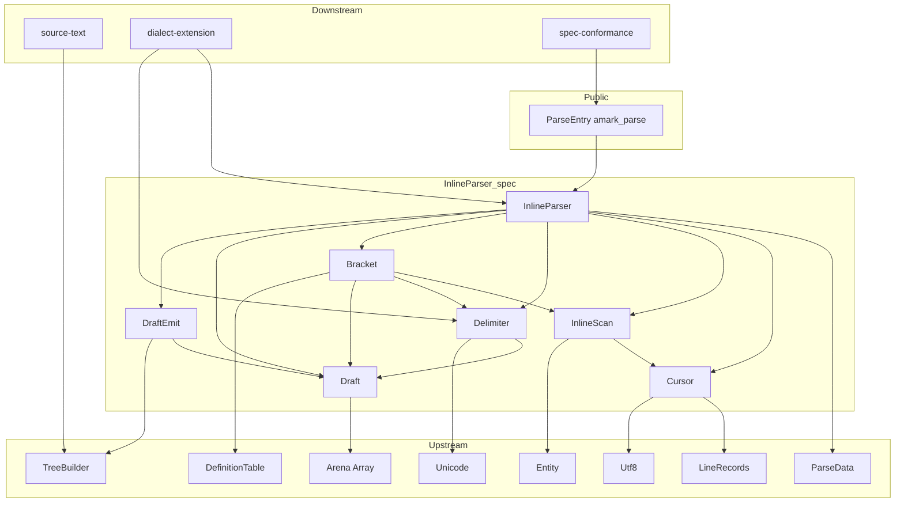
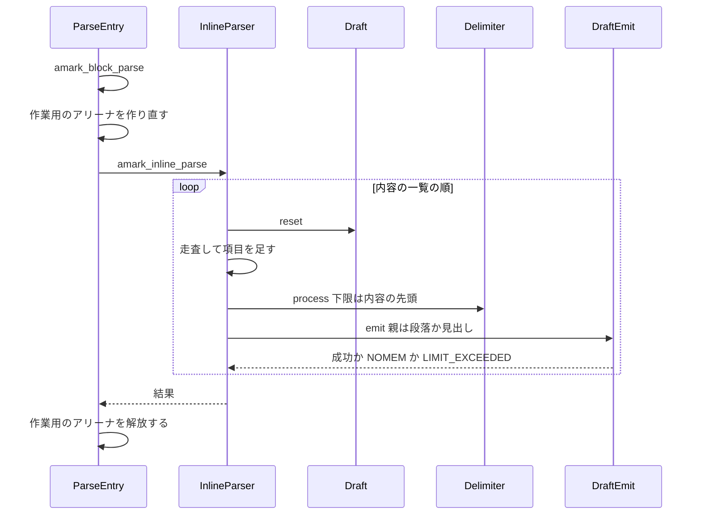
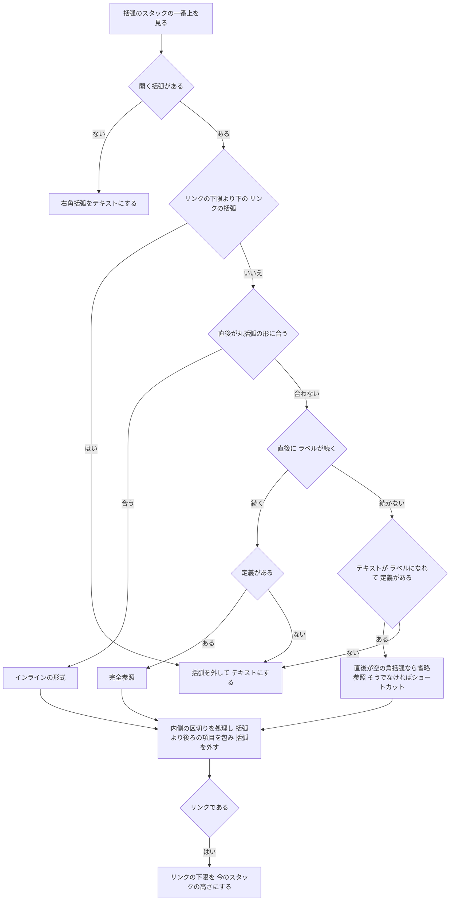

# Design Document

## Overview

**Purpose**: inline-parser は、CommonMark 0.31.2 のインライン構造の解析を作る。利用者は、`amark_parse` を 1 回呼ぶだけで、ブロックとインラインの両方を持つ木を受け取れるようになる。

**Users**: 利用者は、これまでと同じ公開の関数（`amark_parse` と、たどる API）を使う。下流の開発者（source-text、dialect-extension、spec-conformance）は、この spec が定めるインラインのノードの範囲と属性を読み、dialect-extension は、起動文字と区切りの種類を足す箇所を使う。

**Impact**: `amark_parse` が返す文書の段落と見出しに、インラインの子が加わる。公開ヘッダと公開シンボルは変わらない。入れ子の深さとノードの数の上限は、インラインのノードも数える。そのため、`amark_parse` を通してノードの数と深さを確かめる既存のテストの期待値が変わる。project-foundation の `array` に、小さな関数を 1 つ足す。

### Goals
- 段落と見出しの内容を、再帰を使わず、内容の長さにほぼ比例する時間で、インラインのノードにする。
- すべての範囲を、利用者が渡した内容のオフセットで表す。写しは作らない。
- 木に足すノードを、最終の形に決まったものだけにする。足してから取り除くノードを作らない。
- 失敗したときは、`amark_parse` の既存の後始末だけで、確保したものがすべて解放される。

### Non-Goals
- エスケープと文字参照を文字に戻すこと、dest・title・コードスパンの中身の意味上の値（source-text）
- URL の正規化、HTML のエスケープ、画像の代替テキスト（spec-conformance のテスト用の出力）
- 方言を登録する公開 API、規則の呼び出しの契約、結果の検査（dialect-extension）
- GFM の拡張（取り消し線、拡張オートリンク）
- spec.txt の全例を HTML と比べること（spec-conformance）
- `refdef.c`、`definition.c`、`scan.c` の作り直し（行をまたぐ読み方や dest と title の規則を、共通の部品にまとめ直すこと）

## Boundary Commitments

### This Spec Owns
- インラインの規則のすべて：起動文字の走査、コードスパン、エスケープ、文字参照、オートリンク、生の HTML、強調、リンクと画像、改行、テキスト
- インラインのノードの範囲と属性を定めること（「範囲の決まり」の表）
- 参照の形式のリンクと画像の解決（どのラベルで、どの定義を引くか）
- 内部の関数 `amark_inline_parse` と、それを `amark_parse` から呼ぶ 1 か所
- 入れ子の深さとノードの数の上限を、インラインのノードに適用すること
- 時間を線形に保つための記録（区切りの下限、バッククォートの列の位置、閉じない HTML の打ち切り、リンクの下限）
- 起動文字の表と区切りの種類の表（方言の規則を足す箇所）
- テストの支援 `amark_test_dump_tree`（木の全体を 1 行の文字列にする）

### Out of Boundary
- 行の記録、内容の範囲、ラベルの走査と正規化、定義の表の中身と作り方（block-parser）。この spec は読むだけである。
- 木の表し方、不変条件の定義、属性の読み出しの公開 API（syntax-tree）
- 範囲から文字列を作ること（source-text）
- `struct amark_dialect` の中身と、方言の規則の呼び出し（dialect-extension）。この spec は、設定の `dialect` を読まない。
- spec.txt をリポジトリに置くこと、例を取り出すスクリプト（spec-conformance）

### Allowed Dependencies
- block-parser：`parse_data`（`amark_inline_content_count`、`amark_inline_content_at`）、`line`（`amark_line_bounds`、`amark_line_get`）、`definition`（`amark_label_scan`、`amark_definitions_find`）。`refdef`、`scan`、`block` は使わない。
- syntax-tree：`document`、`tree_internal`（`amark_tree_append` と属性の設定だけ。`amark_tree_wrap`、`amark_tree_remove`、`amark_tree_set_range`、`amark_tree_set_kind`、`amark_tree_insert_before` は使わない）、`config_internal`、`tree_check`（テストだけ）、公開の型とたどる API（`amark_node_parent`）
- project-foundation：`arena`、`array`、`utf8`（`amark_utf8_decode_lossy`）、`line_index`（`amark_line_index_line_at`）
- unicode-tables：`unicode`（`amark_unicode_is_punctuation`、`amark_unicode_is_whitespace`）、`entity`（`amark_entity_lookup`）
- C99 の標準ヘッダ：`stdbool.h`、`stddef.h`、`stdint.h`、`string.h`
- 依存の向きは次のとおりで、左のものだけが右のものを取り込む。
  - `parse → inline → bracket → delimiter → draft`
  - `bracket → inline_scan → cursor`
  - `delimiter` と `draft` は、`cursor` と `inline_scan` を取り込まない。木を作る API（`tree_internal`）を取り込むのは `draft` だけである。
- 上流への変更は、次の 2 つに限る。どちらも、既存の関数の契約は変えない。
  - `src/array.h`・`src/array.c`：`amark_array_clear` を足す。
  - `src/parse.c`：`amark_inline_parse` の呼び出しを足す。

### Revalidation Triggers
次の変更は、下流の spec（source-text、dialect-extension、spec-conformance）の見直しを要する。
- インラインのノードの範囲の決まりと、属性の範囲（dest、title）の決まりの変更
- テキストをまとめる決まり、改行のノードの範囲の決まりの変更
- 参照を解決する順（インライン、完全参照、省略参照、ショートカット）と、ラベルとして認める条件の変更
- 入れ子の深さとノードの数の数え方の変更
- 起動文字の表、区切りの種類の表、項目の木（`amark_draft_item_t`）の形の変更（dialect-extension だけ）
- ノードの ID の付く順（内容ごとに、文書の順）の変更

## Architecture

### Existing Architecture Analysis
- `amark_parse` は、`amark_block_parse` の後で作業用のアリーナを解放する。インラインの解析は、この間に足す。失敗したときの文書の破棄は、すでに `parse.c` にある。
- block-parser は、段落と見出しごとに、内容の範囲を文書の順の一覧にしている。行の記録は、各行の内容が始まる位置（プレフィックスと先頭の空白の後）を持つ。段落の続きの行は先頭の空白が除かれているので、内容の範囲の中の行では `pad` は 0 である。
- `amark_document_node_count` は、取り除いたノードも数える。`block.c` は、ノードを足す前にこの数を上限と比べる。ノードの配列の要素は再利用されない。
- `amark_tree_wrap` は、包まれる側の子孫を 1 段深くする。深さの上限を、ノードを足す時点だけで調べることができない。
- 行をまたぐ読み方（行末で、次の行の `content_start` へ進む）は、`refdef.c` と `definition.c` が `static` で持つ。dest と title の読み方も `refdef.c` の `static` である。`scan.c` のタグの判定は、1 行の中だけを読む。
- `checks.objects` は、可変の静的データと、ポインタを含む const の表を禁じる。起動文字の表と区切りの種類の表は、ポインタを含まない const の配列にする。処理の振り分けは `switch` で行う。
- デコードは、設定によらず `amark_utf8_decode_lossy` を使う（`definition.c` と同じ）。正しい UTF-8 では結果が同じである。

### Architecture Pattern & Boundary Map

方式は「項目の木を作業用に作り、対応が決まってから、木へ書き出す」の 2 段である。

1. **走査**：内容を前から 1 回読み、項目（テキスト、コードスパン、区切りの列、括弧など）を、作業用のアリーナの「項目の木」に足す。区切りの対応（cmark の区切りのスタック）と括弧の対応（括弧のスタック）は、この項目の木の上で決める。
2. **書き出し**：項目の木を文書の順にたどり、`amark_tree_append` でノードを足す。このとき、隣り合うテキストをまとめ、深さとノードの数の上限を確かめる。



**Architecture Integration**:
- Selected pattern：区切りのスタックと括弧のスタック（cmark と同じ規則）を、作業用の項目の木の上で動かし、決まった結果だけを木へ書き出す。
- Domain/feature boundaries：読む（Cursor、InlineScan）、対応を決める（Delimiter、Bracket）、持つ（Draft）、木に書く（DraftEmit）、順に動かす（InlineParser）を分ける。木を作る API に触れるのは DraftEmit（`draft.c` の `amark_draft_emit`）だけである。
- Existing patterns preserved：2 段階の解析、作業用のアリーナ、文書が資源の持ち主、再帰なし、失敗は戻り値、`switch` による振り分け。
- New components rationale：下の「Components and Interfaces」の各節に書く。
- Steering compliance：規則は設定で変えられない。グローバルな状態を持たない。原文を複製しない。

**主な決定**（背景と比べた案は `research.md`）:

| 決定 | 内容 | 理由 |
|------|------|------|
| 項目の木を作ってから書き出す | 区切りと括弧を、まず作業用の項目にする。木には最終のノードだけを足す | 取り除くノードがないので、ノードの数の上限が最終の木の大きさと一致する。深さは書き出すときに分かる。ノードの ID が文書の順になる |
| 上流の走査を作り直さない | 行をまたぐカーソル、dest と title、タグの走査を、この spec の中に新しく書く | 承認済みの block-parser のコードとテストに触れない。規則の重複は、単体テストで両方を同じ例に通して抑える |
| dest の丸括弧は 32 段まで | 山括弧で囲まない dest の丸括弧の入れ子に、上限 32 を置く | 上限がないと、`[a](b` の繰り返しで時間が 2 乗になる。仕様は上限を認めている（3 段以上）。cmark と同じ値である。要件 8.6 を直した |
| 直前の文字は、その場で後ろへ読む | 区切りの列の直前の文字を、最大 3 バイト戻って求める | 後ろ向きのデコードを上流に足さずに済む。不正なバイト列は U+FFFD になる |
| 段落の深さは親をたどって数える | 深さの上限が指定されているときだけ、段落から根まで親をたどる | block-parser の一覧の形を変えない。深さの合計は内容の長さに比例する（「Performance & Scalability」） |

### Technology Stack

| Layer | Choice / Version | Role in Feature | Notes |
|-------|------------------|-----------------|-------|
| Language | C99 | 実装のすべて | コンパイラの拡張なし。`assert` は使わない |
| Build | CMake（既存） | `AMARK_SOURCES` にファイルを足す | 新しい依存はない |
| Test | Naos v0.4.0（既存） | 単体テストと公開 API のテスト | |
| 仕様 | CommonMark 0.31.2 | インラインの規則の出どころ（6 章と付録） | spec.txt はリポジトリに置かない。例はテストのコードに写す |
| 参考の実装 | cmark 0.31.1 の `inlines.c`、`test/pathological_tests.py` | 流れ、線形に保つ工夫、病的な入力の一覧の参考 | コードは写さない |

## File Structure Plan

### Directory Structure
```
src/
├── inline.h                # InlineParser：amark_inline_parse
├── inline.c                #   内容ごとの繰り返し、起動文字の振り分け、テキストと改行
├── inline_scan.h           # InlineScan：構文の形を読む関数（木も項目も作らない）
├── inline_scan.c           #   コードスパン、文字参照、オートリンク、生の HTML、リンクの丸括弧の部分
├── cursor.h                # Cursor：行の内容を順に読む位置と、前後の文字
├── cursor.c
├── draft.h                 # Draft：作業用の項目の木（下書き）と、文書の木への書き出し
├── draft.c
├── delimiter.h             # Delimiter：区切りの種類、開閉の判定、区切りのスタック、強調の対応
├── delimiter.c
├── bracket.h               # Bracket：括弧のスタック、`]` の処理、参照の解決
└── bracket.c
tests/
├── support/
│   ├── tree_dump.h         # amark_test_dump_tree を足す
│   └── tree_dump.c
└── unit/
    ├── test_cursor.c          # Cursor
    ├── test_inline_scan.c     # InlineScan
    ├── test_draft.c           # 項目の木の操作、書き出し、テキストのまとめ、上限
    ├── test_delimiter.c       # 開閉の判定と、強調の対応
    ├── test_bracket.c         # リンクと画像、参照の解決（amark_parse を通す）
    ├── test_inline.c          # 種類ごとの範囲と属性（amark_parse を通す）
    ├── test_inline_limits.c   # 上限、深い入れ子、病的な入力、確保の失敗の注入
    ├── test_spec_inline.c     # spec.txt の例：強調とリンクと画像を除く 9 つの節
    ├── test_spec_emphasis.c   # spec.txt の例：Emphasis and strong emphasis
    └── test_spec_links.c      # spec.txt の例：Links、Images
```

- 名前は、既存の `block.c`、`scan.c`、`refdef.c`、`definition.c`、`line.c` にならい、扱うものを 1 語で表す。`inline.c` は `block.c` と対になる。`scan.c` はブロックの判定で使われているので、インラインの走査は `inline_scan.c` とする（`tree.c` と `tree_check.c` の形）。関数と型の名前は、ファイルの名前を前に付ける（`amark_cursor_*`、`amark_draft_*`、`amark_delimiter_*`、`amark_bracket_*`、`amark_inline_scan_*`）。リンクの処理を `link.c` としないのは、公開の `amark_link_*`（属性の読み出し）と名前が紛れるからである。
- どのファイルも 600 行前後までに収める見込みである。`inline_scan.c` は生の HTML の文法を持つので、いちばん大きくなる。

### Modified Files
- `src/parse.c` — `amark_block_parse` の後で、作業用のアリーナを作り直し、`amark_inline_parse` を呼ぶ。
- `src/CMakeLists.txt` — `AMARK_SOURCES` に 6 つの `.c`（`bracket.c`、`cursor.c`、`delimiter.c`、`draft.c`、`inline.c`、`inline_scan.c`）を足す。
- `src/array.h`、`src/array.c` — `amark_array_clear`（長さを 0 に戻す。確保した場所は保つ）を足す。
- `tests/unit/test_array.c` — `amark_array_clear` のテストを足す。
- `tests/support/tree_dump.h`、`tests/support/tree_dump.c` — `amark_test_dump_tree` を足す。`amark_test_dump_blocks` は変えない。
- `tests/unit/test_tree_dump.c` — インラインの書式のテストを足す。
- `tests/CMakeLists.txt` — 上の単体テストを登録する。
- `tests/unit/test_block_limits.c` — `amark_parse` を通す深さとノードの数の期待値を、インラインのノードを含む値に直す（段落のテキストは、段落より 1 段深く、1 つ多い）。
- `tests/unit/test_parse.c` — ノードの数に触れる注釈と、上限の境の値を直す。
- `tests/public/test_parse.c` — 文書の順のノードの表に、インラインのノードを足す。
- `.kiro/specs/inline-parser/requirements.md` — 要件 8.6 を直す（丸括弧の入れ子は 32 段まで）。
- `.kiro/specs/project-foundation/design.md` — `amark_array_clear` を反映する（Array の節）。
- `.kiro/specs/syntax-tree/design.md` — TreeBuilder の Integration の注記を直す（inline-parser は `amark_tree_append` だけを使う）。

`tests/checks/exported_symbols.txt` と公開ヘッダは変えない（18.7）。`test_block.c`（`amark_block_parse` を直接呼ぶ）と、`amark_test_dump_blocks` を使う `test_spec_*.c` は変えない（19.11）。

## System Flows

### 解析の入口と、内容 1 つの処理



- 長さ 0 の内容は飛ばす（1.4）。
- どこかで失敗したら、そのまま戻る。途中の木は直さない。`parse.c` が、作業用のアリーナの解放と `amark_document_destroy` で後始末をする（16.7）。
- 項目、区切りのスタック、括弧のスタックの配列は、内容ごとに `amark_array_clear` で空にして使い回す。作業用のメモリは、いちばん大きい内容に比例する量で済む。

### 走査の 1 歩

走査は、カーソルが内容の終わりに着くまで、次の振り分けを繰り返す。振り分けは `inline.c` の 1 つの関数にまとめる（17.1）。

| カーソルの位置 | 処理 | できる項目 |
|----------------|------|------------|
| 行の内容の終わり（内容の終わりではない） | 改行の種類を決め、次の行へ進む | ハードな改行、ソフトな改行 |
| `\` | 次が ASCII の句読点ならエスケープ。次が行の内容の終わりで、内容の終わりではないなら、ハードな改行。ほか（内容の最後のバイトを含む）はテキスト | エスケープ、ハードな改行、テキスト |
| `` ` `` | 列の長さを数え、同じ長さの閉じる列を探す | コードスパン、テキスト（列の全体） |
| `&` | 文字参照の形を読む | 文字参照、テキスト（`&`） |
| `<` | オートリンク、生の HTML の順に試す | オートリンク、生の HTML、テキスト（`<`） |
| `*`、`_` | 列を数え、開閉を判定し、区切りのスタックに積む | テキスト（区切りの列。後で縮むか消える） |
| `[` | 括弧のスタックに積む | テキスト（`[`） |
| `!` | 次が `[` なら、画像として括弧のスタックに積む | テキスト（`![` か `!`） |
| `]` | 「`]` の処理」の流れ | リンク、画像、テキスト（`]`） |
| それ以外 | 次の起動文字か行の内容の終わりまでを読む | テキスト |

- 起動文字かどうかは、256 個の表（`special`）で引く。表は、ポインタを含まない const の配列を、解析の状態へ写したものである。
- テキストが行の内容の終わりに着いたときは、末尾に連続する空白（スペースとタブ）をテキストから外し、その最初の位置を「改行の開始」として覚える（3.5、13.4）。外した結果、長さが 0 になるテキストは作らない（3.6）。「改行の開始」は、行ごとに初めへ戻す。
- 改行の項目の範囲は、「改行の開始」（なければ行の内容の終わり）から、その行の行末記号の直後までである。行末記号の直前にスペースが 2 つ以上続けばハード、そうでなければソフトである（13.1、13.3）。`\` による改行は、`\` から行末記号の直後までである（13.2）。次の行のプレフィックスと先頭の空白は、どの項目にも入らない（13.5）。
- コードスパン、生の HTML、リンクの丸括弧の部分、完全参照のラベルは、1 つの関数が行をまたいで読み切るので、その中の行末記号は改行の項目にならない（13.7）。

### `]` の処理



- 順は、インライン、完全参照、省略参照、ショートカットである（9.10）。完全参照のラベルに定義がないときは、ショートカットを試さず、`]` をテキストにする。カーソルは `]` の直後に戻るので、続くラベルは、それ自身が括弧として走査される（9.7）。
- 「直後に `[` があるが、ラベルの形に合わない」ときは、ラベルが続かないものとして、ショートカットを試す。`[]` は省略参照である。`[ ]` のように空白だけのものは、ラベルでも `[]` でもないので、ショートカットを試す（9.8）。
- 「テキストがラベルになれる」は、開く `[` から `amark_label_scan` を呼び、結果の終わりが今の `]` と一致することで判定する（9.8、9.9）。テキストの中に角括弧があれば、走査はそこで止まる。
- **リンクの下限**：リンク（画像ではない）ができたとき、括弧のスタックに残っているリンクの括弧は、すべて無効になる（8.10）。これを、スタックをたどらずに、「高さがこの値より下のリンクの括弧は無効」という 1 つの値で表す。括弧を外して高さが下限より低くなったら、下限を高さまで下げる。画像の括弧は、下限によらず有効である（10.4）。
- 括弧を外すとき、括弧のテキストの項目（`[` や `![`）は、リンクができた場合だけ項目の木から取り除く。

## Requirements Traceability

| Requirement | Summary | Components | Interfaces | Flows |
|-------------|---------|------------|------------|-------|
| 1.1, 1.2, 1.3, 1.4, 1.5, 1.6 | 入口への統合、解析する対象 | ParseEntry、InlineParser | `amark_inline_parse`、`amark_inline_content_at` | 解析の入口 |
| 1.7, 1.8, 1.9, 1.10 | 失敗しない、不変条件、たどる API、複製しない | InlineParser、DraftEmit | `amark_tree_append`、属性の設定 | 解析の入口 |
| 2.1, 2.2, 2.3, 2.4, 2.5, 2.6, 2.7 | 範囲の決まり | Draft、DraftEmit、InlineParser | 「範囲の決まり」の表 | 走査の 1 歩 |
| 3.1, 3.2, 3.4, 3.5, 3.7 | テキスト | InlineParser | 走査の振り分け | 走査の 1 歩 |
| 3.3, 3.6 | テキストをまとめる、長さ 0 を作らない | DraftEmit、Draft | `amark_draft_emit`、`amark_draft_remove` | — |
| 4.1, 4.2, 4.3, 4.4, 4.5 | エスケープ | InlineParser | 走査の振り分け | 走査の 1 歩 |
| 4.6 | dest と title の中のエスケープ | InlineScan | `amark_inline_scan_link_tail` | `]` の処理 |
| 5.1, 5.2, 5.3, 5.4, 5.5, 5.6, 5.7 | 文字参照 | InlineScan、InlineParser | `amark_inline_scan_entity` | 走査の 1 歩 |
| 5.8 | dest と title の中の文字参照 | InlineScan | `amark_inline_scan_link_tail` | — |
| 6.1, 6.2, 6.3, 6.4, 6.5, 6.6, 6.7 | コードスパン | InlineScan、InlineParser | `amark_inline_scan_code_span` | 走査の 1 歩 |
| 7.1, 7.2, 7.3 | 開閉の判定 | Cursor、Delimiter | `amark_cursor_char_before`、`amark_cursor_char_at`、`amark_delimiter_classify` | 走査の 1 歩 |
| 7.4, 7.5, 7.6, 7.7, 7.8, 7.9, 7.10 | 強調の対応 | Delimiter、Draft | `amark_delimiters_process`、`amark_draft_wrap` | — |
| 7.11 | リンクの境をまたがない | Bracket、Delimiter | `amark_delimiters_process` の下限 | `]` の処理 |
| 8.1, 8.2, 8.3, 8.4, 8.5, 8.6, 8.7 | インラインの形式 | InlineScan、Bracket | `amark_inline_scan_link_tail` | `]` の処理 |
| 8.8, 8.9, 8.10 | 合わないとき、角括弧の対応、リンクの中のリンク | Bracket | `amark_bracket_close`、リンクの下限 | `]` の処理 |
| 9.1, 9.2, 9.3, 9.4, 9.5, 9.6, 9.7, 9.8, 9.9, 9.10, 9.11, 9.12, 9.13 | 参照の形式と解決 | Bracket | `amark_label_scan`、`amark_definitions_find` | `]` の処理 |
| 10.1, 10.2, 10.3, 10.4, 10.5, 10.6, 10.7 | 画像 | Bracket、InlineParser | `amark_brackets_push`、`amark_bracket_close` | `]` の処理 |
| 11.1, 11.2, 11.3, 11.4, 11.5 | オートリンク | InlineScan | `amark_inline_scan_autolink` | 走査の 1 歩 |
| 12.1, 12.2, 12.3, 12.4, 12.5, 12.6 | 生の HTML | InlineScan | `amark_inline_scan_html` | 走査の 1 歩 |
| 13.1, 13.2, 13.3, 13.4, 13.5, 13.6, 13.7, 13.8, 13.9 | 改行 | InlineParser、Cursor | `amark_cursor_line_break_end`、`amark_cursor_next_line` | 走査の 1 歩 |
| 14.1, 14.2, 14.3, 14.4 | 優先の順 | InlineParser、Bracket | 走査の順、`]` の処理 | 走査の 1 歩 |
| 15.1, 15.2, 15.3 | 行の内容だけを読む | Cursor | `amark_cursor_*` | — |
| 15.4, 15.5, 15.6, 15.7, 15.8 | 不正なバイト列と U+0000 | Cursor、DefinitionTable | `amark_utf8_decode_lossy` | — |
| 16.1, 16.2, 16.3, 16.4, 16.5 | 深さとノードの数 | DraftEmit、Draft | `amark_draft_emit` | 解析の入口 |
| 16.6, 16.7, 16.8, 16.9, 16.10 | 失敗の扱いとメモリ | ParseEntry、InlineParser | `amark_inline_parse` | 解析の入口 |
| 17.1, 17.2, 17.3, 17.4, 17.5, 17.6 | 方言の箇所 | InlineParser、Delimiter、Draft | `special` の表、`amark_delimiter_kind_t`、項目の `kind` | 走査の 1 歩 |
| 18.1, 18.2, 18.3 | 時間、メモリ、再帰なし | すべて | 「Performance & Scalability」 | — |
| 18.4, 18.5, 18.6, 18.7 | 状態なし、決定性、並行、公開シンボル | すべて | リポジトリの検査 | — |
| 19.1, 19.2, 19.3, 19.4, 19.5, 19.6, 19.7, 19.8, 19.9, 19.10, 19.11 | 単体テスト | TreeDump、各テスト | `amark_test_dump_tree` | 「Testing Strategy」 |

## Components and Interfaces

| Component | Domain/Layer | Intent | Req Coverage | Key Dependencies (P0/P1) | Contracts |
|-----------|--------------|--------|--------------|--------------------------|-----------|
| InlineParser | 内部 | 内容ごとに走査し、項目を作り、書き出す | 1, 3, 4, 13, 14, 16.6〜16.10, 17.1, 17.4, 17.5, 17.6 | すべての Inline の部品、ParseData (P0) | Service、State |
| Cursor | 内部 | 行の内容を順に読む位置と、前後の文字 | 7.1, 7.2, 13.5, 15 | LineRecords、Utf8 (P0) | Service |
| InlineScan | 内部 | 構文の形を読む | 4.6, 5, 6, 8.1〜8.7, 11, 12 | Cursor、Entity (P0) | Service、State |
| Draft | 内部 | 作業用の項目の木 | 2, 3.6, 17.3 | Arena、Array (P0) | Service、State |
| Delimiter | 内部 | 区切りの開閉と、強調の対応 | 7, 17.2 | Draft、Unicode (P0) | Service、State |
| Bracket | 内部 | 括弧の対応と、参照の解決 | 8.8〜8.10, 9, 10 | InlineScan、Delimiter、Draft、DefinitionTable (P0) | Service、State |
| DraftEmit | 内部（`draft.c`） | 項目の木を、文書の木へ書き出す | 1.8, 1.9, 2, 3.3, 16.1〜16.5 | Draft、TreeBuilder (P0) | Service |
| 上流への追加 | 内部 | 配列を空にする関数、入口の呼び出し | 1.1, 18.2 | — | Service |
| TreeDump | テストの支援 | 木の全体を 1 行の文字列にする | 19.1 | 公開のたどる API (P0) | Service |

どの関数も、再帰を使わず、グローバルな状態を持たない。失敗する関数は `amark_error_t` を返し、失敗は `AMARK_ERROR_NOMEM`（確保の失敗）か `AMARK_ERROR_LIMIT_EXCEEDED`（上限、大きさの計算のあふれ）である。

### 範囲の決まり

位置はすべて、内容の先頭から数えたバイトのオフセットである。

| 種類 | 範囲の開始 | 範囲の終了 | 子 | 属性 |
|------|-----------|-----------|----|------|
| テキスト | 最初のバイト | 最後のバイトの直後。1 行の中。行末の空白を含まない | なし | — |
| バックスラッシュのエスケープ | `\` | 句読点の直後（2 バイト） | なし | — |
| 文字参照 | `&` | `;` の直後 | なし | — |
| コードスパン | 開く列の最初 | 閉じる列の直後 | なし | — |
| 強調 | 使った開く区切り（1 つ） | 使った閉じる区切り（1 つ）の直後 | 間の項目 | — |
| 強い強調 | 使った開く区切り（2 つ） | 使った閉じる区切り（2 つ）の直後 | 間の項目 | — |
| リンク | `[` | インラインは `)` の直後。完全参照と省略参照は 2 つ目の `]` の直後。ショートカットは `]` の直後 | テキストの中の項目 | 形式。インラインは dest と title。参照は定義のノード |
| 画像 | `!` | リンクと同じ | 説明の中の項目 | リンクと同じ |
| オートリンク | `<` | `>` の直後 | なし | URI かメールアドレス |
| 生の HTML | `<` | 最後の `>` の直後 | なし | — |
| ハードな改行 | 行末の空白の最初、または `\` | 行末記号の直後 | なし | — |
| ソフトな改行 | 行末の空白の最初（なければ行末記号） | 行末記号の直後 | なし | — |

- 区切りの列の一部だけを使うとき、開く列は右側（内側）から、閉じる列は左側（内側）から使う。残りは外側に残り、テキストになるか、外側の強調に使われる（7.7、7.8）。
- dest の範囲は、山括弧で囲む書き方では山括弧の内側、囲まない書き方ではその全体である。title の範囲は区切りの内側である。`<>` と空の title は長さ 0 の範囲、書かれていないものは「なし」である（8.2〜8.5）。`[a]()` の dest は「なし」である。
- 行の内容のバイトは、必ず、段落か見出しの直接の子のどれかの範囲に入る（2.3）。どの項目にも入らないのは、行のプレフィックスと先頭の空白だけである。
- 境は、ASCII の起動文字、行の内容の端、行末記号の直後のどれかにしか置かない。UTF-8 の文字の途中と、CR と LF の間では区切らない（2.7）。

### 内部：読む

#### Cursor

| Field | Detail |
|-------|--------|
| Intent | 内容の範囲を、行の内容だけをたどって読む位置。区切りの前後の文字も返す |
| Requirements | 7.1, 7.2, 13.5, 15.1, 15.2, 15.3, 15.4, 15.5, 15.6, 15.7, 15.8 |

**Responsibilities & Constraints**
- 位置は、常に、ある行の内容の中か、その行の内容の終わりにある。プレフィックスと行の先頭の空白の中には止まらない。
- 値として写せる（構造体の代入）。試して戻すときは、写しを取っておいて戻す。
- 確保せず、失敗しない。文書も内容も変えない。

**Dependencies**
- Outbound: LineRecords — 行の境と記録 (P0)
- Outbound: Utf8 — `amark_utf8_decode_lossy` (P0)

**Contracts**: Service [x]

##### Service Interface
```c
/* src/cursor.h */
typedef struct amark_cursor {
    const amark_document_t *doc;
    const unsigned char *bytes; /* 内容 */
    size_t limit;      /* 内容の範囲の終わり */
    size_t pos;        /* 今の位置。line_start <= pos <= line_end */
    size_t line;       /* pos のある行の番号 */
    size_t line_start; /* その行の内容の始まり（最初の行では範囲の始まり） */
    size_t line_end;   /* その行の内容の終わり。最後の行では limit */
} amark_cursor_t;

void amark_cursor_init(amark_cursor_t *cursor,
                       const amark_document_t *doc,
                       size_t start, size_t limit);

/* pos == limit */
bool amark_cursor_at_end(const amark_cursor_t *cursor);
/* pos == line_end。at_end でなければ、行末記号が続く */
bool amark_cursor_at_line_end(const amark_cursor_t *cursor);

/* 今の行の行末記号の直後（次の行の最初のバイト）の位置 */
size_t amark_cursor_line_break_end(const amark_cursor_t *cursor);

/* 次の行の内容の始まりへ進む。at_line_end で、at_end でないこと */
void amark_cursor_next_line(amark_cursor_t *cursor);

/* 今の位置以降の pos へ進む。pos は、ある行の内容の中か終わりで、limit 以下 */
void amark_cursor_seek(amark_cursor_t *cursor, size_t pos);

/* pos の直前の文字。pos が行の内容の始まりなら U+000A */
uint32_t amark_cursor_char_before(const amark_cursor_t *cursor,
                                  size_t pos);
/* pos にある文字。pos が行の内容の終わりなら U+000A */
uint32_t amark_cursor_char_at(const amark_cursor_t *cursor,
                              size_t pos);
```
- Preconditions: `start <= limit`。`[start, limit)` は、block-parser が用意した内容の範囲で、その行の記録は書かれている。`char_before` と `char_at` の `pos` は、今の行の `line_start` 以上 `line_end` 以下である。
- Postconditions: `next_line` の後、`pos` は次の行の `content_start` である。`seek` は、行を前から順に進めて、`pos` のある行を見つける（進んだ行の数に比例する時間）。
- `char_before` は、`pos` から最大 3 バイトの継続バイトを戻り、そこから `amark_utf8_decode_lossy` で読む。読んだ長さが `pos` にちょうど届けばその文字、届かなければ U+FFFD を返す。`char_at` は、`line_end` までを長さとして `amark_utf8_decode_lossy` で読む。どちらも、U+0000 を U+FFFD にして返す（15.4、15.5）。
- 内容の範囲の先頭と末尾は、行の内容の始まりと終わりでもあるので、U+000A（空白）として働く（7.2）。

**Implementation Notes**
- Integration: `refdef.c` と `definition.c` の行の進み方と同じ決まり（行末で、次の行の `content_start` へ進む）である。テストで、複数の行にわたるラベルを例に、`amark_label_scan` の結果と同じ位置を通ることを確かめる。
- Risks: 内容の範囲の中の行で `pad` が 0 でないと、タブの残りの桁を読み落とす。block-parser の決まりでは起きないので、テストで `pad` が 0 であることを確かめる。

#### InlineScan

| Field | Detail |
|-------|--------|
| Intent | 構文の形を読み、終わりの位置と部分の範囲を返す。項目も木も作らない |
| Requirements | 4.6, 5.1, 5.2, 5.3, 5.4, 5.5, 5.7, 5.8, 6.1, 6.2, 6.3, 6.5, 8.1, 8.2, 8.3, 8.4, 8.5, 8.6, 8.7, 11.1, 11.2, 11.4, 12.1, 12.2, 12.3, 12.5 |

**Responsibilities & Constraints**
- 各関数は、カーソルが構文の最初のバイト（`` ` ``、`&`、`<`、`(`）にある状態で呼ぶ。合えば、カーソルを構文の直後へ進めて `true` を返す。合わなければ、カーソルを動かさずに `false` を返す。
- 行をまたぐ構文は、カーソルで行の内容だけを読む。プレフィックスの中のバイトは読まない（6.5、8.7、12.3）。
- 時間を線形に保つための記録（`amark_inline_scan_memo_t`）を持つ。記録は、内容ごとに初期化する。

**Dependencies**
- Inbound: InlineParser、Bracket (P0)
- Outbound: Cursor (P0)、Entity — `amark_entity_lookup` (P0)

**Contracts**: Service [x] / State [x]

##### Service Interface
```c
/* src/inline_scan.h */
typedef struct amark_inline_scan_memo {
    amark_array_t backticks;   /* size_t。添字は列の長さ。その長さの列を最後に見た位置 */
    bool backticks_complete;   /* この内容で、終わりまで探したことがある */
    unsigned html_no_end;      /* コメント、処理命令、宣言、CDATA の「この先に終わりがない」印 */
} amark_inline_scan_memo_t;

void amark_inline_scan_memo_init(amark_inline_scan_memo_t *memo,
                                 amark_arena_t *scratch);
/* 内容ごとに呼ぶ。backticks の配列は空にしない（下の説明） */
void amark_inline_scan_memo_begin(amark_inline_scan_memo_t *memo);

/* カーソルは開く列の最初。open_length は列の長さ。
   *found が true なら、カーソルは閉じる列の直後。false なら動かない。
   失敗するのは、記録の配列を伸ばせなかったときだけ */
amark_error_t amark_inline_scan_code_span(amark_cursor_t *cursor,
                                          amark_inline_scan_memo_t *memo,
                                          size_t open_length, bool *found);

/* `&` から `;` まで。1 行の中だけ */
bool amark_inline_scan_entity(amark_cursor_t *cursor);

/* `<` から `>` まで。1 行の中だけ */
bool amark_inline_scan_autolink(amark_cursor_t *cursor,
                                amark_autolink_type_t *type);

/* `<` から最後の `>` まで。6.6 節の 6 つの形 */
bool amark_inline_scan_html(amark_cursor_t *cursor,
                            amark_inline_scan_memo_t *memo);

typedef struct amark_link_tail {
    bool has_destination;
    amark_range_t destination;
    bool has_title;
    amark_range_t title;
} amark_link_tail_t;

/* `(` から `)` まで */
bool amark_inline_scan_link_tail(amark_cursor_t *cursor,
                                 amark_link_tail_t *out);

/* dest の丸括弧の入れ子の上限 */
#define AMARK_LINK_DEST_PAREN_MAX 32
```

- **コードスパン**：閉じる列は、前後がバッククォートでない、同じ長さの列である。探しながら、見た列の長さごとに、その開始位置を `backticks` に書く。`backticks_complete` が立っていて、`backticks[open_length]` が今の位置以下なら、探さずに「ない」と答える。内容の終わりまで探して見つからなかったら、`backticks_complete` を立てる。
  - `backticks` は、長さを添字とする配列で、必要な長さまで伸ばす（伸ばした分は 0 で埋める）。列の長さに上限は置かない（6.1）。配列の大きさは、内容のバイト数以下である。
  - `backticks` は、内容が変わっても空にしない。位置は内容の先頭から数えたオフセットで、内容は文書の順に処理するので、前の内容の値は、今の位置より必ず小さい。「今の位置以下なら、ない」の判定で、古い値は自然に無視される。
- **文字参照**：`&#` と 1〜7 桁の 10 進の数字と `;`、`&#x`（`&#X`）と 1〜6 桁の 16 進の数字と `;`、`&` と ASCII の英数字の並びと `;` で、並びが `amark_entity_lookup` で見つかるもの。数値は、値が有効かどうかを見ない（5.4）。英数字の並びは、英数字でないバイトで止まるので、`&` ごとに読む長さは、その並びの長さで抑えられる。
- **オートリンク**：`<`、絶対 URI（ASCII の英字で始まり、英数字と `+`、`.`、`-` が続く、2〜32 文字のスキーム、`:`、空白と `<` と `>` と ASCII の制御文字を含まない並び）、`>`。または、`<`、メールアドレス（仕様の正規表現のとおり）、`>`。URI を先に試す。
- **生の HTML**：開始タグ、終了タグ、コメント（`<!-->`、`<!--->`、`<!--` から最初の `-->` まで）、処理命令（`<?` から最初の `?>` まで）、宣言（`<!` と ASCII の英字から、最初の `>` まで）、CDATA セクション（`<![CDATA[` から最初の `]]>` まで）。タグの中の空白は、スペース、タブ、行末記号である。引用符で囲んだ属性の値は、行をまたげる。
  - コメント、処理命令、宣言、CDATA は、内容の終わりまで探して終わりがなかったら、`html_no_end` のその種類の印を立てる。印が立っている種類は、探さずに「合わない」と答える。
  - タグの名前、属性の名前、引用符のない属性の値は、`<` を含められない。引用符で囲んだ値は、次の同じ引用符で終わる。そのため、合わないタグを読む長さは、次の `<` か、次の次の引用符までで抑えられる。
- **リンクの丸括弧の部分**：`(`、空白（スペース、タブ、行末記号）、省略できる dest、省略できる title（前に空白が要る）、空白、`)`。dest を先に読む。`(` と空白の直後が `)` なら、dest も title もない。そうでなければ、そこにあるものは dest として読む（`[a]("t")` の `"t"` は、title ではなく dest である。仕様の例 504）。title は、dest の後に空白があるときだけ試す。
  - 山括弧の dest は、行末記号と、エスケープされていない `<` を含まない。
  - 山括弧のない dest は、スペースと ASCII の制御文字（行末記号を含む）で終わる。エスケープされていない丸括弧は、対応していなければならない。開く丸括弧が `AMARK_LINK_DEST_PAREN_MAX` を超えて入れ子になったら、「合わない」と答える（8.6）。対応する相手のない `)` は、dest を終える。
  - title は、`"…"`、`'…'`、`(…)` のどれかで、エスケープされていない閉じる区切りで終わる。`(…)` は、エスケープされていない `(` を含まない。行をまたげる。
  - エスケープ（`\` と ASCII の句読点）は、区切りの対応の判定にだけ使う（4.6）。文字参照は解釈しない（5.8）。
  - 段落の中に空行はないので、「行末記号は 1 つまで」の決まりは、空白と行末記号をまとめて飛ばすことで満たされる。

**Implementation Notes**
- Integration: dest と title の規則は `refdef.c` と同じである（違いは、dest が空でもよいこと、丸括弧の上限、終わりが `)` であること）。テストで、同じ dest と title の例を、`amark_refdef_parse` とこの関数の両方に通す。
- Risks: タグの文法が `scan.c`（HTML ブロックの開始条件 7）と重なる。規則を直すときは、両方を直す。両方のテストに、同じタグの例を置く。

### 内部：持つ

#### Draft

| Field | Detail |
|-------|--------|
| Intent | 内容 1 つぶんの項目の木を、作業用のアリーナに持つ |
| Requirements | 2.1, 2.2, 2.4, 2.6, 3.6, 17.3 |

**Responsibilities & Constraints**
- 項目は、配列の要素で、添字（ID）でつなぐ。ID 0 は「ない」、ID 1 は根（段落か見出しにあたる）である。
- 走査が足す項目は、いつも根の最後の子になる。強調とリンクは、根の子の並びの一部を包んで作る。
- 項目の木は、文書の木の不変条件（子は親の内側、兄弟は重ならず原文の順）を、書き出す時点で満たす。走査の途中は、区切りの項目が縮むことがある。
- 木を作る API を使うのは、書き出しの関数 `amark_draft_emit`（次の DraftEmit の節）だけである。項目を足す、包む、取り除く関数は、文書に触れない。

**Dependencies**
- Inbound: InlineParser、Delimiter、Bracket、DraftEmit (P0)
- Outbound: Arena、Array (P0)

**Contracts**: Service [x] / State [x]

##### Service Interface
```c
/* src/draft.h */
typedef uint32_t amark_draft_id_t;
#define AMARK_DRAFT_NONE ((amark_draft_id_t)0)
#define AMARK_DRAFT_ROOT ((amark_draft_id_t)1)

typedef struct amark_draft_link {
    amark_link_form_t form;
    bool has_destination;
    amark_range_t destination;
    bool has_title;
    amark_range_t title;
    amark_node_id_t definition; /* 参照の形式だけ。ほかは AMARK_NODE_NONE */
} amark_draft_link_t;

typedef struct amark_draft_item {
    amark_kind_t kind;               /* インラインの種類の ID。根は AMARK_KIND_NONE */
    amark_draft_id_t parent;
    amark_draft_id_t first_child;
    amark_draft_id_t last_child;
    amark_draft_id_t prev;
    amark_draft_id_t next;
    size_t start;
    size_t end;
    uint32_t attr;                   /* リンクと画像：links の添字に 1 を足した値。
                                        オートリンク：種別に 1 を足した値。なければ 0 */
    amark_node_id_t node;            /* 書き出したノード。DraftEmit だけが書く */
} amark_draft_item_t;

typedef struct amark_draft {
    amark_array_t items; /* amark_draft_item_t。0 は使わない。1 は根 */
    amark_array_t links; /* amark_draft_link_t */
} amark_draft_t;

void amark_draft_init(amark_draft_t *draft, amark_arena_t *scratch);

/* 空にして、根だけにする */
amark_error_t amark_draft_reset(amark_draft_t *draft);

/* 根の最後の子として足す */
amark_error_t amark_draft_append(amark_draft_t *draft,
                                 amark_kind_t kind, size_t start,
                                 size_t end,
                                 amark_draft_id_t *out);

/* after の次から before の前まで（before が NONE なら最後まで）の兄弟を、
   新しい項目の子に移し、新しい項目を after の次に置く。間が空でもよい */
amark_error_t amark_draft_wrap(amark_draft_t *draft,
                               amark_draft_id_t after,
                               amark_draft_id_t before,
                               amark_kind_t kind, size_t start,
                               size_t end,
                               amark_draft_id_t *out);

void amark_draft_remove(amark_draft_t *draft,
                        amark_draft_id_t id);
void amark_draft_set_range(amark_draft_t *draft,
                           amark_draft_id_t id,
                           size_t start, size_t end);
amark_error_t amark_draft_set_link(amark_draft_t *draft,
                                   amark_draft_id_t id,
                                   const amark_draft_link_t *attr);
void amark_draft_set_autolink(amark_draft_t *draft,
                              amark_draft_id_t id,
                              amark_autolink_type_t type);
const amark_draft_item_t *amark_draft_get(
                                          const amark_draft_t *draft, amark_draft_id_t id);
```
- Preconditions: `after` と `before` は根の子で、`after` は `before` より前にある（強調もリンクも、根の子の並びの上で作る）。`id` は、足した項目で、取り除かれていない。
- Postconditions: `wrap` は、移す兄弟の数に比例する時間で終わる（1 つの繰り返しで、各兄弟の `parent` を書き換える）。失敗したら、何も動いていない。`remove` は、項目を並びから外すだけで、要素は残る（`reset` まで再利用しない）。
- 項目の数が `UINT32_MAX - 1` に達したら、`AMARK_ERROR_LIMIT_EXCEEDED` を返す。
- `amark_draft_get` が返すポインタは、次に項目を足すまで有効である。

**Implementation Notes**
- Integration: 方言の種類の項目は、`kind` に方言の ID を入れるだけで、同じ流れで扱える（17.3）。DraftEmit が、ID の範囲を見て、ノードの別（インライン）を指定する。
- Risks: 1 つの項目は、兄弟として移されるのが 1 回だけである（包まれた後は、包んだ項目の子になり、根の子の並びから外れる）。そのため、`wrap` の時間の合計は、項目の数に比例する。

### 内部：対応を決める

#### Delimiter

| Field | Detail |
|-------|--------|
| Intent | 区切りの列の開閉を判定し、区切りのスタックで強調の対応を決める |
| Requirements | 7.1, 7.3, 7.4, 7.5, 7.6, 7.7, 7.8, 7.9, 7.10, 7.11, 17.2 |

**Responsibilities & Constraints**
- 区切りの種類（文字と、対応したときに作る種類）を表で持つ。`*` と `_` は、この表の 2 つの要素である。
- 区切りのスタックは、配列の上の両方向のリストである。要素は、区切りの項目、種類、開けるか、閉じられるか、列の元の長さ（積んだときの長さ）を持つ。列の今の長さ（まだ使われていない区切りの数）は、項目の範囲の長さである。「3 の倍数の規則」と下限の表は元の長さを使い、使う数（1 つか 2 つか）は今の長さで決める。仕様の規則 9 と 10 は「区切りを含む列の長さ」で書かれていて、cmark も commonmark.js も元の長さを使う。
- 対応の規則は、CommonMark 0.31.2 の付録の「process emphasis」のとおりである。
- カーソルも走査も知らない。前後の文字は、呼ぶ側がコードポイントで渡す。

**Dependencies**
- Inbound: InlineParser、Bracket (P0)
- Outbound: Draft (P0)、Unicode — 句読点と空白の判定 (P0)

**Contracts**: Service [x] / State [x]

##### Service Interface
```c
/* src/delimiter.h */
#define AMARK_DELIMITER_KIND_MAX 8

typedef struct amark_delimiter_kind {
    unsigned char ch;       /* 区切りの文字 */
    bool intraword_limited; /* true：語の中で開閉しない（`_` の規則） */
    amark_kind_t single;    /* 区切り 1 つずつで作る種類 */
    amark_kind_t pair;      /* 区切り 2 つずつで作る種類 */
} amark_delimiter_kind_t;

typedef struct amark_delimiters {
    amark_delimiter_kind_t kinds[AMARK_DELIMITER_KIND_MAX];
    size_t kind_count;      /* この spec では 2（`*` と `_`） */
    amark_array_t stack;    /* 区切りのスタックの要素 */
    uint32_t top;           /* 一番上の要素。0 は空 */
} amark_delimiters_t;

/* kinds を CommonMark の 2 つにする */
void amark_delimiters_init(amark_delimiters_t *delims,
                           amark_arena_t *scratch);
void amark_delimiters_reset(amark_delimiters_t *delims);

/* 区切りの文字から種類の添字を引く。なければ kind_count */
size_t amark_delimiters_kind_of(const amark_delimiters_t *delims,
                                unsigned char ch);

/* 前後の文字から、開けるか、閉じられるかを決める（6.2 節） */
void amark_delimiter_classify(const amark_delimiter_kind_t *kind,
                              uint32_t before, uint32_t after,
                              bool *can_open, bool *can_close);

/* 開けることも閉じることもできない列は、積まなくてよい */
amark_error_t amark_delimiters_push(amark_delimiters_t *delims,
                                    amark_draft_id_t item,
                                    size_t kind, bool can_open,
                                    bool can_close);

/* 項目の開始が bottom 以上の区切りについて、強調の対応を決め、
   それらをスタックから外す */
amark_error_t amark_delimiters_process(amark_delimiters_t *delims,
                                       amark_draft_t *draft,
                                       size_t bottom);
```
- `classify`：`before` と `after` が Unicode の空白か句読点かを `amark_unicode_is_whitespace` と `amark_unicode_is_punctuation` で調べ、left-flanking と right-flanking を決める。`intraword_limited` が偽なら、開けるのは left-flanking、閉じられるのは right-flanking である。真なら、開けるのは「left-flanking で、right-flanking でないか、直前が句読点」、閉じられるのは「right-flanking で、left-flanking でないか、直後が句読点」である（7.3）。
- `process`：閉じられる区切りを前から順に見て、それぞれについて、後ろ向きに、同じ種類の開ける区切りを探す。
  - 「3 の倍数の規則」に当たる組は飛ばす（7.5）。当たるのは、どちらかが開けることも閉じることもできる列で、元の長さの和が 3 の倍数で、閉じる列の元の長さが 3 の倍数でないときである。
  - 開く側と閉じる側の今の長さがともに 2 以上なら 2 つずつ、そうでなければ 1 つずつ使う（7.6）。
  - 対応したら、間の区切りをスタックから外し、`amark_draft_wrap` で間の項目を包む。新しい項目の範囲は、`[開く項目の end - 使った数, 閉じる項目の start + 使った数)` である。開く項目の `end` と閉じる項目の `start` を、使った数だけ縮める。長さが 0 になった項目は取り除き、スタックからも外す（3.6、7.8）。
  - 開く区切りが見つからなかったら、その閉じる区切りの位置を、下限の表に書く。下限の表は、「種類 × 閉じる区切りが開けるかどうか × 閉じる区切りの元の長さを 3 で割った余り」ごとに 1 つの位置を持つ（種類 1 つにつき 6 個）。次に同じ組を探すときは、下限より前を見ない。開けない区切りは、ここでスタックから外す。
- 下限の表は、`process` の呼び出しごとの局所の配列（`AMARK_DELIMITER_KIND_MAX * 6` 個）である。

**Implementation Notes**
- Integration: dialect-extension は、`kinds` に要素を足すことで、方言の区切りを同じ流れに乗せる（17.2）。この spec は、足す手段（公開 API）を持たない。
- Validation: `classify` は、仕様の 6.2 節の例の前後の文字の組で、表として確かめる。`process` は、項目を手で並べた入力で確かめる。
- Risks: 下限の表を「長さを 3 で割った余り」と「開けるかどうか」で分けないと、対応を取りこぼす（cmark の issue 389 の入力）。テストに含める。

#### Bracket

| Field | Detail |
|-------|--------|
| Intent | 括弧のスタックを持ち、`]` でリンクか画像を作るかを決める |
| Requirements | 7.11, 8.1, 8.8, 8.9, 8.10, 9.1, 9.2, 9.3, 9.4, 9.5, 9.6, 9.7, 9.8, 9.9, 9.10, 9.11, 9.12, 9.13, 10.1, 10.2, 10.3, 10.4, 10.5, 10.7, 14.2 |

**Responsibilities & Constraints**
- 括弧のスタックの要素は、括弧のテキストの項目、画像かどうか、`[` の位置を持つ。
- リンクの下限（「`]` の処理」を参照）を持つ。
- リンクか画像ができたら、まず `[` の直後を下限として区切りを処理し、次に、括弧の項目より後ろの項目を包み、括弧の項目を取り除く。区切りを先に処理するので、強調の対応は、いつも根の子の並びの上で決まる。リンクのテキストの内側の区切りは、ここでスタックから外れるので、外側の区切りと対応しない（7.11、14.2）。
- 定義の表は読むだけである。ラベルの走査と比較は、`amark_label_scan` と `amark_definitions_find` に任せる。正規化の手順を自分で持たない（9.5）。

**Dependencies**
- Inbound: InlineParser (P0)
- Outbound: InlineScan — `amark_inline_scan_link_tail` (P0)、Delimiter — `amark_delimiters_process` (P0)、Draft (P0)、DefinitionTable (P0)

**Contracts**: Service [x] / State [x]

##### Service Interface
```c
/* src/bracket.h */
typedef struct amark_brackets {
    amark_array_t stack; /* 括弧のスタックの要素 */
    size_t link_floor;   /* 高さがこれより下のリンクの括弧は無効 */
} amark_brackets_t;

void amark_brackets_init(amark_brackets_t *brackets,
                         amark_arena_t *scratch);
void amark_brackets_reset(amark_brackets_t *brackets);

/* item は `[` か `![` のテキストの項目。open は `[` の位置 */
amark_error_t amark_brackets_push(amark_brackets_t *brackets,
                                  amark_draft_id_t item,
                                  bool image, size_t open);

/* カーソルは `]` にある。リンクか画像を作ったら *made を true にし、
   カーソルをその直後へ進める。作らなかったら *made を false にし、
   カーソルは動かさない（呼ぶ側が `]` をテキストにして 1 つ進む） */
amark_error_t amark_bracket_close(amark_brackets_t *brackets,
                                  amark_draft_t *draft,
                                  amark_delimiters_t *delims,
                                  amark_cursor_t *cursor,
                                  bool *made);
```
- Preconditions: カーソルの位置のバイトは `]` である。
- Postconditions: 開く括弧があれば、作っても作らなくても、スタックから 1 つ外れている。リンクを作ったら、`link_floor` は今のスタックの高さである。
- 完全参照のラベルは、`]` の直後の `[` から `amark_label_scan(doc, open, limit, …)` で読む（行をまたげる。9.12）。直後が `[` でなければ、ラベルは続かない（空白と行末記号を間に認めない。9.11）。
- 定義は、`amark_definitions_find` が返すノード（原文で最初の定義）を使う。文書のどこにある定義でも引ける（9.5、9.6）。
- 属性は、`amark_draft_set_link` で項目に持たせる。参照の形式では、dest と title を「なし」にし、定義のノードを入れる（9.4）。

**Implementation Notes**
- Integration: 画像は、括弧のスタックの印が違うだけで、同じ流れである。項目の範囲の開始が `!` になる（10.1）。
- Risks: `amark_label_scan` は、1 回に最大 1,000 文字を読む。走査はエスケープされていない角括弧で止まるので、1 回に読む長さは、次の角括弧までである。

### 内部：木に書く

#### DraftEmit

| Field | Detail |
|-------|--------|
| Intent | 項目の木を、文書の順にたどり、文書の木へノードとして足す |
| Requirements | 1.8, 1.9, 2.2, 2.4, 3.3, 16.1, 16.2, 16.3, 16.4, 16.5 |

##### Service Interface
```c
/* src/draft.h（Draft と同じファイル） */
/* parent は段落か見出し。parent_depth はその深さ（max_depth が 0 なら使わない）。
   max_depth と max_nodes は、0 なら上限なし */
amark_error_t amark_draft_emit(amark_document_t *doc,
                               amark_draft_t *draft,
                               amark_node_id_t parent, size_t parent_depth,
                               size_t max_depth, size_t max_nodes);
```
- 項目の木を、`first_child`、`next`、`parent` だけでたどる（再帰もスタックも使わない）。足したノードの ID は、項目の `node` に書き、子を足すときの親として読む。
- **テキストをまとめる**：続く兄弟がどちらもテキストで、前の `end` と後ろの `start` が等しいとき、1 つのノードにする（3.3）。行をまたぐテキストは、間に改行の項目があるので、まとまらない（3.4）。
- **深さ**：根の子の深さは `parent_depth + 1` である。`max_depth` が 0 でなく、足すノードの深さがそれを超えたら、`AMARK_ERROR_LIMIT_EXCEEDED` を返す（16.1）。
- **ノードの数**：ノードを足す前に、`max_nodes` が 0 でなく、`amark_document_node_count(doc)` が `max_nodes` 以上なら、`AMARK_ERROR_LIMIT_EXCEEDED` を返す（`block.c` と同じ数え方。16.3）。この spec は木からノードを取り除かないので、数は最終の木の大きさと一致する（16.4）。
- ノードは `amark_tree_append(doc, 親, kind, cls, start, end, &id)` で足す。`kind` が `AMARK_KIND_DIALECT_MIN` 未満なら `cls` は `AMARK_NODE_CLASS_AUTO`、以上なら `AMARK_NODE_CLASS_INLINE` である。リンクと画像には `amark_tree_set_link`、オートリンクには `amark_tree_set_autolink` を呼ぶ。
- 失敗したら、すぐに戻る。途中まで足したノードは、そのままにする（文書ごと破棄される）。

### 内部：順に動かす

#### InlineParser

| Field | Detail |
|-------|--------|
| Intent | 内容の一覧を順に処理する。起動文字を振り分け、テキストと改行を作る |
| Requirements | 1.1, 1.2, 1.3, 1.4, 1.5, 1.6, 1.7, 1.10, 3.1, 3.2, 3.4, 3.5, 3.7, 4.1, 4.2, 4.3, 4.4, 4.5, 5.6, 6.4, 6.6, 6.7, 10.6, 11.3, 11.5, 12.4, 12.6, 13, 14.1, 14.3, 14.4, 16.6, 16.8, 16.9, 16.10, 17.1, 17.4, 17.5, 17.6 |

##### Service Interface
```c
/* src/inline.h */
amark_error_t amark_inline_parse(amark_document_t *doc,
                                 const amark_resolved_config_t *config,
                                 amark_arena_t *scratch);
```
- Preconditions: `amark_block_parse` が成功している。`scratch` は初期化されたアリーナで、呼ぶ側が解放する。`config` からは、`max_nesting_depth` と `max_node_count` だけを読む（`dialect` は読まない。17.5）。
- Postconditions: 成功したら、すべての内容について、インラインのノードが段落と見出しの子になっていて、木は `amark_tree_check` を通る。ブロックのノードは変わっていない（1.6）。失敗したら、`AMARK_ERROR_NOMEM` か `AMARK_ERROR_LIMIT_EXCEEDED` を返す。木は途中まで足されていることがあるが、文書は破棄できる。
- 内容の一覧にあるのは、段落と見出しだけである。ほかの種類のブロックには触れない（1.3）。

##### State Management
- 解析の状態は、`amark_inline_parse` の局所の構造体 1 つである。文書、設定の 2 つの上限、`special` の表（256 バイト）、Draft、Delimiter、Bracket、InlineScan の記録、「改行の開始」を持つ。呼び出しの外に状態を残さない（18.4）。
- `special` の表は、CommonMark の起動文字（`` \ ` & < * _ [ ] ! ``）に印を付けた const の表を、初めに写したものである。区切りの文字の印は、Delimiter の `kinds` から付ける。dialect-extension は、この表と `kinds` に足す（17.1、17.2）。

**Implementation Notes**
- **優先の順**：コードスパン、オートリンク、生の HTML は、起動文字に着いた時点で読み切るので、その中の `]`、`*`、`_` は走査されない（14.1、14.3）。エスケープも、`\` に着いた時点で 2 バイトを 1 つの項目にするので、エスケープされた文字は起動文字にならない（4.2、14.4）。文字参照も同じである（5.6）。
- **コードスパンとエスケープ**：`` \` `` はエスケープの項目になる。その後ろのバッククォートは、そこから新しい列として数える（6.6）。
- **段落の深さ**：`max_nesting_depth` が 0 でないときだけ、内容ごとに、段落から根まで `amark_node_parent` でたどって数える。
- **作業用のメモリ**：`parse.c` は、`amark_block_parse` の後で作業用のアリーナを解放し、初期化し直してから `amark_inline_parse` を呼ぶ。ブロックの解析の作業用のメモリを、インラインの解析の間に持ち越さない。
- Risks: 走査が 1 歩で必ず 1 バイト以上進むこと（どの入力でも終わること）を、起動文字ごとに確かめる。

#### 上流への追加

```c
/* src/array.h：長さを 0 にする。確保した場所と容量は保つ。失敗しない */
void amark_array_clear(amark_array_t *array);
```

```c
/* src/parse.c の parse_document の中（概略） */
err = amark_block_parse(doc, config, &scratch);
amark_arena_deinit(&scratch);
if (err == AMARK_ERROR_NONE) {
    amark_arena_init(&scratch, &config->allocator);
    err = amark_inline_parse(doc, config, &scratch);
    amark_arena_deinit(&scratch);
}
```

### テストの支援

#### TreeDump

| Field | Detail |
|-------|--------|
| Intent | 木の全体（ブロックとインライン）を、比べやすい 1 行の文字列にする |
| Requirements | 19.1 |

```c
/* tests/support/tree_dump.h */
size_t amark_test_dump_tree(const amark_document_t *doc, char *buffer,
                            size_t size);
```
- ブロックの書式は `amark_test_dump_blocks` と同じである。インラインは、次のように書く。子を持たない種類は、範囲の原文を引用符で囲んで添える。

| 種類 | 書式 |
|------|------|
| テキスト | `(text "foo")` |
| エスケープ、文字参照 | `(esc "\\*")`、`(ref "&amp;")` |
| コードスパン、生の HTML | ``(code "`a`")``、`(html "<b>")` |
| オートリンク | `(autolink uri "<http://a>")`、`(autolink email "<a@b.c>")` |
| 強調、強い強調 | `(em …)`、`(strong …)` |
| リンク（インライン） | `(link inline dest="/u" title="t" …)`。書かれていない部分は書かない。空なら `dest=""` |
| リンク（参照） | `(link full def="label" …)`、`(link collapsed def="label" …)`、`(link shortcut def="label" …)`。`def` は、参照先の定義のラベルの原文 |
| 画像 | `(image …)`。属性はリンクと同じ |
| 改行 | `(br)`、`(sbr)` |

- 引用符の中では、`"` と `\` を `\` でエスケープし、行末記号を `\n` と `\r`、タブを `\t`、そのほかの印字できないバイトと ASCII の外のバイトを `\xHH` で書く。
- 公開のたどる API だけを使い、再帰なしで、文書の順に書く。範囲の数値は書かない。範囲は、`test_inline.c` が数値で確かめる。

## Data Models

### Logical Data Model
- **項目の木**は、内容 1 つぶんの作業用の木である。根は段落か見出しにあたり、ほかの項目は、最終的に 1 つのノードになる（テキストは、隣とまとめられることがある）。区切りの項目と括弧の項目は、初めはテキストで、強調やリンクに使われた分だけ縮むか、取り除かれる。
- **区切りのスタック**と**括弧のスタック**の要素は、項目を ID で指す。
- 文書に残るのは、ノードと、リンクと画像とオートリンクの属性だけである。解析のデータ（`amark_parse_data_t`）には、何も足さない。

### Physical Data Model

| データ | 置き場 | 大きさ |
|--------|--------|--------|
| インラインのノードと属性 | 文書（既存のノードと属性の配列） | ノード 1 つにつき `sizeof(amark_node_t)` |
| 項目の配列、リンクの属性の配列 | 作業用のアリーナ。内容ごとに空にして使い回す | いちばん項目の多い内容の、項目の数に比例 |
| 区切りのスタック、括弧のスタック | 作業用のアリーナ。同じく使い回す | 1 つの内容の中の、区切りの列と括弧の数に比例 |
| バッククォートの列の位置の表 | 作業用のアリーナ。解析の間、伸ばすだけ | 文書の中でいちばん長いバッククォートの列の長さに比例 |

- 原文のバイトは、どこにも複製しない。
- 配列は、伸びるときに古い場所がアリーナに残るので、最大で約 2 倍を使う。項目の数は内容のバイト数以下なので、作業用のメモリは、内容の長さの定数倍に収まる（18.2）。

## Error Handling

### Error Strategy
- 失敗は、戻り値の `amark_error_t` だけで伝える。失敗した関数は、すぐに呼び出した側へ戻る。後始末は、`amark_parse` が、作業用のアリーナの解放と `amark_document_destroy` で行う（16.7、16.10）。
- 「構文に合わない」は失敗ではない。走査の関数は `false` を返し、起動文字はテキストになる（1.7）。
- 内部の関数の誤用（事前条件の違反）は検査しない。事前条件は関数の説明に書き、テストで確かめる。

### Error Categories and Responses
- **資源の上限の超過**（`LIMIT_EXCEEDED`）：インラインのノードの深さ、ノードの数（DraftEmit）。項目の数、ノードの数、属性の数が表せる範囲を超えたとき。大きさの計算があふれたとき。
- **メモリ不足**（`NOMEM`）：作業用のアリーナか文書のアリーナの確保が失敗したとき。
- 入力の制約違反と設定の誤りは、この spec からは返らない（`amark_parse` が先に検査する）。診断は足さない。

### Monitoring
- ライブラリは I/O を持たないので、ログは出さない。

## Testing Strategy

`amark_parse` を通すテストは、できた文書を `amark_tree_check` に通す（19.6）。

### 単体テスト：`tests/unit/test_cursor.c`
- 1 行の内容、複数の行の内容、ブロッククォートとリスト項目の中の内容、遅延継続行で、`next_line` と `seek` が行の内容だけを通る（15.1、15.2、15.3）。3 種類の行末記号で `line_break_end` が正しい（13.8）。
- `char_before` と `char_at`：ASCII、2〜4 バイトの文字、行の内容の始まりと終わり（U+000A）、不正なバイト列（途中で切れた列、継続バイトだけ、長すぎる形）が U+FFFD、U+0000 が U+FFFD（15.4、15.5）。
- 内容の範囲の中の行の記録で、`pad` が 0 である。

### 単体テスト：`tests/unit/test_inline_scan.c`
- コードスパン：同じ長さの列だけが閉じる、行をまたぐ、プレフィックスの中のバッククォートを数えない、記録が立った後は探さない、1,001 個以上の列（6.1〜6.3、6.5）。
- 文字参照：実体名、10 進の 7 桁と 8 桁、16 進の 6 桁と 7 桁、`;` がない、表にない名前、値が 0 とサロゲートと U+10FFFF 超（5.1〜5.5）。
- オートリンク：スキームの 1・2・32・33 文字、空白と `<` を含む、メールアドレスの形、行をまたがない（11.1、11.2、11.4）。
- 生の HTML：6 つの形の合う例と合わない例、`<!-->` と `<!--->`、属性の間と値の中の改行、閉じない 4 つの形で印が立つ（12.1〜12.3、12.5）。
- リンクの丸括弧の部分：`()`、`(<>)`、dest だけ、title の 3 つの区切り、空の title、行をまたぐ title、エスケープされた括弧、丸括弧の入れ子の 32 段と 33 段、dest と title の間に空白がない（8.1〜8.7、4.6）。`refdef.c` と同じ dest と title の例を通す。

### 単体テスト：`tests/unit/test_draft.c`、`test_delimiter.c`
- Draft：`append`、`wrap`（間が 1 つ、複数、空、最後まで）、`remove`、`reset` の後の再利用。確保の失敗で何も動かない。
- `amark_delimiter_classify`：6.2 節の left-flanking と right-flanking の例、`_` の語の中の規則、Unicode の句読点と空白（U+00A0、全角の句読点、通貨記号）（7.1、7.3）。
- `amark_delimiters_process`：規則 9 と 10（3 の倍数）、規則 11 から 17 の例、列の一部だけを使う場合の範囲、下限より前の区切りに触れない（7.4〜7.8、7.11）。
- DraftEmit：テキストをまとめる（隣り合う、離れている、間に改行がある）、ノードの ID が文書の順、深さの上限の境、ノードの数の上限の境、方言の ID の項目がインラインのノードになる（3.3、16.1〜16.4、17.3）。

### 単体テスト：`tests/unit/test_inline.c`
- 「範囲の決まり」の表の各行を、ノードと属性の範囲と行番号の数値で確かめる。LF、CR、CRLF、複数の行にわたる構造、ブロッククォートとリスト項目の中、遅延継続行を含める（19.2、2.1〜2.7）。
- テキスト：対応しない起動文字がテキストになる、行末の空白を含まない、長さ 0 のテキストがない（3.1〜3.6）。
- 改行：スペース 2 つ、スペース 1 つ、タブ、`\`、強調とリンクの中の改行、内容の末尾（13.1〜13.9）。
- 行の内容の全バイトが、直接の子のどれかに入る（2.3）。段落と見出しのほかのブロックに子がない（1.3）。空の ATX 見出しに子がない（1.4）。
- 不正な UTF-8 の 2 つの設定と U+0000：区切りの前後で句読点として働く、範囲が元のオフセット、正しい入力では同じ木（19.4、15.4〜15.7）。
- 解析する範囲が 0 から始まらないとき、範囲の外をインラインとして読まない（1.5）。

### 単体テスト：`tests/unit/test_bracket.c`
- 4 つの形式の属性。dest と title の「なし」と「空」（8.2〜8.5、9.4）。
- 参照の解決：重なるラベルで最初の定義、リンクより後ろの定義、コンテナの中の定義、一致しないラベル、999 文字と 1,000 文字、case folding、行をまたぐラベル、エスケープを戻さない比較（19.3、9.5〜9.9、9.12）。
- 優先の順：`[a](b)` と定義 `[a]`、`[a][b]` で `b` に定義がない、`[a][]`、`[a] []`、`[a][ ]`（9.7、9.10、9.11）。
- リンクの中のリンク、画像の中のリンク、リンクの中の画像、リンクの下限が次の括弧で戻らないこと（`[a [b](c) [d] e](f)`）（8.10、10.4）。
- リンクのテキストの内側と外側の区切りが対応しない（`**x [a*b**c*](d)`）（7.11）。

### 単体テスト：`tests/unit/test_inline_limits.c`
- 深さとノードの数の上限：上限ちょうどで成功、1 つ超えると `LIMIT_EXCEEDED`。深さは、深い強調と、深いコンテナの中の段落の両方で確かめる（19.5）。
- 入れ子が 10 万段の強調（`*a **a ` の繰り返し）、10 万段の角括弧、10 万段の画像（``）で、解析と解放が終わる（19.8）。
- 「Performance & Scalability」の表の入力のそれぞれを、2 乗なら CI の制限時間に収まらない大きさ（繰り返しを数十万回）で解析し、終わることと、期待する形の木になることを確かめる（19.9）。
- メモリ：`test_alloc` の `peak_bytes` が、内容の長さの定数倍に収まる（18.2）。
- 確保の失敗を各回に注入する。成功するまで `fail_at` を 1 ずつ増やし、どの回でも `live` が 0 に戻り、失敗のときは `*out` が `NULL` である（19.7）。
- 同じ入力を 2 回解析して、ノードの ID・種類・範囲・属性が同じである（18.5）。

### 単体テスト：spec.txt の例
- 例ごとに、入力の文字列と、期待する `amark_test_dump_tree` の結果を、表として手で書く。例の番号を添える。期待する文字列は、仕様の HTML から書き起こす。エスケープと文字参照を戻した値と、URL の正規化は比べない（19.1）。

| ファイル | 節（例の番号） | 例の数 |
|----------|----------------|--------|
| `test_spec_inline.c` | Backslash escapes（12〜24）、Entity and numeric character references（25〜41）、Inlines（327）、Code spans（328〜349）、Autolinks（594〜612）、Raw HTML（613〜632）、Hard line breaks（633〜647）、Soft line breaks（648〜649）、Textual content（650〜652） | 112 |
| `test_spec_emphasis.c` | Emphasis and strong emphasis（350〜481） | 132 |
| `test_spec_links.c` | Links（482〜571）、Images（572〜593） | 112 |

- これらのファイルは、先頭の MIT の表示の後に、例が CommonMark の仕様（CC BY-SA 4.0）から取ったものであることを書く（既存の `test_spec_*.c` と同じ）。

### 既存のテストと、公開 API のテスト
- `tests/public/test_parse.c`：公開ヘッダだけで、インラインのノードの種類・範囲・リンクの属性を読む（19.10）。
- `tests/unit/test_block_limits.c`、`test_parse.c`：期待値を直した後、すべて通る。`test_block.c` と、`amark_test_dump_blocks` を使う `test_spec_*.c` は、変えずに通る（19.11）。
- `tests/unit/test_tree_dump.c`：`amark_test_dump_tree` の書式、引用符の中のエスケープ、足りないバッファ。

### リポジトリの検査（既存のもの）
- `checks.exports`：公開シンボルが増えていない（18.7）。
- `checks.objects`：可変の静的データと、禁止した関数の参照がない（18.4、16.10）。

## Performance & Scalability

- **時間**：内容 1 つの処理は、その長さにほぼ比例する。走査は前へしか進まず、試して戻る読み方には、下の表の対策がある。ノードを 1 つ足すたびに、行番号の二分探索が 2 回ある（syntax-tree の性質）。

| 入力（要件 18.1） | 例 | 対策 |
|-------------------|----|------|
| 多数の対応しない区切り | `a_ ` の繰り返し、`_a ` の繰り返し、`*a_ ` の繰り返し | 区切りの下限の表。開けない閉じる区切りは、対応がなければ外す |
| 対応が決まりにくい並び | `*a ` の繰り返しの後に `_a*_ ` の繰り返し、`a**b` の後に `c* ` の繰り返し | 下限の表を、種類・開けるかどうか・長さを 3 で割った余りで分ける |
| 深い強調 | `*a **a ` の繰り返しと、その逆、`*` を数万個と `a` と `*` を数万個 | 項目は 1 回しか移らない。書き出しは再帰を使わない |
| 深い角括弧、閉じない角括弧 | `[` の繰り返しと `a` と `]` の繰り返し、`[a` の繰り返し、`a]` の繰り返し | `]` 1 つにつき括弧を 1 つ外す。ラベルの走査は、次の角括弧で止まる |
| リンクの中のリンクの無効化 | `` の繰り返し | リンクの下限（スタックをたどらない） |
| dest の中の丸括弧、閉じないリンク | `[a](b` の繰り返し、`[a](<b` の繰り返し、`[ (](` の繰り返し | 丸括弧の入れ子は 32 段まで。山括弧の dest は次の `<` で止まる。title は次の同じ区切りで止まる |
| 長さの異なるバッククォートの列 | `e` とバッククォート 1 個、2 個、3 個…… | 列の長さごとの位置の表と、「終わりまで探した」印 |
| 閉じない HTML の構造 | `<!--`、`<?`、`<!A`、`<![CDATA[` の繰り返し、`<a b="` の繰り返し | 種類ごとの「この先に終わりがない」印。タグは次の `<` か引用符で止まる |
| 多数の `&` と `\` | `&a` の繰り返し、`\a` の繰り返し | 文字参照は英数字の並びだけを読む。エスケープは 2 バイトだけを見る |
| 定義のない参照、長いラベル | `[0] ` の繰り返しと多数の定義、999 文字のラベルの繰り返し | ラベルの走査は 1,000 文字まで。検索は log N とラベルの長さの積 |
| 深いコンテナの中の強調 | `>` を 10 万個と `a*` を 10 万個 | 段落の深さは、内容ごとに 1 回だけ数える |

- **段落の深さを数える時間**：深さ d のコンテナの中で段落か見出しが始まる行は、d に比例する数のプレフィックス（`>` や字下げ）を持つ。遅延継続行は、新しい段落を始めない。そのため、すべての内容について深さを足し合わせても、内容の長さの定数倍に収まる。深さの上限が指定されていないときは、数えない。
- **メモリ**：文書に残るのはノードと属性だけで、ノードの数は内容のバイト数以下である。作業用のメモリは「Physical Data Model」の表のとおりで、戻る前に解放する。
- **スタック**：再帰がないので、呼び出しの深さは、入力によらず一定である（18.3）。

## Supporting References

- CommonMark Spec 0.31.2：2.4 節（エスケープ）、2.5 節（文字参照）、6 章（インライン）、付録「A parsing strategy」の「Phase 2: inline structure」
- cmark 0.31.1 `src/inlines.c`：`scan_delims`、`process_emphasis`、`S_insert_emph`、`handle_close_bracket`、`scan_to_closing_backticks`、`handle_pointy_brace`、`manual_scan_link_url_2`
- cmark 0.31.1 `test/pathological_tests.py`：病的な入力の一覧
- 調査の記録と、決定の背景：`research.md`
