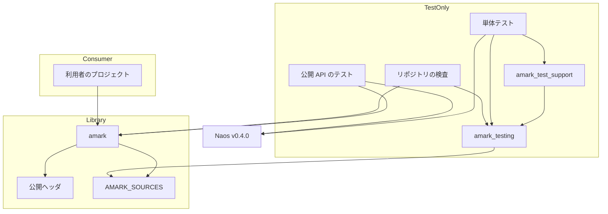
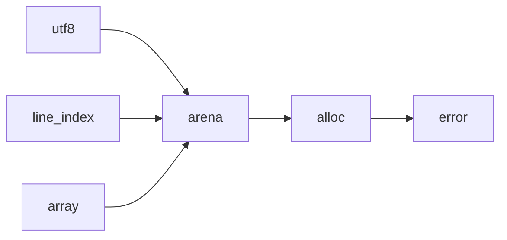
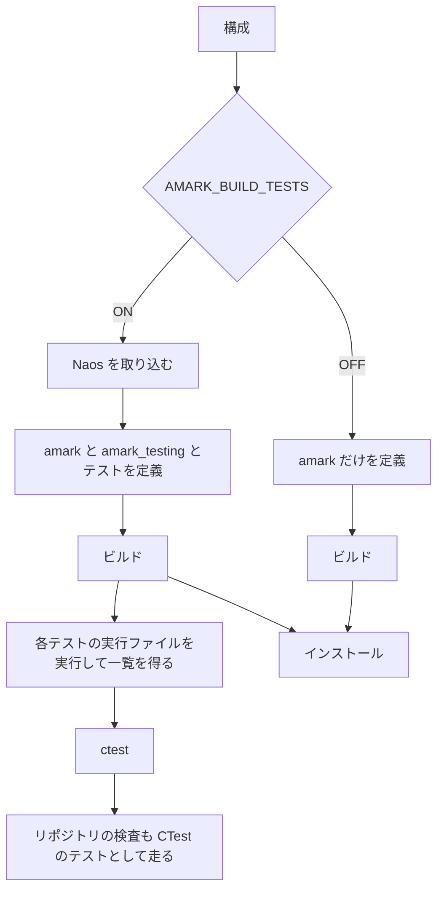
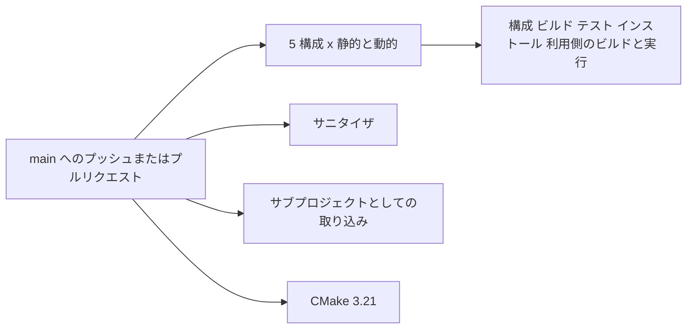

# Design Document: project-foundation

## Overview

**Purpose**: この spec は、amark のほかのすべての spec が乗る土台を作る。土台は、リポジトリの基盤（ビルド、インストール、テスト、CI、ライセンス）と、内部の部品（確保関数の抽象、アリーナ、可変長の配列、行の索引、UTF-8）からなる。

**Users**: amark の開発者は、この土台の上でモジュールとテストを追加する。利用者は、インストールした amark を `find_package(Amark)` で見つけてリンクする。後続の spec は、内部の部品を内部ヘッダ経由で使う。

**Impact**: リポジトリには現在 `.kiro` と `.claude` しかない。この spec が、最初のソース、ビルドの設定、CI、LICENSE、README を追加する。`structure.md` に書いた配置と命名は、この設計で確定する。

### Goals
- 5 つのコンパイラ構成（Windows の MSVC と MinGW、Linux の GCC と Clang、macOS の Clang）で、静的ライブラリと動的ライブラリを警告なしでビルドし、テストし、インストールできる。
- 後続の spec が、ソース 1 行とテスト 1 行を足すだけでモジュールを追加できる。
- 内部の部品が、製品の性質（状態を持たない、失敗が局所的、再帰を使わない）を土台の段階で満たす。その性質を CI が機械的に確かめる。

### Non-Goals
- 解析の API、木の型、設定・エラー・診断の公開型（syntax-tree）
- Unicode の表と Unicode License v3 の表示（unicode-tables）
- 資源の上限の検査、不正な UTF-8 の扱いを選ぶ設定とその適用（syntax-tree、block-parser）
- リリースの自動化、パッケージの公開
- 静的ライブラリと動的ライブラリを 1 つのインストール先に同時に置くこと（1 回のインストールはどちらか一方）

## Boundary Commitments

### This Spec Owns
- ビルドの構成：ルートと `src/`、`tests/` の CMakeLists、`cmake/` のモジュール、オプション（`AMARK_BUILD_TESTS`、`AMARK_WARNINGS_AS_ERRORS`、`AMARK_SANITIZE`、`AMARK_INSTALL`）
- ターゲットの名前：`amark`（別名 `Amark::amark`）と、テスト専用の `amark_testing`、`amark_test_support`
- 公開ヘッダの最小の組：`amark/amark.h`、`amark/export.h`（生成）、`amark/version.h`（生成）と、関数 `amark_version_string`
- パッケージの設定（`AmarkConfig.cmake`、版の互換の規則）
- テストの登録の方法（`amark_add_unit_test`）と、確保の失敗を注入するテスト用の確保関数
- リポジトリの検査（公開シンボル、グローバルな状態と禁止関数、著作権表示）
- CI のワークフロー
- LICENSE、README、CONTRIBUTING（著作権表示の規約）
- 内部の部品の契約：`error.h`、`alloc.h`、`arena.h`、`array.h`、`line_index.h`、`utf8.h`

### Out of Boundary
- 確保関数の型を公開ヘッダに出すことと、設定の誤りの検査（syntax-tree）。この spec の `amark_allocator_t` は内部ヘッダにある。
- 内部の状態（`amark_error_t`）を公開のエラーの種類に対応づけること（syntax-tree）
- 文書がアリーナをどう持つか、解析の途中の作業用メモリをどう分けるか（syntax-tree、block-parser）
- 置き換えた結果の位置と原文の位置の対応づけ（置き換えを適用する spec）
- U+0000 の置き換え、BOM の除去、行末以外の文字の分類
- スレッドを実際に使う並行性のテスト（spec-conformance）。この spec は、可変の静的な状態がないことを検査で保証する。

### Allowed Dependencies
- C99 の標準ライブラリ。`malloc` と `free` を呼んでよいのは `src/alloc.c` だけである。
- CMake 3.21 以上と、CMake に付属するモジュール（`GenerateExportHeader`、`CMakePackageConfigHelpers`、`GNUInstallDirs`、`FetchContent`）
- Naos `v0.4.0`（コミット `09fde7172c4b63d416c32e98499cb0c0306d3dea`）。テストだけが使う。ライブラリは Naos に依存しない。
- GitHub Actions と、`actions/checkout`、`msys2/setup-msys2`
- 内部の部品どうしの依存は、下の「依存の向き」に限る。内部の部品は、後続の spec のモジュールを取り込まない。

### Revalidation Triggers
次の変更は、後続の spec に影響する。変更するときは、依存する spec を確かめ直す。

- 内部ヘッダの関数の形、`amark_error_t` の値、`amark_allocator_t` のメンバの変更
- アリーナの整列の保証、配列の伸び方（要素へのポインタが無効になる条件）の変更
- 行番号の規則（1 始まり、行末の定義）と、UTF-8 の置換の単位の変更
- ターゲットの名前、オプションの名前と既定値、`AMARK_SOURCES` への追加の方法、`amark_add_unit_test` の引数の変更
- Naos の版の変更（1.0 前なので、マイナー版でも互換が壊れうる）
- CMake の最小の版の変更
- 公開シンボルの一覧（`tests/checks/exported_symbols.txt`）の形式の変更

## Architecture

### Architecture Pattern & Boundary Map

ビルドは「1 つのソースの一覧から、2 つのライブラリを作る」構成にする。`amark` は利用者に渡すライブラリで、種類は `BUILD_SHARED_LIBS` に従う。`amark_testing` はテスト専用の静的ライブラリで、同じソースから作り、内部の関数をテストから呼べるようにする。



内部の部品の依存の向きは次のとおりである。矢印の元が先に依存する。逆向きの取り込みは誤りとして扱う。



**Architecture Integration**:
- **選んだ構成**：単一のライブラリのターゲットと、テスト専用の静的ライブラリ。理由は「Design Decisions」に書く。
- **境界**：公開するものは `include/amark/` と `AMARK_API` で決まる。内部の部品は `src/` の内部ヘッダにあり、動的ライブラリでは隠れる。
- **steering との整合**：`structure.md` のディレクトリと命名に従う。内部の部品は Markdown を知らない。グローバルな状態、`abort`、`exit`、`longjmp`、再帰を使わない。
- **新しい要素の理由**：`amark_testing` は、動的ライブラリの構成でも内部の関数をテストするために要る。`amark_version_string` は、動的ライブラリに公開シンボルが 1 つもないと Windows でインポートライブラリができず、利用者がリンクできないために要る。

### Design Decisions

| 決定 | 選んだもの | 採らなかったもの | 理由 |
|---|---|---|---|
| ライブラリのターゲット | `amark` 1 つ。種類は `BUILD_SHARED_LIBS` | `amark_static` と `amark_shared` の 2 つ | 利用者は静的でも動的でも `Amark::amark` と書ける（2.5、2.6）。CMake の標準の方法である。CI が両方をビルドする。 |
| 内部の関数のテスト | 同じソースからテスト専用の静的ライブラリを作る | OBJECT ライブラリの共有、内部のシンボルをテスト用に公開 | 動的ライブラリの公開範囲を変えずに済む。テストの実行ファイルが DLL に依存しないので、Naos のビルド時の検出も安定する。ソースを 2 回コンパイルする費用は小さい。 |
| 名前の付け方 | CMake のプロジェクトとパッケージは `Amark`（`find_package(Amark)`、`AmarkConfig.cmake`、名前空間 `Amark::`）。ライブラリのターゲットとファイルは `amark`。C の `typedef` した型は末尾に `_t` を付け、構造体と列挙のタグは `_t` を付けない（`typedef struct amark_arena { ... } amark_arena_t;`） | パッケージも `amark` にそろえる | プロジェクトの名前に合わせる。型と関数・変数を名前の形で見分けられる。`_t` で終わる名前は POSIX が予約しているが、`amark_` で始まるので衝突しない。 |
| エクスポートマクロ | `GenerateExportHeader` で `amark/export.h` を生成 | 手書きのヘッダ | brief の方針に合う。コンパイラごとの属性と、静的ライブラリ用の定義（`AMARK_STATIC_DEFINE`）を CMake が扱う。 |
| 確保関数の形 | `malloc_fn` と `free_fn` の 2 つと文脈の値 | `realloc` を加えた 3 つ | brief の「malloc と free」に合う。配列はアリーナの上にあるので、`realloc` が要らない。 |
| 配列・索引・置換の結果の置き場所 | アリーナだけ | 確保関数から直接、または両方に対応 | 「資源はすべて文書かアリーナに属する」に合う。個別の解放がなくなり、解放もれが起きない。両方に対応する抽象は、今は使い道がない。 |
| 失敗時にメモリを残さない方法 | 必要な大きさを先に数え、確保を 1 回にする | 伸ばしながら書き、失敗したら巻き戻す | 確保が失敗したときは何も確保していないので、巻き戻しが要らない（9.10、11.8）。 |
| 前提条件の違反 | 呼び出す側の責任とし、`assert` を使わない | デバッグ時の `assert` | `assert` は `abort` を呼ぶ。steering が `abort` を禁じている。違反はテストとサニタイザで見つける。 |
| Naos の固定 | コミットのハッシュ（タグ `v0.4.0` に対応） | タグの名前 | タグは付け替えられる。ハッシュなら取り込む内容が変わらない（3.1）。 |
| CI の設定の渡し方 | ワークフローから `-D` で渡す | CMakePresets | README の手順と CI の手順が同じになる（5.5）。プリセットは今は要らない。 |
| README とコードのコメントの言語 | 英語 | 日本語 | 公開する C のライブラリの慣習に合わせる。spec と steering は日本語のままにする。 |

### Technology Stack

| Layer | Choice / Version | Role in Feature | Notes |
|-------|------------------|-----------------|-------|
| 言語 | C99、拡張なし | ライブラリとテスト | `C_STANDARD 99`、`C_STANDARD_REQUIRED ON`、`C_EXTENSIONS OFF` |
| ビルド | CMake 3.21 以上 | 構成、インストール、パッケージの設定 | Naos と `PROJECT_IS_TOP_LEVEL`、`TARGET_RUNTIME_DLLS` が 3.21 を要する |
| テスト | Naos `v0.4.0`、CTest | 単体テストの記述と登録 | FetchContent。サブプロジェクトでは常に静的ライブラリになる |
| CI | GitHub Actions | 全構成でのビルドとテスト | Windows の MinGW は MSYS2 の UCRT64 |
| 検査 | `nm`（binutils）、CMake のスクリプト | 公開シンボル、可変の静的データ、禁止関数 | Linux の構成だけで実行する |
| C++（任意） | C++11 のコンパイラがあるとき | 公開ヘッダを C++ から使えることの確認 | ライブラリのビルドには要らない |

## File Structure Plan

### Directory Structure
```
/
├── CMakeLists.txt                    # プロジェクトの定義、版、オプション、サブディレクトリ、インストール
├── LICENSE                           # MIT、Copyright (c) 2026 The Amark Authors
├── README.md                         # 概要、必要な道具、ビルド・テスト・インストール、使い方、ライセンス
├── CONTRIBUTING.md                   # 著作権表示の規約、命名、テストの追加の方法
├── .gitignore                        # build/ など
├── cmake/
│   ├── AmarkCompileOptions.cmake     # amark_target_defaults()：C99、警告、公開範囲、サニタイザ
│   ├── AmarkConfig.cmake.in          # パッケージの設定のひな形
│   └── version.h.in                  # amark/version.h のひな形
├── include/amark/
│   └── amark.h                       # 公開ヘッダの入口。export.h と version.h を取り込み、amark_version_string を宣言
├── src/
│   ├── CMakeLists.txt                # AMARK_SOURCES、amark と amark_testing の定義、生成ヘッダ
│   ├── version.c                     # amark_version_string
│   ├── error.h                       # amark_error_t
│   ├── alloc.h / alloc.c             # 確保関数の抽象、あふれを検査する計算
│   ├── arena.h / arena.c             # アリーナ
│   ├── array.h / array.c             # 可変長の配列
│   ├── line_index.h / line_index.c   # 行の索引
│   └── utf8.h / utf8.c               # UTF-8 の検査・デコード・置換
├── tests/
│   ├── CMakeLists.txt                # Naos の取り込み、amark_add_unit_test()、各テストの登録
│   ├── support/
│   │   ├── test_alloc.h / test_alloc.c   # 数える・失敗させる確保関数
│   ├── unit/
│   │   ├── test_alloc.c              # 以下、部品ごとに 1 ファイル = 1 実行ファイル
│   │   ├── test_arena.c
│   │   ├── test_array.c
│   │   ├── test_line_index.c
│   │   └── test_utf8.c
│   ├── public/
│   │   ├── test_version.c            # Amark::amark にリンクする公開 API のテスト
│   │   └── header_cxx.cpp            # 公開ヘッダを C++ で取り込めることの確認
│   ├── checks/
│   │   ├── CheckExports.cmake        # 動的ライブラリの公開シンボルを一覧と比べる
│   │   ├── CheckObjects.cmake        # 可変の静的データと禁止関数がないことを確かめる
│   │   ├── CheckLicenseHeaders.cmake # ソースの先頭の表示を確かめる
│   │   └── exported_symbols.txt      # 公開シンボルの一覧（1 行に 1 つ）
│   └── consumer/
│       ├── CMakeLists.txt            # find_package か add_subdirectory で amark を使う小さなプロジェクト
│       └── main.c                    # amark_version_string を呼ぶ
└── .github/workflows/
    └── ci.yml                        # CI
```

生成するヘッダ（`amark/export.h`、`amark/version.h`）は、ビルドのディレクトリの `include/amark/` に作る。リポジトリにはコミットしない。

### Modified Files
- `.kiro/steering/structure.md` — 命名の規約（CMake のパッケージ名 `Amark`、`typedef` した型の `_t`）は設計の段階で書き足した。実装では、冒頭の注（「最初の spec の設計で確定させる」）を消し、`tests/` の下の配置（`unit/`、`public/`、`support/`、`checks/`、`consumer/`）を書き足す。実装の最後に行う。

### 後続の spec がモジュールを足す方法
1. `src/` に `.c` と内部ヘッダを置き、`src/CMakeLists.txt` の `AMARK_SOURCES` に 1 行足す。
2. `tests/unit/` にテストを置き、`tests/CMakeLists.txt` に `amark_add_unit_test(test_<module> SOURCES unit/test_<module>.c)` を 1 行足す。
3. 公開する関数を足したら、`tests/checks/exported_symbols.txt` に名前を足す。

## System Flows

### 構成からテストまで



- Naos は、テストの実行ファイルをビルドの直後に実行してテストの一覧を得る。実行ファイルが起動できないと、ビルドが失敗する。このため、ルートの CMakeLists は、amark が最上位のときに実行ファイルと DLL の出力先を 1 つのディレクトリ（`<build>/bin`）にそろえる。
- ビルドの前に `ctest` を実行すると、`<target>.NOT_BUILT` という失敗するテストが出る。README の手順はビルドを先に行う。

### CI



## Requirements Traceability

| Requirement | Summary | Components | Interfaces / 方法 |
|-------------|---------|------------|-------------------|
| 1.1, 1.6 | 5 構成で警告なしにビルド、警告の水準 | BuildConfig、CI | `amark_target_defaults`、`AMARK_WARNINGS_AS_ERRORS` |
| 1.2 | 静的と動的を選べる | BuildConfig | `BUILD_SHARED_LIBS` |
| 1.3 | 拡張なしの C99 | BuildConfig | `C_STANDARD 99`、`C_EXTENSIONS OFF` |
| 1.4 | `AMARK_API` だけを公開 | BuildConfig、RepoChecks | `C_VISIBILITY_PRESET hidden`、`CheckExports.cmake` |
| 1.5 | 同じ取り込み方、C と C++ | PublicHeaders | `amark/amark.h`、`header_cxx.cpp` |
| 1.7 | 取り込まれたときは警告をエラーにしない | BuildConfig | `AMARK_WARNINGS_AS_ERRORS` の既定は OFF |
| 1.8 | 古い CMake では失敗 | BuildConfig | `cmake_minimum_required(VERSION 3.21)` |
| 1.9 | C99 のコンパイラと CMake だけで足りる | BuildConfig | `LANGUAGES C`、Naos はテストのときだけ |
| 2.1, 2.2 | インストールするものとしないもの | PackageConfig | `install(TARGETS/DIRECTORY/EXPORT)`、内部ヘッダは対象外 |
| 2.3, 2.5 | `find_package(Amark)` とターゲット | PackageConfig | `Amark::amark`、`AmarkConfig.cmake` |
| 2.4 | 版の互換の判定 | PackageConfig | `SameMinorVersion` |
| 2.6 | 直接取り込んでも同じ名前 | BuildConfig | `add_library(Amark::amark ALIAS amark)` |
| 2.7 | 版を 1 か所で定義 | BuildConfig、PublicHeaders | `project(Amark VERSION ...)`、`version.h.in` |
| 3.1, 3.5 | Naos の固定、テストが無効なら取り込まない | TestHarness | `FetchContent_Declare` とコミットのハッシュ |
| 3.2, 3.3 | `ctest` とテストの登録 | TestHarness | `amark_add_unit_test`、`naos_add_executable` |
| 3.4, 3.6, 3.7 | テストのオプションと既定値 | BuildConfig | `AMARK_BUILD_TESTS`（既定は `PROJECT_IS_TOP_LEVEL`） |
| 3.8 | 内部の関数をテストから呼ぶ | TestHarness | `amark_testing` |
| 3.9 | サニタイザのオプション | BuildConfig | `AMARK_SANITIZE` |
| 4.1, 4.2, 4.3, 4.5, 4.7 | CI の構成と失敗の扱い | CI | `ci.yml` の matrix、`fail-fast: false`、`--output-on-failure` |
| 4.4 | サニタイザの構成 | CI | `sanitize` ジョブ |
| 4.6 | インストールした amark を別のプロジェクトから使う | CI、ConsumerProject | `tests/consumer/` |
| 5.1 | LICENSE | RepoDocs | `LICENSE` |
| 5.2, 5.3 | 著作権表示の規約と適用 | RepoDocs、RepoChecks | `CONTRIBUTING.md`、`CheckLicenseHeaders.cmake` |
| 5.4, 5.5 | README と手順 | RepoDocs、CI | `README.md`。CI は README と同じコマンドを使う |
| 6.1, 6.2, 6.3, 6.4, 6.7 | 確保関数の選択と文脈の値 | Allocator | `amark_allocator_resolve`、`amark_malloc`、`amark_free` |
| 6.5, 6.6 | 失敗とあふれ | Allocator | `amark_error_t`、`amark_malloc_array`、`amark_size_mul` |
| 7.1, 7.2, 7.7, 7.8 | アリーナからの確保 | Arena | `amark_arena_alloc` |
| 7.3, 7.4, 7.9 | アリーナの解放と確保元 | Arena | `amark_arena_destroy`、`amark_arena_init` |
| 7.5, 7.6 | アリーナの失敗とあふれ | Arena | `amark_arena_alloc` の戻り値 |
| 8.1, 8.2, 8.5, 8.6, 8.7 | 配列への追加と伸び方 | Array | `amark_array_push`、`amark_array_reserve` |
| 8.3, 8.4, 8.9 | 読み書き、取り出し、要素の型 | Array | `amark_array_at`、`amark_array_len`、`amark_array_pop` |
| 8.8 | 配列の確保元 | Array | `amark_array_init` のアリーナ |
| 9.1, 9.2, 9.9, 9.10, 9.11 | 索引の作成 | LineIndex | `amark_line_index_build` |
| 9.3, 9.4, 9.5, 9.6, 9.8 | 行番号を求める | LineIndex | `amark_line_index_line_at` |
| 9.7 | 行の総数 | LineIndex | `amark_line_index_line_count` |
| 10.1, 10.2, 10.3, 10.4, 10.5, 10.6, 10.7 | UTF-8 の検査 | Utf8 | `amark_utf8_validate` |
| 10.8, 10.9 | UTF-8 のデコード | Utf8 | `amark_utf8_decode` |
| 11.1, 11.2, 11.3, 11.4, 11.5, 11.6, 11.7, 11.8, 11.9 | UTF-8 の置換 | Utf8 | `amark_utf8_replace` |
| 12.1, 12.3, 12.4, 12.7 | 状態なし、禁止関数なし、再帰なし | 全部品、RepoChecks | `CheckObjects.cmake`、レビュー |
| 12.2 | 決定的 | 全部品 | 入力と確保関数だけに依存する契約 |
| 12.5 | 失敗の原因を区別 | Error | `AMARK_ERROR_NOMEM`、`AMARK_ERROR_OVERFLOW` |
| 12.6 | Markdown を知らない | 全部品 | 依存の向き |
| 12.8 | 公開ヘッダに現れない | BuildConfig、RepoChecks | 内部ヘッダは `src/`、`CheckExports.cmake` |
| 12.9, 12.10 | 単体テストと解放もれ | TestHarness、UnitTests | `amark_test_alloc_t`、失敗の注入の繰り返し |

## Components and Interfaces

| Component | Domain/Layer | Intent | Req Coverage | Key Dependencies | Contracts |
|-----------|--------------|--------|--------------|------------------|-----------|
| BuildConfig | ビルド | ターゲット、オプション、警告、公開範囲 | 1.1–1.9 の各項、2.6、2.7、3.4、3.6、3.7、3.9 | CMake (P0) | Batch |
| PublicHeaders | 公開 API | 入口のヘッダ、エクスポートマクロ、版 | 1.5、2.7 | BuildConfig (P0) | Service |
| PackageConfig | 配布 | インストールと `find_package` | 2.1–2.5 の各項 | BuildConfig (P0) | Batch |
| TestHarness | テスト | Naos の取り込み、登録、テスト用の確保関数 | 3.1、3.2、3.3、3.5、3.8、12.9、12.10 | Naos (P0)、BuildConfig (P0) | Service |
| RepoChecks | テスト | 公開シンボル、静的データ、禁止関数、著作権表示 | 1.4、5.3、12.1、12.4、12.8 | nm (P1) | Batch |
| ConsumerProject | テスト | インストールした amark を使う小さなプロジェクト | 4.6、2.3、2.4、2.6 | PackageConfig (P0) | Batch |
| CI | 運用 | 全構成でのビルドとテスト | 4.1–4.7 の各項 | GitHub Actions (P0) | Batch |
| RepoDocs | 文書 | LICENSE、README、CONTRIBUTING | 5.1、5.2、5.4、5.5 | — | — |
| Error | 内部の部品 | 失敗の種類 | 12.5 | — | Service |
| Allocator | 内部の部品 | 確保関数の抽象 | 6.1–6.7 の各項 | Error (P0) | Service |
| Arena | 内部の部品 | まとめて確保し、まとめて解放する | 7.1–7.9 の各項 | Allocator (P0) | Service、State |
| Array | 内部の部品 | 伸びる配列、スタック | 8.1–8.9 の各項 | Arena (P0) | Service、State |
| LineIndex | 内部の部品 | オフセットから行番号 | 9.1–9.11 の各項 | Arena (P0) | Service |
| Utf8 | 内部の部品 | 検査、デコード、置換 | 10.1–10.9、11.1–11.9 の各項 | Arena (P0) | Service |

### ビルドと配布

#### BuildConfig

| Field | Detail |
|-------|--------|
| Intent | ターゲットとオプションを定義し、全ターゲットに同じコンパイルの設定を与える |
| Requirements | 1.1, 1.2, 1.3, 1.4, 1.6, 1.7, 1.8, 1.9, 2.6, 2.7, 3.4, 3.6, 3.7, 3.9 |

**Responsibilities & Constraints**
- `cmake_minimum_required(VERSION 3.21)`、`project(Amark VERSION 0.1.0 LANGUAGES C)`。版はここだけで定義する。
- オプション：

| オプション | 既定値 | 意味 |
|---|---|---|
| `BUILD_SHARED_LIBS` | OFF（CMake の標準） | ON なら動的ライブラリ |
| `AMARK_BUILD_TESTS` | `${PROJECT_IS_TOP_LEVEL}` | テストをビルドする。ON のときだけ Naos を取り込む |
| `AMARK_WARNINGS_AS_ERRORS` | OFF | 警告をエラーにする。CI が ON にする |
| `AMARK_SANITIZE` | OFF | ASan と UBSan を有効にする。GCC と Clang だけ。ほかのコンパイラで ON にすると構成が失敗する |
| `AMARK_INSTALL` | `${PROJECT_IS_TOP_LEVEL}` | インストールの規則を定義する |

- `amark_target_defaults(<target>)` は、amark が持つ各ターゲット（`amark`、`amark_testing`、`amark_test_support`、テスト）に次を設定する。Naos のターゲットには適用しない。
  - `C_STANDARD 99`、`C_STANDARD_REQUIRED ON`、`C_EXTENSIONS OFF`
  - `C_VISIBILITY_PRESET hidden`
  - 警告：GCC と Clang は `-Wall -Wextra -Wpedantic`、MSVC は `/W4` と `/utf-8`
  - `AMARK_WARNINGS_AS_ERRORS` が ON なら、`COMPILE_WARNING_AS_ERROR` に相当する指定（GCC と Clang は `-Werror`、MSVC は `/WX`）
- `AMARK_SANITIZE` が ON のとき、ルートのディレクトリの範囲で `-fsanitize=address,undefined -fno-sanitize-recover=all -fno-omit-frame-pointer` をコンパイルとリンクの両方に加える。Naos にも同じ指定がかかる。
- `src/CMakeLists.txt` は、`AMARK_SOURCES` を 1 つの一覧として定義し、そこから 2 つのライブラリを作る。
  - `amark`：種類は `BUILD_SHARED_LIBS` に従う。別名 `Amark::amark`。`VERSION` はプロジェクトの版、`SOVERSION` は `0`。
  - `amark_testing`：`AMARK_BUILD_TESTS` が ON のときだけ作る静的ライブラリ。`AMARK_STATIC_DEFINE` を PUBLIC に定義し、`src/` を PUBLIC の取り込み先にする。インストールしない。
- amark が最上位のとき、`CMAKE_RUNTIME_OUTPUT_DIRECTORY` を `<build>/bin` にする。

**Contracts**: Batch [x]

##### Batch / Job Contract
- Trigger: `cmake -S . -B build [-D...]`、`cmake --build build`
- Input / validation: 上の表のオプション。`AMARK_SANITIZE` と MSVC の組み合わせは `FATAL_ERROR`。
- Output / destination: ライブラリ、生成ヘッダ（`<build>/include/amark/`）、テストの実行ファイル（`<build>/bin`）
- Idempotency & recovery: 構成は繰り返し実行できる。Naos の取り込みは CMake が保持する。

**Implementation Notes**
- Risks: Naos を静的にリンクするテストで、Unix の `libm` が要る場合がある（Naos の CMake はリンクを指定していない）。リンクが失敗したら、テストのターゲットに `m` を足す。

#### PublicHeaders

| Field | Detail |
|-------|--------|
| Intent | 利用者が取り込む入口と、エクスポートマクロ、版の情報を提供する |
| Requirements | 1.5, 2.7 |

**Contracts**: Service [x]

##### Service Interface
```c
/* <amark/amark.h> */
#include <amark/export.h>   /* AMARK_API（生成） */
#include <amark/version.h>  /* AMARK_VERSION_MAJOR, _MINOR, _PATCH, AMARK_VERSION_STRING（生成） */

#ifdef __cplusplus
extern "C" {
#endif

/* ライブラリをビルドしたときの版を "0.1.0" の形で返す。戻り値は静的な定数で、解放しない。 */
AMARK_API const char *amark_version_string(void);

#ifdef __cplusplus
}
#endif
```
- Postconditions: 戻り値は `AMARK_VERSION_STRING` と同じ内容である（ヘッダとライブラリの版が合っていることを利用者が確かめられる）。
- Invariants: 公開ヘッダは内部ヘッダを取り込まない。それだけで取り込める。

**Implementation Notes**
- Integration: `export.h` は `generate_export_header(amark EXPORT_MACRO_NAME AMARK_API EXPORT_FILE_NAME <build>/include/amark/export.h)` で作る。静的ライブラリのときは、`amark` に `AMARK_STATIC_DEFINE` を PUBLIC に定義する。
- Integration: syntax-tree が解析の API を足すときは、`amark.h` に宣言を足すか、新しい公開ヘッダを `amark.h` から取り込む。

#### PackageConfig

| Field | Detail |
|-------|--------|
| Intent | インストールと、`find_package(Amark)` 用の設定を提供する |
| Requirements | 2.1, 2.2, 2.3, 2.4, 2.5 |

**Responsibilities & Constraints**
- インストールするもの：`amark` のライブラリ（`LIBDIR`、DLL は `BINDIR`）、`include/amark/*.h` と生成ヘッダ（`INCLUDEDIR/amark`）、`AmarkTargets.cmake`・`AmarkConfig.cmake`・`AmarkConfigVersion.cmake`（`LIBDIR/cmake/Amark`）、`LICENSE`（`DATADIR/licenses/amark`）。
- インストールしないもの：`src/` の内部ヘッダ、`amark_testing`、`amark_test_support`、テスト、Naos。
- エクスポートの名前空間は `Amark::`。利用者は `target_link_libraries(app PRIVATE Amark::amark)` と書く。取り込み先と `AMARK_STATIC_DEFINE` は、ターゲットの PUBLIC の設定として伝わる。
- 版の互換は `SameMinorVersion` とする。1.0 前はマイナー版で互換が壊れうるためである。1.0 のときに `SameMajorVersion` へ変える。
- 1 つのインストール先には、静的か動的のどちらか一方を置く。

**Contracts**: Batch [x]

##### Batch / Job Contract
- Trigger: `cmake --install build --prefix <dir>`（マルチ構成のジェネレータでは `--config` を付ける）
- Output / destination: 上のとおり。`GNUInstallDirs` の変数に従う。
- Idempotency & recovery: 同じ先に繰り返しインストールできる。

### テスト

#### TestHarness

| Field | Detail |
|-------|--------|
| Intent | Naos を取り込み、テストを同じ方法で登録できるようにする。確保の失敗を注入する道具を提供する |
| Requirements | 3.1, 3.2, 3.3, 3.5, 3.8, 12.9, 12.10 |

**Responsibilities & Constraints**
- ルートの CMakeLists は、`AMARK_BUILD_TESTS` が ON のときに `enable_testing()` を呼び、`tests/` を加える。
- `tests/CMakeLists.txt` は、Naos を次の指定で取り込む。`GIT_TAG` はコミットのハッシュで、コメントにタグの名前を書く。
  ```cmake
  FetchContent_Declare(Naos
      GIT_REPOSITORY https://github.com/vabelorg/naos.git
      GIT_TAG 09fde7172c4b63d416c32e98499cb0c0306d3dea  # v0.4.0
  )
  FetchContent_MakeAvailable(Naos)
  ```
- テストは 1 ファイルを 1 つの実行ファイルにする。各ファイルが自分の `NAOS_MAIN` を持つ。共有の `main.c` を置かないので、spec を並行して進めても同じファイルを編集しない。

**Contracts**: Service [x]

##### Service Interface
```cmake
# 内部の関数を試すテスト。amark_testing と amark_test_support にリンクする。
amark_add_unit_test(<name> SOURCES <source>... [LIBRARIES <library>...])

# 公開 API だけを試すテスト。Amark::amark にリンクする。
amark_add_public_test(<name> SOURCES <source>...)
```
どちらも `naos_add_executable` を呼び、`amark_target_defaults` を適用する。CTest の名前は `<name>.<suite>.<test>` になる。

```c
/* tests/support/test_alloc.h：数える・失敗させる確保関数 */
typedef struct amark_test_alloc {
    size_t malloc_calls;  /* malloc_fn が呼ばれた回数（失敗を含む） */
    size_t free_calls;    /* free_fn が呼ばれた回数 */
    size_t live;          /* 確保して、まだ解放していないかたまりの数 */
    size_t fail_at;       /* この回の malloc_fn を失敗させる。0 なら失敗させない */
    size_t ctx_mismatch;  /* 文脈の値が違っていた回数 */
} amark_test_alloc_t;

void amark_test_alloc_init(amark_test_alloc_t *state);
amark_allocator_t amark_test_allocator(amark_test_alloc_t *state);
```
- Postconditions: `amark_test_allocator` が返す確保関数は、実際の確保を `malloc` と `free` で行い、`state` を文脈の値として受け取って数を更新する。
- 失敗の注入の型：`fail_at` を 1 から順に増やしながら操作を繰り返し、操作が成功するまで続ける。毎回、後始末のあとに `live == 0` を確かめる。

**Implementation Notes**
- Integration: Naos の `NAOS_REQUIRE_*` は `longjmp` でテストを抜ける。後始末（`amark_arena_destroy` など）は teardown に置く。
- Integration: Naos 0.4.0 では、検査を 1 つも実行しないテストは失敗する。
- Risks: Naos は 1.0 前である。版を上げるときは、CHANGELOG の互換の項を読む。

#### RepoChecks

| Field | Detail |
|-------|--------|
| Intent | 製品の性質とリポジトリの規約を、CTest のテストとして機械的に確かめる |
| Requirements | 1.4, 5.3, 12.1, 12.4, 12.8 |

**Contracts**: Batch [x]

##### Batch / Job Contract

| テストの名前 | 実行する条件 | 入力 | 判定 |
|---|---|---|---|
| `checks.exports` | Linux、動的ライブラリ、`nm` がある | `$<TARGET_FILE:amark>`、`exported_symbols.txt` | `nm -D --defined-only` の関数とデータのシンボルが、一覧と完全に一致する |
| `checks.objects` | Linux、`nm` がある | `$<TARGET_FILE:amark_testing>` | 可変の静的データ（`nm` の種類 `b B d D C`）が 1 つもない。未定義のシンボルに `abort`、`exit`、`_Exit`、`longjmp`、`setjmp` がない。`malloc` と `free` を参照するのは `alloc.c` のオブジェクトだけである |
| `checks.license_headers` | 常に | `src/`、`include/`、`tests/`、`cmake/` の `.c`、`.h`、`.cpp`、`.cmake`、`.in`、`CMakeLists.txt` | 各ファイルの先頭 5 行に `Copyright (c) The Amark Authors` と `SPDX-License-Identifier: MIT` がある |

- どれも `cmake -P` のスクリプトで、`add_test` で登録する。条件に合わない構成では登録しない。
- Idempotency & recovery: 読み取りだけを行う。

**Implementation Notes**
- Integration: `checks.objects` は、サニタイザを有効にした構成では登録しない（サニタイザが静的データを加えるため）。
- Integration: 生成したソース（unicode-tables の表など）も `checks.license_headers` の対象になる。生成スクリプトが同じ表示を出力する。

#### ConsumerProject

| Field | Detail |
|-------|--------|
| Intent | 利用者の立場で amark を使えることを確かめる |
| Requirements | 4.6, 2.3, 2.4, 2.6 |

**Contracts**: Batch [x]

##### Batch / Job Contract
- Trigger: CI が `cmake -S tests/consumer -B build-consumer` を実行する。
- Input / validation:
  - `AMARK_CONSUMER_MODE=package`（既定）：`find_package(Amark 0.1 REQUIRED)` を呼ぶ。`CMAKE_PREFIX_PATH` でインストール先を渡す。続けて `find_package(Amark 99.0 QUIET)` が見つからないことを確かめ、見つかったら構成を失敗させる。
  - `AMARK_CONSUMER_MODE=subdirectory`：`add_subdirectory(<amark のソース> amark)` を呼ぶ。そのあと、`AMARK_BUILD_TESTS` が OFF で、Naos のターゲットが存在しないことを確かめる。
- Output: `main.c` が `amark_version_string()` と `AMARK_VERSION_STRING` を比べ、一致すれば 0 を返す。`add_test` で登録し、`ctest` で実行する。
- Windows の動的ライブラリでは、`$<TARGET_RUNTIME_DLLS:consumer>` をビルドの後に実行ファイルの隣へ写す。

### 運用と文書

#### CI

| Field | Detail |
|-------|--------|
| Intent | 変更のたびに、全構成でビルドとテストを回す |
| Requirements | 4.1, 4.2, 4.3, 4.4, 4.5, 4.6, 4.7 |

**Contracts**: Batch [x]

##### Batch / Job Contract
- Trigger: `main` へのプッシュと、プルリクエスト。同じ参照の古い実行は取り消す。権限は `contents: read` だけにする。
- ジョブ：

| ジョブ | 構成 | 内容 |
|---|---|---|
| `build`（matrix、`fail-fast: false`） | {Linux GCC、Linux Clang、macOS Clang、Windows MSVC、Windows MinGW UCRT64} × {静的、動的} の 10 個 | 構成（`-DAMARK_WARNINGS_AS_ERRORS=ON`、Release）→ ビルド → `ctest --output-on-failure` → インストール → ConsumerProject（package）の構成・ビルド・`ctest` |
| `sanitize` | Linux Clang、Debug、`-DAMARK_SANITIZE=ON` | 構成 → ビルド → `ctest --output-on-failure` |
| `subproject` | Linux GCC | ConsumerProject（subdirectory）の構成・ビルド・`ctest` |
| `min-cmake` | Linux GCC、CMake 3.21 | 構成 → ビルド → `ctest` |

- MinGW のジョブは `msys2/setup-msys2` で UCRT64 の GCC、CMake、Ninja を入れ、その中のシェルで各手順を実行する。
- マルチ構成のジェネレータ（Visual Studio）のために、ビルドには `--config Release`、`ctest` には `-C Release` を常に付ける。
- 構成・ビルド・テストのコマンドは、README に書くものと同じにする。
- Idempotency & recovery: 各ジョブは独立している。どれかが失敗すると実行全体が失敗になり、ログにテストの出力が残る。

#### RepoDocs

| Field | Detail |
|-------|--------|
| Intent | ライセンス、使い方、貢献の決まりを示す |
| Requirements | 5.1, 5.2, 5.4, 5.5 |

- `LICENSE`：MIT の全文。著作権表示は `Copyright (c) 2026 The Amark Authors`。
- `CONTRIBUTING.md`：ソースの先頭の表示を次のとおり定める。年は書かない（毎年の更新を避けるため）。CMake のファイルは同じ 2 行を `#` のコメントで書く。
  ```c
  /*
   * Copyright (c) The Amark Authors
   * SPDX-License-Identifier: MIT
   */
  ```
  あわせて、命名（`amark_`、`AMARK_`、`typedef` した型の末尾の `_t`）、モジュールとテストを足す手順、禁止事項（グローバルな状態、`abort`・`exit`・`longjmp`、再帰、`assert`）を書く。
- `README.md`：概要、状態（開発中）、必要な道具、構成・ビルド・テスト・インストールのコマンド、`find_package` と `add_subdirectory` での使い方、オプションの表、ライセンス。

### 内部の部品

内部の部品に共通の決まりは次のとおりである（12.1、12.2、12.4、12.6、12.7）。
- 可変の静的な状態を持たない。結果は、引数と確保関数の動作だけで決まる。
- 失敗は `amark_error_t` で返す。失敗しない関数は、値を直接返す。
- 前提条件（NULL でない、範囲の中など）は呼び出す側が守る。部品は検査せず、`assert` も使わない。
- バイト列は `const unsigned char *` と `size_t` の長さで受け取る。長さが 0 のとき、ポインタは NULL でもよい。
- 構造体の中身は `src/` の中で見えるが、後続の spec はメンバを直接読み書きせず、関数を使う。

#### Error

| Field | Detail |
|-------|--------|
| Intent | 内部の部品が返す失敗の種類を定める |
| Requirements | 12.5 |

**Contracts**: Service [x]

```c
/* src/error.h */
typedef enum amark_error {
    AMARK_ERROR_NONE = 0,
    AMARK_ERROR_NOMEM,     /* 確保関数が失敗した */
    AMARK_ERROR_OVERFLOW   /* 大きさの計算があふれた */
} amark_error_t;
```
- syntax-tree は、この 2 つの失敗を公開のエラーの種類に対応づける。必要なら、値を足してよい。

#### Allocator

| Field | Detail |
|-------|--------|
| Intent | すべての確保と解放を、指定された確保関数に通す |
| Requirements | 6.1, 6.2, 6.3, 6.4, 6.5, 6.6, 6.7 |

**Responsibilities & Constraints**
- `malloc` と `free` を呼ぶのは、このモジュールの既定の確保関数だけである。
- `amark_allocator_t` は値として写して持つ。確保と解放には、同じ値（同じ関数の組と同じ文脈の値）を使う。

**Dependencies**
- Inbound: Arena — かたまりの確保と解放 (P0)
- External: C の標準ライブラリ — `malloc`、`free` (P0)

**Contracts**: Service [x]

##### Service Interface
```c
/* src/alloc.h */
typedef void *(*amark_malloc_fn_t)(void *ctx, size_t size);  /* 失敗したら NULL */
typedef void (*amark_free_fn_t)(void *ctx, void *ptr);        /* ptr は NULL でない */

typedef struct amark_allocator {
    amark_malloc_fn_t malloc_fn;
    amark_free_fn_t free_fn;
    void *ctx;
} amark_allocator_t;

/* malloc と free を使う既定の確保関数を返す。ctx は NULL。 */
amark_allocator_t amark_allocator_default(void);

/* requested が NULL なら既定の確保関数を、そうでなければ *requested の写しを返す。 */
amark_allocator_t amark_allocator_resolve(const amark_allocator_t *requested);

amark_error_t amark_malloc(const amark_allocator_t *allocator, size_t size, void **out);
amark_error_t amark_malloc_array(const amark_allocator_t *allocator, size_t count, size_t elem_size, void **out);
void amark_free(const amark_allocator_t *allocator, void *ptr);

/* あふれたら false を返し、*out を変えない。 */
bool amark_size_add(size_t a, size_t b, size_t *out);
bool amark_size_mul(size_t a, size_t b, size_t *out);
```
- Preconditions: `allocator` と `out` は NULL でない。`requested` が NULL でないとき、`malloc_fn` と `free_fn` は両方とも NULL でない（この検査は syntax-tree が行う）。
- Postconditions:
  - `amark_malloc`：成功すると `*out` は NULL でない。`size` が 0 のときは 1 バイトを要求する。確保関数が NULL を返すと `AMARK_ERROR_NOMEM` を返し、`*out` を NULL にする。
  - `amark_malloc_array`：`count * elem_size` があふれると、確保関数を呼ばずに `AMARK_ERROR_OVERFLOW` を返す。
  - `amark_free`：`ptr` が NULL なら何もしない。そうでなければ `free_fn(ctx, ptr)` を 1 回呼ぶ。
- Invariants: `ctx` は変更せずに渡す。

**Implementation Notes**
- Integration: syntax-tree が確保関数を公開の設定に出すときは、関数ポインタの型を公開ヘッダへ移し、`alloc.h` がそれを取り込む形にする。メンバの名前を `malloc` と `free` そのものにせず `_fn` を付けるのは、`malloc` や `free` をマクロで定義する C のランタイム（デバッグ用の CRT など）があるためである。

#### Arena

| Field | Detail |
|-------|--------|
| Intent | 小さな確保をかたまりにまとめ、解放を 1 回で行う |
| Requirements | 7.1, 7.2, 7.3, 7.4, 7.5, 7.6, 7.7, 7.8, 7.9 |

**Responsibilities & Constraints**
- 確保関数から得たかたまりを、単方向のリストで持つ。返したメモリは動かさない。
- 個別の解放、巻き戻し、再利用は提供しない。

**Dependencies**
- Inbound: Array、LineIndex、Utf8、後続の spec — メモリの確保 (P0)
- Outbound: Allocator — かたまりの確保と解放 (P0)

**Contracts**: Service [x] / State [x]

##### Service Interface
```c
/* src/arena.h */
typedef struct amark_arena_block amark_arena_block_t;

typedef struct amark_arena {
    amark_allocator_t allocator;
    amark_arena_block_t *current;   /* 新しい確保に使うかたまり。なければ NULL */
    size_t next_block_size;
} amark_arena_t;

/* 確保は行わない。allocator の写しを持つ。 */
void amark_arena_init(amark_arena_t *arena, const amark_allocator_t *allocator);

amark_error_t amark_arena_alloc(amark_arena_t *arena, size_t size, void **out);
amark_error_t amark_arena_alloc_array(amark_arena_t *arena, size_t count, size_t elem_size, void **out);

/* すべてのかたまりを確保関数に返し、arena を init の直後と同じ状態に戻す。 */
void amark_arena_destroy(amark_arena_t *arena);
```
- Preconditions: `arena` は `amark_arena_init` で初期化してある。
- Postconditions:
  - `amark_arena_alloc`：成功すると、`*out` は `size` バイト以上で、`AMARK_ARENA_ALIGN` の倍数の位置を指す。内容は初期化しない。`size` が 0 のときは 1 バイトとして扱う。
  - 失敗（`NOMEM`、`OVERFLOW`）のとき、`*out` は NULL で、アリーナの状態は呼び出しの前と同じである。それまでに返したメモリは有効なままである。
  - `amark_arena_destroy`：確保関数から得たかたまりの数だけ `free_fn` を呼ぶ。2 回続けて呼んでも安全である。
- Invariants: `AMARK_ARENA_ALIGN` は、`long long`、`long double`、`void *`、関数ポインタを含む共用体の整列である（C99 には `max_align_t` がないため）。

##### State Management
- かたまりの大きさ：最初は 4096 バイト。新しいかたまりを得るたびに 2 倍にし、1 MiB で止める。これで、確保関数の呼び出しの回数は確保の回数より十分に少なくなる（7.8）。
- 現在のかたまりに入らない要求のうち、次のかたまりの大きさも超えるものは、専用のかたまりを得てリストの現在のかたまりの後ろにつなぐ。現在のかたまりの残りは引き続き使う（7.7）。
- かたまりの大きさは、ヘッダと整列の分を `amark_size_add` で加えて求める。あふれたら `AMARK_ERROR_OVERFLOW` を返す（7.6）。
- 解放は、リストを先頭から順にたどる繰り返しで行う（7.9）。
- Concurrency: 1 つのアリーナを複数のスレッドから同時に使わない。別々のアリーナは、別々のスレッドで同時に使える。

#### Array

| Field | Detail |
|-------|--------|
| Intent | アリーナの上で伸びる配列を提供する。スタックとしても使う |
| Requirements | 8.1, 8.2, 8.3, 8.4, 8.5, 8.6, 8.7, 8.8, 8.9 |

**Dependencies**
- Outbound: Arena — 記憶域 (P0)

**Contracts**: Service [x] / State [x]

##### Service Interface
```c
/* src/array.h */
typedef struct amark_array {
    amark_arena_t *arena;
    void *data;
    size_t len;
    size_t cap;
    size_t elem_size;
} amark_array_t;

/* 確保は行わない。elem_size は 1 以上。 */
void amark_array_init(amark_array_t *array, amark_arena_t *arena, size_t elem_size);

/* *elem（elem_size バイト）を末尾に写す。 */
amark_error_t amark_array_push(amark_array_t *array, const void *elem);

/* 容量を min_cap 以上にする。長さは変えない。 */
amark_error_t amark_array_reserve(amark_array_t *array, size_t min_cap);

size_t amark_array_len(const amark_array_t *array);

/* index 番目の要素へのポインタを返す。index は len より小さい。 */
void *amark_array_at(const amark_array_t *array, size_t index);

/* 空なら false を返す。そうでなければ末尾の要素を *out に写して（out が NULL なら写さない）取り除き、true を返す。 */
bool amark_array_pop(amark_array_t *array, void *out);
```
- Postconditions:
  - `push` と `reserve` が失敗したとき、`data`、`len`、`cap` は呼び出しの前と同じである（8.5）。
  - 容量が広がると、要素は新しい場所へ写る。値と順序は変わらない（8.2）。それまでに `amark_array_at` で得たポインタは無効になる。
- Invariants: `len <= cap`。`data` は `AMARK_ARENA_ALIGN` に整列しているので、どの型の要素にも使える（8.9）。

##### State Management
- 伸び方：容量が足りないとき、新しい容量を `max(8, cap * 2, min_cap)` とし、アリーナから新しい場所を得て写す。古い場所はアリーナに残り、アリーナの解放で消える。残る量の合計は最後の容量より小さいので、時間もメモリも要素の数にほぼ比例する（8.7）。
- 新しい容量とそのバイト数は `amark_size_mul` で求める。あふれたら、確保を試みずに `AMARK_ERROR_OVERFLOW` を返す（8.6）。
- 配列そのものの解放はない。アリーナと一緒に消える。

#### LineIndex

| Field | Detail |
|-------|--------|
| Intent | バイトのオフセットから行番号を求める |
| Requirements | 9.1, 9.2, 9.3, 9.4, 9.5, 9.6, 9.7, 9.8, 9.9, 9.10, 9.11 |

**Dependencies**
- Outbound: Arena — 行の開始位置の表 (P0)

**Contracts**: Service [x]

##### Service Interface
```c
/* src/line_index.h */
typedef struct amark_line_index {
    const size_t *line_starts;  /* 各行の最初のバイトのオフセット。昇順。line_starts[0] は 0 */
    size_t line_count;          /* 1 以上 */
    size_t length;              /* バイト列の長さ */
} amark_line_index_t;

amark_error_t amark_line_index_build(amark_line_index_t *index, amark_arena_t *arena,
                                    const unsigned char *bytes, size_t length);

/* offset を含む行の番号を返す。最初の行は 1。offset は length 以下。 */
size_t amark_line_index_line_at(const amark_line_index_t *index, size_t offset);

size_t amark_line_index_line_count(const amark_line_index_t *index);
```
- 行の規則：行末は、LF、後ろに LF が続かない CR、CR と LF の組である。行末の記号は、それが終わらせる行に属する。次の行は、行末の直後のバイトから始まる。したがって `line_count` は「行末の数 + 1」である。
  - 長さ 0 のバイト列：1 行。オフセット 0 は行 1。
  - `"a\n"`：2 行。オフセット 0 と 1 は行 1、オフセット 2（長さに等しい）は行 2。
  - `"a\r\nb"`：2 行。CR（1）と LF（2）は行 1、`b`（3）は行 2。
- Postconditions:
  - `build`：バイト列を 2 回走査する。1 回目で行を数え、2 回目で表を埋める。確保はアリーナから 1 回だけ行う。失敗したときは何も確保しておらず、`*index` を変えない（9.10）。行の数に `size_t` の大きさを掛けたバイト数があふれたら `AMARK_ERROR_OVERFLOW` を返す。
  - `line_at`：`line_starts` を二分探索し、`line_starts[i] <= offset` を満たす最大の `i` に 1 を足して返す（9.8）。
- Invariants: バイト列を変更しない。バイトの値だけを見るので、不正な UTF-8 でも同じ規則で動く（9.11）。索引はバイト列へのポインタを持たない。

#### Utf8

| Field | Detail |
|-------|--------|
| Intent | UTF-8 を検査し、コードポイントを取り出し、不正な列を U+FFFD に置き換える |
| Requirements | 10.1, 10.2, 10.3, 10.4, 10.5, 10.6, 10.7, 10.8, 10.9, 11.1, 11.2, 11.3, 11.4, 11.5, 11.6, 11.7, 11.8, 11.9 |

**Responsibilities & Constraints**
- 正しさの定義は、Unicode 標準の表 3-7（Well-Formed UTF-8 Byte Sequences）である。
- 検査と置換は、1 つの内部の関数（1 つの列を調べ、正しければその長さを、不正なら極大の部分列の長さを返す）を共有する。これで、2 つの判定がずれない。

**Dependencies**
- Outbound: Arena — 置換の結果 (P0)
- Inbound: unicode-tables、block-parser、inline-parser — デコード (P0)

**Contracts**: Service [x]

##### Service Interface
```c
/* src/utf8.h */

/* 全体が正しい UTF-8 なら true。不正なら false を返し、error_offset が NULL でなければ、
   最初の不正な列が始まるオフセットを書く。確保は行わない。 */
bool amark_utf8_validate(const unsigned char *bytes, size_t length, size_t *error_offset);

/* bytes の先頭の 1 文字をデコードし、コードポイントを *codepoint に書いて、バイト数（1〜4）を返す。 */
size_t amark_utf8_decode(const unsigned char *bytes, size_t length, uint32_t *codepoint);

typedef struct amark_utf8_replaced {
    const unsigned char *bytes;   /* 結果。replacement_count が 0 のときは入力と同じポインタ */
    size_t length;
    size_t replacement_count;     /* 出力した U+FFFD の数 */
} amark_utf8_replaced_t;

amark_error_t amark_utf8_replace(amark_arena_t *arena, const unsigned char *bytes, size_t length,
                                amark_utf8_replaced_t *out);
```
- `amark_utf8_validate`
  - 不正とするもの：最短でない符号化（`C0`、`C1` で始まる列、`E0 80..9F`、`F0 80..8F`）、サロゲート（`ED A0..BF`）、U+10FFFF を超える値（`F4 90..BF`、`F5..FF`）、途中で切れた列、先頭バイトのない継続バイト。
  - U+0000 と U+FEFF は正しいものとして扱う。長さ 0 は正しい。
- `amark_utf8_decode`
  - Preconditions: `length` は 1 以上。`bytes` は、検査を通ったバイト列の中の、文字の先頭を指す。`length` は、そこからバイト列の終わりまでの長さ以下である。
  - Postconditions: `bytes[0]` から `bytes[戻り値 - 1]` までだけを読む（10.9）。前提条件を満たさない入力に対する結果は定めない。
- `amark_utf8_replace`
  - 置換の単位：不正な列の極大の部分列 1 つにつき、U+FFFD（`EF BF BD`）を 1 つ出す。極大の部分列とは、正しい列の先頭として続けられる最長の部分、または、それがなければ 1 バイトである。例：`E2 82`（途中で切れた 3 バイトの列）は 1 つ、`F0 80 80` は 3 つ（`F0 80` は正しい列の先頭にならないため、3 バイトをそれぞれ置き換える）、`C0 AF` は 2 つ。
  - 手順：1 回目の走査で結果の長さと置換の数を求める。置換の数が 0 なら、確保せずに入力のポインタと長さを返す（11.5）。そうでなければ、アリーナから 1 回だけ確保し、2 回目の走査で書く。
  - 結果の長さは `amark_size_add` で積算する。あふれたら `AMARK_ERROR_OVERFLOW` を返す。失敗したときは何も確保しておらず、`*out` を変えない（11.8）。
  - 結果は常に正しい UTF-8 である。入力は変更しない。
- Invariants: どの関数も、時間はバイト列の長さにほぼ比例する。

**Implementation Notes**
- Integration: 置換の数が 0 のとき、結果は入力のバイト列を指す。呼び出す側は、入力のバイト列を結果より長く保つ。
- Risks: 置換の単位は、WHATWG の Encoding Standard のデコーダと同じ結果になる。テストで、Unicode 標準の表 3-8 から 3-11 の例を確かめる。

## Error Handling

### Error Strategy
- 内部の部品の失敗は 2 種類だけである。確保関数の失敗（`AMARK_ERROR_NOMEM`）と、大きさのあふれ（`AMARK_ERROR_OVERFLOW`）。どちらも戻り値で伝える。
- 失敗した操作は、対象の状態を変えない（アリーナ、配列、索引、置換の結果のどれも）。呼び出す側は、アリーナを解放するだけで後始末ができる。
- 前提条件の違反は失敗として扱わない。動作を定めず、テスト、サニタイザ、レビューで見つける。
- ビルドの構成の誤り（古い CMake、対応していないコンパイラでのサニタイザ）は、構成のときに `FATAL_ERROR` で止め、原因と直し方をメッセージに書く。

### Monitoring
- 実行時のログは持たない（I/O を行わない）。
- CI は、失敗したテストの出力を `--output-on-failure` でログに残す。

## Testing Strategy

### Unit Tests（`tests/unit/`、`amark_testing` にリンク）
- **test_alloc**：既定の確保関数で確保と解放ができる。指定した確保関数だけが呼ばれ、文脈の値がそのまま渡る（`ctx_mismatch == 0`）。確保関数が NULL を返すと `NOMEM`。`amark_malloc_array(SIZE_MAX, 2)` は確保関数を呼ばずに `OVERFLOW`。`amark_free(NULL)` は確保関数を呼ばない。`amark_size_add` と `amark_size_mul` の境界（6.1–6.7）。
- **test_arena**：返した位置が `AMARK_ARENA_ALIGN` の倍数。小さな確保 10,000 回で、確保関数の呼び出しが 100 回より少ない。先に書いた内容が、後の確保のあとも変わらない。1 MiB を超える確保が成功し、その後の小さな確保も成功する。`destroy` のあと `live == 0`。途中の確保を失敗させても、それまでのメモリが読め、`destroy` で `live == 0`。`size` が `SIZE_MAX` で `OVERFLOW`（7.1–7.9）。
- **test_array**：追加した順に読める。容量が広がっても値が変わらない。`pop` が逆順に返し、空で false。要素の大きさが 1、8、24 バイトの型で動く。伸びるときの確保を失敗させると、`len` と中身が変わらない。`reserve(SIZE_MAX)` が `OVERFLOW`。100,000 個の追加で、確保関数の呼び出しの回数が要素の数に比べて十分に少ない（8.1–8.9）。
- **test_line_index**：空、行末なし、LF、CR、CRLF、混在、連続する行末、行末で終わる入力、行末だけの入力について、すべてのオフセットの行番号を、1 バイトずつ数える単純な参照実装と比べる。`line_count`。不正な UTF-8 を含む入力。確保の失敗で `NOMEM` を返し、`live` が増えない（9.1–9.11）。
- **test_utf8**：1〜4 バイトの各範囲の境界（U+007F、U+0080、U+07FF、U+0800、U+FFFF、U+10000、U+10FFFF）、U+0000 と U+FEFF が正しい。不正の各種類について、`error_offset` が最初の不正な列を指す。デコードが検査済みの全境界で正しい値と長さを返す。置換が Unicode 標準の例と一致し、結果が検査を通り、入力が変わらない。正しい入力では `replacement_count == 0` で、ポインタが入力と同じで、確保がない。確保の失敗で `NOMEM` を返し、`live` が増えない（10.1–10.9、11.1–11.9）。
- **失敗の注入**：確保を行うすべての操作について、`fail_at` を 1 から順に増やす繰り返しで、各回の後始末のあとに `live == 0` を確かめる（12.9、12.10）。

### Public API Tests（`tests/public/`、`Amark::amark` にリンク）
- **test_version**：`amark_version_string()` が `AMARK_VERSION_STRING` と一致する。静的と動的の両方の構成で走る（1.5、2.7）。
- **header_cxx**：`<amark/amark.h>` を C++ で取り込み、`amark_version_string` を呼んでリンクできる。C++ のコンパイラがあるときだけビルドする（1.5）。

### Repository Checks（`tests/checks/`）
- `checks.exports`、`checks.objects`、`checks.license_headers`。内容は RepoChecks の表のとおり（1.4、5.3、12.1、12.4、12.8）。

### Integration Tests（CI）
- 10 個の構成で、構成 → ビルド → テスト → インストール → 利用側のビルドと実行（1.1、1.2、2.1–2.5、4.1–4.3、4.6）。
- インストール先に内部ヘッダ（`arena.h` など）とテスト用のファイルがないことを、利用側の構成で確かめる（2.2）。
- `find_package(Amark 99.0)` が見つからない（2.4）。
- サブプロジェクトとして取り込んだとき、同じ `Amark::amark` が使え、テストと Naos が取り込まれない（2.6、3.5、3.7、1.7）。
- サニタイザの構成で全テストが通る（3.9、4.4）。
- CMake 3.21 で構成・ビルド・テストが通る（1.8 の下限の確認）。

### この spec で行わないテスト
- スレッドを使う並行性のテスト（12.3）。`checks.objects` が可変の静的データのないことを保証し、実際の並行の実行は spec-conformance が確かめる。

## Security Considerations
- UTF-8 の検査は、最短でない符号化とサロゲートを不正とする。これは、検査をすり抜ける別表現（`C0 AF` で `/` を表すなど）を防ぐ。
- 大きさの計算は、すべて `amark_size_add` と `amark_size_mul` を通す。信頼できない入力の長さから確保の大きさを求めるときの、整数のあふれを防ぐ。
- CI のワークフローは、読み取りの権限だけを持つ。プルリクエストから秘密の値を使わない。
- Naos はコミットのハッシュで固定する。

## Performance & Scalability
- アリーナ：確保 1 回の時間は一定。確保関数の呼び出しは、かたまりの大きさを 2 倍にしていくので少ない。
- 配列：追加の時間は償却して一定。
- 行の索引：作成は長さに比例、検索は行の数の対数に比例。表は 1 行あたり `size_t` 1 つである。
- UTF-8：どの関数も長さに比例。置換は 2 回の走査で、正しい入力では確保も複写もしない。
- 数値の目標は置かない。全体の性能は spec-conformance の病的な入力のテストで確かめる。
