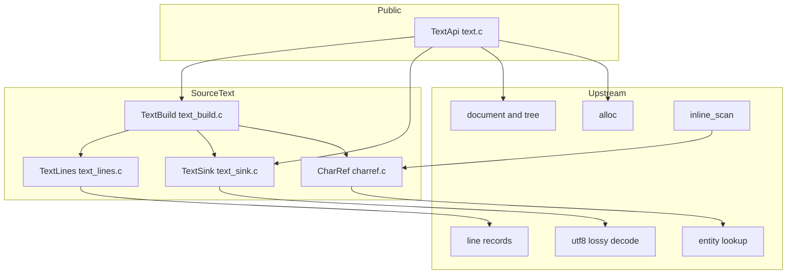
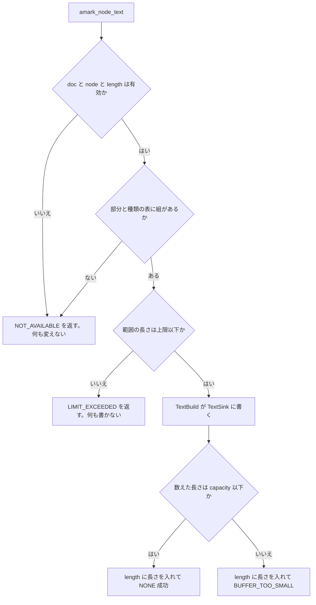

# Design Document

## Overview

**Purpose**: source-text は、ノードの範囲から、利用者がそのまま使える文字列を作る公開 API を用意する。利用者は、プレフィックス、タブの桁、エスケープ、文字参照の規則を知らなくても、コードの中身、リンク先、題、テキストを文字列として受け取れる。

**Users**: 利用者は、`amark_parse` で得た文書とノードの ID を渡して、4 つの公開の関数を呼ぶ。下流の開発者（spec-conformance）は、この値から、テスト用の HTML を作る。

**Impact**: 公開ヘッダ `amark/text.h` と、公開シンボル 4 つが加わる。`amark_error_t` に、失敗でない 2 つの結果（`AMARK_ERROR_NOT_AVAILABLE`、`AMARK_ERROR_BUFFER_TOO_SMALL`）が加わる。`amark_parse` と既存の関数は、この 2 つを返さない。木と解析の結果は変わらない。文字参照の構文の規則を、inline-parser の `inline_scan.c` から新しい `charref` に移し、両方がそれを使う（動作は変えない）。確保した文字列を利用者が解放する、という形が初めて加わるので、structure.md に例外として書き足す。

### Goals
- 文字列を作る処理を、1 回の走査で、再帰も確保もなしに行う（確保するのは、確保関数で作る方法の 1 回だけ）。
- 文書に状態を残さない。同じ文書を、複数のスレッドから同時に読める。
- 論理的な文字列と意味上の値を、常に、U+0000 を含まない正しい UTF-8 にする。
- 文字参照の構文の規則を、ライブラリの中で 1 か所にする。

### Non-Goals
- URL の正規化、パーセントエンコード、HTML のエスケープ、`mailto:` を付けること（出力する側）
- 子を持つノードの、子の値をつないだ文字列（画像の代替テキストを含む）
- リンクのラベルを正規化した文字列の公開
- コンテナのノードと、方言の種類のブロックのノードの、論理的な文字列
- 原文の差し替え、木から Markdown を書き出すこと（後の段階の候補）
- カーソル（`cursor.c`）の作り直し。この spec は、カーソルを使わず、変えない。

## Boundary Commitments

### This Spec Owns
- 公開ヘッダ `include/amark/text.h` と、その 4 つの関数（`amark_node_raw`、`amark_node_text`、`amark_node_text_alloc`、`amark_text_free`）、列挙 `amark_text_part_t`
- `amark_error_t` に足す 2 つの値（`AMARK_ERROR_NOT_AVAILABLE`、`AMARK_ERROR_BUFFER_TOO_SMALL`）の意味。型そのものの持ち主は、syntax-tree のままである。
- 「どの種類のノードの、どの部分が、どの決まりで文字列になるか」の表（「部分と種類の表」）
- 行をつなぐ決まり：プレフィックスを除く、タブの残りの桁を補う、行末記号を置き換える
- コードブロックのコードの行を決めること（閉じるフェンスの行の判定を含む）
- コードスパンの中身の決まり
- エスケープと文字参照を文字に戻す決まりと、文字参照の構文と値（`charref`）
- 出力の文字の扱い（U+0000 と不正なバイト列を U+FFFD にする）
- 結果の受け渡し（バッファ、確保した文字列とその解放）

### Out of Boundary
- 行の記録の中身と作り方、ブロックのノードの範囲、属性の範囲（block-parser）。この spec は読むだけである。
- インラインのノードの範囲と種類（inline-parser）。この spec は読むだけである。
- 実体名の表と、その参照（unicode-tables）
- 木の表し方と、たどる API（syntax-tree）
- 値から HTML を作ること、spec.txt の全例を通すこと（spec-conformance）
- 方言の種類のノードの値（dialect-extension が要るなら、そこで決める）

### Allowed Dependencies
- block-parser：`line`（`amark_line_bounds`、`amark_line_get`）、`scan`（`amark_scan_close_fence` だけ）。`block`、`refdef`、`definition`、`parse_data` の関数は使わない。
- syntax-tree：`document`（`amark_document_content`、`amark_document_line_index`、`amark_document_parse_data` は「あるか」を見るだけ、ノードと属性の読み出し）、公開の型とたどる API
- project-foundation：`alloc`（`amark_malloc`、`amark_free`、`amark_size_add`）、`utf8`（`amark_utf8_decode_lossy`）、`line_index`（`amark_line_index_line_at`）
- unicode-tables：`entity`（`amark_entity_lookup`）。`charref` だけが使う。
- C99 の標準ヘッダ：`stdbool.h`、`stddef.h`、`stdint.h`、`string.h`
- 依存してはならないもの：`inline`、`inline_scan`、`cursor`、`bracket`、`delimiter`、`draft`（インラインの解析）、アリーナ（文書のアリーナに何も足さない）
- 依存の向きは次のとおりで、左のものだけが右のものを取り込む。
  - `text → text_build → text_lines`、`text_build → text_sink`、`text_build → charref → entity`
  - `inline_scan → charref`（上流への変更）
- 上流への変更は、次の 4 つに限る。どれも、既存の関数の契約と動作は変えない。
  - `include/amark/error.h`：`amark_error_t` に 2 つの値（5 と 6）を足す。既存の 5 つの値は変えない。syntax-tree の要件 10 と設計の ErrorKind を、合わせて直す。
  - `src/inline_scan.c`：`amark_inline_scan_entity` の中身を、`amark_charref_scan` の呼び出しにする。
  - `include/amark/allocator.h`：確保関数が同時に呼ばれうることを、説明に書き足す。
  - `include/amark/amark.h`：`text.h` を取り込む。

### Revalidation Triggers
次の変更は、下流（spec-conformance、利用者）の見直しを要する。
- 公開の関数の引数と戻り値、`amark_text_part_t` の値と、`amark_error_t` に足した 2 つの値の変更
- 「部分と種類の表」の変更（どの種類が、どの部分に答えるか）
- 行末記号、タブ、コードスパンの空白、コードブロックの最後の `\n` の決まりの変更
- 文字に戻す決まり（不正な数値の文字参照を U+FFFD にすることを含む）と、文字の置き換えの決まりの変更
- バッファに収まらないときに、何が書かれ、何が伝わるかの変更

上流の次の変更は、この spec の見直しを要する。
- 行の記録の意味（`content_start`、`pad`）、閉じるフェンスの行の記録の付け方、ブロックのノードの範囲の決まり（block-parser）
- インラインのノードの範囲、dest と title の範囲の決まり（inline-parser）
- 文字参照の構文（桁の数など）。`charref` を直すと、inline-parser の木も変わる。

## Architecture

### Existing Architecture Analysis
- ノードは、範囲と、開始行・終了行を持つ。行の記録は、各行の `content_start`（内容が始まる位置）と `pad`（0〜3。0 でなければ、その位置のバイトはタブで、`pad` 個のスペースとして読む）を持ち、行番号から一定の時間で引ける。
- カーソル（inline-parser）は、行の内容だけを読むが、`pad` を見ず、行末記号で終わる範囲を扱えない。この spec の範囲には、その両方がある（コードブロックの行、改行のノード、最後の行の長さが 0 のブロック）。そのため、行をつなぐ処理は、カーソルとは別に作る。
- 文書は、UTF-8 の扱いの設定を持たない。「エラーにする」設定で解析した文書は、解析する範囲が正しい UTF-8 なので、常に `amark_utf8_decode_lossy` と同じ読み方で出力すれば、どちらの設定でも同じ決まりになる（9.2、9.5）。
- コードブロックの属性は、閉じるフェンスの有無を持たない。最後の行の記録から判定できる（「コードの行」の節）。
- たどる API は `bool` と `*out` で答える。`amark_error_t` は、これまで、成功と 4 つの失敗だけを持っていた（syntax-tree の要件 10）。この spec は、ライブラリのエラーの型を 1 つに保つために、ここに 2 つの値を足す。

### Architecture Pattern & Boundary Map



**Architecture Integration**:
- **方式**：「範囲を行ごとの区間に分ける（TextLines）→ 区間を決まりに従って書く（TextBuild）→ 数えながら、収まる分だけ書く（TextSink）」の 3 段にする。公開の関数（TextApi）は、ノードの種類と求められた部分から、範囲と決まりを選ぶだけである。
- **一般化**：要件 2〜8 の 9 通りの文字列は、4 つの決まり（そのまま、文字に戻す、コードスパン、コードの行）と、範囲の選び方の組み合わせで表せる。公開の関数は、部分を選ぶ引数を持つ 1 組にし、種類ごとの関数は作らない。
- **作るか、使うか**：実体名の参照、不正なバイト列の読み方、閉じるフェンスの判定、行の境は、既存の関数を使う。文字参照の構文は、`inline_scan.c` にあるものを `charref` に移して共有する。
- **簡素化**：カーソルは使わない。2 回の走査（大きさを数える、書く）をしない。TextSink が、1 回の走査で数えながら、収まる分だけ書く。
- **steering との整合**：再帰なし、グローバルな状態なし、入力を変えない、確保は設定の確保関数だけ。「個別に解放するものを作らない」には、確保した文字列という例外が 1 つ加わる（「確保した文字列」の節）。

### Technology Stack

| Layer | Choice / Version | Role in Feature | Notes |
|-------|------------------|-----------------|-------|
| Language | C99 | 実装のすべて | コンパイラの拡張なし |
| Build | CMake（既存） | `AMARK_SOURCES` に 5 つの `.c` を足す | 新しい依存はない |
| Test | Naos v0.4.0（既存） | 単体テストと公開 API のテスト | |
| 仕様 | CommonMark 0.31.2 | 2.3 節（U+0000）、2.4 節、2.5 節、4.4 節、4.5 節、6.1 節、6.3 節 | 例はテストのコードに写す |

## File Structure Plan

### Directory Structure
```
include/amark/
└── text.h                  # 公開：列挙 2 つと関数 4 つ
src/
├── text.c                  # TextApi：引数の検査、「部分と種類の表」、バッファと確保
├── text_build.h            # TextBuild：4 つの決まりで、範囲を TextSink に書く
├── text_build.c            #   コードの行を決める処理を含む
├── text_lines.h            # TextLines：範囲を、行ごとの区間に分ける
├── text_lines.c
├── text_sink.h             # TextSink：数えながら、収まる分だけ書く。文字の置き換え
├── text_sink.c
├── charref.h               # CharRef：文字参照の構文と値
└── charref.c
tests/
├── support/
│   ├── text_dump.h         # amark_test_dump_text：文書の順に、各ノードの値を 1 つの文字列にする
│   └── text_dump.c
├── unit/
│   ├── test_charref.c      # CharRef
│   ├── test_text_sink.c    # TextSink
│   ├── test_text_lines.c   # TextLines（amark_parse で作った文書の上で）
│   ├── test_text_build.c   # 4 つの決まりと、コードの行
│   ├── test_text.c         # 「部分と種類の表」、答えられない呼び出し、受け渡し、確保の失敗の注入
│   ├── test_text_limits.c  # 時間、深い入れ子、同時の読み出し
│   ├── test_spec_text_leaf.c    # spec.txt の例の値：Tabs、Indented code blocks、Fenced code blocks、Link reference definitions
│   ├── test_spec_text_inline.c  # spec.txt の例の値：Backslash escapes、Entity and numeric character references、Code spans、Autolinks
│   └── test_spec_text_links.c   # spec.txt の例の値：Links、Images
└── public/
    └── test_text.c         # 公開 API だけで、木をたどって値を得る
```

- `text.c` の内部ヘッダは作らない（公開ヘッダ `amark/text.h` だけを持つ）。ほかの 4 つは、`.c` と同じ名前の内部ヘッダの組である。
- どのファイルも 400 行前後までに収まる見込みである。

### Modified Files
- `include/amark/amark.h` — `<amark/text.h>` を取り込む。
- `include/amark/error.h` — `AMARK_ERROR_NOT_AVAILABLE = 5` と `AMARK_ERROR_BUFFER_TOO_SMALL = 6` を足す。説明に、この 2 つは失敗ではなく、文字列の取り出しの関数だけが返すことを書く。
- `tests/unit/test_config.c` — `amark_error_t` の値の検査を、7 つの値（0 から 6）に直す。
- `.kiro/specs/syntax-tree/design.md` — ErrorKind の節の列挙に、2 つの値を足す（要件 10 は、設計と合わせて直してある）。
- `include/amark/allocator.h` — 説明に、「文書を複数のスレッドから同時に読み、`amark_node_text_alloc` と `amark_text_free` を呼ぶなら、確保関数は同時に呼ばれてよいものにする」と書き足す。
- `src/CMakeLists.txt` — `AMARK_SOURCES` に `charref.c`、`text.c`、`text_build.c`、`text_lines.c`、`text_sink.c` を足す。公開ヘッダのインストールは、ディレクトリごとなので、変えなくてよい。
- `src/inline_scan.c` — `amark_inline_scan_entity` を、`amark_charref_scan` を呼ぶ形にする。桁の数の定数と、数字の判定のうち、ほかで使わなくなるものを除く。
- `tests/CMakeLists.txt` — `amark_test_support` に `text_dump.c` を足し、上のテストを登録する。
- `tests/checks/exported_symbols.txt` — 4 つのシンボルを足す。
- `tests/consumer/main.c` — `amark_node_raw` を 1 回呼ぶ（利用側で、新しいヘッダとシンボルが使えることの確認）。
- `.kiro/steering/structure.md` — 「資源の持ち主は文書」に、確保した文字列の例外を書き足す。依存の向きの図に `charref` の位置を書き足す。
- `.kiro/specs/inline-parser/design.md` — InlineScan の節に、文字参照の構文が `charref` にあることを書き足す。

`tests/public/header_cxx.cpp` は、`amark.h` を取り込んでいるので、変えなくても `text.h` を C++ として検査する。

## System Flows

### 1 回の呼び出し



- 「答えられない」は、TextSink に 1 バイトも書く前に決まる（11.4）。
- 上限の検査も、書く前に行う。結果の長さは、範囲の長さの 3 倍に 1 を足した数を超えない（「長さの上限」の節）。この数に終端の NUL の 1 を足した数が `size_t` に収まらないときだけ、`LIMIT_EXCEEDED` になる（10.12）。
- `amark_node_text_alloc` は、同じ流れを 2 回通る。1 回目は `capacity` を 0 として長さを得る。次に、長さに 1 を足した大きさを確保し、2 回目で書いて、終端の NUL を置く。

## Requirements Traceability

| Requirement | Summary | Components | Interfaces | Flows |
|-------------|---------|------------|------------|-------|
| 1.1, 1.2, 1.3, 1.4, 1.5, 1.6, 1.7 | 原文のバイト列 | TextApi | `amark_node_raw` | — |
| 2.1, 2.9, 2.10, 2.11 | 論理的な文字列の対象 | TextApi | 「部分と種類の表」の `AMARK_TEXT_LOGICAL` | 1 回の呼び出し |
| 2.2, 2.3, 2.8 | 行の内容だけを読む | TextLines | `amark_text_lines_next` | — |
| 2.4, 2.5 | タブの残りの桁 | TextLines、TextBuild | 区間の `pad` | — |
| 2.6, 2.7, 2.12 | 行末記号を `\n` に、ほかは書かれたまま | TextBuild | `AMARK_TEXT_RULE_PLAIN` | — |
| 3.1, 3.4, 3.5, 3.6, 3.8, 3.9 | コードの行を書く | TextBuild | `amark_text_build_code` | — |
| 3.2, 3.3, 3.7 | コードの行の範囲 | TextBuild | 「コードの行」の決まり | — |
| 4.1 | バッククォートの列を除く | TextApi | 「部分と種類の表」 | — |
| 4.2, 4.3, 4.4, 4.5, 4.6, 4.7 | コードスパンの決まり | TextBuild、TextLines | `AMARK_TEXT_RULE_CODE_SPAN` | — |
| 5.1, 5.2, 5.9, 5.10, 5.11 | エスケープを戻す | TextBuild | `AMARK_TEXT_RULE_DECODED` | — |
| 5.3, 5.4, 5.5, 5.6, 5.7, 5.8 | 文字参照を戻す | CharRef、TextBuild | `amark_charref_scan` | — |
| 6.1, 6.2, 6.3, 6.4, 6.5, 6.6 | ノードの値 | TextApi | 「部分と種類の表」の `AMARK_TEXT_VALUE` | 1 回の呼び出し |
| 7.1, 7.2, 7.3, 7.4, 7.5, 7.6, 7.7, 7.11 | dest と title の対象 | TextApi | 「部分と種類の表」、属性の範囲 | 1 回の呼び出し |
| 7.8, 7.9, 7.10 | dest と title の中身 | TextBuild、TextLines | `AMARK_TEXT_RULE_DECODED` | — |
| 8.1, 8.2, 8.3, 8.4 | info | TextApi、TextBuild | 「部分と種類の表」の `AMARK_TEXT_INFO` | — |
| 9.1, 9.2, 9.3, 9.5, 9.6, 9.7 | 文字の置き換え | TextSink | `amark_text_sink_put_source` | — |
| 9.4 | 原文のバイト列には適用しない | TextApi | `amark_node_raw` | — |
| 10.1, 10.2, 10.8, 10.9, 10.10, 10.11 | 2 つの方法、確保した文字列 | TextApi | `amark_node_text_alloc`、`amark_text_free` | 1 回の呼び出し |
| 10.3, 10.4, 10.5, 10.6, 10.7 | バッファに書く | TextApi、TextSink | `amark_node_text` | 1 回の呼び出し |
| 10.12 | 大きさのあふれ | TextApi | 「長さの上限」 | 1 回の呼び出し |
| 10.13 | 文書と内容を変えない | すべて | `const` の引数 | — |
| 11.1, 11.2, 11.3, 11.4, 11.6 | 答えられない呼び出し | TextApi | `AMARK_ERROR_NOT_AVAILABLE` | 1 回の呼び出し |
| 11.5, 11.7, 11.8 | 結果の区別 | TextApi | `amark_error_t`（足した 2 つの値を含む） | 1 回の呼び出し |
| 12.1, 12.2, 12.3 | 時間とスタック | TextLines、TextBuild、TextApi | Performance の節 | — |
| 12.4, 12.5, 12.6, 12.11 | 状態を持たない、同時に読める | すべて | 「確保した文字列」の節 | — |
| 12.7 | 規則を設定で変えない | TextApi | 設定を受け取らない | — |
| 12.8, 12.9, 12.10 | 公開ヘッダとシンボル | TextApi | `text.h`、`exported_symbols.txt` | — |
| 13.1 | spec.txt の例 | TextDump | `test_spec_text_leaf.c`、`test_spec_text_inline.c`、`test_spec_text_links.c` | — |
| 13.2, 13.3, 13.4, 13.6, 13.7, 13.8, 13.9, 13.10, 13.11, 13.14 | 決まりと受け渡しのテスト | — | `test_text_lines.c`、`test_text_build.c`、`test_text_sink.c`、`test_text.c` | — |
| 13.5 | 文字に戻す決まりの境 | — | `test_charref.c`、`test_text_build.c` | — |
| 13.12 | 時間と深い入れ子 | — | `test_text_limits.c` | — |
| 13.13 | 公開 API だけのテスト | — | `tests/public/test_text.c` | — |

## Components and Interfaces

| Component | Domain/Layer | Intent | Req Coverage | Key Dependencies (P0/P1) | Contracts |
|-----------|--------------|--------|--------------|--------------------------|-----------|
| TextApi | 公開 | 引数を検査し、範囲と決まりを選び、結果を渡す | 1, 2.1, 2.9〜2.11, 4.1, 6, 7.1〜7.7, 7.11, 8, 9.4, 10, 11, 12.2, 12.7〜12.10 | TextBuild、TextSink、Document、Alloc (P0) | Service |
| TextBuild | 内部 | 4 つの決まりで、範囲を TextSink に書く | 2.4〜2.7, 2.12, 3, 4.2〜4.7, 5.1, 5.2, 5.9〜5.11, 7.8〜7.10, 8.2, 8.3 | TextLines、TextSink、CharRef (P0)、Scan (P1) | Service |
| TextLines | 内部 | 範囲を、行ごとの区間に分ける | 2.2, 2.3, 2.4, 2.8, 12.1, 12.3 | LineRecords (P0) | Service |
| TextSink | 内部 | 数えながら、収まる分だけ書く。文字を置き換える | 9.1〜9.3, 9.5〜9.7, 10.3, 10.4, 10.7 | Utf8 (P0) | Service、State |
| CharRef | 内部（Unicode の表の層） | 文字参照の構文を読み、値を返す | 5.3〜5.8 | Entity (P0) | Service |
| TextDump | テストの支援 | 文書の各ノードの値を、1 つの文字列にする | 13.1 | 公開の API (P0) | Service |

内部の関数は、どれも、再帰を使わず、グローバルな状態を持たず、確保せず、失敗しない。失敗しうるのは、TextApi の確保と、上限の検査だけである。

### 公開

#### TextApi

| Field | Detail |
|-------|--------|
| Intent | 公開の 4 つの関数。引数を検査し、「部分と種類の表」で範囲と決まりを選び、結果を渡す |
| Requirements | 1.1〜1.7, 2.1, 2.9, 2.10, 2.11, 4.1, 6.1〜6.6, 7.1〜7.7, 7.11, 8.1, 8.4, 9.4, 10.1〜10.13, 11.1〜11.8, 12.2, 12.4〜12.11 |

**Responsibilities & Constraints**
- ノードの種類と属性から、「読む範囲」「最初の行」「決まり」を選ぶ。選べなければ `AMARK_ERROR_NOT_AVAILABLE` を返す。文字列の中身の規則は持たない（TextBuild の責任）。
- 文書も内容も変えない。文書のアリーナに何も足さない。
- 確保するのは、`amark_node_text_alloc` の 1 回だけで、`doc->allocator` を通す。

**Dependencies**
- Outbound: TextBuild — 範囲を書く (P0)
- Outbound: TextSink — バッファと長さ (P0)
- Outbound: Document — ノード、属性、内容、行の索引 (P0)
- Outbound: Alloc — `amark_malloc`、`amark_free` (P0)

**Contracts**: Service [x]

##### Service Interface
```c
/* include/amark/text.h */

/* ノードのどの部分を文字列にするか。値は版が変わっても変えない。 */
typedef enum amark_text_part {
    AMARK_TEXT_LOGICAL = 1,     /* 論理的な文字列（要件 2） */
    AMARK_TEXT_VALUE = 2,       /* ノードの値（要件 3、4、6） */
    AMARK_TEXT_DESTINATION = 3, /* dest の値（要件 7） */
    AMARK_TEXT_TITLE = 4,       /* title の値（要件 7） */
    AMARK_TEXT_INFO = 5         /* info の値（要件 8） */
} amark_text_part_t;

/*
 * 結果は amark_error_t で返す。include/amark/error.h に、次の 2 つの値を足す。
 *   AMARK_ERROR_NOT_AVAILABLE = 5     答えられない
 *   AMARK_ERROR_BUFFER_TOO_SMALL = 6  バッファに収まらない。*length が必要な大きさ
 * 成功は AMARK_ERROR_NONE（長さ 0 の結果を含む）、確保の失敗は AMARK_ERROR_NOMEM、
 * 大きさが表せる範囲を超えるときは AMARK_ERROR_LIMIT_EXCEEDED である。
 */

/* ノードの範囲にあたる、内容の中のバイト列。複製しない。 */
AMARK_API bool amark_node_raw(const amark_document_t *doc,
                              amark_node_id_t node,
                              const char **bytes, size_t *length);

/* 結果を buffer に書く。終端の NUL は書かない。 */
AMARK_API amark_error_t amark_node_text(const amark_document_t *doc,
                                              amark_node_id_t node,
                                              amark_text_part_t part,
                                              char *buffer, size_t capacity,
                                              size_t *length);

/* 結果を、文書の確保関数で作った、NUL で終わる文字列で返す。 */
AMARK_API amark_error_t amark_node_text_alloc(
    const amark_document_t *doc, amark_node_id_t node,
    amark_text_part_t part, char **out, size_t *length);

/* amark_node_text_alloc の文字列を、同じ文書の確保関数で解放する。 */
AMARK_API void amark_text_free(const amark_document_t *doc, char *text);
```

`amark_node_raw`
- `doc`、`bytes`、`length` のどれかが NULL、または `node` がその文書のノードを指さないとき、`false` を返し、`*bytes` と `*length` を変えない（たどる API と同じ決まり）。
- 成功したら、`*bytes` に「内容の先頭＋範囲の開始」、`*length` に範囲の長さを入れて `true` を返す。長さ 0 でも `true` である（1.6）。内容が NULL（長さ 0 の内容）のとき、`*bytes` は NULL でありうる。
- 解析データを使わないので、どの文書でも答える。範囲の長さによらない時間で終わる（12.2）。

`amark_node_text`
- `doc` か `length` が NULL、`node` が無効、`part` が 5 つの値のどれでもない、表に組がない、のどれかなら、`AMARK_ERROR_NOT_AVAILABLE` を返し、`buffer` と `*length` を変えない（11.1〜11.4）。文書が解析データを持たないとき（内部 API で直接作った文書）も `AMARK_ERROR_NOT_AVAILABLE` である。
- `buffer` が NULL のときは、`capacity` を 0 として扱う（大きさだけを尋ねる呼び出し。10.5）。
- 結果の長さ L を `*length` に入れる。L が `capacity` 以下なら、`buffer[0]` から `buffer[L-1]` に結果を書いて `AMARK_ERROR_NONE` を返す。L が `capacity` を超えるなら、`AMARK_ERROR_BUFFER_TOO_SMALL` を返す。このとき、`buffer` の先頭から `capacity` バイトまでは書き換えられていてよいが、その中身は定めない。`capacity` を超えては書かない（10.4）。
- 「必要な大きさ」は L である。終端の NUL の分は含まない。L バイトのバッファで呼び直せば、必ず `AMARK_ERROR_NONE` になる（10.6）。
- `AMARK_ERROR_NOMEM` は返さない（確保しない。10.7）。

`amark_node_text_alloc`
- `out` が NULL のときも `AMARK_ERROR_NOT_AVAILABLE` である。`length` は NULL でよい（長さが要らないとき）。
- 成功したら、`*out` に L+1 バイトの文字列（最後は NUL）、`*length` に L を入れて `AMARK_ERROR_NONE` を返す。L が 0 でも、1 バイトの文字列を確保する（10.10）。結果は U+0000 を含まないので、C の文字列としてそのまま使える。
- 成功のほかでは、`*out` と `*length` を変えず、確保したものを残さない（10.11、11.4）。`AMARK_ERROR_BUFFER_TOO_SMALL` は返さない。
- 文字列は、文書を解放する前に、`amark_text_free` で解放する。文書を解放しても、文字列は解放されない。

`amark_text_free`
- `doc` か `text` が NULL なら、何もしない。`doc` は、その文字列を作った文書であること（確保関数を得るためだけに使う）。

##### 部分と種類の表

| 部分 | ノード | 読む範囲 | 最初の行 | 決まり |
|------|--------|----------|----------|--------|
| LOGICAL | テーマの区切り、見出し、コードブロック、HTML ブロック、段落、リンク参照定義、インラインのノード（方言の種類を含む） | ノードの範囲 | ノードの開始行 | PLAIN |
| VALUE | テキスト | ノードの範囲 | ノードの開始行 | PLAIN |
| VALUE | バックスラッシュのエスケープ、文字参照 | ノードの範囲 | ノードの開始行 | DECODED |
| VALUE | オートリンク | 範囲の両端を 1 バイトずつ除く | ノードの開始行 | PLAIN |
| VALUE | コードスパン | 先頭のバッククォートの数 n を数え、両端を n バイトずつ除く | ノードの開始行 | CODE_SPAN |
| VALUE | コードブロック | 「コードの行」 | — | コードの行 |
| DESTINATION、TITLE | リンク、画像（インラインの形式で、その部分が書かれている） | 属性の範囲 | 行の索引で引く | DECODED |
| DESTINATION、TITLE | リンク参照定義（その部分が書かれている） | 属性の範囲 | 行の索引で引く | DECODED |
| INFO | フェンスのコードブロック（info が書かれている） | info の範囲 | ノードの開始行 | DECODED |

- 表にない組は、すべて `AMARK_ERROR_NOT_AVAILABLE` である。コンテナ（文書、ブロッククォート、リスト、リスト項目）の LOGICAL（2.9）、方言の種類のブロックの LOGICAL（2.11）、方言の種類の VALUE、参照の形式のリンクの DESTINATION と TITLE（7.5）、書かれていない部分（7.6、8.4）を含む。
- 「書かれているが空」は、範囲の長さが 0 で、結果は `AMARK_ERROR_NONE` と長さ 0 になる（7.7、7.11）。属性の「書かれている」は、文書が持つ属性の `present` をそのまま使う。
- コードスパンの n は、範囲の先頭から続く `` ` `` の数である。inline-parser の決まりで、ノードの範囲は開く列の最初から始まり、閉じる列は同じ長さである（4.1）。
- dest と title の最初の行は、`amark_line_index_line_at` で、範囲の開始のオフセットから引く（行の数の対数に比例する時間。12.1）。長さ 0 の範囲では、行を引かない。

##### 長さの上限
- 結果は、読む範囲の 1 バイトにつき、多くても 3 バイトである（U+0000 と不正な 1 バイトが U+FFFD の 3 バイトに、タブ 1 バイトが 3 個のスペースになる場合が最大。文字参照は、もとより長くなっても 5 バイトが 6 バイトで、3 倍より小さい）。コードの行では、行末記号のない最後の行に `\n` を足すので、1 バイト増える。
- 確保する方法では、結果の長さ L に、終端の NUL の 1 バイトを足す。L は 3R+1 を超えないので、L+1 が `size_t` に収まるには、3R+2 が `SIZE_MAX` 以下であればよい。
- そのため、範囲の長さ R が `(SIZE_MAX - 2) / 3` 以下なら、長さの計算も、確保する大きさの計算もあふれない。TextApi は、書く前にこれを確かめ、超えていれば `AMARK_ERROR_LIMIT_EXCEEDED` を返す（10.12）。TextSink は、あふれの検査を持たない。

##### 確保した文字列
- `amark_node_text_alloc` の文字列は、文書のアリーナではなく、`doc->allocator` から直接確保する。アリーナに置くと、文書を変えることになり、同じ文書を同時に読めなくなるからである（12.5、12.6）。
- これは、structure.md の「個別に解放するものを作らない」の、ただ 1 つの例外である。structure.md に、「利用者に渡す文字列だけは、利用者が `amark_text_free` で解放する」と書き足す。
- 同じ文書について、複数のスレッドから `amark_node_text_alloc` と `amark_text_free` を呼ぶなら、確保関数が同時に呼ばれる。既定の確保関数（`malloc` と `free`）は、これを満たす。利用者の確保関数については、`allocator.h` の説明に条件を書く。`amark_node_raw` と `amark_node_text` は、確保関数を呼ばない。

**Implementation Notes**
- Integration: ノードと属性は、`document.h` の構造体から直接読む（`tree.c` の公開の関数を重ねて呼ばない）。無効な ID の判定は、たどる API と同じ条件（0、作られた数より大きい、取り除かれたノード）にする。
- Validation: `tests/unit/test_text.c` で、表のすべての行と、表にない組を確かめる。
- Risks: 公開の型と関数は、後から変えにくい。`amark_text_part_t` に値を足すのは互換である（知らない値は `AMARK_ERROR_NOT_AVAILABLE`）。

### 内部

#### TextLines

| Field | Detail |
|-------|--------|
| Intent | 内容の範囲 `[start, end)` を、行ごとの区間に分ける |
| Requirements | 2.2, 2.3, 2.4, 2.8, 4.3, 7.8, 12.1, 12.3 |

**Responsibilities & Constraints**
- 1 つの行につき、1 つの区間を返す。区間は、その行の内容のうち、範囲に入る部分である。
- プレフィックスと、ブロックの規則が除くインデントは、行の記録の `content_start` より前にあるので、区間に入らない。遅延継続行も、記録が正しいので、同じ決まりで読める（2.8）。
- 確保せず、失敗せず、文書を変えない。

**Dependencies**
- Outbound: LineRecords — `amark_line_bounds`、`amark_line_get` (P0)

**Contracts**: Service [x]

##### Service Interface
```c
/* src/text_lines.h */
typedef struct amark_text_segment {
    size_t start;  /* 区間 [start, end)。行の内容の中 */
    size_t end;
    unsigned pad;  /* 0〜3。0 でなければ、start のバイトはタブで、
                      その代わりに pad 個のスペースを出す */
    bool line_end; /* この行の行末記号が、範囲に入っている */
} amark_text_segment_t;

typedef struct amark_text_lines {
    const amark_document_t *doc;
    size_t start; /* 範囲 */
    size_t end;
    size_t line;  /* 次に返す行 */
    bool done;
} amark_text_lines_t;

/* [start, end) を、first_line（start のある行）から読み始める。 */
void amark_text_lines_init(amark_text_lines_t *lines,
                           const amark_document_t *doc,
                           size_t start, size_t end, size_t first_line);

/* 次の区間を *out に入れて true。もうなければ false。 */
bool amark_text_lines_next(amark_text_lines_t *lines,
                           amark_text_segment_t *out);
```
- Preconditions: `start <= end`。`[start, end)` は解析する範囲の中にあり、`first_line` は `start` のある行である。文書は解析データを持つ。範囲は、行末記号の組（CR と LF）の途中で始まらず、終わらない（上流の範囲の決まりが保証する）。
- 区間の決まり。行 L の境を `(ls, ce, le)`（行の開始、内容の終わり、次の行の開始）、記録を `(cs, pad)` とする。
  - 区間の開始 a は、最初の行では `start`、2 行目から後ろでは `cs` である（2.2、2.3）。
  - 区間の終了 b は、`min(end, ce)` である。ただし a を下回らない。
  - `pad` は、`a == cs` で、a が b より小さいときだけ記録の値とし、ほかは 0 とする（2.4）。
  - `line_end` は、`end > ce` のとき真である。
  - `end <= le` なら、この行で終わる。そうでなければ、次の行へ進む。
- `start == end` のときは、区間を 1 つも返さない。
- 1 回の `next` は、行の数によらない時間で終わる。

**Implementation Notes**
- Integration: 最初の行では、記録ではなく `start` から読む。ATX 見出しの行の記録は、`#` の列の後ろの内容の位置を指すので、記録から読むと `#` が落ちるからである。ノードの範囲の開始は、プレフィックスの中にはない（上流の範囲の決まり）。インデントされたコードブロックがタブから始まるときは、`start` が `cs` と同じ位置なので、`pad` が正しく付く。インラインのノードは `pad` が 0 の行にある。
- Validation: `tests/unit/test_text_lines.c`。カーソルと同じ行の進み方になることを、複数の行にわたる段落で確かめる。
- Risks: 行の記録の意味が変わると、結果が変わる（Revalidation Triggers）。

#### TextSink

| Field | Detail |
|-------|--------|
| Intent | 結果の長さを数えながら、バッファに収まる分だけ書く。原文のバイトを出すときに、文字を置き換える |
| Requirements | 9.1, 9.2, 9.3, 9.5, 9.6, 9.7, 10.3, 10.4, 10.7 |

**Contracts**: Service [x] / State [x]

##### Service Interface
```c
/* src/text_sink.h */
typedef struct amark_text_sink {
    unsigned char *buffer; /* NULL でよい（capacity は 0） */
    size_t capacity;
    size_t length;         /* これまでに出したバイトの数（収まらなかった分も数える） */
} amark_text_sink_t;

void amark_text_sink_init(amark_text_sink_t *sink, unsigned char *buffer,
                          size_t capacity);

/* 1 バイトを、そのまま出す（スペース、'\n'、ASCII の句読点に使う）。 */
void amark_text_sink_put_byte(amark_text_sink_t *sink, unsigned char byte);

/* 正しい UTF-8 と分かっているバイト列を、そのまま出す（文字参照の値に使う）。 */
void amark_text_sink_put_bytes(amark_text_sink_t *sink,
                               const unsigned char *bytes, size_t count);

/* 原文のバイト列を出す。U+0000 と不正なバイト列を U+FFFD にする。 */
void amark_text_sink_put_source(amark_text_sink_t *sink,
                                const unsigned char *bytes, size_t count);
```
- どの関数も、`length` が `capacity` より小さい間だけ、`buffer[length]` に書き、書かなくても `length` を進める。`capacity` を超えては書かない。
- `put_source` は、`bytes` を `amark_utf8_decode_lossy` で 1 文字ずつ読む（長さは、渡された `count` の残りまで）。正しい文字で U+0000 でないものは、そのバイトをそのまま出す。U+0000 と、不正な列の極大の部分は、`EF BF BD` を出す（9.1、9.2）。ほかの文字は変えない（9.6、9.7）。
- 区間は行の内容の中にあり、上流の範囲は文字の途中で切れないので、区間ごとに `put_source` を呼んでも、解析と同じ区切り方になる。

##### State Management
- State model: `length` だけが進む。戻す操作はない。
- Concurrency strategy: 呼び出しごとの局所変数である。共有しない。

#### TextBuild

| Field | Detail |
|-------|--------|
| Intent | 4 つの決まりのどれかで、範囲を TextSink に書く |
| Requirements | 2.4, 2.5, 2.6, 2.7, 2.12, 3.1〜3.9, 4.2〜4.7, 5.1, 5.2, 5.9, 5.10, 5.11, 7.8, 7.9, 7.10, 8.2, 8.3 |

**Responsibilities & Constraints**
- 文字列の中身の規則を、すべてここに持つ。ノードの種類は知らない（コードブロックの属性を除く）。
- 確保せず、失敗しない。

**Dependencies**
- Outbound: TextLines — 区間 (P0)
- Outbound: TextSink — 出力 (P0)
- Outbound: CharRef — 文字参照 (P0)
- Outbound: Scan — `amark_scan_close_fence` (P1)

**Contracts**: Service [x]

##### Service Interface
```c
/* src/text_build.h */
typedef enum amark_text_rule {
    AMARK_TEXT_RULE_PLAIN = 1,    /* 書かれたまま。行末記号は '\n' */
    AMARK_TEXT_RULE_DECODED = 2,  /* エスケープと文字参照を戻す。行末記号は '\n' */
    AMARK_TEXT_RULE_CODE_SPAN = 3 /* 行末記号はスペース。前後のスペース 1 つを除く */
} amark_text_rule_t;

/* [start, end)（first_line から始まる）を、rule で sink に書く。 */
void amark_text_build_range(const amark_document_t *doc, size_t start,
                            size_t end, size_t first_line,
                            amark_text_rule_t rule, amark_text_sink_t *sink);

/* コードブロック node のコードの行を、sink に書く。 */
void amark_text_build_code(const amark_document_t *doc,
                           const amark_node_t *node,
                           const amark_node_attr_t *attr,
                           amark_text_sink_t *sink);
```
- Preconditions: TextLines と同じ。`amark_text_build_code` の `node` はコードブロックで、`attr` はその属性である。

**PLAIN**（2.4〜2.7、2.12）
- 区間ごとに、`pad` 個のスペースを出し（`pad` が 0 でなければ、区間の最初のバイトであるタブを飛ばす）、残りを `put_source` で出す。`line_end` が真なら `\n` を出す。

**DECODED**（要件 5、7.8〜7.10、8.2、8.3）
- PLAIN と同じ流れで、区間の中を前から 1 回読む。
  - `\` の次のバイトが、区間の中にあり、ASCII の句読点なら、その句読点だけを出して 2 バイト進む（5.1）。そうでなければ、`\` を出して 1 バイト進む（5.2）。
  - `&` では、`amark_charref_scan` を、区間の終わりまでを長さとして呼ぶ。合えば、その値を `put_bytes` で出し、参照の長さだけ進む（5.3〜5.6）。合わなければ、`&` を出して 1 バイト進む（5.7）。
  - ほかのバイトは、次の `\` か `&` の手前までをまとめて `put_source` で出す。
- 出したものは読み直さないので、二重には戻らない（5.9）。`\\` は `\` を出して 2 バイト進むので、次のバイトは新しく読まれる（5.10）。
- エスケープも文字参照も、行をまたがない（行末記号の前の `\` は、次のバイトが区間の外なので、そのまま出る）。

**CODE_SPAN**（4.2〜4.7）
- 中身を、「区間のバイトと、`line_end` ごとのスペース 1 つ」の並びとして見る（4.2、4.3）。
- 1 回目の走査で、並びの最初がスペースか、最後がスペースか、スペースでないバイトが 1 つでもあるかを調べる。3 つとも真なら、最初と最後の 1 つずつを除く（4.4、4.5）。
- 2 回目の走査で、除く分を飛ばして出す。区間のバイトは `put_source` で出す（`pad` は、段落と見出しの行では常に 0 である）。タブとほかの空白は変えない（4.6）。`\` と `&` は解釈しない（4.7）。

**コードの行**（要件 3）
- 行の範囲を決める。ノードの開始行を S、終了行を E とする。
  - インデントされたコードブロック：S から E まで（3.3）。
  - フェンスのコードブロック：S+1 から E まで。ただし、E が閉じるフェンスの行なら、E-1 まで（3.2）。S と E が同じなら、行はない（3.7）。
- 閉じるフェンスの行の判定：S と E が異なり、行 E の記録が `pad` 0 で、`content_start` のバイトがフェンスの文字であり、そこから行の内容の終わりまでの `amark_scan_close_fence` が、開始のフェンスの長さ以上を返す。
  - 根拠：block-parser は、閉じるフェンスの行の記録を、最初の空白でないバイト（`pad` 0）にする。コードの行の記録は、開始のフェンスのインデントの分まで空白を除いた位置である。その位置がフェンスの文字になるのは、インデントをすべて除けたとき、つまりインデントが 3 桁以下のときだけで、その行が閉じるフェンスの形なら、解析のときに閉じるフェンスとして扱われている。そのため、取り違えは起きない。
- 各行について、記録の `content_start` から行の内容の終わりまでを、PLAIN と同じに出し（`pad` を含む。3.4、3.5、3.9）、その後ろに必ず `\n` を出す（3.1、3.6）。`\` と `&` は解釈しない（3.8）。
- 行は、TextLines を通さず、`amark_line_get` と `amark_line_bounds` で直接読む（行の全体を読むので、範囲で切る必要がない）。

**Implementation Notes**
- Integration: info は 1 行の中にあるので、`amark_text_build_range` に、ノードの開始行を渡すだけでよい。
- Validation: `tests/unit/test_text_build.c`。閉じるフェンスの判定は、開始のフェンスのインデントが 0〜3、コードの行のインデントが 0〜7、タブ、コンテナの中、閉じないフェンス、最後の行の長さが 0、の組み合わせで確かめる。
- Risks: 閉じるフェンスの判定は、block-parser の記録の付け方に頼る。block-parser の設計と、この節の「根拠」が食い違ったら、block-parser に「閉じるフェンスがある」という属性を足す形に切り替える。

#### CharRef

| Field | Detail |
|-------|--------|
| Intent | 文字参照（実体名、10 進、16 進）の構文を読み、表す文字を返す |
| Requirements | 5.3, 5.4, 5.5, 5.6, 5.7, 5.8 |

**Responsibilities & Constraints**
- 文字参照の構文の、ただ 1 つの持ち主である。inline-parser（木を作る）と source-text（値を作る）が、同じ関数を呼ぶので、「ノードになったものは、必ず値を持つ」が保たれる。
- 表だけを読み、確保せず、失敗しない。

**Dependencies**
- Inbound: InlineScan — 構文の認識 (P0)
- Inbound: TextBuild — 値 (P0)
- Outbound: Entity — `amark_entity_lookup` (P0)

**Contracts**: Service [x]

##### Service Interface
```c
/* src/charref.h */
typedef struct amark_charref {
    unsigned char utf8[8]; /* 値の UTF-8（1〜6 バイト） */
    size_t utf8_length;
} amark_charref_t;

/*
 * bytes[0] は '&'。length は、そこから読んでよいバイトの数（行の内容の終わりまで）。
 * 文字参照なら、'&' から ';' までの長さを返し、out が NULL でなければ値を入れる。
 * 文字参照でなければ 0 を返し、*out を変えない。
 */
size_t amark_charref_scan(const unsigned char *bytes, size_t length,
                          amark_charref_t *out);
```
- 構文は、今の `amark_inline_scan_entity` と同じである。`&#` と 1〜7 桁の 10 進の数字と `;`。`&#x` か `&#X` と 1〜6 桁の 16 進の数字と `;`。`&` と、`amark_entity_lookup` が見つける ASCII の英数字の名前と `;`。
- 値：実体名は、表の 1 つまたは 2 つのコードポイントの UTF-8。数値は、その数のコードポイントの UTF-8。ただし、0、U+D800〜U+DFFF、U+10FFFF より大きい数は、U+FFFD にする（5.6）。7 桁の 10 進と 6 桁の 16 進は、32 ビットに収まる。
- 読むのは、`&` の後ろの英数字の並びと、`#`、`x`、`;` までである（1 回の呼び出しの時間は、その長さに比例する）。

**Implementation Notes**
- Integration: `amark_inline_scan_entity` は、`amark_charref_scan(p + pos, line_end - pos, NULL)` を呼び、0 でなければカーソルをその長さだけ進める。`tests/unit/test_inline_scan.c` と `test_spec_inline.c` が、動作が変わらないことを確かめる。
- Risks: `charref` は、structure.md の層では「Unicode の表」の側に置く（`entity` だけに依存する）。インラインの解析からも、文字列の取り出しからも、下の層になる。

### テストの支援

#### TextDump

| Field | Detail |
|-------|--------|
| Intent | 文書を文書の順にたどり、各ノードが答える値を、1 つの文字列にする |
| Requirements | 13.1 |

```c
/* tests/support/text_dump.h */
/* 収まれば true。buffer は NUL で終わる。 */
bool amark_test_dump_text(const amark_document_t *doc, char *buffer,
                          size_t size);
```
- 公開の API（たどる API と `amark_node_text`）だけを使う。VALUE、DESTINATION、TITLE、INFO のうち、`AMARK_ERROR_NONE` になるものを、文書の順に、`種類の名前:部分=値` の形で並べる。値の中の制御文字、`\`、区切りの文字は、エスケープして書く。
- 期待する文字列は、spec.txt の HTML から手で導く（HTML のエスケープとパーセントエンコードを戻した形）。書式は、`tree_dump` の決まり（種類の名前、エスケープ）にならう。

## Error Handling

### Error Strategy
- 結果は、`amark_error_t`（`amark_node_raw` は `bool`）だけで伝える。`abort`、`exit`、`longjmp` は使わない（11.8）。
- ライブラリのエラーの型は、`amark_error_t` の 1 つに保つ。「答えられない」と「バッファに収まらない」は失敗ではないが、同じ型の値として返す（`AMARK_ERROR_NOT_AVAILABLE`、`AMARK_ERROR_BUFFER_TOO_SMALL`）。この 2 つを返すのは、`amark_node_text` と `amark_node_text_alloc` だけである。`amark_parse` と、ほかの既存の関数は返さない。
- 内部の関数（TextBuild、TextLines、TextSink、CharRef）は失敗しない。事前条件は、TextApi が確かめてから呼ぶ。

### Error Categories and Responses
- **答えられない**（`NOT_AVAILABLE`）：無効な引数、表にない組、書かれていない部分、解析データのない文書。何も変えない。
- **バッファに収まらない**（`BUFFER_TOO_SMALL`）：`*length` の大きさのバッファで呼び直す。
- **メモリ不足**（`NOMEM`）：`amark_node_text_alloc` だけ。何も残さない。
- **資源の上限の超過**（`LIMIT_EXCEEDED`）：範囲の長さが `(SIZE_MAX - 2) / 3` を超えるとき。書く前に返す。
- Markdown の中身を理由にした失敗はない（11.7）。診断は足さない（12.11）。

### Monitoring
- ライブラリは I/O を持たないので、ログは出さない。

## Testing Strategy

`amark_parse` を通すテストは、既定の設定と、数える確保関数（`test_alloc.h`）を使う。

### 単体テスト：`tests/unit/test_charref.c`
- 実体名（`amp`、`nbsp`、2 つのコードポイントの `NotEqualTilde`、もとより長くなる `nGt`）、大文字と小文字の区別、表にない名前、`;` のない並び、空の名前（5.3、5.7、5.8）。
- 桁の数の境：10 進の 7 桁と 8 桁、16 進の 6 桁と 7 桁、桁のない `&#;` と `&#x;`（5.4、5.5、5.7）。
- 値が 0、U+D7FF、U+D800、U+DFFF、U+E000、U+10FFFF、U+110000 の数値の文字参照（5.6、13.5）。
- `length` で切れた並び（行の内容の終わりで `;` に届かない）が 0 を返す。`out` が NULL でも長さを返す。

### 単体テスト：`tests/unit/test_text_sink.c`
- `capacity` が 0、結果より 1 小さい、ちょうど、の 3 つで、`length` が同じで、`capacity` を超えて書かれない（番兵のバイトで確かめる。10.4、13.8）。
- `put_source`：U+0000、途中で切れた列、継続バイトだけ、長すぎる形、サロゲートの符号が、極大の部分ごとに U+FFFD 1 つになる。正しい 2〜4 バイトの文字、制御文字、U+FEFF は変わらない（9.1〜9.3、9.6、13.7）。

### 単体テスト：`tests/unit/test_text_lines.c`
- 1 行の範囲、複数の行の範囲、ブロッククォートとリスト項目と入れ子のコンテナの中、遅延継続行で、区間がプレフィックスを含まない（2.2、2.3、2.8、13.2）。
- タブの残りの桁が 1、2、3 の行で、`pad` が付く。範囲が行の途中から始まるとき、`pad` が付かない（2.4）。
- 3 種類の行末記号と、行末記号のない最後の行で、`line_end` が正しい。行末記号の直後で終わる範囲（改行のノード、最後の行の長さが 0 のブロック）で、最後の区間の `line_end` が真になり、次の行へ進まない。
- 長さ 0 の範囲が、区間を返さない。
- ATX 見出しのノードの範囲で、最初の区間が `#` から始まる（行の記録は内容の位置を指す）。

### 単体テスト：`tests/unit/test_text_build.c`
- PLAIN：コンテナでないブロックの種類とインラインの種類のそれぞれ（13.3）。1 行に収まる範囲が原文と同じ（2.12）。行末の空白、エスケープ、文字参照、構文の区切りが、書かれたまま残る（2.7）。
- DECODED：すべての ASCII の句読点のエスケープ、句読点でない文字の前と末尾の `\`、`\\*`、`&amp;lt;`、`\&amp;`、複数の行にわたる title（コンテナの中、続きの行の先頭の空白）（5.1、5.2、5.9、5.10、7.8、13.5）。
- CODE_SPAN：前後のスペースの除去の各場合（両側、片側だけ、スペースだけ、2 つ以上、タブ）、行末記号がスペースになる、行末記号で始まる・終わる中身、コンテナの中、`\` と `&` が残る（4.2〜4.7）。
- コードの行：インデントされたコードブロック（途中の空行、4 桁より深いインデント、タブがインデントの境をまたぐ）、フェンスのコードブロック（閉じるフェンスあり・なし、コードの行が 0、開始のフェンスのインデント 0〜3 とコードの行のインデントの組み合わせ、閉じるフェンスに似たコードの行、コンテナの中、最後の行に行末記号がない、最後の行の長さが 0）（3.1〜3.9）。

### 単体テスト：`tests/unit/test_text.c`
- `amark_error_t` の足した 2 つの値が 5 と 6 で、既存の 5 つの値が変わらない（`test_config.c`）。
- 「部分と種類の表」のすべての行と、表にない組（コンテナの LOGICAL、参照の形式のリンクの dest、インデントされたコードブロックの INFO など）（2.9、6.6、7.5、8.4、13.3）。
- dest と title の「書かれていない」「書かれているが空」「書かれている」と、参照先の定義から値を得ること（7.6、7.7、7.11、13.6）。
- 答えられない呼び出しの各条件（NULL の文書、無効な ID、NULL の `length`、無効な `part`、解析データのない文書）で、バッファと `*length` と `*out` が変わらない（11.1〜11.4、13.9）。
- 受け渡し：大きさだけを尋ねる呼び出し、1 小さいバッファ、ちょうどのバッファ、2 つの方法の一致、長さ 0 の結果（確保した文字列は 1 バイトで NUL）（10.1〜10.6、10.10、13.8）。
- `amark_node_raw`：すべての種類のノードで、内容の中の範囲と同じ位置と長さ。根は、解析する範囲の全体。長さ 0 の範囲（1.1〜1.7、13.4）。
- 確保の失敗の注入：`amark_node_text_alloc` の確保を失敗させ、`AMARK_ERROR_NOMEM` と、残りがないことを確かめる。`amark_node_raw` と `amark_node_text` が確保関数を呼ばない（10.7、10.11、13.10、13.11）。
- U+0000 と、2 つの UTF-8 の設定：値が正しい UTF-8 で、`amark_node_raw` は変わらない。正しい UTF-8 の入力では、2 つの設定で同じ値（9.4、9.5、13.7）。
- 呼び出しの前後で、内容のバイト列と、木の `tree_dump` が変わらない（10.13、12.11、13.14）。

### 単体テスト：`tests/unit/test_text_limits.c`
- 多数の `&` と `\` を含む範囲、多数の短い行にわたるコードブロック、入れ子が 10 万段のブロッククォートの中の段落とコードブロックで、入力を 2 倍にしたときの時間が、ほぼ 2 倍までに収まる（既存の `test_inline_limits.c` と同じ測り方）。スタックを使い切らない（12.1、12.3、13.12）。
- 複数のスレッドから同時に呼ぶテストは、この spec では作らず、spec-conformance に送る（既存のテストにスレッドの支援がなく、roadmap.md も並行性のテストを spec-conformance に置いている）。この spec では、12.6 を次の 3 つで支える。文書と内容を変えないこと（`test_text.c`）、`amark_node_raw` と `amark_node_text` が確保関数を呼ばないこと（`test_text.c`）、可変の静的データがないこと（`CheckObjects.cmake`）。

### 単体テスト：`tests/unit/test_spec_text_leaf.c`、`test_spec_text_inline.c`、`test_spec_text_links.c`
- 既存の `test_spec_*.c` と同じく、節のまとまりごとにファイルを分ける（それぞれの節は、File Structure Plan のとおり）。
- spec.txt 0.31.2 の、Tabs、Backslash escapes、Entity and numeric character references、Indented code blocks、Fenced code blocks、Link reference definitions、Code spans、Links、Images、Autolinks の例を、`amark_test_dump_text` の文字列で比べる（13.1）。入力は、例の番号とともに、テストのコードに写す（既存の `test_spec_*.c` と同じ出どころと表示）。

### 公開 API のテスト：`tests/public/test_text.c`
- `amark_parse` で得た文書をたどり、各ノードの値を `amark_node_text` と `amark_node_text_alloc` で得る（13.13）。

### 既存のテストとリポジトリの検査
- `test_inline_scan.c`、`test_spec_inline.c`、`test_inline.c` が変わらずに通る（`charref` への移し替えの確認）。
- `CheckExports.cmake`（公開シンボルが一覧と一致）、`CheckObjects.cmake`（可変の静的データがない）、`header_cxx.cpp`、`tests/consumer` が通る（12.4、12.8〜12.10）。

## Performance & Scalability
- 1 回の呼び出しは、読む範囲を 1 回（コードスパンは 2 回）走査する。行ごとの処理は一定の時間である。時間は、範囲の長さと、範囲にかかる行の数の和に比例する（行の数は、範囲の長さ以下である）。
- dest と title では、最初の行を引く 2 分探索（行の数の対数）が加わる（12.1）。
- `amark_node_text_alloc` は、走査を 2 回行う（長さを得る、書く）。
- 再帰はなく、スタックは一定である（12.3）。入れ子の深さは、行の記録が吸収しているので、時間にもスタックにも現れない。

## 後の段階との関係
roadmap.md の Future Phases が求める確認である。どちらも、この spec の API の形を変えずに足せる。
- **source-edit**：`amark_node_raw` と範囲があれば、変えない部分を原文のまま写せる。
- **markdown-writer**：ノードの値（VALUE、DESTINATION、TITLE、INFO）から書き出せる。エスケープし直す処理は、書き出す側が持つ。
- `amark_text_part_t` に値を足すのは、互換な変更である。
