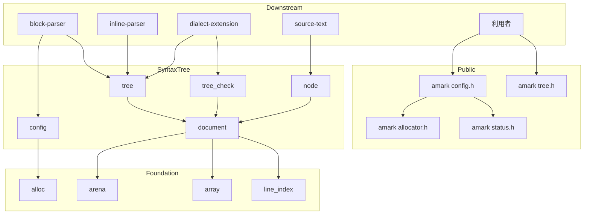
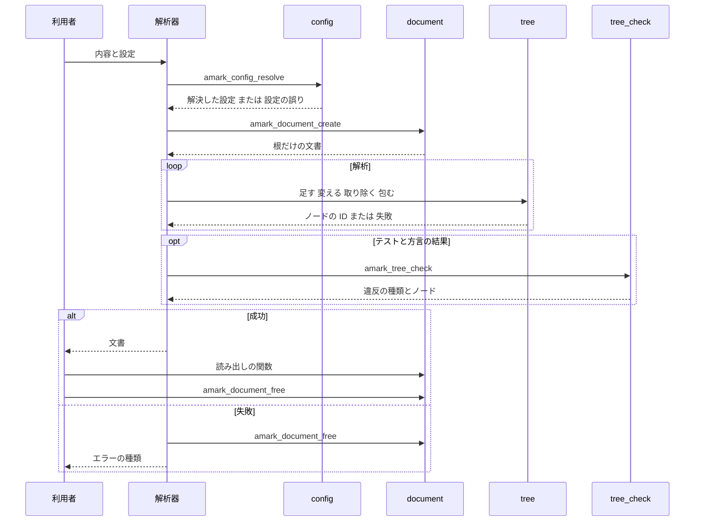
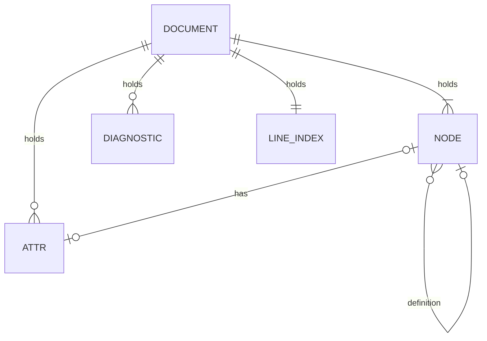

# Design Document

## Overview

**Purpose**: syntax-tree は、amark の解析結果を表す構文木と、その周りの公開の型を作る。ノードは原文を複製せず、原文の範囲（バイトのオフセット）と行番号だけを持つ。

**Users**: 利用者は、木を読み取り専用でたどる公開 API と、解析の設定・エラーの種類・診断の型を使う。解析器の開発者（block-parser、inline-parser、dialect-extension）は、木を作る内部 API と、不変条件を検査する関数を使う。

**Impact**: 公開ヘッダに、はじめて解析に関わる型と関数が加わる。project-foundation の `src/alloc.h` にある確保関数の型の定義を、公開ヘッダへ移す（動作は変えない）。この spec だけでは Markdown を解析できない。解析の入口は block-parser が作る。

### Goals
- CommonMark 0.31.2 の全要素と方言の種類を、1 つのノードの形で表す。
- 木を作る・読む・検査する・解放する処理を、すべて再帰なしで行う。
- 公開 API に構造体のレイアウトを出さず、ID と関数だけで木を読めるようにする。
- 設定の検査と解決を 1 か所にまとめ、block-parser がそのまま使えるようにする。

### Non-Goals
- 解析の規則と、解析の入口となる公開 API（block-parser、inline-parser）
- 設定の適用（範囲の切り出し、UTF-8 の検査と置換、資源の上限の検査）（block-parser）
- 範囲から文字列を作ること（source-text）
- 方言を定義して登録する公開 API（dialect-extension）
- 木を作る・書き換える公開 API、「最後の子」「前の兄弟」をたどる公開 API
- 種類やエラーの名前を文字列で返す関数

## Boundary Commitments

### This Spec Owns
- ノードの種類の ID の値と、方言の種類の ID の空間（`AMARK_KIND_DIALECT_MIN` 以上）
- ノードの表し方（範囲、行、つながり、属性）と、文書の本体のレイアウト（内部ヘッダ `src/document.h`）
- 木の不変条件の定義と、それを検査する関数
- 公開の型：`amark_document_t`、`amark_node_id_t`、`amark_kind_t`、`amark_range_t`、属性の列挙、`amark_status_t`、`amark_allocator_t`、`amark_config_t`、`amark_diagnostic_t`
- 公開の関数：木をたどる関数、属性を返す関数、診断を読む関数、文書を解放する関数、設定を初期化する関数、設定を検査する関数
- 内部の関数：文書を作る、ノードを足す・変える・取り除く・包む、属性を設定する、診断を足す、設定を解決する、内部のエラーを公開のエラーに変換する

### Out of Boundary
- どの構文にどの種類と属性を付けるか（block-parser、inline-parser）
- 資源の上限（入力の大きさ、入れ子の深さ、ノードの数）の検査。この spec は、上限の値を設定から取り出すところまでを行う。
- 「置き換えて続ける」設定のときに、文書に渡す内容をどのバイト列にするか（block-parser）
- 方言の構造体 `struct amark_dialect` の中身、方言の種類の ID の割り当て方、方言の属性のバイト列の形式（dialect-extension）
- 方言の規則が返した結果を採用するかどうかの判断と、その診断の文面（dialect-extension）
- 内容のバイト列を利用者に返す公開 API（source-text）

### Allowed Dependencies
- project-foundation の内部の部品：`alloc`、`arena`、`array`、`line_index`、`error.h`
- C99 の標準ヘッダ：`stdbool.h`、`stddef.h`、`stdint.h`、`string.h`
- 依存してはならないもの：`utf8`、`unicode`、`entity`（Markdown と文字の知識は要らない）、および解析器と方言のモジュール
- 公開ヘッダは内部ヘッダを取り込まない。内部ヘッダは公開ヘッダを取り込んでよい。

### Revalidation Triggers
次の変更は、下流の spec（block-parser、inline-parser、source-text、dialect-extension、spec-conformance）の見直しを要する。
- 種類の ID の値、`AMARK_KIND_DIALECT_MIN`、`amark_status_t` の値の変更
- 公開の関数の引数や戻り値、`amark_range_t`・`amark_diagnostic_t`・`amark_config_t` の項目の変更
- 内部 API（`src/tree.h`、`src/document.h`、`src/config.h`）の関数の契約の変更
- 不変条件の追加・削除・意味の変更
- 範囲と行の定義（どこから数えるか、終了行の決め方）の変更
- 「取り除いたノードの要素を再利用しない」という決まりの変更（ID の寿命が変わる）

## Architecture

### Existing Architecture Analysis
- モジュールは `src/<module>.c` と `src/<module>.h` の組で、`src/CMakeLists.txt` の `AMARK_SOURCES` に 1 行足すと `amark` と `amark_testing` の両方に入る。
- 公開ヘッダは `include/amark/` をディレクトリごとインストールする。ヘッダを足しても、インストールの規則は変えなくてよい。
- `checks.exports` は、動的ライブラリの公開シンボルが `tests/checks/exported_symbols.txt` と一致することを確かめる。`checks.objects` は、可変の静的データと `abort`・`exit`・`longjmp` の参照を禁じる。このため `assert` は使わない。
- `amark_array_t` は伸びるときに要素を写すので、要素へのポインタは次の追加で無効になる。
- 内部のエラーの型 `amark_error_t` は `NONE`・`NOMEM`・`OVERFLOW` の 3 つである。この型は変えない。

### Architecture Pattern & Boundary Map



**Architecture Integration**:
- **Selected pattern**: アリーナ上の平坦な配列と、32 ビットの添字によるつながり。公開 API は「文書とノードの ID」の組を受け取る関数の集まりである。
- **境界の分け方**: 「文書」（入れ物と診断）、「木を作る」（書き込み）、「読み出す」（公開の読み取り）、「検査する」、「設定」の 5 つのモジュールに分ける。書き込みと読み取りは、文書の本体のレイアウト（`src/document.h`）だけを共有し、互いを呼ばない。
- **依存の向き**: `公開ヘッダ ← 内部ヘッダ`、`project-foundation の部品 ← document ← tree / node / tree_check`、`alloc ← config`。`config` と木の側のモジュールは互いに依存しない。
- **守る既存のパターン**: モジュールは `.c` と内部ヘッダの組。名前は `amark_` で始める。再帰、可変の静的データ、I/O、`assert` を使わない。失敗は戻り値で伝える。
- **Steering との整合**: 資源の持ち主は文書である。原文は複製しない。木を作るのは内部 API だけである。

### Technology Stack

| Layer | Choice / Version | Role in Feature | Notes |
|-------|------------------|-----------------|-------|
| ライブラリ | C99 | 構文木、設定、診断 | 新しい依存はない |
| メモリ | project-foundation の `arena`・`array` | ノード、属性、診断、文字列の置き場 | 文書ごとにアリーナを 1 つ持つ |
| 行番号 | project-foundation の `line_index` | 範囲から行番号を定める | 内容の全体について作る |
| テスト | Naos `v0.4.0`、CTest | 単体テストと公開 API のテスト | 既存の登録の関数を使う |

## File Structure Plan

### Directory Structure
```
include/amark/
├── allocator.h        # 確保関数の型（amark_malloc_fn_t、amark_free_fn_t、amark_allocator_t）
├── status.h           # amark_status_t
├── config.h           # amark_config_t、amark_utf8_mode_t、AMARK_END_OF_CONTENT、初期化と検査の関数
└── tree.h             # 文書、ノードの ID、種類、範囲、属性、診断の型と、読み出しと解放の関数
src/
├── status.c / status.h        # amark_error_t から amark_status_t への変換
├── config.c / config.h        # 設定の初期化・検査・解決（amark_resolved_config_t）
├── document.c / document.h    # 文書の本体とノードのレイアウト、文書を作る・解放する、診断を足す・読む
├── tree.c / tree.h            # 木を作る内部 API（足す、差し込む、変える、取り除く、包む、属性の設定）
├── node.c                     # 公開の読み出しの関数（たどる、種類、範囲、行、属性）。内部ヘッダは持たない
└── tree_check.c / tree_check.h  # 不変条件の検査
tests/
├── unit/
│   ├── test_config.c          # 設定の解決と、エラーの変換
│   ├── test_document.c        # 文書を作る・解放する、診断、確保の失敗の注入
│   ├── test_tree.c            # 木を作る操作と、公開の読み出し、深い木
│   └── test_tree_check.c      # 不変条件の各条件
└── public/
    └── test_config.c          # 公開 API だけでの、設定の初期化と検査、「ない」を表す値での呼び出し
```

### Modified Files
- `include/amark/amark.h` — 新しい 4 つの公開ヘッダを取り込む。
- `src/alloc.h` — 確保関数の 3 つの型の定義を消し、`<amark/allocator.h>` を取り込む。関数の宣言は変えない。
- `src/CMakeLists.txt` — `AMARK_SOURCES` に `config.c`、`document.c`、`node.c`、`status.c`、`tree.c`、`tree_check.c` を足す。
- `tests/CMakeLists.txt` — 上の 4 つの単体テストと 1 つの公開 API のテストを登録する。
- `tests/public/header_cxx.cpp` — 新しい公開の型と関数を C++ から使うテストを足す。
- `tests/checks/exported_symbols.txt` — この spec が公開する関数の名前を足す。
- `README.md` — 公開 API の節に、設定の初期化と木のたどり方の例を足す。

## System Flows

### 文書の一生



- 解析が失敗したときは、解析器が作りかけの文書を `amark_document_free` で解放する。内部 API のどの失敗の後でも、文書は解放できる状態にある。
- 図の「解析器」は block-parser 以降の spec である。この spec のテストでは、テストのコードが解析器の役をする。

### 文書の順の走査（利用者の側）

親・最初の子・次の兄弟だけで、再帰もスタックも使わずに全体を回れる。公開ヘッダの注釈と README に、次の形の例を載せる。

```c
amark_node_id_t root = amark_document_root(doc);
amark_node_id_t node = root;
while (node != AMARK_NODE_NONE) {
    /* node を訪れる */
    amark_node_id_t next = amark_node_first_child(doc, node);
    while (next == AMARK_NODE_NONE && node != root) {
        next = amark_node_next_sibling(doc, node);
        if (next == AMARK_NODE_NONE) {
            node = amark_node_parent(doc, node);
        }
    }
    node = next;
}
```

## Requirements Traceability

| Requirement | Summary | Components | Interfaces |
|-------------|---------|------------|------------|
| 1.1 | 種類は 1 つ | Document | `amark_node` の `kind` |
| 1.2 | ブロックの種類 | PublicTree | `AMARK_KIND_DOCUMENT` から `AMARK_KIND_LINK_REFERENCE_DEFINITION` |
| 1.3 | インラインの種類 | PublicTree | `AMARK_KIND_TEXT` から `AMARK_KIND_CHARACTER_REFERENCE` |
| 1.4 | 書き方は属性で区別 | PublicTree | `amark_heading_style`、`amark_code_block_style` |
| 1.5 | 空行はノードにしない | PublicTree | 空行の種類を定義しない |
| 1.6 | 方言の ID の空間 | PublicTree | `AMARK_KIND_DIALECT_MIN` |
| 1.7 | CommonMark か方言か | NodeReader | `amark_kind_is_core`、`amark_kind_is_dialect` |
| 1.8 | ブロックかインラインか | NodeReader | `amark_node_is_block`、`amark_node_is_inline` |
| 1.9 | ID の値は変えない | PublicTree | 列挙に値を明示する |
| 2.1 | 範囲 `[start, end)` | Document、NodeReader | `amark_node_range` |
| 2.2 | 内容の先頭から数える | Document | `amark_document_create` の契約 |
| 2.3 | 長さ 0 の範囲 | TreeBuilder | `amark_tree_append` |
| 2.4 | 行は 1 から、CommonMark の行末 | Document | `line_index` を使う |
| 2.5 | 開始行 | TreeBuilder | 行の定め方 |
| 2.6 | 終了行 | TreeBuilder | 行の定め方 |
| 2.7 | 根の範囲は解析する範囲 | Document | `amark_document_create` |
| 2.8 | 原文を複製しない | Document | Data Models |
| 2.9 | 内容を変更しない | Document | 内容は `const` で受ける |
| 3.1 | 見出しの属性 | TreeBuilder、NodeReader | `amark_tree_set_heading`、`amark_heading_level`、`amark_heading_style` |
| 3.2 | リストの種別とタイト | TreeBuilder、NodeReader | `amark_tree_set_list`、`amark_list_type`、`amark_list_spacing` |
| 3.3 | 箇条書きの記号 | NodeReader | `amark_list_bullet_char` |
| 3.4 | 開始番号と区切り | NodeReader | `amark_list_start`、`amark_list_delimiter` |
| 3.5 | コードブロックの書き方 | TreeBuilder、NodeReader | `amark_tree_set_code_block`、`amark_code_block_style` |
| 3.6 | フェンスと info | NodeReader | `amark_code_block_fence_char`、`amark_code_block_fence_length`、`amark_code_block_info` |
| 3.7 | リンクと画像の形式 | TreeBuilder、NodeReader | `amark_tree_set_link`、`amark_link_form` |
| 3.8 | dest と title の範囲 | NodeReader | `amark_link_destination`、`amark_link_title` |
| 3.9 | 参照先の定義 | NodeReader | `amark_link_definition` |
| 3.10 | リンク参照定義の範囲 | TreeBuilder、NodeReader | `amark_tree_set_definition`、`amark_definition_label`、`amark_definition_destination`、`amark_definition_title` |
| 3.11 | オートリンクの種別 | TreeBuilder、NodeReader | `amark_tree_set_autolink`、`amark_autolink_type` |
| 3.12 | 「ない」と「空」の区別 | NodeReader | 範囲を返す関数の戻り値 |
| 3.13 | 属性の範囲も内容の先頭から | Document | `amark_range_t` |
| 3.14 | 方言の属性 | TreeBuilder、NodeReader | `amark_tree_set_dialect_data`、`amark_node_dialect_data` |
| 4.1 | 根を返す | NodeReader | `amark_document_root` |
| 4.2 | 親・最初の子・次の兄弟 | NodeReader | `amark_node_parent`、`amark_node_first_child`、`amark_node_next_sibling` |
| 4.3 | 「ノードがない」 | PublicTree | `AMARK_NODE_NONE` |
| 4.4 | 種類・範囲・行 | NodeReader | `amark_node_kind`、`amark_node_range`、`amark_node_start_line`、`amark_node_end_line` |
| 4.5 | 属性を返す | NodeReader | 属性の関数 |
| 4.6 | 種類の合わない属性 | NodeReader | 「ない」を表す値を返す決まり |
| 4.7 | 方言のノード | NodeReader | `amark_node_kind`、`amark_node_dialect_data` |
| 4.8 | 兄弟は原文の順 | TreeBuilder、TreeCheck | 足す順と、範囲の条件 |
| 4.9 | 再帰なしの走査 | NodeReader | System Flows の例 |
| 4.10 | 木の大きさによらない時間 | Document | ノードに行とつながりを持たせる |
| 4.11 | 文書を変更しない | NodeReader | 引数は `const amark_document_t *` |
| 4.12 | 同じ文書を並行して読む | NodeReader | 読み出しは書き込みもキャッシュも持たない |
| 4.13 | 書き換える公開 API がない | PublicTree | 公開ヘッダに宣言しない |
| 4.14 | 解放まで有効 | Document | ID と範囲の寿命 |
| 5.1 | すべて解放する | Document | `amark_document_free` |
| 5.2 | 作ったときの確保関数で | Document | 文書が確保関数の写しを持つ |
| 5.3 | 「文書がない」では何もしない | Document | `amark_document_free(NULL)` |
| 5.4 | 再帰なしの解放 | Document | アリーナの解放 |
| 5.5 | 内容に触れない | Document | 内容は持ち主ではない |
| 5.6 | 別々の文書は独立 | Document | 共有する状態がない |
| 6.1 | 構造の条件 | TreeCheck | `AMARK_TREE_VIOLATION_ROOT`、`AMARK_TREE_VIOLATION_LINK` |
| 6.2 | 範囲の条件 | TreeCheck | `AMARK_TREE_VIOLATION_BOUNDS`、`_PARENT_RANGE`、`_SIBLING_ORDER` |
| 6.3 | 行の条件 | TreeCheck | `AMARK_TREE_VIOLATION_LINES` |
| 6.4 | 入れ子の条件 | TreeCheck | `AMARK_TREE_VIOLATION_NESTING` |
| 6.5 | 属性の条件 | TreeCheck | `AMARK_TREE_VIOLATION_ATTRIBUTE` |
| 6.6 | 成り立つと報告 | TreeCheck | `AMARK_TREE_VIOLATION_NONE` |
| 6.7 | 最初の違反を返す | TreeCheck | `amark_tree_check_result_t` |
| 6.8 | 部分だけの検査 | TreeCheck | `amark_tree_check_subtree` |
| 6.9 | 変更も確保も再帰もしない | TreeCheck | 親の添字で戻る走査 |
| 6.10 | ノードの数に比例する時間 | TreeCheck | 1 回の走査 |
| 6.11 | 壊れた木でも安全に終わる | TreeCheck | 添字の範囲の検査と、歩数の上限 |
| 6.12 | 公開しない | TreeCheck | `src/tree_check.h` |
| 7.1 | 文書を作る | Document | `amark_document_create` |
| 7.2 | 親の最後の子として足す | TreeBuilder | `amark_tree_append` |
| 7.3 | 行は範囲から定める | TreeBuilder | 行の定め方 |
| 7.4 | 属性を設定する | TreeBuilder | `amark_tree_set_*` |
| 7.5 | 範囲・種類の変更、取り除く、包む | TreeBuilder | `amark_tree_set_range`、`amark_tree_set_kind`、`amark_tree_remove`、`amark_tree_wrap`、`amark_tree_insert_before` |
| 7.6 | 方言のノードを作る | TreeBuilder | `amark_tree_append` の `cls`、`amark_tree_set_dialect_data` |
| 7.7 | 文書の確保関数だけを使う | Document | 文書のアリーナ |
| 7.8 | 確保の失敗 | TreeBuilder | `AMARK_STATUS_NOMEM` |
| 7.9 | ノードの数の上限 | TreeBuilder | `AMARK_STATUS_LIMIT_EXCEEDED` |
| 7.10 | 作りかけの文書の解放 | Document | `amark_document_free` |
| 7.11 | 途中の木を検査に渡せる | TreeBuilder、TreeCheck | つながりを常に正しく保つ |
| 7.12 | 公開しない | TreeBuilder | `src/tree.h`、`AMARK_API` を付けない |
| 7.13 | 再帰を使わない | TreeBuilder | どの操作もループを持たないか、1 重のループ |
| 8.1 | 設定の項目 | Config | `amark_config_t` |
| 8.2 | 規則を変える項目がない | Config | `amark_config_t` |
| 8.3 | 既定の設定 | Config | `amark_config_init` |
| 8.4 | 「内容の全体」 | Config | `AMARK_END_OF_CONTENT` |
| 8.5 | UTF-8 の扱い | Config | `amark_utf8_mode_t` |
| 8.6 | 資源の上限 | Config | `max_*`（0 は上限なし） |
| 8.7 | ファイル名は省略できる | Config | `filename` が `NULL` |
| 8.8 | 確保関数の組 | Config | `amark_allocator_t` |
| 8.9 | 方言なし | Config | `dialect` が `NULL` |
| 9.1 | 設定の検査 | Config | `amark_config_validate` |
| 9.2 | 既定の設定は正しい | Config | `amark_config_resolve` |
| 9.3 | 確保関数の片方だけ | Config | 検査の規則 2 |
| 9.4 | 開始が終了より大きい | Config | 検査の規則 3 |
| 9.5 | 終了が長さより大きい | Config | 検査の規則 3 |
| 9.6 | 空の範囲は正しい | Config | 検査の規則 3 |
| 9.7 | 定義されていない UTF-8 の扱い | Config | 検査の規則 4 |
| 9.8 | 上限の超過は判定しない | Config | 検査の規則にない |
| 9.9 | 確保も変更もしない | Config | 引数は `const`、結果は呼び出した側の変数 |
| 9.10 | 公開の関数 | Config | `AMARK_API` |
| 10.1 | 成功と 4 つの失敗 | Status | `amark_status_t` |
| 10.2 | 構文の誤りの値がない | Status | `amark_status_t` |
| 10.3 | 値は変えない | Status | 列挙に値を明示する |
| 10.4 | 戻り値で伝える | Status、Config、TreeBuilder | `assert` と `abort` を使わない |
| 11.1 | 診断の項目 | PublicTree | `amark_diagnostic_t` |
| 11.2 | 重大度 | PublicTree | `amark_severity_t` |
| 11.3 | メッセージは NUL で終わる | Document | `amark_document_add_diagnostic` が写す |
| 11.4 | ファイル名を返す | Document | 文書が持つ写し |
| 11.5 | ファイル名がない | Document | `filename` が `NULL` |
| 11.6 | 足された順に持つ | Document | 診断の配列 |
| 11.7 | 件数と番号で読む | Document | `amark_document_diagnostic_count`、`amark_document_diagnostic` |
| 11.8 | 件数以上の番号 | Document | `false` を返す |
| 11.9 | 解放まで有効 | Document | 文字列をアリーナに写す |
| 11.10 | 診断を足す | Document | `amark_document_add_diagnostic` |
| 11.11 | 足すときの確保の失敗 | Document | 写してから配列に足す順序 |
| 11.12 | 足す関数は公開しない | Document | `src/document.h` |
| 12.1 | 中身の見えないハンドル | PublicTree | `amark_document_t` は不完全型、ノードは ID |
| 12.2 | C99、全コンパイラ、C++ | PublicTree、Config、Status | 公開ヘッダの決まり |
| 12.3 | それだけで取り込める | PublicTree、Config、Status | 公開ヘッダの決まり |
| 12.4 | 名前の決まり | すべて | `amark_`、`AMARK_` |
| 12.5 | 公開シンボルの一覧 | BuildAndChecks | `exported_symbols.txt` |
| 12.6 | 状態も I/O もない | すべて | `checks.objects` |
| 12.7 | 同じ操作から同じ木 | TreeBuilder | ID は足した順の連番 |
| 12.8 | 解析の規則を知らない | すべて | Allowed Dependencies |
| 12.9 | 単体テストの範囲 | Tests | Testing Strategy |
| 12.10 | 確保の失敗の注入 | Tests | Testing Strategy |
| 12.11 | 深さ 10 万段 | Tests | Testing Strategy |

## Components and Interfaces

| Component | Layer | Intent | Req Coverage | Key Dependencies | Contracts |
|-----------|-------|--------|--------------|------------------|-----------|
| Status | 公開の型 | エラーの種類と、内部のエラーからの変換 | 10.1–10.4 | `error.h` (P0) | Service |
| Config | 公開の型と関数 | 設定の型、初期化、検査、解決 | 8.1–8.9、9.1–9.10 | Status (P0)、`alloc` (P0) | Service |
| PublicTree | 公開ヘッダ | 文書・ノード・種類・属性・診断の型と定数 | 1.2–1.6、1.9、4.3、4.13、11.1、11.2、12.1–12.3 | なし | Service |
| Document | 内部 | 文書の本体、作る・解放する、診断 | 2.1、2.2、2.4、2.7–2.9、4.10、4.14、5.1–5.6、7.1、7.7、7.10、11.3–11.12 | `arena`・`array`・`line_index` (P0) | Service、State |
| TreeBuilder | 内部 | 木を作る操作と属性の設定 | 2.3、2.5、2.6、3.1–3.14、7.2–7.9、7.11–7.13、12.7 | Document (P0) | Service |
| NodeReader | 公開の関数 | 木をたどり、情報を返す | 1.7、1.8、3.1–3.14、4.1–4.12 | Document (P0) | Service |
| TreeCheck | 内部 | 不変条件の検査 | 6.1–6.12 | Document (P0) | Service |
| BuildAndChecks | ビルド | ソースとテストの登録、公開シンボルの一覧 | 12.5、12.6 | 既存の CMake | Batch |
| Tests | テスト | 単体テストと公開 API のテスト | 12.9–12.11 | Naos、`amark_test_support` | — |

### 公開の型

#### Status

| Field | Detail |
|-------|--------|
| Intent | 失敗の原因を 4 つの種類で伝える |
| Requirements | 10.1, 10.2, 10.3, 10.4 |

**Responsibilities & Constraints**
- 公開の関数と、この spec の内部 API は、失敗を `amark_status_t` で返す。
- project-foundation の部品が返す `amark_error_t` は、`amark_status_from_error` で変換する。変換はこの関数だけで行う。

##### Service Interface
```c
/* include/amark/status.h */
typedef enum amark_status {
    AMARK_STATUS_OK = 0,
    AMARK_STATUS_INVALID_INPUT = 1,  /* 入力の制約違反 */
    AMARK_STATUS_INVALID_CONFIG = 2, /* 設定の誤り */
    AMARK_STATUS_LIMIT_EXCEEDED = 3, /* 資源の上限の超過 */
    AMARK_STATUS_NOMEM = 4           /* メモリ不足 */
} amark_status_t;

/* src/status.h */
amark_status_t amark_status_from_error(amark_error_t error);
```
- 変換：`AMARK_ERROR_NONE` → `OK`、`AMARK_ERROR_NOMEM` → `NOMEM`、`AMARK_ERROR_OVERFLOW` → `LIMIT_EXCEEDED`。
- `OVERFLOW`（大きさの計算があふれた）を資源の上限の超過とするのは、実装が表せる大きさを超えたことを意味するからである。

#### Config

| Field | Detail |
|-------|--------|
| Intent | 解析の対象と資源の扱いを指定する型と、その検査 |
| Requirements | 8.1, 8.2, 8.3, 8.4, 8.5, 8.6, 8.7, 8.8, 8.9, 9.1, 9.2, 9.3, 9.4, 9.5, 9.6, 9.7, 9.8, 9.9, 9.10 |

**Responsibilities & Constraints**
- 設定の型を公開する。構文の規則を変える項目は持たない。
- 検査と解決を `amark_config_resolve` の 1 か所で行う。公開の `amark_config_validate` は、これを呼んで結果を捨てる。
- 資源の上限の値は取り出すだけで、内容と比べない。比べるのは block-parser である。
- メモリを確保しない。

**Dependencies**
- Outbound: `alloc` — 既定の確保関数（`amark_allocator_default`）(P0)
- Inbound: block-parser — 解析の入口で `amark_config_resolve` を呼ぶ (P0)

##### Service Interface
```c
/* include/amark/allocator.h（src/alloc.h から移す。内容は同じ） */
typedef void *(*amark_malloc_fn_t)(void *ctx, size_t size);
typedef void (*amark_free_fn_t)(void *ctx, void *ptr);
typedef struct amark_allocator {
    amark_malloc_fn_t malloc_fn;
    amark_free_fn_t free_fn;
    void *ctx;
} amark_allocator_t;

/* include/amark/config.h */
typedef struct amark_dialect amark_dialect_t; /* 中身は dialect-extension が定める */

typedef enum amark_utf8_mode {
    AMARK_UTF8_STRICT = 0, /* 不正な UTF-8 はエラー */
    AMARK_UTF8_REPLACE = 1 /* U+FFFD に置き換えて続ける */
} amark_utf8_mode_t;

#define AMARK_END_OF_CONTENT ((size_t)-1)

typedef struct amark_config {
    size_t struct_size;             /* amark_config_init が書き込む */
    const amark_dialect_t *dialect; /* NULL：CommonMark だけ */
    size_t start;                   /* 解析する範囲の開始 */
    size_t end;                     /* 終了。AMARK_END_OF_CONTENT：内容の終わりまで */
    amark_allocator_t allocator;    /* 2 つの関数がどちらも NULL：malloc と free */
    const char *filename;           /* NULL：ファイル名なし */
    int utf8_mode;                  /* amark_utf8_mode_t の値 */
    size_t max_input_size;          /* 0：上限なし */
    size_t max_nesting_depth;       /* 0：上限なし */
    size_t max_node_count;          /* 0：上限なし */
} amark_config_t;

AMARK_API void amark_config_init(amark_config_t *config);
AMARK_API amark_status_t amark_config_validate(const amark_config_t *config,
                                               size_t content_length);

/* src/config.h */
typedef struct amark_resolved_config {
    const amark_dialect_t *dialect;
    size_t start;
    size_t end;                  /* AMARK_END_OF_CONTENT は content_length に直してある */
    amark_allocator_t allocator; /* 既定の確保関数に直してある */
    const char *filename;
    amark_utf8_mode_t utf8_mode;
    size_t max_input_size;
    size_t max_nesting_depth;
    size_t max_node_count;
} amark_resolved_config_t;

amark_status_t amark_config_resolve(const amark_config_t *config,
                                    size_t content_length,
                                    amark_resolved_config_t *out);
```
- `amark_config_init`：`config` を既定の値にする。`struct_size` は `sizeof(amark_config_t)`、`end` は `AMARK_END_OF_CONTENT`、ほかはすべて 0 か `NULL`。`config` が `NULL` なら何もしない。
- `utf8_mode` を `int` にしているのは、定義されていない値が入っていても、読むことが未定義の動作にならないようにするためである。
- `amark_config_resolve` と `amark_config_validate`：`config` が `NULL` のときは、既定の設定として扱う。次の規則を順に確かめ、最初に破れたところで `AMARK_STATUS_INVALID_CONFIG` を返す。すべて通れば `AMARK_STATUS_OK` を返す。
  1. `struct_size` が `sizeof(amark_config_t)` に等しい。
  2. `allocator.malloc_fn` と `allocator.free_fn` が、どちらも `NULL` か、どちらも `NULL` でない。
  3. `end` が `AMARK_END_OF_CONTENT` なら `content_length` に読み替える。そのうえで `start <= end` かつ `end <= content_length` である。
  4. `utf8_mode` が `AMARK_UTF8_STRICT` か `AMARK_UTF8_REPLACE` である。
- Postconditions: 失敗したとき、`*out` は変わらない。`config` は変わらない。
- `dialect`、`filename`、`max_*` には、誤りとなる値がない。2 つの関数がどちらも `NULL` のとき、`allocator.ctx` は無視する。

**Implementation Notes**
- Integration: `src/alloc.h` は 3 つの型の定義を消して `<amark/allocator.h>` を取り込む。`amark_allocator_default` などの関数は内部のままである。
- Risks: 項目を足す版では、規則 1 を「知っている大きさのどれか」に広げる。

#### PublicTree

| Field | Detail |
|-------|--------|
| Intent | 木と診断を読むための公開の型と定数 |
| Requirements | 1.2, 1.3, 1.4, 1.5, 1.6, 1.9, 4.3, 4.13, 11.1, 11.2, 12.1, 12.2, 12.3 |

**Responsibilities & Constraints**
- 文書は不完全型、ノードは 32 ビットの ID とする。構造体のレイアウトは出さない。
- 列挙は、すべての値を明示して書く。属性の列挙は 0 を「ない」とする。
- `amark_range_t` と `amark_diagnostic_t` は、呼び出した側が用意する値の型で、項目は今後も足さない。
- 4 つの公開ヘッダは、それぞれ必要な標準ヘッダと `<amark/export.h>` を自分で取り込み、`extern "C"` で囲む。

##### Service Interface
```c
/* include/amark/tree.h */
typedef struct amark_document amark_document_t;

typedef uint32_t amark_node_id_t;
#define AMARK_NODE_NONE ((amark_node_id_t)0)

typedef uint32_t amark_kind_t;
enum {
    AMARK_KIND_NONE = 0,
    /* ブロック：1 から 31 */
    AMARK_KIND_DOCUMENT = 1,
    AMARK_KIND_BLOCK_QUOTE = 2,
    AMARK_KIND_LIST = 3,
    AMARK_KIND_LIST_ITEM = 4,
    AMARK_KIND_THEMATIC_BREAK = 5,
    AMARK_KIND_HEADING = 6,
    AMARK_KIND_CODE_BLOCK = 7,
    AMARK_KIND_HTML_BLOCK = 8,
    AMARK_KIND_PARAGRAPH = 9,
    AMARK_KIND_LINK_REFERENCE_DEFINITION = 10,
    /* インライン：32 から 63 */
    AMARK_KIND_TEXT = 32,
    AMARK_KIND_CODE_SPAN = 33,
    AMARK_KIND_EMPHASIS = 34,
    AMARK_KIND_STRONG = 35,
    AMARK_KIND_LINK = 36,
    AMARK_KIND_IMAGE = 37,
    AMARK_KIND_AUTOLINK = 38,
    AMARK_KIND_RAW_HTML = 39,
    AMARK_KIND_HARD_BREAK = 40,
    AMARK_KIND_SOFT_BREAK = 41,
    AMARK_KIND_BACKSLASH_ESCAPE = 42,
    AMARK_KIND_CHARACTER_REFERENCE = 43
};
#define AMARK_KIND_DIALECT_MIN ((amark_kind_t)0x10000)

typedef struct amark_range {
    size_t start;
    size_t end;
} amark_range_t;

typedef enum amark_heading_style {
    AMARK_HEADING_STYLE_NONE = 0, AMARK_HEADING_ATX = 1, AMARK_HEADING_SETEXT = 2
} amark_heading_style_t;
typedef enum amark_list_type {
    AMARK_LIST_TYPE_NONE = 0, AMARK_LIST_BULLET = 1, AMARK_LIST_ORDERED = 2
} amark_list_type_t;
typedef enum amark_list_spacing {
    AMARK_LIST_SPACING_NONE = 0, AMARK_LIST_TIGHT = 1, AMARK_LIST_LOOSE = 2
} amark_list_spacing_t;
typedef enum amark_code_block_style {
    AMARK_CODE_BLOCK_STYLE_NONE = 0, AMARK_CODE_BLOCK_INDENTED = 1, AMARK_CODE_BLOCK_FENCED = 2
} amark_code_block_style_t;
typedef enum amark_link_form {
    AMARK_LINK_FORM_NONE = 0, AMARK_LINK_INLINE = 1, AMARK_LINK_FULL = 2,
    AMARK_LINK_COLLAPSED = 3, AMARK_LINK_SHORTCUT = 4
} amark_link_form_t;
typedef enum amark_autolink_type {
    AMARK_AUTOLINK_TYPE_NONE = 0, AMARK_AUTOLINK_URI = 1, AMARK_AUTOLINK_EMAIL = 2
} amark_autolink_type_t;

typedef enum amark_severity {
    AMARK_SEVERITY_WARNING = 1, AMARK_SEVERITY_ERROR = 2
} amark_severity_t;
typedef struct amark_diagnostic {
    size_t offset;             /* 内容の先頭から数えたバイトのオフセット */
    size_t line;               /* 行番号。最初の行は 1 */
    amark_severity_t severity;
    const char *message;       /* NUL で終わる。文書の解放まで有効 */
    const char *filename;      /* NULL：ファイル名なし。文書の解放まで有効 */
} amark_diagnostic_t;
```
- 種類の ID は、1 から 31 がブロック、32 から 63 がインライン、`AMARK_KIND_DIALECT_MIN` 以上が方言である。64 から `0xFFFF` は、将来の CommonMark の種類のために空けておく。
- ノードを作る・取り除く・書き換える関数は、公開ヘッダに宣言しない。

### 内部：文書

#### Document

| Field | Detail |
|-------|--------|
| Intent | 1 回の解析の結果（木、属性、診断）の持ち主 |
| Requirements | 2.1, 2.2, 2.4, 2.7, 2.8, 2.9, 3.13, 4.10, 4.14, 5.1, 5.2, 5.3, 5.4, 5.5, 5.6, 7.1, 7.7, 7.10, 11.3, 11.4, 11.5, 11.6, 11.7, 11.8, 11.9, 11.10, 11.11, 11.12 |

**Responsibilities & Constraints**
- 文書の本体は、確保関数から 1 つ確保する。それ以外のメモリ（ノード、属性、診断、行の索引、ファイル名とメッセージの写し、方言の属性）は、すべて文書のアリーナから得る。
- 内容のバイト列は持ち主ではない。ポインタと長さだけを持ち、変更も解放もしない。内容は、文書を解放するまで呼び出した側が保つ。
- 文書とノードのレイアウトは `src/document.h` に置く。`src/` の中では見えるが、ほかの spec のモジュールは関数だけを使う。
- 1 つの文書を、複数のスレッドから同時に書き換えてはならない。書き換えが終わった文書は、複数のスレッドから同時に読める。

**Dependencies**
- Outbound: `arena`、`array`、`line_index`、`alloc` (P0)
- Inbound: TreeBuilder、NodeReader、TreeCheck、解析器 (P0)

##### Service Interface
```c
/* src/document.h */
amark_status_t amark_document_create(const amark_allocator_t *allocator,
                                     const unsigned char *content,
                                     size_t content_length,
                                     size_t start, size_t end,
                                     const char *filename,
                                     amark_document_t **out);

amark_status_t amark_document_add_diagnostic(amark_document_t *doc,
                                             size_t offset,
                                             amark_severity_t severity,
                                             const char *message);

const unsigned char *amark_document_content(const amark_document_t *doc);
size_t amark_document_content_length(const amark_document_t *doc);
const amark_line_index_t *amark_document_line_index(const amark_document_t *doc);
size_t amark_document_node_count(const amark_document_t *doc);

/* include/amark/tree.h */
AMARK_API void amark_document_free(amark_document_t *doc);
AMARK_API size_t amark_document_diagnostic_count(const amark_document_t *doc);
AMARK_API bool amark_document_diagnostic(const amark_document_t *doc, size_t index,
                                         amark_diagnostic_t *out);
```
- `amark_document_create`
  - Preconditions: `allocator` は解決済み（2 つの関数が `NULL` でない）。`start <= end <= content_length`。`content` は `content_length` が 0 のとき `NULL` でもよい。`filename` は `NULL` か、NUL で終わる文字列。
  - Postconditions: 成功すると、`*out` は根（ID 1、種類は文書、範囲は `[start, end)`）だけを持つ文書になる。行の索引は内容の全体について作ってある。`filename` は文書の中に写してある。
  - 失敗すると、確保したものをすべて解放し、`*out` を `NULL` にして `NOMEM` か `LIMIT_EXCEEDED` を返す。
- `amark_document_add_diagnostic`
  - Preconditions: `offset <= content_length`。`message` は NUL で終わる文字列。
  - Postconditions: メッセージを文書の中に写し、行番号を `offset` から定めて、診断の最後に足す。
  - メッセージを写してから配列に足す。どちらかが失敗したら `NOMEM` か `LIMIT_EXCEEDED` を返し、すでにある診断と木は変わらない（写したメッセージはアリーナに残るが、どこからも参照されない）。
- `amark_document_node_count`：これまでに作ったノードの数を返す。取り除いたノードも数える。block-parser がノードの数の上限と比べるのに使う。
- `amark_document_free`：`doc` が `NULL` なら何もしない。そうでなければ、確保関数の写しを取り、アリーナを解放し、本体を解放する。
- `amark_document_diagnostic`：`index` が件数以上のとき、または `doc` か `out` が `NULL` のとき、`false` を返して `*out` を変えない。`amark_document_diagnostic_count` は、`doc` が `NULL` なら 0 を返す。

##### State Management
- State model: 「作っている途中」と「できあがり」の区別を、文書は持たない。内部 API を呼ぶ側が書き換えをやめた時点で、読み取り専用になる。
- Concurrency strategy: 共有する状態がないので、別々の文書は並行して使える。読み出しの関数は文書に何も書かない。

### 内部：木を作る

#### TreeBuilder

| Field | Detail |
|-------|--------|
| Intent | 解析器と方言が木を組み立てるための操作 |
| Requirements | 2.3, 2.5, 2.6, 3.1, 3.2, 3.3, 3.4, 3.5, 3.6, 3.7, 3.8, 3.9, 3.10, 3.11, 3.12, 3.14, 4.8, 7.2, 7.3, 7.4, 7.5, 7.6, 7.8, 7.9, 7.11, 7.12, 7.13, 10.4, 12.7 |

**Responsibilities & Constraints**
- つながり（親、最初の子、最後の子、前の兄弟、次の兄弟）と行番号を、どの操作の後でも正しく保つ。
- 範囲・入れ子・属性の条件は確かめない。確かめるのは TreeCheck である（`research.md` の「内部 API は範囲の正しさを検査しない」を参照）。
- 関数は ID を受け渡しする。ノードへのポインタは返さない。
- 失敗するのは、確保の失敗（`NOMEM`）と、表せる数の超過（`LIMIT_EXCEEDED`）だけである。失敗したとき、木は呼び出しの前と同じである。
- ID は、足した順の連番である。同じ順序の同じ操作からは、同じ ID の同じ木ができる。

**Dependencies**
- Outbound: Document — 配列と行の索引 (P0)
- Inbound: block-parser、inline-parser、dialect-extension、テスト (P0)

##### Service Interface
```c
/* src/tree.h */
typedef enum amark_node_class {
    AMARK_NODE_CLASS_AUTO = 0,  /* CommonMark の種類：ID から決める */
    AMARK_NODE_CLASS_BLOCK = 1,
    AMARK_NODE_CLASS_INLINE = 2
} amark_node_class_t;

/* ノードを足す */
amark_status_t amark_tree_append(amark_document_t *doc, amark_node_id_t parent,
                                 amark_kind_t kind, amark_node_class_t cls,
                                 size_t start, size_t end, amark_node_id_t *out);
amark_status_t amark_tree_insert_before(amark_document_t *doc, amark_node_id_t sibling,
                                        amark_kind_t kind, amark_node_class_t cls,
                                        size_t start, size_t end, amark_node_id_t *out);
amark_status_t amark_tree_wrap(amark_document_t *doc,
                               amark_node_id_t first, amark_node_id_t last,
                               amark_kind_t kind, amark_node_class_t cls,
                               size_t start, size_t end, amark_node_id_t *out);

/* ノードを変える（失敗しない） */
void amark_tree_set_range(amark_document_t *doc, amark_node_id_t node,
                          size_t start, size_t end);
void amark_tree_set_kind(amark_document_t *doc, amark_node_id_t node,
                         amark_kind_t kind, amark_node_class_t cls);
void amark_tree_remove(amark_document_t *doc, amark_node_id_t node);

/* 属性を設定する */
amark_status_t amark_tree_set_heading(amark_document_t *doc, amark_node_id_t node,
                                      unsigned level, amark_heading_style_t style);
amark_status_t amark_tree_set_list(amark_document_t *doc, amark_node_id_t node,
                                   amark_list_type_t type, char marker,
                                   uint32_t start_number, amark_list_spacing_t spacing);
amark_status_t amark_tree_set_code_block(amark_document_t *doc, amark_node_id_t node,
                                         amark_code_block_style_t style, char fence_char,
                                         size_t fence_length, const amark_range_t *info);
amark_status_t amark_tree_set_link(amark_document_t *doc, amark_node_id_t node,
                                   amark_link_form_t form,
                                   const amark_range_t *destination,
                                   const amark_range_t *title,
                                   amark_node_id_t definition);
amark_status_t amark_tree_set_definition(amark_document_t *doc, amark_node_id_t node,
                                         const amark_range_t *label,
                                         const amark_range_t *destination,
                                         const amark_range_t *title);
amark_status_t amark_tree_set_autolink(amark_document_t *doc, amark_node_id_t node,
                                       amark_autolink_type_t type);
amark_status_t amark_tree_set_dialect_data(amark_document_t *doc, amark_node_id_t node,
                                           const void *data, size_t size);
```

共通の事前条件：`doc` は `NULL` でない。ノードの ID は、その文書で作られ、取り除かれていないものである。`start <= end <= content_length`。`kind` が `AMARK_KIND_DIALECT_MIN` 未満なら `cls` は `AUTO`、以上なら `BLOCK` か `INLINE` である。事前条件を破った呼び出しの結果は定めない。

- `amark_tree_append`：`[start, end)` のノードを作り、`parent` の最後の子にする。
- `amark_tree_insert_before`：ノードを作り、`sibling` の直前の兄弟にする。`sibling` は根でない。
- `amark_tree_wrap`：ノードを作り、`first` から `last` までの連続する兄弟（`first` と `last` は同じ親を持ち、`first` は `last` と同じか前にある）を、その子に移す。新しいノードは、`first` があった位置に入る。移す兄弟の数に比例する時間がかかる（親の添字を書き換えるため）。
- `amark_tree_set_range`：範囲を変え、行番号を定め直す。
- `amark_tree_set_kind`：種類を変える。属性は「ない」に戻る。子はそのまま残る。根には使えない。
- `amark_tree_remove`：ノードを、その子孫ごと木から外す。木の大きさによらない時間で済む。外したノードの種類は `AMARK_KIND_NONE` になり、その ID は以後使えない。根には使えない。
- 3 つの「足す」関数は、ノードの数が `UINT32_MAX - 1` に達していると `LIMIT_EXCEEDED` を返す。失敗したとき `*out` は `AMARK_NODE_NONE` になる。
- 属性を設定する関数は、ノードにまだ属性の要素がなければ 1 つ足す（ここで `NOMEM` か `LIMIT_EXCEEDED` になりうる）。すでにあれば上書きするので、失敗しない。ノードの種類は、その属性を持つ種類でなければならない。
  - `amark_tree_set_list`：`marker` は、箇条書きなら記号の文字、番号付きなら区切りの文字である。`start_number` は番号付きのときだけ意味を持つ。タイトかルーズかが後で決まるときは、もう一度呼ぶ。
  - `amark_tree_set_code_block`：インデントのときは `fence_char` を 0、`fence_length` を 0、`info` を `NULL` にする。
  - `amark_tree_set_link`：リンクと画像の両方に使う。インラインの形式では `definition` を `AMARK_NODE_NONE` にする。参照の形式では `destination` と `title` を `NULL` にする。
  - 範囲の引数は、`NULL` が「書かれていない」を、`start == end` の範囲が「書かれているが空」を表す。
  - `amark_tree_set_dialect_data`：`size` バイトを文書の中に写す。`size` が 0 なら、属性を「ない」にする。方言の種類のノードにだけ使う。

##### 行の定め方
`amark_tree_append`、`amark_tree_insert_before`、`amark_tree_wrap`、`amark_tree_set_range` は、行番号を次のように定める。呼び出した側は行番号を渡さない。
- 開始行：`amark_line_index_line_at(start)`
- 終了行：`start < end` なら `amark_line_index_line_at(end - 1)`、そうでなければ開始行と同じ

**Implementation Notes**
- Integration: block-parser は、開いているブロックの終わりを `amark_tree_set_range` で延ばす。inline-parser は、区切りのテキストを `amark_tree_remove` で外し、間の兄弟を `amark_tree_wrap` で包む。
- Risks: 配列に足すと要素が動く。1 つの関数の中でも、足した後にノードへのポインタを取り直す。

### 公開：読み出す

#### NodeReader

| Field | Detail |
|-------|--------|
| Intent | 木を読み取り専用でたどり、ノードの情報を返す |
| Requirements | 1.7, 1.8, 2.1, 3.1, 3.2, 3.3, 3.4, 3.5, 3.6, 3.7, 3.8, 3.9, 3.10, 3.11, 3.12, 3.14, 4.1, 4.2, 4.4, 4.5, 4.6, 4.7, 4.9, 4.11, 4.12 |

**Responsibilities & Constraints**
- すべての関数は、文書を変更せず、メモリを確保せず、木の大きさによらない時間で返る。
- 「答えられない」呼び出しには、決まった値を返す。未定義の動作は起こさない。答えられないのは、`doc` が `NULL` のとき、ID が `AMARK_NODE_NONE` か作ったノードの数を超えるとき、ID が取り除かれたノードのとき、ノードの種類がその属性を持たないときである。
  - ID を返す関数：`AMARK_NODE_NONE`
  - 種類を返す関数：`AMARK_KIND_NONE`
  - 列挙を返す関数：0（`*_NONE`）
  - 数や文字を返す関数：0
  - `bool` を返す関数：`false`。`out` の先は変えない。

##### Service Interface
```c
/* include/amark/tree.h */
AMARK_API bool amark_kind_is_core(amark_kind_t kind);
AMARK_API bool amark_kind_is_dialect(amark_kind_t kind);

AMARK_API amark_node_id_t amark_document_root(const amark_document_t *doc);
AMARK_API amark_node_id_t amark_node_parent(const amark_document_t *doc, amark_node_id_t node);
AMARK_API amark_node_id_t amark_node_first_child(const amark_document_t *doc, amark_node_id_t node);
AMARK_API amark_node_id_t amark_node_next_sibling(const amark_document_t *doc, amark_node_id_t node);

AMARK_API amark_kind_t amark_node_kind(const amark_document_t *doc, amark_node_id_t node);
AMARK_API bool amark_node_is_block(const amark_document_t *doc, amark_node_id_t node);
AMARK_API bool amark_node_is_inline(const amark_document_t *doc, amark_node_id_t node);
AMARK_API bool amark_node_range(const amark_document_t *doc, amark_node_id_t node, amark_range_t *out);
AMARK_API size_t amark_node_start_line(const amark_document_t *doc, amark_node_id_t node);
AMARK_API size_t amark_node_end_line(const amark_document_t *doc, amark_node_id_t node);

AMARK_API unsigned amark_heading_level(const amark_document_t *doc, amark_node_id_t node);
AMARK_API amark_heading_style_t amark_heading_style(const amark_document_t *doc, amark_node_id_t node);

AMARK_API amark_list_type_t amark_list_type(const amark_document_t *doc, amark_node_id_t node);
AMARK_API amark_list_spacing_t amark_list_spacing(const amark_document_t *doc, amark_node_id_t node);
AMARK_API char amark_list_bullet_char(const amark_document_t *doc, amark_node_id_t node);
AMARK_API char amark_list_delimiter(const amark_document_t *doc, amark_node_id_t node);
AMARK_API bool amark_list_start(const amark_document_t *doc, amark_node_id_t node, uint32_t *out);

AMARK_API amark_code_block_style_t amark_code_block_style(const amark_document_t *doc, amark_node_id_t node);
AMARK_API char amark_code_block_fence_char(const amark_document_t *doc, amark_node_id_t node);
AMARK_API size_t amark_code_block_fence_length(const amark_document_t *doc, amark_node_id_t node);
AMARK_API bool amark_code_block_info(const amark_document_t *doc, amark_node_id_t node, amark_range_t *out);

AMARK_API amark_link_form_t amark_link_form(const amark_document_t *doc, amark_node_id_t node);
AMARK_API bool amark_link_destination(const amark_document_t *doc, amark_node_id_t node, amark_range_t *out);
AMARK_API bool amark_link_title(const amark_document_t *doc, amark_node_id_t node, amark_range_t *out);
AMARK_API amark_node_id_t amark_link_definition(const amark_document_t *doc, amark_node_id_t node);

AMARK_API bool amark_definition_label(const amark_document_t *doc, amark_node_id_t node, amark_range_t *out);
AMARK_API bool amark_definition_destination(const amark_document_t *doc, amark_node_id_t node, amark_range_t *out);
AMARK_API bool amark_definition_title(const amark_document_t *doc, amark_node_id_t node, amark_range_t *out);

AMARK_API amark_autolink_type_t amark_autolink_type(const amark_document_t *doc, amark_node_id_t node);

AMARK_API const void *amark_node_dialect_data(const amark_document_t *doc, amark_node_id_t node, size_t *size);
```
- `amark_kind_is_core`：`kind` が、定義されている CommonMark の種類（1 から 10、32 から 43）のとき `true`。`amark_kind_is_dialect`：`kind` が `AMARK_KIND_DIALECT_MIN` 以上のとき `true`。どちらでもない値（0 と、空けてある範囲）では、どちらも `false` になる。
- `amark_node_is_block` と `amark_node_is_inline`：文書のノードはブロックである。方言の種類のノードは、作るときに指定された別を返す。
- 行を返す関数は、答えられないとき 0 を返す（行番号は 1 から始まるので、0 はどの行でもない）。
- `amark_link_*` は、リンクと画像の両方に使える。`amark_link_destination` と `amark_link_title` は、インラインの形式で、その部分が書かれているときだけ `true` を返す。参照の形式の dest と title は、`amark_link_definition` が返すノードから `amark_definition_*` で読む。
- `amark_list_bullet_char` は箇条書きのリストでだけ、`amark_list_delimiter` と `amark_list_start` は番号付きのリストでだけ答える。
- `amark_code_block_fence_char`、`amark_code_block_fence_length`、`amark_code_block_info` は、フェンスのコードブロックでだけ答える。`amark_code_block_info` は、info が書かれていないとき `false` を返す。
- 範囲を返す関数が `true` を返し、範囲の開始と終了が等しいとき、その部分は「書かれているが空」である。
- `amark_node_dialect_data`：方言の種類のノードに属性が載っていれば、そのバイト列の先頭を返し、`size` が `NULL` でなければ大きさを書く。載っていなければ `NULL` を返し、大きさを 0 にする。バイト列は文書の解放まで有効で、任意の型に合う境界にそろえてある。

### 内部：検査する

#### TreeCheck

| Field | Detail |
|-------|--------|
| Intent | 木の不変条件を確かめ、最初の違反を返す |
| Requirements | 6.1, 6.2, 6.3, 6.4, 6.5, 6.6, 6.7, 6.8, 6.9, 6.10, 6.11, 6.12 |

**Responsibilities & Constraints**
- 木を変更せず、メモリを確保せず、再帰を使わない。走査は、最初の子・次の兄弟・親の添字だけで行う。
- 壊れた木を渡されても安全に終わる。添字は、使う前に必ず「作ったノードの数以下」であることを確かめる。訪れたノードの数が作ったノードの数を超えたら、循環があるとみなして `LINK` の違反を返す。
- 違反は、文書の順で最初に見つけたものを返す。1 つのノードについては、下の表の順に確かめる。

##### Service Interface
```c
/* src/tree_check.h */
typedef enum amark_tree_violation {
    AMARK_TREE_VIOLATION_NONE = 0,
    AMARK_TREE_VIOLATION_ROOT,          /* 根が文書でない、親か兄弟を持つ */
    AMARK_TREE_VIOLATION_LINK,          /* つながりが合わない、添字が範囲の外、循環 */
    AMARK_TREE_VIOLATION_BOUNDS,        /* start > end、または end > 内容の長さ */
    AMARK_TREE_VIOLATION_LINES,         /* 行番号が範囲と対応しない */
    AMARK_TREE_VIOLATION_PARENT_RANGE,  /* 子が親の範囲の外にある */
    AMARK_TREE_VIOLATION_SIBLING_ORDER, /* 前の兄弟と重なる、または順が逆 */
    AMARK_TREE_VIOLATION_NESTING,       /* 文書の子がインライン、インラインの子がブロック */
    AMARK_TREE_VIOLATION_ATTRIBUTE      /* 属性の値か範囲か参照先が正しくない */
} amark_tree_violation_t;

typedef struct amark_tree_check_result {
    amark_tree_violation_t violation;
    amark_node_id_t node; /* 違反したノード。違反がなければ AMARK_NODE_NONE */
} amark_tree_check_result_t;

amark_tree_check_result_t amark_tree_check(const amark_document_t *doc);
amark_tree_check_result_t amark_tree_check_subtree(const amark_document_t *doc,
                                                   amark_node_id_t node);
```

| 順 | 違反 | 確かめること |
|----|------|--------------|
| 1 | `ROOT` | （根だけ）種類が文書である。親・前の兄弟・次の兄弟がない。 |
| 2 | `LINK` | 親・最初の子・最後の子・前の兄弟・次の兄弟の添字が、作ったノードの数以下である。種類が `AMARK_KIND_NONE` でない。最初の子の「前の兄弟」がない。最後の子の「次の兄弟」がない。子がないとき、最初の子と最後の子がどちらもない。次の兄弟があれば、その「前の兄弟」がこのノードで、その親がこのノードの親と同じである。最初の子があれば、その親がこのノードである。 |
| 3 | `BOUNDS` | `start <= end` かつ `end <= 内容の長さ` |
| 4 | `LINES` | 開始行と終了行が、「行の定め方」で定めた値と等しい。 |
| 5 | `PARENT_RANGE` | （根以外）`親.start <= start` かつ `end <= 親.end` |
| 6 | `SIBLING_ORDER` | （前の兄弟があるとき）`前の兄弟.end <= start` |
| 7 | `NESTING` | 親が文書なら、このノードはブロックである。親がインラインなら、このノードはインラインである。種類が CommonMark の種類なら、ブロックかインラインかの別が ID の範囲と合う。 |
| 8 | `ATTRIBUTE` | 下の「属性の条件」 |

属性の条件：
- 見出し：属性があり、書き方が ATX か Setext である。レベルは、ATX なら 1 から 6、Setext なら 1 か 2 である。
- リスト：属性があり、種別が箇条書きか番号付きである。記号は、箇条書きなら `-`・`+`・`*` のどれか、番号付きなら `.` か `)` である。タイトかルーズかが決まっている。
- コードブロック：属性があり、書き方がインデントかフェンスである。フェンスなら、文字が `` ` `` か `~` で、長さが 3 以上で、info（あれば）がノードの範囲の内側にある。
- リンクと画像：属性があり、形式が 4 つのどれかである。インラインの形式なら、dest と title（あれば）がノードの範囲の内側にあり、参照先がない。参照の形式なら、参照先の ID が作ったノードの数以下で、その種類がリンク参照定義であり、dest と title がない。
- リンク参照定義：属性があり、ラベルと dest が書かれていて、ラベル・dest・title（あれば）がノードの範囲の内側にある。
- オートリンク：属性があり、種別が URI かメールアドレスである。
- 属性が持つ範囲はすべて、`start <= end` である。
- 方言の種類のノードの属性は、中身を確かめない。

- `amark_tree_check`：根から木の全体を確かめる。
- `amark_tree_check_subtree`：`node` とその子孫について、順 2 から 8 を確かめる。`node` 自身の親との関係（順 5、7）と、前の兄弟との関係（順 6）も確かめる。`node` に次の兄弟があれば、`node.end <= 次の兄弟.start` も確かめる（方言の規則が足したノードが、後ろの兄弟と重なっていないことを見るため）。`node` が `AMARK_NODE_NONE` か範囲の外なら、`LINK` の違反を返す。
- 取り除いた部分木の中のリンク参照定義を参照先にしているリンクは、この検査では見つけられない（参照先の種類が残るため）。部分木ごと取り除くときの参照の扱いは、取り除く側の責任である。

### ビルドとテスト

#### BuildAndChecks
- `src/CMakeLists.txt` の `AMARK_SOURCES` に 6 つのソースを足す。
- `tests/checks/exported_symbols.txt` に、Config・Document・NodeReader の節で `AMARK_API` を付けた 37 個の関数の名前を足す（設定 2、文書 3、種類 2、たどる 4、ノードの情報 6、属性 20）。`checks.exports` がこの一覧とライブラリの一致を確かめる（12.5）。
- `checks.objects` が、可変の静的データと `abort`・`exit`・`longjmp` の参照がないことを確かめる（12.6）。新しい検査は足さない。

## Data Models

### Logical Data Model



- 文書は、ノードの配列、属性の配列、診断の配列、行の索引を持つ。どれも文書のアリーナにある。
- ノードは、属性の配列の要素を 0 個か 1 個持つ。属性の要素は 1 つのノードだけのものである。
- 参照の形式のリンクと画像は、リンク参照定義のノードを ID で指す。

### Physical Data Model

`src/document.h` に置く。`src/` の中だけで見える。

```c
typedef struct amark_node {
    amark_kind_t kind;            /* AMARK_KIND_NONE：使わない要素か、取り除いたノード */
    uint32_t is_inline;           /* 0：ブロック、1：インライン */
    amark_node_id_t parent;
    amark_node_id_t first_child;
    amark_node_id_t last_child;
    amark_node_id_t prev_sibling;
    amark_node_id_t next_sibling;
    uint32_t attr;                /* 属性の配列の添字。0：属性なし */
    size_t start;
    size_t end;
    size_t start_line;
    size_t end_line;
} amark_node_t;

typedef struct amark_opt_range {
    size_t start;
    size_t end;
    bool present;
} amark_opt_range_t;

typedef union amark_node_attr {
    struct { unsigned level; amark_heading_style_t style; } heading;
    struct { amark_list_type_t type; amark_list_spacing_t spacing;
             char marker; uint32_t start_number; } list;
    struct { amark_code_block_style_t style; char fence_char;
             size_t fence_length; amark_opt_range_t info; } code_block;
    struct { amark_link_form_t form; amark_opt_range_t destination;
             amark_opt_range_t title; amark_node_id_t definition; } link;
    struct { amark_opt_range_t label; amark_opt_range_t destination;
             amark_opt_range_t title; } definition;
    struct { amark_autolink_type_t type; } autolink;
    struct { const void *data; size_t size; } dialect;
} amark_node_attr_t;

typedef struct amark_stored_diagnostic {
    size_t offset;
    size_t line;
    amark_severity_t severity;
    const char *message; /* アリーナにある写し */
} amark_stored_diagnostic_t;

struct amark_document {
    amark_allocator_t allocator;
    amark_arena_t arena;
    const unsigned char *content; /* 持ち主ではない */
    size_t content_length;
    amark_line_index_t lines;
    amark_array_t nodes;          /* amark_node_t。0 番は使わない。1 番が根 */
    amark_array_t attrs;          /* amark_node_attr_t。0 番は使わない */
    amark_array_t diagnostics;    /* amark_stored_diagnostic_t */
    const char *filename;         /* アリーナにある写し、または NULL */
};
```

- ノードの ID は、ノードの配列の添字である。作ったノードの数は `amark_array_len(&nodes) - 1` である。
- ノード 1 つは、64 ビットの環境で 64 バイトである。属性の要素は、属性を設定したノードの分だけ作る。
- 属性の共用体のどの構造体が有効かは、ノードの種類で決まる。`amark_tree_set_kind` は `attr` を 0 に戻す（前の要素は配列に残るが、参照されない）。
- 原文のバイトは、どこにも複製しない。文書が写しを持つ文字列は、ファイル名、診断のメッセージ、方言の属性だけである。
- 内容の長さもオフセットも `size_t` で持つ。ノードの数だけが 32 ビットに限られる。

**Consistency & Integrity**
- どの内部 API の呼び出しの後でも、TreeCheck の `LINK` と `LINES` の条件は成り立つ（事前条件を守っているかぎり）。
- ほかの条件は、解析器が木を作り終えた時点で成り立たせる。

## Error Handling

### Error Strategy
- すべての失敗は、戻り値の `amark_status_t` で伝える。`assert`、`abort`、`exit`、`longjmp` は使わない。
- この spec の関数が返す失敗は、次の 3 つだけである。`AMARK_STATUS_INVALID_INPUT` は、この spec のどの関数も返さない（block-parser が UTF-8 の検査で使う）。

| 失敗 | 返す関数 | 原因 | 失敗の後の状態 |
|------|----------|------|----------------|
| `INVALID_CONFIG` | `amark_config_validate`、`amark_config_resolve` | 検査の規則 1 から 4 | 何も変わらない |
| `NOMEM` | `amark_document_create`、ノードを足す関数、属性を設定する関数、`amark_document_add_diagnostic` | 確保関数の失敗 | 文書は呼び出しの前と同じ。`amark_document_create` は何も残さない |
| `LIMIT_EXCEEDED` | 同上 | ノードの数が `UINT32_MAX - 1` に達した、または大きさの計算があふれた | 同上 |

- 読み出しの公開の関数は失敗しない。答えられない呼び出しには、NodeReader の節の決まった値を返す。
- 内部 API の事前条件の違反（取り除いた ID を渡す、など）は検出しない。解析器の誤りは、単体テストで TreeCheck を呼んで見つける。

### Monitoring
ライブラリはログを出さない。診断は文書に足し、利用者が `amark_document_diagnostic` で読む。

## Testing Strategy

どのテストも、`tests/support/` の数える確保関数を使い、終わりに解放されていないブロックがないことを確かめる。

### 単体テスト：`tests/unit/test_config.c`
- `amark_status_from_error` が 3 つの内部のエラーを決まった値に変換する（10.1）。`amark_status_t` の 5 つの値が 0 から 4 である（10.3）。
- `amark_config_resolve` が、既定の設定を「方言なし、`[0, content_length)`、既定の確保関数、エラーにする、上限なし」に解決する。内容の長さが 0 でも、`SIZE_MAX` でも成功する（8.3、8.4、9.2）。
- `config` が `NULL` のとき、既定の設定と同じ結果になる。
- 規則 1 から 4 のそれぞれについて、破った設定が `INVALID_CONFIG` になり、`*out` が変わらない（9.3、9.4、9.5、9.7）。境界の値（`start == end`、`end == content_length`、`start == content_length` で `end` が `AMARK_END_OF_CONTENT`）は成功する（9.6）。
- 上限の値が内容の長さより小さくても成功し、値がそのまま解決した設定に入る（8.6、9.8）。
- 指定した確保関数とその `ctx`、ファイル名、方言のポインタが、そのまま解決した設定に入る（8.7、8.8、8.9）。

### 単体テスト：`tests/unit/test_document.c`
- `amark_document_create` が作った文書は、根だけを持ち、根の種類が文書で、範囲が `[start, end)` で、行番号が内容の先頭から数えた値である（2.2、2.7、7.1）。内容が空のときも作れる。
- 文書を作って解放すると、数える確保関数の `live` が 0 に戻り、`ctx_mismatch` が 0 である（5.1、5.2）。`amark_document_free(NULL)` は確保関数を呼ばない（5.3）。
- 診断を 3 件足すと、足した順に読める。行番号が `offset` に対応する。メッセージとファイル名は、渡した文字列の配列を書き換えた後も変わらない（11.3、11.4、11.6、11.7、11.9、11.10）。
- ファイル名なしで作った文書の診断は、`filename` が `NULL` である（11.5）。
- 件数以上の番号、`NULL` の文書、`NULL` の `out` で `amark_document_diagnostic` が `false` を返し、`*out` を変えない（11.8）。
- 確保の失敗の注入：`fail_at` を 1 から順に上げて、文書を作り、ノードを 100 個と診断を 10 件足す手順を繰り返す。どの回でも、失敗した呼び出しは `NOMEM` を返し、その前に足した診断の件数と内容が変わらず、解放の後に `live` が 0 である（7.8、7.10、11.11、12.10）。
- 内容のバイト列が、作る前と解放の後で同じである（2.9、5.5）。

### 単体テスト：`tests/unit/test_tree.c`
- すべての CommonMark の種類（22 個）のノードを足し、種類、ブロックかインラインか、範囲、行が読める。`amark_kind_is_core` と `amark_kind_is_dialect` が、定義した ID、0、空けてある範囲、`AMARK_KIND_DIALECT_MIN`、その前後で決まった値を返す（1.1 から 1.3、1.6 から 1.8）。
- 種類の ID の値が、設計の表の数と等しい（1.9）。
- 行の定め方：LF・CR・CRLF の混ざった内容で、範囲が行末の記号で終わる場合、CRLF の間で終わる場合、長さ 0 の場合、内容の終わりにある場合の開始行と終了行（2.3 から 2.6、7.3）。
- 属性：見出し、リスト（箇条書きと番号付き、タイトとルーズ、開始番号 0 と 999999999）、コードブロック（インデントとフェンス、info なし・空・あり）、リンクと画像（4 つの形式、title なし・空・あり、参照先）、リンク参照定義、オートリンクについて、設定した値が読める（3.1 から 3.13、4.5）。属性を 2 回設定すると、後の値が読める。
- 種類の合わない属性の関数、`AMARK_NODE_NONE`、範囲の外の ID、取り除いたノードの ID、`NULL` の文書で、すべての読み出しの関数が決まった値を返す（4.3、4.6）。
- 方言のノード：`AMARK_KIND_DIALECT_MIN` 以上の ID で、ブロックとインラインのノードを作り、ID、別、載せたバイト列と大きさが読める。バイト列は、渡した配列を書き換えた後も変わらない（3.14、4.7、7.6）。
- 操作：`insert_before`（先頭と途中）、`set_range`、`set_kind`（属性が「ない」に戻る）、`remove`（先頭・途中・最後・ただ 1 つの子）、`wrap`（1 つ・複数・親の全部の子）の後で、文書の順の走査の結果が期待した列と一致し、`amark_tree_check` の `LINK` と `LINES` の違反がない（4.2、4.8、7.2、7.5、7.11）。
- 走査：System Flows の例の形のループで、不規則な形の木の全ノードを文書の順に 1 回ずつ訪れる（4.1、4.9）。
- 同じ操作の列を 2 つの文書に行うと、すべてのノードの ID、種類、範囲、行、つながりが一致する（12.7）。
- 深い木：深さ 10 万段の鎖を作り、走査、`amark_tree_check`、解放が終わる（5.4、6.9、12.11）。
- 確保の失敗の注入：ノードを足す関数と属性を設定する関数のそれぞれで、失敗した呼び出しの前後で木が変わらず、解放の後に `live` が 0 である（7.8、12.10）。

### 単体テスト：`tests/unit/test_tree_check.c`
- すべての種類と属性を含む正しい木で、違反がない（6.6）。
- 違反の種類ごとに、正しい木からその条件だけを破った木を作り、決まった違反とノードが返る。条件を破るには、内部 API で誤った範囲や属性を渡すか、`src/document.h` のレイアウトを通してノードの項目を直接書き換える（6.1 から 6.5、6.7）。
  - `ROOT`：根の種類を段落にする。
  - `LINK`：子の親の添字を別のノードにする。次の兄弟の添字を範囲の外にする。次の兄弟を自分自身にして循環を作る。
  - `BOUNDS`：`end` を内容の長さより大きくする。`start` を `end` より大きくする。
  - `LINES`：終了行を 1 つずらす。
  - `PARENT_RANGE`：子の開始を親の開始より前にする。子の終了を親の終了より後にする。
  - `SIBLING_ORDER`：兄弟を 1 バイト重ねる。兄弟の順を逆にする。隣り合う兄弟（`前.end == 次.start`）は違反にならない。
  - `NESTING`：文書の子にテキストを足す。強調の子に段落を足す。
  - `ATTRIBUTE`：属性の条件の各項目を 1 つずつ破る（レベル 0 と 7、Setext のレベル 3、info がノードの外、参照先が段落、参照先が範囲の外、など）。
- 違反が 2 つあるとき、文書の順で先のノードの違反が返る（6.7）。
- `amark_tree_check_subtree`：部分木の外にだけ違反がある木では違反がない。部分木の根が親の外にある、前の兄弟と重なる、次の兄弟と重なる場合に、違反が返る（6.8）。
- 検査の前後で、ノードの配列のバイト列が同じで、確保関数が呼ばれていない（6.9）。
- ノードが 100 万個の木（幅の広い木と、深い鎖）の検査が終わる。検査が 1 回の走査であること（6.10）は、時間を測ると CI で不安定になるので、訪れる回数の上限（作ったノードの数）を超えないことで確かめる。
- 循環や範囲の外の添字を含む木で、検査が終わり、ASan の構成で範囲の外の読み出しが報告されない（6.11）。

### 公開 API のテスト：`tests/public/test_config.c` と `tests/public/header_cxx.cpp`
- `amark_config_init` の後の各項目が既定の値で、`amark_config_validate` が成功する（8.1、8.3、9.1、9.10）。
- 初期化していない（0 で埋めた）設定が `INVALID_CONFIG` になる。
- 確保関数の片方だけを指定した設定、範囲が逆の設定、`utf8_mode` が 2 の設定が `INVALID_CONFIG` になる。
- `NULL` の文書で、`amark_document_free`、`amark_document_root`、`amark_document_diagnostic_count`、たどる関数が、決まった値を返して終わる（5.3）。
- `header_cxx.cpp`：`<amark/amark.h>` を C++ として取り込み、設定の初期化と検査を呼ぶ。列挙の値を `switch` で使える（12.2、12.3）。
- 木を読む関数の正常な動作は、公開 API だけでは木を作れないので、単体テスト（`test_tree.c`）で確かめる。公開 API だけを通した確認は、解析の入口ができる block-parser 以降で行う。

### 並行性
- 2 つのスレッドの代わりに、2 つの文書への操作を交互に行い、結果が単独で行った場合と一致することを確かめる（5.6）。スレッドを使うテストは、spec-conformance が行う。
- 読み出しの関数が文書に書き込まないこと（4.11、4.12）は、引数が `const` であることと、`test_tree_check.c` と同じ「読み出しの前後でバイト列が同じ」の確認で確かめる。

### リポジトリの検査（既存のもの）
- `checks.exports`：公開シンボルが一覧と一致する（7.12、12.5）。
- `checks.objects`：可変の静的データと禁止した関数の参照がない（10.4、12.6）。
- `checks.license_headers`：新しいファイルに著作権表示がある。

## Performance & Scalability
- ノードを足す操作は、行番号のための二分探索を 2 回行う。全体の時間は「ノードの数 × log（行の数）」である。
- 文書を作るとき、行の索引のために内容の全体を 2 回走査する。解析する範囲が内容の一部でも、内容の長さに比例する時間がかかる。
- 配列は 2 倍ずつ伸び、古い場所はアリーナに残る。使うメモリは、最後の配列の大きさの 2 倍程度までである。
- 読み出しの関数は、どれも木の大きさによらない時間で返る（4.10）。

## Supporting References
- 後の段階の候補との関係（roadmap の Future Phases）：
  - **source-edit**（範囲を指定して原文を差し替える）は、ノードの範囲と属性の範囲だけで作れる。データモデルの変更は要らない。
  - **markdown-writer**（木から Markdown を書き出す）が、プログラムで組み立てた木を扱うには、木を作る公開 API が要る。そのときは `src/tree.h` の関数を公開の形に整えればよく、ノードの表し方は変えなくてよい。ただし、原文を持たない木では範囲が意味を持たないので、その扱いは markdown-writer の spec で決める。
- 判断の経緯と、採らなかった案は `research.md` にある。
