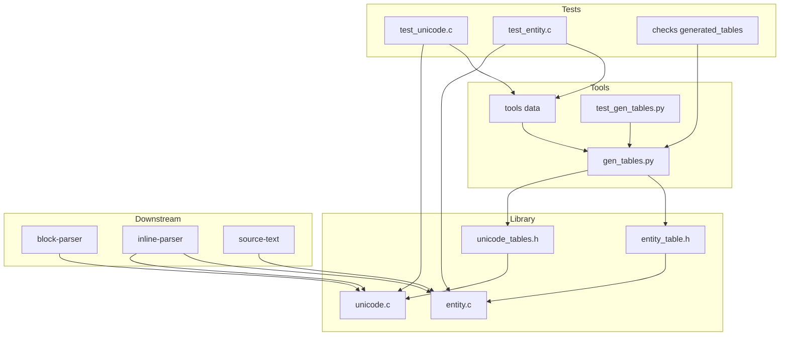
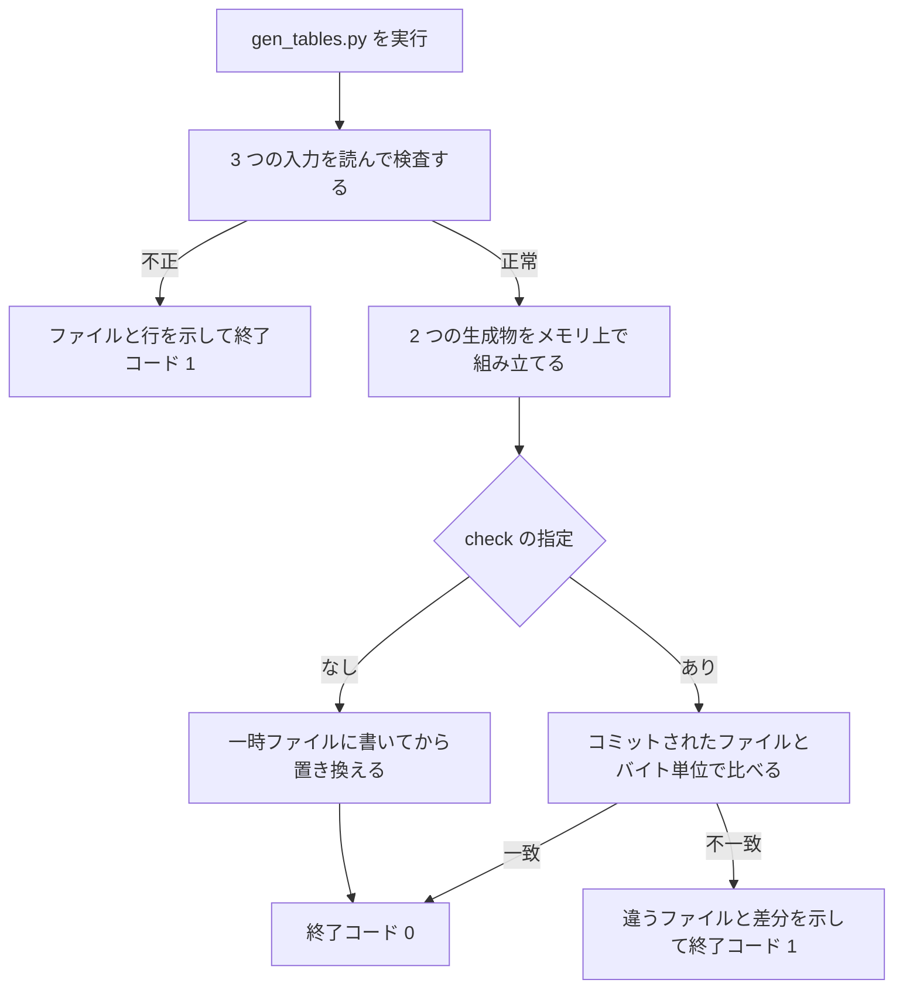

# Design Document

## Overview

**Purpose**: unicode-tables は、CommonMark 0.31.2 の解析に要る文字のデータを Amark の中に持たせる。Unicode の句読点と空白の判定、full case folding、HTML5 の実体名の 3 種類である。

**Users**: 後続の spec（block-parser、inline-parser、source-text）のコードが、参照する関数を呼ぶ。Amark の開発者が、Unicode の版を上げるときに生成スクリプトを実行する。

**Impact**: リポジトリに `tools/`（生成スクリプトと入力データ）ができる。`src/` に 2 つのモジュール（`unicode`、`entity`）と 2 つの生成物が加わる。`LICENSE` に第三者のデータの表示が加わる。CI に、生成物が最新であることを確かめるジョブが加わる。公開 API は変わらない。

### Goals
- 入力データ（UCD 18.0.0 の 2 ファイルと entities.json）から、表の C のソースを 1 つのコマンドで作る。結果はバイト単位で再現できる。
- 句読点の判定、空白の判定、case folding、実体名の参照を、確保も初期化も状態もない内部の関数として用意する。
- コミットされた生成物が入力データとスクリプトに合っていることを、CI と手元で確かめる。
- Unicode の版を上げる作業を、データの差し替えと再生成だけにする。

### Non-Goals
- UTF-8 の検査とデコード（project-foundation）。
- リンクのラベルの正規化、文字参照の構文の認識、数値文字参照、flanking の規則（block-parser、inline-parser、source-text）。
- 正規化（NFC など）、書記素の分割、文字幅、simple case folding、トルコ語の畳み込み。
- 参照する関数の公開。
- 入力データをネットワークから取得する仕組み。差し替えは開発者が手で行う。

## Boundary Commitments

### This Spec Owns
- 生成スクリプト `tools/gen_tables.py` と、その自己テスト。
- 入力データ `tools/data/` の 3 ファイルと、その出所の記録。
- 生成物 `src/unicode_tables.h` と `src/entity_table.h`。手では編集しない。
- 内部の関数 `amark_unicode_is_punctuation`、`amark_unicode_is_whitespace`、`amark_unicode_fold`、`amark_entity_lookup` の契約と実装。
- 生成物が最新であることの検査（スクリプトの `--check`、CTest の登録、CI のジョブ）。
- `LICENSE` の第三者のデータの節と、`.gitattributes` の行末の設定。

### Out of Boundary
- 関数の結果の使い方。文字列全体の畳み込みと比較、`&` と `;` の検出、flanking の判定は、呼び出す側が行う。
- UTF-8 とコードポイントの間の変換。呼び出す側が、project-foundation の `amark_utf8_decode` で得たコードポイントを渡す。
- 対象の Unicode の版を決めること。この設計は 18.0.0 を前提にし、版を上げる手順だけを用意する。
- 既存の検査（`checks.objects`、`checks.license_headers`、`checks.exports`）の変更。生成物と関数が、今の検査をそのまま通る。

### Allowed Dependencies
- `src/unicode.c` と `src/entity.c` が取り込めるのは、C の標準ヘッダ（`<stdbool.h>`、`<stddef.h>`、`<stdint.h>`、`<string.h>`）、自分の内部ヘッダ、自分の生成物だけである。`src/` のほかのモジュールを取り込まない。
- 生成物は、それぞれ 1 つの `.c` からだけ取り込む。ほかのファイルは表に直接触れない。
- 生成スクリプトは、Python 3.9 以上の標準ライブラリだけを使う。ネットワークに接続しない。
- ビルドとテストは、project-foundation の仕組み（`AMARK_SOURCES`、`amark_add_unit_test`、Naos `v0.4.0`）を使う。
- 単体テストは、`tools/data/` のファイルを読んでよい。ライブラリのコードは読まない（I/O を持たない）。

### Revalidation Triggers
次の変更があったら、下流の spec（block-parser、inline-parser、source-text、spec-conformance）は統合を確かめ直す。
- 4 つの関数のシグネチャ、戻り値の意味、事前条件の変更。
- `amark_entity_lookup` が返すポインタの寿命の変更（今は静的で、解放しない）。
- 空白の判定の定義の変更（Zs とタブ・LF・FF・CR）、または句読点の定義の変更（P と S）。
- Unicode の版の変更、または entities.json の差し替え。関数の契約は変わらないが、結果が変わるコードポイントがある。spec.txt の準拠テストを回し直す。
- 関数を公開 API に出すこと。

表の内部の形（構造体、分け方、並べ方）の変更は、下流に影響しない。

## Architecture

### Existing Architecture Analysis
- モジュールは `src/<module>.c` と `src/<module>.h` の組である。`src/CMakeLists.txt` の `AMARK_SOURCES` に 1 行足すと、`amark` と `amark_testing` の両方に入る。
- 単体テストは `tests/unit/test_<module>.c` で、`amark_add_unit_test` で登録する。
- `checks.objects` は、可変の静的データを禁じる。ポインタを含む `const` の表は、位置独立コードでは可変のデータとして扱われるので、表にはポインタを入れない（`research.md` を参照）。
- `checks.license_headers` は、`.h` と `.c` の先頭 5 行に著作権表示と `SPDX-License-Identifier: MIT` があることを確かめる。生成物も対象になる。
- リポジトリに `.gitattributes` はない。Windows のチェックアウトでは行末が CRLF に変わる。

### Architecture Pattern & Boundary Map



**Architecture Integration**:
- **Selected pattern**: ソート済みの `const` の表と二分探索。表はスクリプトで生成してコミットする（cmark と md4c と同じ形）。
- **境界の分け方**: 生成の側（`tools/`）と実行時の側（`src/`）は、生成物のファイルだけでつながる。実行時の側は、Unicode（コードポイントをキーにする）と実体名（名前をキーにする）の 2 つのモジュールに分ける。2 つは互いに依存しない。
- **依存の向き**: `入力データ → 生成スクリプト → 生成物 → 参照する関数 → 下流の解析器`。参照する関数は、`src/` のほかのモジュールに依存しない。
- **守る既存のパターン**: モジュールは `.c` と内部ヘッダの組。名前は `amark_` で始める。表は `static const`。再帰、確保、I/O、可変の静的データを使わない。
- **Steering との整合**: 実行時の外部依存がない。生成物をコミットし、ビルド時には生成しない。Unicode License v3 の表示を付ける。

### Technology Stack

| Layer | Choice / Version | Role in Feature | Notes |
|-------|------------------|-----------------|-------|
| 生成 | Python 3.9 以上、標準ライブラリだけ | 入力データを読み、生成物を書く。最新であることを検査する | 通常のビルドには要らない |
| 入力データ | UCD 18.0.0（DerivedGeneralCategory.txt、CaseFolding.txt）、WHATWG の entities.json | 表のもとになるデータ | `tools/data/` にそのままコミットする |
| ライブラリ | C99 | 参照する関数と生成した表 | 新しい依存はない |
| テスト | Naos `v0.4.0`、CTest | 単体テストと検査の登録 | project-foundation のものを使う |
| CI | GitHub Actions | 最新であることの検査のジョブ | `ubuntu-latest` の `python3` を使う |

## File Structure Plan

### Directory Structure
```
tools/
├── gen_tables.py              # 生成スクリプト。生成と --check の両方の入口
├── test_gen_tables.py         # 生成スクリプトの自己テスト（unittest）
└── data/
    ├── DerivedGeneralCategory.txt   # UCD 18.0.0。取得したままの内容
    ├── CaseFolding.txt              # UCD 18.0.0。取得したままの内容
    ├── entities.json                # WHATWG。取得したままの内容
    └── README.md                    # 各ファイルの取得元、版、取得した日、SHA-256、利用の条件
src/
├── unicode.h                  # 句読点・空白の判定と case folding の宣言
├── unicode.c                  # 上の実装。unicode_tables.h を取り込むただ 1 つのファイル
├── unicode_tables.h           # 生成物。句読点の範囲、Zs の範囲、case folding の 2 つの表
├── entity.h                   # 実体名の参照の宣言
├── entity.c                   # 上の実装。entity_table.h を取り込むただ 1 つのファイル
└── entity_table.h             # 生成物。実体名の文字の配列と項目の表
tests/unit/
├── test_unicode.c             # 判定と case folding の単体テスト。UCD の 2 ファイルを読んで全コードポイントを比べる
└── test_entity.c              # 実体名の参照の単体テスト。entities.json を読んで全実体名を比べる
.gitattributes                 # 入力データは変換しない。生成物は LF に固定する
```

### Modified Files
- `src/CMakeLists.txt` — `AMARK_SOURCES` に `unicode.c` と `entity.c` を足す。
- `tests/CMakeLists.txt` — 2 つの単体テストを登録し、入力データの場所を `AMARK_TEST_DATA_DIR` として渡す。Python 3.9 以上が見つかったら `checks.generated_tables` と `checks.generator` を登録する。
- `.github/workflows/ci.yml` — ジョブ `generated-tables` を足す。
- `LICENSE` — MIT の本文の後ろに、第三者のデータの節を足す。
- `README.md` — License の節に第三者のデータの説明を足す。必要な道具に「表の再生成には Python 3.9 以上」を足す。
- `CONTRIBUTING.md` — 表を再生成する手順の節を足す。

変えないファイル：`tests/checks/exported_symbols.txt`（公開シンボルは増えない）、`tests/checks/*.cmake`、ルートの `CMakeLists.txt`（`LICENSE` はすでにインストールの対象である）。

## System Flows



- 入力の検査がすべて通り、2 つの生成物をメモリ上で組み立て終えるまで、ファイルを書かない。失敗したときは、既存の生成物が元のまま残る（1.7）。
- `--check` はファイルを書かない（3.4）。

## Requirements Traceability

| Requirement | Summary | Components | Interfaces | Flows |
|-------------|---------|------------|------------|-------|
| 1.1 | 入力データだけから 4 種類の表を書き出す | TableGenerator、InputData | `gen_tables.py` | 生成 |
| 1.2 | どの環境でもバイト単位で同じ | TableGenerator、GitAttributes、FreshnessCheck | 出力の規則 | 生成、検査 |
| 1.3 | ネットワークが要らない | TableGenerator、InputData | — | — |
| 1.4 | 先頭に生成物である旨、入力の名前と版、スクリプトの名前 | TableGenerator | 生成物の先頭の形式 | — |
| 1.5 | 先頭に著作権表示 | TableGenerator | 生成物の先頭の形式 | — |
| 1.6 | 要る性質のデータだけを含む | TableGenerator | 表の内容の規則 | — |
| 1.7 | 入力の不備で失敗し、生成物を書き換えない | TableGenerator | 入力の検査、終了コード | 生成 |
| 1.8 | ビルドにスクリプトの実行環境が要らない | BuildIntegration | `AMARK_SOURCES` | — |
| 2.1 | スクリプト、入力、生成物をリポジトリに含む | InputData、TableGenerator | File Structure Plan | — |
| 2.2 | UCD の 2 ファイルは同じ版（18.0.0） | InputData | — | — |
| 2.3 | 入力ごとに取得元と版を記録する | InputData | `tools/data/README.md` | — |
| 2.4 | 差し替えと再生成だけで新しい版の表ができる | TableGenerator、UnicodeLookup、EntityLookup | 版をファイルから読む。表の大きさは生成物が持つ | 生成 |
| 2.5 | UCD の版が食い違えば失敗する | TableGenerator | 入力の検査 | 生成 |
| 2.6 | 再生成の手順を文書に書く | Docs | `CONTRIBUTING.md` | — |
| 3.1 | CI が作り直して比べる | FreshnessCheck | `--check`、ジョブ `generated-tables` | 検査 |
| 3.2 | 違えば失敗し、違うファイルを記録する | FreshnessCheck | `--check` の出力 | 検査 |
| 3.3 | 手元で同じ検査を 1 つの手順で実行できる | FreshnessCheck | `python3 tools/gen_tables.py --check`、`checks.generated_tables` | 検査 |
| 3.4 | 検査はファイルを書き換えない | FreshnessCheck | `--check` | 検査 |
| 4.1、4.2 | P と S は真、それ以外は偽 | UnicodeLookup | `amark_unicode_is_punctuation` | — |
| 4.3 | ASCII の句読点 32 文字は真 | UnicodeLookup | 同上 | — |
| 4.4 | 未割り当てとサロゲートは偽 | UnicodeLookup | 同上 | — |
| 4.5 | 全コードポイントで入力データと一致 | UnicodeLookup、UnitTests | `test_unicode.c` | — |
| 5.1〜5.3 | Zs とタブ・LF・FF・CR は真、それ以外は偽 | UnicodeLookup | `amark_unicode_is_whitespace` | — |
| 5.4 | U+000B、U+0085、U+2028、U+2029 は偽 | UnicodeLookup、UnitTests | 同上 | — |
| 5.5 | 句読点と空白が同時に真にならない | UnicodeLookup、UnitTests | `test_unicode.c` | — |
| 6.1〜6.4 | C は 1 つ、F は 2 つか 3 つ、なければ自分自身。S と T は使わない | UnicodeLookup、TableGenerator | `amark_unicode_fold` | — |
| 6.5、6.6 | 呼び出す側の領域に書き、個数を返す。3 つを超えない | UnicodeLookup | `amark_unicode_fold`、`AMARK_UNICODE_FOLD_MAX` | — |
| 6.7 | ẞ、ß、A、U+0390 の例 | UnicodeLookup、UnitTests | `test_unicode.c` | — |
| 6.8 | 全コードポイントで入力データと一致 | UnicodeLookup、UnitTests | `test_unicode.c` | — |
| 7.1、7.2 | `;` で終わる実体名を引く。なければ見つからない | EntityLookup、TableGenerator | `amark_entity_lookup` | — |
| 7.3 | 大文字と小文字を区別する | EntityLookup | 同上 | — |
| 7.4 | 名前は位置と長さで受け取る | EntityLookup | 同上 | — |
| 7.5 | 長さ 0 と長すぎる名前は見つからない | EntityLookup | 同上 | — |
| 7.6 | `amp`、`nbsp`、`NotEqualTilde` の例 | EntityLookup、UnitTests | `test_entity.c` | — |
| 7.7 | 全実体名で入力データと一致 | EntityLookup、UnitTests | `test_entity.c` | — |
| 7.8 | 返すバイト列は解放が要らない | EntityLookup | 静的な表へのポインタ | — |
| 8.1〜8.3 | 純粋、確保なし、失敗なし、初期化なし | UnicodeLookup、EntityLookup | 関数の契約 | — |
| 8.4 | 表は読み取り専用 | TableGenerator、UnicodeLookup、EntityLookup | ポインタのない `static const` の表。既存の `checks.objects` | — |
| 8.5 | 同期なしで並行に呼べる | UnicodeLookup、EntityLookup | 状態がないこと。既存の `checks.objects` | — |
| 8.6 | 範囲の外の値は偽、または自分自身 | UnicodeLookup、UnitTests | 関数の契約 | — |
| 8.7 | 時間が表の大きさに比例しない | UnicodeLookup、EntityLookup | 二分探索 | — |
| 8.8 | 再帰を使わない | UnicodeLookup、EntityLookup | ループによる二分探索 | — |
| 8.9 | 公開シンボルに加えない | BuildIntegration | `AMARK_API` を付けない。既存の `checks.exports` | — |
| 8.10 | 単体テストを登録し、入力データから作った期待値で一致を確かめる | UnitTests | `AMARK_TEST_DATA_DIR` | — |
| 9.1 | Unicode License v3 の全文と適用されるファイル | ThirdPartyNotices | `LICENSE` | — |
| 9.2 | entities.json の出所と利用の条件 | ThirdPartyNotices | `LICENSE` | — |
| 9.3 | Unicode 由来の生成物の先頭に出所とライセンスの名前 | TableGenerator | 生成物の先頭の形式 | — |
| 9.4 | 表示を含むライセンスのファイルをインストールする | ThirdPartyNotices | 既存のインストールの規則 | — |

## Components and Interfaces

| Component | Domain/Layer | Intent | Req Coverage | Key Dependencies (P0/P1) | Contracts |
|-----------|--------------|--------|--------------|--------------------------|-----------|
| TableGenerator | 生成 | 入力データから生成物を作り、最新であることを検査する | 1.1〜1.7、2.4、2.5、6.4、8.4、9.3 | InputData (P0)、Python 3.9 (P0) | Batch |
| InputData | 生成 | 表のもとになるデータと、その出所の記録 | 1.1、1.3、2.1〜2.3 | — | — |
| FreshnessCheck | 検査 | 生成物が入力とスクリプトに合っていることを、CI と手元で確かめる | 1.2、3.1〜3.4 | TableGenerator (P0) | Batch |
| UnicodeLookup | ライブラリ | 句読点・空白の判定と case folding | 4.1〜4.5、5.1〜5.5、6.1〜6.8、8.1〜8.8 | `unicode_tables.h` (P0) | Service |
| EntityLookup | ライブラリ | 実体名の参照 | 7.1〜7.8、8.1〜8.5、8.7、8.8 | `entity_table.h` (P0) | Service |
| BuildIntegration | ビルド | モジュールとテストをビルドに組み込む | 1.8、8.9、8.10 | project-foundation のビルド (P0) | — |
| UnitTests | テスト | 関数の結果を、入力データから独立に作った期待値と比べる | 4.5、5.4、5.5、6.7、6.8、7.6、7.7、8.6、8.10 | InputData (P0)、Naos (P0) | — |
| ThirdPartyNotices | 文書 | 第三者のデータの表示 | 9.1、9.2、9.4 | — | — |
| GitAttributes | リポジトリ | 行末の変換を止め、バイト単位の一致を保つ | 1.2 | — | — |
| Docs | 文書 | 再生成の手順 | 2.6 | — | — |

### 生成

#### TableGenerator

| Field | Detail |
|-------|--------|
| Intent | 3 つの入力を読んで検査し、2 つの生成物を作る。`--check` では、作った結果をコミットされたファイルと比べる |
| Requirements | 1.1、1.2、1.3、1.4、1.5、1.6、1.7、2.4、2.5、6.4、8.4、9.3 |

**Responsibilities & Constraints**
- `tools/gen_tables.py` の 1 ファイルにする。型ヒントを付ける。標準ライブラリだけを使う。
- 入力はバイト列として読む。出力は ASCII だけで、行末は LF、末尾に改行を 1 つ置く。
- 出力に、日時、ホストの名前、絶対パス、Python の版を書かない（1.2）。項目の順は、コードポイントの昇順、または名前のバイト列の昇順に固定する。
- 生成物に入れるデータは、次のものだけである（1.6）。
  - General Category が P* と S* の範囲。隣り合う範囲と重なる範囲はつなぐ。
  - General Category が Zs の範囲。
  - CaseFolding.txt の状態 C と F の対応。S と T は捨てる（6.4）。
  - entities.json のうち、名前が `;` で終わる項目。名前から `&` と `;` を除き、コードポイントを UTF-8 にする。
- 表にポインタを入れない（8.4）。

**Dependencies**
- Inbound: 開発者、FreshnessCheck — 生成と検査の実行（P0）
- Outbound: InputData — 読み取り（P0）
- External: Python 3.9 以上（P0）

**Contracts**: Service [ ] / API [ ] / Event [ ] / Batch [x] / State [ ]

##### Batch / Job Contract
- **Trigger**: `python3 tools/gen_tables.py [--check] [--data-dir DIR] [--output-dir DIR]`。リポジトリのどのディレクトリから実行してもよい。既定の `DIR` は、スクリプトの場所から決める（`tools/data` と `src`）。`--data-dir` と `--output-dir` は自己テストのためにある。
- **Input / validation**: 次のどれかに当たると、標準エラーに `ファイル:行: 理由` の形（行が分からないときは `ファイル: 理由`）で書き、終了コード 1 で終わる。
  - 入力のファイルがない、または読めない。
  - UCD のファイルの 1 行目が `# <名前>-<X.Y.Z>.txt` の形でない。
  - 2 つの UCD のファイルの版が違う（2.5）。両方の版を示す。
  - DerivedGeneralCategory.txt の行が `範囲 ; 分類` の形でない。分類が 2 文字の既知の値でない。範囲が U+10FFFF を超える。
  - CaseFolding.txt の行が `コードポイント; 状態; 対応先;` の形でない。状態が C、F、S、T のどれでもない。C の対応先が 1 つでない。F の対応先が 2 つでも 3 つでもない。同じコードポイントに C と F の両方がある。
  - entities.json が JSON のオブジェクトでない。名前が `&[A-Za-z0-9]+;?` の形でない。`;` で終わる項目の `codepoints` が 1 つでも 2 つでもない、スカラー値でない、または `characters` と合わない。
  - 表の形の上限を超える（1 つの名前が 255 バイト、名前の合計が 65,535 バイト、1 つの実体の UTF-8 が 6 バイト）。
- **Output / destination**: `src/unicode_tables.h` と `src/entity_table.h`。2 つをメモリ上で組み立て終えてから、同じディレクトリの一時ファイルに書き、置き換える。成功したら、書いたファイルの名前を標準出力に書き、終了コード 0 で終わる。
- **Idempotency & recovery**: 同じ入力からは同じバイト列ができる。何度実行してもよい。失敗したときは何も書いていないので、後始末は要らない。
- **`--check`**: ファイルを書かない。組み立てた結果と既存のファイルをバイト単位で比べる。すべて一致すれば終了コード 0。違うファイル、またはないファイルがあれば、その名前と差分の先頭（統一形式で 40 行まで）と、直し方（`python3 tools/gen_tables.py` を実行する）を標準エラーに書き、終了コード 1 で終わる。
- **終了コード**: 0 は成功、1 は入力の不備か不一致、2 は引数の誤り。

##### 生成物の先頭の形式
`checks.license_headers` が先頭 5 行を調べるので、1〜4 行目を次の形にする（1.4、1.5、9.3）。

```c
/*
 * Copyright (c) The Amark Authors
 * SPDX-License-Identifier: MIT AND Unicode-3.0
 *
 * Generated by tools/gen_tables.py. Do not edit.
 *
 * Source: DerivedGeneralCategory-18.0.0.txt, CaseFolding-18.0.0.txt
 * (Unicode Character Database, Copyright (c) Unicode, Inc., licensed under
 * the Unicode License v3; see LICENSE).
 *
 * Included by unicode.c only.
 */
```

- `entity_table.h` では、SPDX を `MIT AND BSD-3-Clause` にし、Source を `entities.json (sha256 <64 桁>), HTML Standard, Copyright (c) WHATWG (Apple, Google, Mozilla, Microsoft), BSD 3-Clause License; see LICENSE` にする。
- Unicode の版は、入力の 1 行目から読んだ値を書く。entities.json には版がないので、ファイルの SHA-256 を書く。

**Implementation Notes**
- Integration: 生成物の型（範囲、対応、項目の構造体）は、取り込む側の `.c` が先に定義する。生成物は、表の定義と、表の項目の数を表すマクロだけを持つ。
- Validation: 自己テスト `tools/test_gen_tables.py` が、小さな入力を一時ディレクトリに作って確かめる（Testing Strategy を参照）。
- Risks: MSVC の文字列リテラルの上限を避けるため、実体名の文字の配列は、1 行 64 文字ほどの短い文字列リテラルを並べて書く。

#### InputData

| Field | Detail |
|-------|--------|
| Intent | 表のもとになる 3 つのファイルを、取得したままの内容で持つ |
| Requirements | 1.1、1.3、2.1、2.2、2.3 |

- `tools/data/DerivedGeneralCategory.txt` と `tools/data/CaseFolding.txt` は、`https://www.unicode.org/Public/18.0.0/ucd/` のものである。ファイルの名前から版を除いた形で置く。版は 1 行目に残っている。
- `tools/data/entities.json` は、`https://html.spec.whatwg.org/entities.json` のものである。
- `tools/data/README.md` に、ファイルごとに取得元の URL、版（entities.json は取得した日）、SHA-256、利用の条件を書く（2.3）。
- ファイルの内容を変えない。行末の変換も止める（GitAttributes）。

#### FreshnessCheck

| Field | Detail |
|-------|--------|
| Intent | コミットされた生成物が、入力データとスクリプトから作り直した結果と同じであることを確かめる |
| Requirements | 1.2、3.1、3.2、3.3、3.4 |

**Contracts**: Service [ ] / API [ ] / Event [ ] / Batch [x] / State [ ]

##### Batch / Job Contract
- **CI のジョブ `generated-tables`**（3.1、3.2）：`ubuntu-latest` で、チェックアウトの後に `python3 tools/gen_tables.py --check` と `python3 tools/test_gen_tables.py` を実行する。既存のジョブと同じく、既定のブランチへのプッシュとプルリクエストで動く。失敗すると、`--check` の出力（違うファイルと差分）がログに残る。
- **CTest の `checks.generated_tables` と `checks.generator`**（1.2、3.3）：`tests/CMakeLists.txt` で `find_package(Python3 3.9 COMPONENTS Interpreter QUIET)` を呼び、見つかったときだけ登録する。前者は `--check` を、後者は自己テストを実行する。Windows と macOS のランナーでも動くので、OS による出力の違いが見つかる。Python がない環境では登録しない。ビルドとほかのテストには影響しない（1.8）。
- **手元**（3.3）：`python3 tools/gen_tables.py --check`、または `ctest -R checks.generated_tables`。
- どの入口も、リポジトリのファイルを書き換えない（3.4）。自己テストは、一時ディレクトリだけに書く。

#### GitAttributes
`.gitattributes` に次の設定を置く（1.2）。
- `tools/data/** -text`：入力データの行末を変換しない。SHA-256 が OS によらず同じになる。
- `src/unicode_tables.h text eol=lf` と `src/entity_table.h text eol=lf`：生成物を常に LF でチェックアウトする。

### ライブラリ

#### UnicodeLookup

| Field | Detail |
|-------|--------|
| Intent | コードポイントが句読点か空白かを判定し、コードポイントを full case folding で畳み込む |
| Requirements | 4.1、4.2、4.3、4.4、4.5、5.1、5.2、5.3、5.4、5.5、6.1、6.2、6.3、6.4、6.5、6.6、6.7、6.8、8.1、8.2、8.3、8.4、8.5、8.6、8.7、8.8 |

**Responsibilities & Constraints**
- `src/unicode.h` が宣言し、`src/unicode.c` が実装する。`src/unicode_tables.h` を取り込むのは `unicode.c` だけである。
- 状態を持たず、確保せず、失敗しない。引数のほかに読むのは `const` の表だけである。
- 探索はループで書く（8.8）。範囲の表を引く 1 つの `static` の関数を、句読点と空白の両方で使う。

**Dependencies**
- Inbound: block-parser、inline-parser — ラベルの畳み込み、flanking の判定（P0）
- Outbound: `unicode_tables.h` — 表（P0）
- External: なし

**Contracts**: Service [x] / API [ ] / Event [ ] / Batch [ ] / State [ ]

##### Service Interface
```c
/* src/unicode.h */
#include <stdbool.h>
#include <stddef.h>
#include <stdint.h>

/* 1 つのコードポイントを畳み込んだ結果の、コードポイントの数の上限。 */
#define AMARK_UNICODE_FOLD_MAX 3

/* General Category が P または S なら true。 */
bool amark_unicode_is_punctuation(uint32_t codepoint);

/* General Category が Zs、または U+0009、U+000A、U+000C、U+000D なら true。 */
bool amark_unicode_is_whitespace(uint32_t codepoint);

/* codepoint を full case folding（状態 C と F）で畳み込み、結果を out[0] から
   順に書いて、書いた数（1 から AMARK_UNICODE_FOLD_MAX）を返す。 */
size_t amark_unicode_fold(uint32_t codepoint,
                          uint32_t out[AMARK_UNICODE_FOLD_MAX]);
```
- **Preconditions**: `out` は、`AMARK_UNICODE_FOLD_MAX` 個の `uint32_t` を書ける領域を指す。`codepoint` はどの値でもよい。
- **Postconditions**:
  - `amark_unicode_fold` は、`out[0]` から `out[戻り値 - 1]` までだけを書く。対応がなければ `out[0] = codepoint` で 1 を返す（6.3）。
  - U+10FFFF より大きい値には、2 つの判定は false を返し、`amark_unicode_fold` は渡された値を 1 つ返す（8.6）。表にそのような値がないので、特別な分岐なしにこうなる。
  - サロゲートと未割り当てのコードポイントには、判定は false を返す（4.4）。
- **Invariants**: どのコードポイントにも、2 つの判定が同時に true を返すことはない（5.5）。P・S と Zs は別の分類で、タブ・LF・FF・CR は Cc だからである。

##### 表の形
型は `unicode.c` が定義し、表は `unicode_tables.h` が定義する。

```c
typedef struct amark_unicode_range {
    uint32_t first;
    uint32_t last;   /* first 以上。この値を含む */
} amark_unicode_range_t;

typedef struct amark_unicode_fold_simple {
    uint32_t from;
    uint32_t to;
} amark_unicode_fold_simple_t;

typedef struct amark_unicode_fold_full {
    uint32_t from;
    uint32_t to[3];  /* 対応先が 2 つのとき、to[2] は 0 */
} amark_unicode_fold_full_t;
```

| 表 | 型 | 項目の数（18.0.0） | 並び | 大きさ |
|----|----|--------------------|------|--------|
| `amark_unicode_punctuation` | `amark_unicode_range_t` | 359 | `first` の昇順。重ならず、隣り合わない | 2,872 バイト |
| `amark_unicode_space` | `amark_unicode_range_t` | 7 | 同上 | 56 バイト |
| `amark_unicode_fold_simple_table` | `amark_unicode_fold_simple_t` | 1,501 | `from` の昇順 | 12,008 バイト |
| `amark_unicode_fold_full_table` | `amark_unicode_fold_full_t` | 105 | `from` の昇順 | 1,680 バイト |

- 項目の数は、生成物がマクロ（`AMARK_UNICODE_PUNCTUATION_COUNT` など）で持つ。`unicode.c` は数を直接書かない。版を上げても `unicode.c` は変わらない（2.4）。
- U+0000 は対応先にならないので、`to[2] == 0` で「対応先が 2 つ」を表せる。生成スクリプトが、対応先に 0 がないことを確かめる。

**Implementation Notes**
- Integration: `amark_unicode_is_whitespace` は、タブ・LF・FF・CR を手書きの比較で判定し、残りを `amark_unicode_space` で引く。この 4 文字は UCD ではなく CommonMark の規則から来るので、生成しない。
- Integration: `amark_unicode_fold` は、状態 C の表、状態 F の表の順に引く。U+0080 未満は表を引かずに答えてよい（A〜Z だけが変わる）。結果は表と同じでなければならず、全コードポイントのテストがこれを確かめる。
- Validation: `test_unicode.c` の全コードポイントの比較（Testing Strategy）。
- Risks: なし。

#### EntityLookup

| Field | Detail |
|-------|--------|
| Intent | HTML5 の実体名から、それが表す文字の UTF-8 のバイト列を得る |
| Requirements | 7.1、7.2、7.3、7.4、7.5、7.6、7.7、7.8、8.1、8.2、8.3、8.4、8.5、8.7、8.8 |

**Responsibilities & Constraints**
- `src/entity.h` が宣言し、`src/entity.c` が実装する。`src/entity_table.h` を取り込むのは `entity.c` だけである。
- 名前の比較はバイト単位で行う。大文字と小文字を区別する（7.3）。
- `&`、`;`、数値文字参照は扱わない。呼び出す側が、`&` と `;` の間の名前だけを渡す。

**Dependencies**
- Inbound: inline-parser、source-text — 文字参照の解決（P0）
- Outbound: `entity_table.h` — 表（P0）
- External: なし

**Contracts**: Service [x] / API [ ] / Event [ ] / Batch [ ] / State [ ]

##### Service Interface
```c
/* src/entity.h */
#include <stdbool.h>
#include <stddef.h>

/* name_length バイトの名前（"&" と ";" を除いたもの。終端の NUL は要らない）を
   引く。見つかれば *utf8 と *utf8_length に、その実体が表す 1 つか 2 つの
   コードポイントの UTF-8 のバイト列（1 から 6 バイト）を入れて true を返す。
   見つからなければ false を返し、*utf8 と *utf8_length を変えない。 */
bool amark_entity_lookup(const unsigned char *name, size_t name_length,
                         const unsigned char **utf8, size_t *utf8_length);
```
- **Preconditions**: `utf8` と `utf8_length` は NULL でない。`name_length` が 0 でなければ、`name` は `name_length` バイトを読める領域を指す。`name_length` が 0 のとき、`name` は読まない。
- **Postconditions**:
  - true のとき、`*utf8` は静的な読み取り専用のデータを指す。プロセスが終わるまで有効で、呼び出す側は解放も変更もしない（7.8）。バイト列は NUL で終わらない。長さは `*utf8_length` で知る。
  - 長さ 0 の名前、表のどの名前より長い名前、英数字でないバイトを含む名前は、false になる（7.2、7.5）。
- **Invariants**: 読むのは `name[0]` から `name[name_length - 1]` までと、表だけである。

##### 表の形
```c
typedef struct amark_entity_entry {
    uint16_t name_offset;     /* amark_entity_names の中の位置 */
    uint8_t name_length;      /* 1 以上 */
    uint8_t utf8_length;      /* 1 から 6 */
    unsigned char utf8[6];    /* 使わない部分は 0 */
} amark_entity_entry_t;
```

| 表 | 型 | 項目の数 | 並び | 大きさ |
|----|----|----------|------|--------|
| `amark_entity_names` | `char` の配列 | 14,004 文字と終端の NUL | 項目の順に名前をつないだもの。区切りはない | 14,005 バイト |
| `amark_entity_entries` | `amark_entity_entry_t` | 2,125 | 名前のバイト列の昇順。一方がもう一方の接頭辞なら、短いほうが先 | 21,250 バイト |

- 比較は、短いほうの長さまでを `memcmp` で比べ、同じなら長さで比べる。生成スクリプトの並べ方（Python の `bytes` の順）と同じ順である。
- 項目の数は、生成物がマクロ `AMARK_ENTITY_COUNT` で持つ。

**Implementation Notes**
- Integration: 二分探索はループで書く（8.8）。比較は最大 12 回である（8.7）。
- Validation: `test_entity.c` の全実体名の比較（Testing Strategy）。
- Risks: 位置を 16 ビットで持つ。名前の合計が 65,535 バイトを超えると、生成スクリプトが失敗する。今は 14,004 バイトである。

### ビルド、テスト、文書

#### BuildIntegration
- `src/CMakeLists.txt` の `AMARK_SOURCES` に `unicode.c` と `entity.c` を足す。生成物は `.h` なので、足すものはない。ビルドは Python を呼ばない（1.8）。
- 関数に `AMARK_API` を付けない。`tests/checks/exported_symbols.txt` は変えない。動的ライブラリの構成で、既存の `checks.exports` が通る（8.9）。
- `tests/CMakeLists.txt` に次を足す（8.10）。
  - `amark_add_unit_test(test_unicode SOURCES unit/test_unicode.c)` と `amark_add_unit_test(test_entity SOURCES unit/test_entity.c)`。
  - 2 つのテストのターゲットに、`AMARK_TEST_DATA_DIR="${PROJECT_SOURCE_DIR}/tools/data"` をコンパイルの定義として渡す。
  - FreshnessCheck の 2 つの CTest の登録。

#### ThirdPartyNotices
- `LICENSE` は、MIT の本文を先頭にそのまま残す。その後ろに区切りを置き、「Third-party data」の節を足す。
  - **Unicode Character Database**（9.1）：適用されるファイル（`tools/data/DerivedGeneralCategory.txt`、`tools/data/CaseFolding.txt`、そこから生成した `src/unicode_tables.h`）、著作権表示（`Copyright © 1991-2026 Unicode, Inc.`）、Unicode License v3 の全文（`https://www.unicode.org/license.txt` のもの）。
  - **HTML Standard の実体名**（9.2）：出所（WHATWG の HTML Standard、`https://html.spec.whatwg.org/entities.json`）、著作権表示（`Copyright © WHATWG (Apple, Google, Mozilla, Microsoft)`）、条件。`tools/data/entities.json` は CC BY 4.0（ライセンスの URL を書く）、そこから生成した `src/entity_table.h` は BSD 3-Clause（全文を書く）である。
- `LICENSE` は、ルートの `CMakeLists.txt` がすでにインストールしている（9.4）。変更は要らない。
- `README.md` の License の節に、「Amark は MIT。Unicode と WHATWG のデータから作った表を含み、その表示は LICENSE にある」と書く。

#### Docs
`CONTRIBUTING.md` に「Regenerating the tables」の節を足す（2.6）。次のことを書く。
- 要るもの（Python 3.9 以上。ほかのパッケージは要らない）。
- 生成のコマンドと検査のコマンド。
- 版を上げる手順。`tools/data/` のファイルを差し替える、`tools/data/README.md` の版と SHA-256 を直す、生成する、テストを回す、`LICENSE` の Unicode の著作権表示の年を確かめる、入力と生成物を同じコミットに入れる。
- 生成物を手で編集しないこと。

## Data Models

表の形は、UnicodeLookup と EntityLookup の「表の形」に書いた。ここでは、入力から表への対応と、表が満たす不変条件をまとめる。

| 入力 | 取り出すもの | 捨てるもの | 表 |
|------|--------------|------------|-----|
| DerivedGeneralCategory.txt | 分類が Pc、Pd、Ps、Pe、Pi、Pf、Po、Sm、Sc、Sk、So の範囲 | ほかの分類 | `amark_unicode_punctuation` |
| DerivedGeneralCategory.txt | 分類が Zs の範囲 | ほかの分類 | `amark_unicode_space` |
| CaseFolding.txt | 状態 C の行 | 状態 S、T | `amark_unicode_fold_simple_table` |
| CaseFolding.txt | 状態 F の行 | 状態 S、T | `amark_unicode_fold_full_table` |
| entities.json | `;` で終わる名前と、その `codepoints` | `;` のない名前、`characters`（照合にだけ使う） | `amark_entity_names`、`amark_entity_entries` |

**不変条件**（生成スクリプトが保証し、単体テストが関数を通して確かめる）
- 範囲の表は、`first <= last` で、前の項目の `last + 1` より次の項目の `first` が大きい。
- 対応の表は、`from` が重ならず、昇順である。同じコードポイントが 2 つの表の両方に載ることはない。
- 実体名の表は、名前が重ならず、昇順である。`name_offset + name_length` は名前の合計の長さを超えない。
- どの表も、U+10FFFF より大きい値を持たない。

## Error Handling

### Error Strategy
- **参照する関数**：失敗しない（8.2）。エラーの型を返さず、`amark_error_t` を使わない。範囲の外の値や見つからない名前は、エラーではなく通常の結果（false、または渡された値）である。事前条件（NULL でないポインタ）は呼び出す側の責任で、関数は検査しない（`CONTRIBUTING.md` の規約）。
- **生成スクリプト**：入力の不備を見つけたら、すぐに失敗する。原因のファイルと行を示し、何も書かない（1.7）。推測で続けない。表の形の上限を超えたときも、黙って切り詰めずに失敗する。
- **検査**：不一致は、違うファイルと差分と直し方を示して失敗する（3.2）。

### Monitoring
実行時の記録はない。CI のログに、検査の出力が残る。

## Testing Strategy

### 単体テスト：`tests/unit/test_unicode.c`
期待値は、テストが `AMARK_TEST_DATA_DIR` の 2 つのファイルを自分で読んで作る。生成物も生成スクリプトも使わない。コードポイントごとの配列（0 から U+10FFFF）を、行を 1 つずつ読んで埋める。
1. **句読点の全数**（4.1、4.2、4.4、4.5）：0 から U+10FFFF までのすべての値で、`amark_unicode_is_punctuation` の結果が「分類の 1 文字目が P または S」と一致する。
2. **空白の全数**（5.1〜5.3、5.5）：同じ範囲で、`amark_unicode_is_whitespace` の結果が「分類が Zs、または U+0009、U+000A、U+000C、U+000D」と一致する。同時に、2 つの判定がどちらも true になる値がないことを確かめる。
3. **case folding の全数**（6.1〜6.4、6.6、6.8）：同じ範囲で、`amark_unicode_fold` の戻り値と書かれた値が、状態 C と F の行から作った期待値（なければ自分自身）と一致する。`out` の後ろに番兵を置き、戻り値より後ろが書かれていないことを確かめる。
4. **決まった例**（4.3、5.4、6.7）：ASCII の句読点 32 文字がすべて true。U+000B、U+0085、U+2028、U+2029 が空白でない。U+1E9E と U+00DF が `0073 0073`、U+0041 が `0061`、U+0390 が `03B9 0308 0301` になる。U+1E9E の結果が、状態 S の `00DF` でないことも確かめる。
5. **範囲の外の値**（8.6）：`0x110000`、`0x7FFFFFFF`、`0xFFFFFFFF` で、判定が false、畳み込みが渡された値 1 つになる。サロゲート（U+D800、U+DFFF）で判定が false になる。

### 単体テスト：`tests/unit/test_entity.c`
期待値は、テストが `AMARK_TEST_DATA_DIR` の entities.json を自分で読んで作る。このファイルの形（1 行に 1 項目）を前提に、名前と `codepoints` の数値を取り出し、テストの中で UTF-8 にする。
1. **全実体名**（7.1、7.7）：`;` で終わるすべての名前（2,125 個。数も確かめる）について、`&` と `;` を除いた名前を引くと true になり、バイト列が `codepoints` の UTF-8 と一致する。
2. **見つからない名前**（7.2、7.3、7.5）：長さ 0。`Amp`（大文字と小文字の違い）。表にある名前の、先頭の 1 文字を除いたものと、末尾に 1 文字足したもの（全項目について作り、表にないものだけを試す）。32 文字と 1,000 文字の名前。`;` や `&` を含む名前。見つからないとき、出力の引数が変わらないことも確かめる。
3. **決まった例**（7.6）：`amp` が `26`、`nbsp` が `C2 A0`、`NotEqualTilde` が `E2 89 82 CC B8`、`Auml` と `auml` が別のバイト列になる。
4. **長さで受け取ること**（7.4）：名前の直後に NUL でないバイトがある領域から、長さを指定して引く。`ampx` という領域の先頭 3 バイトで `amp` が見つかる。

### 生成スクリプトの自己テスト：`tools/test_gen_tables.py`
一時ディレクトリに小さな入力を作り、`--data-dir` と `--output-dir` で実行する。
1. **再現性**（1.2）：同じ入力で 2 回生成し、2 つの結果がバイト単位で同じ。出力に CR がなく、ASCII だけである。
2. **入力の不備**（1.7、2.5）：ファイルがない、行の形が違う、UCD の版が食い違う、F の対応先が 4 つある、の各場合に、終了コードが 1 で、標準エラーにファイルの名前（行が分かる場合は行も）があり、先に置いた生成物が変わっていない。
3. **`--check`**（3.2、3.4）：生成の直後は終了コード 0。生成物を 1 バイト変えると終了コード 1 で、標準エラーにそのファイルの名前がある。どちらの場合も、生成物のファイルの内容と更新の時刻が変わらない。
4. **内容の規則**（1.4、1.5、1.6、6.4、9.3）：先頭 5 行に著作権表示と SPDX がある。生成物である旨、入力の名前と版、スクリプトの名前がある。状態 S と T の対応、`;` のない実体名が出力にない。

### リポジトリの検査（既存のものと、足すもの）
- `checks.generated_tables`（足す。1.2、3.1〜3.4）：実際の入力データで `--check` が通る。
- `checks.objects`（既存。8.4、8.5）：`unicode.c` と `entity.c` のオブジェクトに、可変の静的データがない。
- `checks.exports`（既存。8.9）：動的ライブラリの公開シンボルが、変えていない一覧と一致する。
- `checks.license_headers`（既存。1.5）：2 つの生成物を含め、すべての `.c` と `.h` の先頭に表示がある。
- CI の既存の構成（5 つのコンパイラ、静的と動的、ASan と UBSan）で、上の単体テストがすべて通る。

### 性能
- 全コードポイントの 3 つの比較（約 111 万個 × 3）が、サニタイザ付きの Debug の構成で、テスト 1 つにつき数秒に収まることを確かめる。収まらなければ、比較を複数のテストに分ける。検査の回数は減らさない。

## Performance & Scalability

- 1 回の参照の比較の回数は、句読点が 9 回まで、空白が 3 回まで、case folding が 18 回まで（2 つの表）、実体名が 12 回までである（8.7）。
- 表の合計は約 52 KB である（句読点 2.9、空白 0.1、case folding 13.7、実体名 35.3）。utf8proc（約 350 KB）の約 7 分の 1 で、brief の「表は小さく保つ」に合う。
- さらに小さくする方法（BMP の範囲を 16 ビットにする、連続する対応を差分にまとめる）は、今は採らない。表の形はモジュールの中に閉じているので、後から変えても下流に影響しない。

## Security Considerations

- 参照する関数は、信頼できない入力から得た値で呼ばれる。どの `uint32_t` の値、どの長さの名前でも、表の外を読まない。全コードポイントのテストと、ASan・UBSan の構成で確かめる。
- 生成スクリプトは、リポジトリの中のファイルだけを読み、ネットワークに接続しない。入力データの同一性は、`tools/data/README.md` の SHA-256 で確かめられる。
